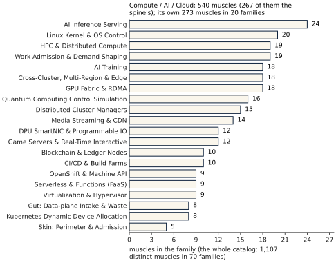
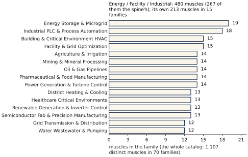
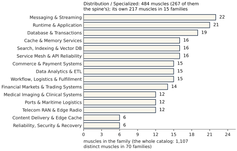
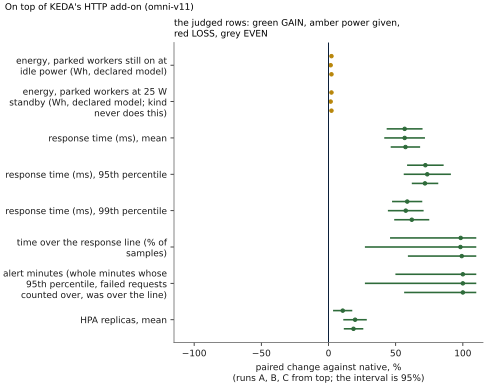
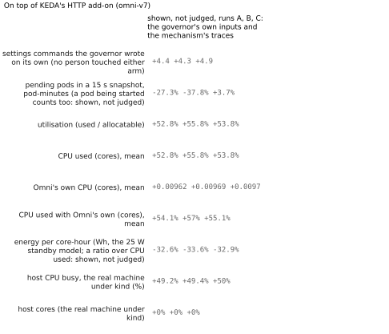
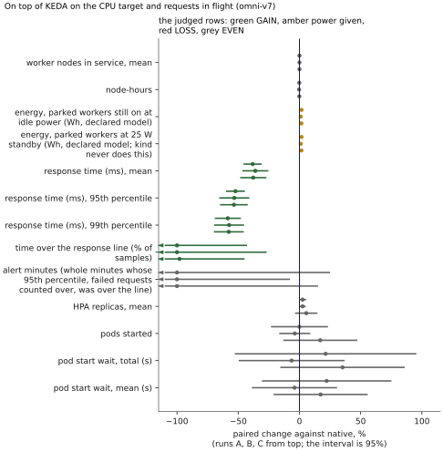
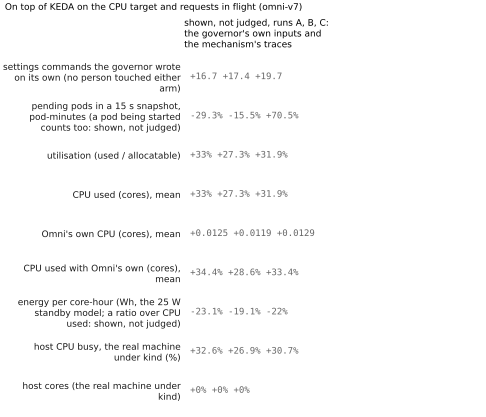
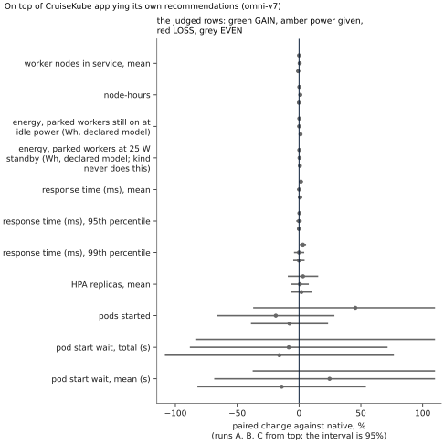
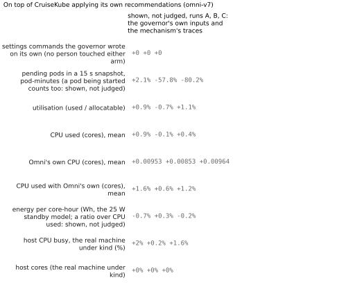
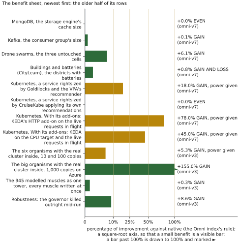

# THE OMNI-COMPASS OWNER'S MANUAL

> © 2026 The Omni-Compass LLC. All rights reserved. **Evaluation and Simulation use only.** Any commercial use, commercialization, monetization, production use, redistribution or hosted service of any part of Omni-Compass requires a signed, paid Omni-Compass Enterprise License from The Omni-Compass LLC. Every copy, export, report and printout carries this notice with `LICENSE`, `NOTICE` and `DISCLOSURES.md`. `SPDX-License-Identifier: LicenseRef-OmniCompass-Evaluation-1.0` All patents, copyrights and trademarks filed in the USA. www.omni-compass.com

## The Master Manual: The Governor, Its Mechanism, Its Results, and How to Wire It onto Your Stack

**This is the Owner's Manual, the master.** It holds everything: what Omni-Compass is, the philosophy and the
mathematics it runs on, its mechanism, how it is built, every result with its evidence class, and how it is wired, run
and checked. It is written for whoever owns or licenses Omni-Compass and so must know the whole mechanism. The
Operator's Manual (`docs/OMNI_COMPASS_MANUAL.md`) is the book for the people who wire and run it; its Part VI (chapters
13 to 30) is the implementer's whole path onto a cloud, from an empty account to a governed cluster, and is the
reference for that work in both books. The printed
book of this text is `docs/OMNI_COMPASS_OWNERS_MANUAL.pdf` (`python3 docs/book/build_book.py --owner`).

**October 2026**
**The Omni-Compass LLC**

All patents, copyrights and trademarks covering the Omni-Compass engine, its mathematics and its software have been filed in the United States by The Omni-Compass LLC.

---

# FRONT MATTER

## The Problem and the Answer

**The bottom line, first: is Omni-Compass a benefit?** The founder's order of 24 October 2026: the first thing anyone sees
says whether Omni-Compass is a benefit, for each way to run it, against native alone, in one light and one number. The light
is the whole verdict: green and round, **GAINING**, Omni-Compass ahead of native; yellow, a yield diamond, **STEADY**, STEADY
(a change under 0.5%); red, a stop-sign octagon, **REDLINING**, behind native, a LOSS; dark, **AWAITING**, no run yet. A slower
service or a failed request turns the light red whatever the work. The number is how much more work was done for the same
demand, the mean of our three runs (one real test on GitHub's own machines, class L; `results/orchestrator/V18_THREE_ARMS_ABC.md`,
engine omni-v18, commit `0ca2bbdac97f`; section 16.1c):

| Way to run it | Light | Work against native | Everything else the record reads |
|---|---|---|---|
| Native alone (Kubernetes' published autoscaling rule on the muscles, written by us as the yardstick) | yellow, STEADY | 0%: the baseline | — |
| Omni-Compass on native | green, GAINING | **GAIN 6.0%** in all three of our runs (A +5.2%, B +5.3%, C +7.4%) | the 95th percentile **GAIN 9.5%** in all three; machines **GAIN 3.1%** by the mean of our three runs, beyond the noise in 1 of 3; serving units **power given 10.2%** in all three; no request failed or answered wrong |
| Omni-Compass direct (Omni-Compass alone on the muscles, no Kubernetes) | green, GAINING | **GAIN 7.5%** in all three of our runs (A +7.3%, B +5.7%, C +9.4%) | the 95th percentile **GAIN 12.1%** in all three; machines **GAIN 2.5%** by the mean of our three runs, beyond the noise in 0 of 3; serving units **power given 5.2%** by the mean, beyond the noise in 2 of 3; no request failed or answered wrong |

The whole workload, by the two routes it is bought by (the composition of every measured layer, a model of measurements,
class S of class L and P; section 16.3b): **on site GAIN 18.5%** and **through the cloud GAIN 14.8%** over the gauges, each
layer's intervals carried (+18.5% and +14.5% by the index's rule). Both are the composition's index, not a price: a bill is the
sum of the costs inside a declared boundary, and today only the cloud's compute is metered in money, so neither route's bill is
resolved yet (section 3.8). Every real test together, the Omni index of Omni-Compass on native reads **GAIN 3.4%**, its
categories from real Kubernetes **GAIN 28.6%** to the database behind its pooler **LOSS 4.9%** (section 16.6). Run and scored
by The Omni-Compass LLC's own code. No outside party has reviewed or approved these results.

**What the whole industry faces.** Every computing system in service, from one server to a cloud region, from a GPU to a
building's chillers, a grid feeder or a robot cell, is run by a stack of native controllers: the Kubernetes autoscalers and
scheduler, the cloud's node pools, the GPU's power and clock firmware, the database's cache and connection pools, the
building's cooling loops, the battery's management system, the servo's loop. Each was designed and tuned alone, against its own
setpoint, with margins sized for the worst case it might meet. Three costs follow, on every stack:

1. **Capacity held idle.** Worst-case margins stay in place through the common case. Machines, power caps, caches and cooling
   run far inside their limits, and the room between the operating point and the limit is paid for and seldom used.
2. **Late reaction.** Reactive loops act on averaged, lagging signals and wait out deliberate cooldowns, so queues and
   response-time tails form before capacity arrives.
3. **Loops at cross purposes.** The loops share power, cooling, connections and memory. One loop's correction is another
   loop's disturbance, and no loop sees the whole.

Demand for computing, above all for AI and the cloud, is growing faster than the power, cooling and hardware that can be built
for it. The usual answer is to add: more machines, more power, more people watching thresholds. Replacing the native
controllers is not an answer most operators will take: they are proven, often certified, and the people on call know them.

**What Omni-Compass does about it.** Omni-Compass is a supervisory governor. It sits on top of those native controllers and
never replaces them. It plugs into each setting a native controller already exposes, through a two-way plug (one wire in, the
reading; one wire out, the setting), takes a snapshot of every setting before its first write, and governs the whole stack as
one body, the organism: every muscle driven as far as its own limit and never past it, and, on the engine that stands, never
below native; where it cannot bring a muscle a GAIN, that muscle stays native. It acts before a line is crossed instead of
after, reads back every write, puts every give-back to its own trial, records every decision with its reason, walks every
setting home if it stops (the lease) and stops at once on the kill switch. Its first rule is do no harm, judged at the
organism: never less work or health than native (`DISCLOSURES.md`, section 3). The aim is the one headline: more work,
faster, on fewer machines, with less energy, from the hardware and the controllers already in place; in a cloud, the same
work for a smaller bill.

**What the record shows so far.** Every claim is a paired comparison of native and Omni-Compass on top of native, and since
23 October of Omni-Compass direct beside them, on the same machines with the same work, run three separate times (A, B and C)
and read GAIN, STEADY or LOSS by what each gauge is for; every row is kept, LOSS included. On real machines (class L, live
software), the combined Omni index reads +3.4%, GAIN, and the service reading alone +9.4%, GAIN, judged across our three runs
by the rule of 24 October (`results/OMNI_INDEX.md`; each test read from its own engine's newest three-run table, none pooled
across engines). The rows that read LOSS stand in their tables, two whole categories among them (the database behind its
pooler, the storage-engine cache; section 16.6), as does the pod start wait on the kind rig (`docs/POD_START_WAIT.md`). The 1,107 muscles of the catalog are
modelled (class S) and are never shown as proof of hardware. The engine is written twice, in Python and in C++, and the
Python's 500 seeded runs through the C++ harness are identical to the last bit (`cpp/tools/engine_runs.cpp`; GitHub
reruns the 500 on every change to the harness, the engine's C++ or the page, and every verify reruns 50 of them). Run and scored by The Omni-Compass LLC's own code. No outside party has reviewed or approved
these results.

**What is not claimed.** No new physics, no new model of computation, and no promise for any system Omni-Compass was not
run on. It does not make a system immune to failure, delay or drift: it keeps each muscle inside its own limits and shows, row
by row, what it did against native. A result on another system is that system's own, from its own paired runs; where it
differs, the first presumption is the wiring (`DISCLOSURES.md`, section 4).

**What is protected, and how.** Omni-Compass belongs to The Omni-Compass LLC. Its source, manuals and records are its
copyrighted work; all patents, copyrights and trademarks filed in the USA. The repository is licensed for Evaluation and
Simulation use only (`LICENSE`); any commercial use, monetization or production use requires a signed, paid Omni-Compass
Enterprise License (`ENTERPRISE_LICENSE.md`). What a licensee acquires is the working whole: the engine, the wiring and the
factory card of every muscle, the harness that measures it against native, and the receipts.

**The cloud is a wire.** A cloud is the wire between the software end (the owner's programs, Kubernetes and the open-source
orchestrators, managers and autoscalers that carry the work) and the hardware end (the bare metal: the GPU chips, the Linux
racks, the data center, on site or off site). Omni-Compass can live in all three places. On the wire alone, as every cloud run
in this repository is set, it can only park machines the cloud's own autoscaler already made, so a cloud run alone can show at
most a small cut in the bill of the wire; the work and speed gained at the software end and the energy and throughput gained
at the bare metal are measured where Omni-Compass sits on them, and composed with the wire into one organism and one bill
(`DISCLOSURES.md`, section 9; section 16.3b, with the company's expected ranges beside the measured readings, an expectation
and never a result).

<!-- the key: GAIN, STEADY and LOSS (tools/readings.py) -->
## The key: GAIN, STEADY and LOSS

Every judged reading in Omni-Compass is one of three words: **GAIN**, **STEADY** or **LOSS**. Better, same and worse are not used anywhere. The word is decided by what the gauge is for, never by the plus or minus sign of its number: who sets the aim differs from one system to the next, and each gauge's aim is written in its preregistration before the runs.

| Word | What each letter stands for | Its sense in underwriting | What it means in a table |
|---|---|---|---|
| **GAIN** | **G** Growth (asset appreciation); **A** Advantage (risk reduction); **I** Improvement (margin expansion); **N** Net-positive (profitable outcome) | surplus and positive variance | the gauge moved toward its declared aim against native: more work done, a shorter wait, fewer misses or failures, or a resource cut |
| **STEADY** | **S** Stable (zero variance); **T** True to baseline (expected norm); **E** Equilibrium (balanced risk); **A** At par (no net change); **D** Drift-free (within the 0.5% floor); **Y** Yield held (nothing lost) | the par baseline: equilibrium | native and Omni-Compass within 0.5% of each other: the mean of the three runs' changes under the 0.5% floor, or no change at all; a knob native already runs at the top of its range is STEADY, at its limit on native |
| **LOSS** | **L** Leakage (capital drain); **O** Off-track (adverse selection); **S** Setback (claim liability); **S** Subpar (negative variance) | actuarial deficit and exposure | the gauge moved away from its declared aim: less work done, a longer wait, more misses or failures |

How the sign of a number becomes a word:

- **Time waited, missed or failed** (a response time, time over the line, failed requests): a fall is GAIN, a rise is LOSS.
- **Work done** (work inside the line, throughput, a hit rate): a rise is GAIN, a fall is LOSS.
- **A resource spent or held** (energy, the power drawn and its peaks and swings, machines, memory, processor time, a bill, wear on a part): a fall is a **cut**, and a cut is GAIN. A rise is **power given**: what Omni put in to buy the work and the speed shown beside it. Power given is always shown and never hidden, and it is never called a loss (the founder's order of 12 October 2026: the max rides every muscle's edge; it never shaves). A peak is power held, so a peak that rose is power given, in a data centre and in a building alike (17 October).
- **Work bought with each unit of a resource** (work per energy): a rise is a cut in what each unit of work took, a GAIN; a fall is power given, because it falls when more power is given for the same work.
- So a minus can read GAIN (a response time cut 65%, a bill cut 30%) and a plus can read LOSS (failed requests up).
- **The floor, and every change above it** (the founder's orders of 20 and 24 October 2026): a change of half of one percent (0.5%) or more either way is a change, and reads **GAIN** or **LOSS** (or **power given**) by what the gauge is for; STEADY is kept for a change under 0.5%. The change is the mean of the three runs' changes, each in percent of native. Where every run moved the same way with its 95% interval clear of zero, the word reads **in all three of our runs**; otherwise it reads **by the mean of our three runs** and says in how many of the three runs it stood beyond the noise, so a reader sees how firmly it stands. Where runs moved 0.5% or more in opposite directions, the reading is **the runs disagree**. A mean under 0.5% reads **STEADY, under the floor**, with its size.
- **Two numbers, never mixed** (the referee's work order of 25 October): every row shows native's value and Omni-Compass's, the **raw change** (Omni-Compass − native) / native with its true sign, + for a rise and − for a fall whatever the gauge is for, labelled raw, and apart from it the word with its size and no sign. A bill cut 3% reads raw −3.0%, GAIN 3.0%; failed requests up 2% read raw +2.0%, LOSS 2.0%; a pod start wait from 0.22 s to 0.83 s reads raw +275.0%, LOSS 275.0%; a change under the 0.5% floor reads STEADY 0.3%. No raw sign is ever turned to match a word.

Some preregistrations name their outcome with a label written before the runs (for example SUPERIOR WITHIN GUARDRAILS in the card protocol). The label stays as it was frozen, and every table shows it with its word first: TOWARD ITS AIMS reads GAIN; BOTH WAYS reads GAIN AND LOSS; AWAY FROM ITS AIMS reads LOSS; SAME AS NATIVE reads STEADY (the same as native); AT ITS LIMIT ON NATIVE reads STEADY (at its limit on native); SUPERIOR WITHIN GUARDRAILS reads GAIN (within the guardrails); ENERGY IMPROVEMENT WITH SERVICE TRADEOFF reads GAIN AND LOSS (energy cut, service traded for it); SERVICE IMPROVEMENT WITH ENERGY TRADEOFF reads GAIN, power given (service GAIN, energy given for it); NONINFERIOR / INCONCLUSIVE reads STEADY (inside the noise, within the guardrails); NOT ESTABLISHED reads STEADY (not established: inside the noise, a guardrail crossed on the mean). A run that breaks its own validity checks reads INVALID and carries no word.

Every reading is one of these. **GAIN, LOSS or power given in all three of our runs**: A, B and C moved the same way, every 95% interval clear of zero. **GAIN, LOSS or power given by the mean of our three runs**: the runs' mean moved 0.5% or more, with the count of runs that stood beyond the noise beside it. **STEADY, under the floor**: the mean moved less than 0.5%. **STEADY, the same**: no change at all. **The runs disagree**: runs moved 0.5% or more in opposite directions, so the test is unstable there and is looked into. **Shown, not judged**: a gauge declared in advance as shown only, such as the knob's own setting.

Why these three words: they are the words of underwriting and actuarial work, where every outcome is graded as surplus, par or deficit, and each letter spells out the same rule. Omni-Compass is there to add (GAIN), never to take (LOSS), and to hand a muscle back to its own native setting where it cannot add (STEADY). Its first rule is do no harm, in the founder's meaning of 19 October 2026: the organism Omni-Compass governs is never left turning out less than its native controllers make it turn out, nor less healthy, and every muscle works only as far as its own limit (`DISCLOSURES.md`, section 3). So **LOSS should never appear**: where it does, the row stays in the table, its cause is found and fixed (our own wiring first, then native's setup, then the scoring) and the test is run again.

Disclosure and disclaimer: GAIN, STEADY and LOSS, and the letters behind them, are The Omni-Compass LLC's own convention for reading its own results. The underwriting senses explain the words; they are not an actuarial, financial or insurance opinion, and no outside body defined, reviewed or approved them. A reading states what our own runs measured against native under the declared aims, not a promise about any other system; every number stands beside its word, so a reader can judge it by any other convention. Run and scored by The Omni-Compass LLC's own code. No outside party has reviewed or approved these results. Preregistered means the rules were written down in our own repository before the runs; nothing was filed with any outside body.
<!-- end of the key -->

## What You Are Looking At: Omni-Compass, Hooked Up, and How to Read Its Report

**What Omni-Compass is.** Omni-Compass is a supervisory governor. It is never a controller of its own and never a
replacement for one: it sits on top of the controllers a system already runs (the Kubernetes autoscaler, a database's
connection pool, a GPU's firmware, a building's battery controller, a power grid's tap changer, a robot's servo) and
moves only the settings those controllers already expose to an operator, through one wire in (what it reads) and one wire
out (what it writes). Everything the native controller does, it still does. Pull the plug and every setting walks back to
where the operator left it (the lease); the kill switch returns them at once.

**What "native" means.** Native is the same stack, the same muscles, the same machines and the same work, run the way
everybody runs it today: the shipped controllers at their shipped or operator settings. Every benchmark sets omni beside
native, where omni (Omni-Compass on native) is that same native stack with Omni-Compass on top; since the founder's order of
23 October a third arm runs beside them wherever a muscle's native is a controller that can be switched off, **Omni-Compass
direct**, the same stack with that controller off and Omni-Compass the only controller moving the knob. The three are always
shown together, each pair read on its own (section 1.1). Nothing else differs between the arms, so whatever differs in the
result is what Omni-Compass did.

**What a muscle and an organism are.** A muscle is one setting a native controller exposes (a pool's size, a power cap, a
clock ceiling, a replica count, a battery's charge rate) together with the gauges that show what it does. Most companies
build deep control for one field, and a fleet manager such as Meta's Twine schedules one kind of work (containers) over a
very large fleet. Omni-Compass's proposition is different in kind: cross-sector governance, one governor over the shared
functional needs of otherwise separate realms. An organism is a stack of muscles from many sectors governed as one body:
the four realms (Compute / AI / Cloud; Physics / Robotics / Autonomous; Energy / Facility / Industrial; Distribution /
Specialized), the four stacked together, and the whole tower of 1,107 distinct muscles in 70 families. The benchmark of an
organism tests what happens when those muscles share one governor and interact.

**What has been measured, and how.** The breadth of the map and the breadth of the evidence are stated separately:

- **1,107 muscles are catalogued** (`realms/catalog_v5.csv`). Each has a plant model, our own model of that kind of system:
  evidence class **S** until the muscle is wired to real software or hardware and measured.
- **26 knobs are measured on real, unmodified software** (class **L**): real Kubernetes (9), PostgreSQL behind PgBouncer
  (3), MySQL (4), MongoDB (4), Apache Kafka (3) and Redis (3), each A, B and C.
- **39 knobs are measured inside independent, published simulators** (class **S**, but not our own models): power grids
  (pandapower with SimBench), buildings and batteries (CityLearn), robot arms (MuJoCo Menagerie), drone swarms
  (gym-pybullet-drones).
- **Organisms with a real cluster inside**: the modelled organism (S) drives a real Kubernetes cluster (L). "100 copies"
  means a hundred copies of the modelled organism around one real cluster, not a hundred physical clusters; the number
  of real machines is always stated beside it.
- **A physical meter** (class **P**) speaks for hardware energy; the GPU's own meter and the processor's RAPL counters are
  the meters used. Modelled energy is never presented as metered.

**What you see when it is hooked up.** Every result arrives as a receipt with the same shape: the two arms side by side,
every gauge of the system (the work done, the response times, the misses and failures, the machines and energy spent),
the paired change with its 95% interval, and one word per gauge, GAIN, STEADY or LOSS (the key, above). A three-run table
repeats the test three times, A, B and C, on the same frozen engine and profile, and reads each row by one rule:
the change is the mean of the three runs' changes in percent of native; a mean under 0.5% reads STEADY, under the floor (STEADY, the same where nothing moved); from 0.5% up the word comes from what the gauge is for, GAIN, LOSS or power given, **in all three of our runs** where every run moved the same way with its 95% interval clear of zero, otherwise **by the mean of our three runs** with the count of runs beyond the noise; runs that moved 0.5% or more in opposite directions read **the runs disagree** (section 15).
Over a benchmark sit three summaries: the Omni index (one number for all real tests together), the benefit sheet (one
number and one word per benchmark) and the wiring page (for each knob: write, watch, or the operator's choice).

**How to read a report, in order.**

1. **The engine and the evidence class.** The header names the engine fingerprint (`python3 tools/omni_version.py`) and the
   class (P, L or S). A result is never read across engines, and S is never read as proof about real equipment.
2. **The work and the service rows first**: work done, response times, time over the line, failed requests. These say
   what the system delivered. A GAIN here is the point of the governor; a LOSS here is the first thing to look for.
3. **Then the resource rows**: machines, energy, memory, connections. A cut is a GAIN. A rise is **power given**: what
   Omni-Compass put in to buy the work and speed above it. Read the two together: power given that bought nothing is the
   cost to fix.
4. **Then the floor and the noise.** STEADY, a mean change under 0.5% (under the floor) or none at all, is a result, not a
   failure. A change of 0.5% or more is a change and shows its word, with the count of runs beyond the noise beside it
   whenever not all three are. The runs disagree means runs that moved 0.5% or more pointed different ways: the test is
   unstable there and is looked into.
5. **Then the clock and the machine.** Where the test machine itself is the limit (its processor saturated, native alone
   failing a large share of requests, a run behind its window's clock), the report says so; a test machine's limit is never
   reported as the governor's result, and the test is rebuilt so the machine no longer decides it.
6. **Every row is shown**, LOSS included. Nothing is cut from a table because it went against Omni-Compass.

**How the brain tells GAIN from LOSS.** The governor does not read a plus or a minus sign as good or bad. Before it
moves anything, every gauge it reads is declared with its aim, and the aim decides the word: for time waited, missed or
failed (a response time, time over the line, failed requests) a fall is GAIN; for work done (work inside the line,
throughput, missions flown) a rise is GAIN; for a resource spent or held (energy, machines, memory, a bill, wear) a fall is a
cut, and a cut is GAIN, while a rise is power given, kept only when it buys work or speed shown beside it. Less energy for the
same work is GAIN; more speed for the same machines is GAIN; more work for the same energy is GAIN. In the engine this is
done in two places. The verdict (`omnicompass/verdict.py`) lets a muscle's setting move only between native and the deepest
step a paired trial on that muscle has shown costs its own work nothing (each piece of work no slower, within the
measurement's resolution); a step that costs more is undone at once and not tried again for a while, and where no step
passes the muscle stays native, which is STEADY. Inside an organism, the body's guard (the reflex rule, `docs/FORMAL_V5.md`)
then refuses any step that pushes another part of the body past its cushion, so no GAIN in one muscle is bought with a LOSS
in another.

**Wiring it: who, what, when, where, why and how.** Read this before the wiring chapters; a governor wired without it may
run and still not be the mechanism.

- **Why.** To get more work, faster, with fewer misses, from the machines and the energy already paid for, by letting one
  brain move the settings native controllers already expose, in the direction each gauge's aim asks, and only while no
  other gauge pays for it. If nothing can be gained, the purpose is met by leaving native alone.
- **What.** Two things per muscle and nothing else: one wire in (the gauges that show the muscle's state and its work, read
  live from the system, never typed into code) and one wire out (the one setting native already exposes to an operator, with
  its hard range read from the system). The brain, the compass, the verdict and the lease are in the engine; the wiring
  never re-implements them.
- **Where.** On top of the native controller, never in place of it: on the autoscaler's target and ceiling, not on the
  pods; on the pool's size, not on the queries; on the card's power limit, not on its firmware. Every muscle of the stack is
  wired into the same brain, so the body is judged as one.
- **Who.** The operator who owns the system grants each wire, decides which knobs Omni may write and which it only watches,
  and keeps the kill switch. The governor writes only what it was granted; the native controller keeps doing its own job.
- **When.** Watch first: the governor reads every wire and writes nothing until the wire check passes and paired runs on
  the operator's own system show the receipt. Then one level at a time (the eight levels, Part IV). It reads and decides once
  a second, all the time; staying native is a live decision, made again every second, never a setting left on.
- **How.** The plug snapshots each setting once, at the start; the brain reads every gauge, places each muscle on its
  compass, tries one step on one muscle at a time inside a body, keeps it only if the verdict shows a GAIN and no LOSS, and
  hands every setting back to the snapshot on reset, on the lease after a crash, or at once on the kill switch. The proof is
  the receipt: native and Omni on the same work, every gauge, three runs, every row shown.

**What the end result is.** A system fully hooked up runs native exactly as before, with one governor reading every gauge
of every muscle once a second and moving, muscle by muscle, only where a paired trial has shown a GAIN with no LOSS
anywhere in the body; where it cannot help, the muscle stays native, which is STEADY, not a failure. The intended outcome,
stated as the claim the receipts test: more work, faster, with fewer misses, on the same or fewer machines, with every
unit of power given shown beside what it bought. Whether a given system gets there is answered only by its own receipts.

## Notice and Disclaimer

The software is provided "as is", without warranty of any kind. Every result in this manual carries its evidence
class (section 14). A modelled result is a statement about a model; a software benchmark is a statement about the
software it ran on; only a hardware meter speaks for hardware. Nothing in this manual is a promise of a particular
saving on a particular system. The only number that applies to your system is the one your own paired runs produce,
on your own receipt. Before Omni-Compass writes to any production system, it must run in watch mode, pass the wire
check, and be covered by a signed Omni-Compass Enterprise License.

**Rights and changes.** © 2026 The Omni-Compass LLC. All rights reserved. The Omni-Compass LLC reserves the right to
change this manual, the software it describes and their terms at any time, without notice. Every copy, export or printout
of this manual carries this notice, `LICENSE`, `NOTICE` and `DISCLOSURES.md` unchanged. All patents, copyrights and
trademarks filed in the USA. www.omni-compass.com

**THE PUBLISHED BENCHMARKS ARE THE RECORD OF WHAT OMNI-COMPASS DID ON THE SYSTEMS, LOADS AND ENGINE THEY NAME, EACH WITH ITS EVIDENCE CLASS. WHERE A RESULT ON ANY OTHER SYSTEM DIFFERS FROM THEM, OR ANYTHING LOOKS WRONG, THE FIRST PRESUMPTION IS THE WIRING, THE SETTINGS, OR HOW OMNI-COMPASS WAS IMPLEMENTED OR READ, NOT THE LAW. CHECK THOSE FIRST (THE MANUAL'S "WIRED RIGHT OR WIRED WRONG") BEFORE DRAWING ANY CONCLUSION ABOUT OMNI-COMPASS.**

**The factory tune.** The engine in this repository is presented as The Omni-Compass LLC tuned it and ships it: a
self-running engine, set at the factory. Every muscle in the catalog is wired, and each runs on the setting found for it:
its own card where one was found on development seeds and kept under the strict rule (364 muscles,
`realms/muscle_cards_v5.csv`), the engine's own setting for every other muscle, all frozen and fingerprinted by version
(`python3 tools/omni_version.py`). Muscles differ: no single setting is right for every muscle, family, sector, domain or
realm, and none is presented as universal. Every published result is the factory tune of the engine its table names (`python3 tools/omni_version.py`), and is run again on each engine that stands. As with any engine, a licensee may
then add on, retune, upgrade or tune down any muscle or any combination of muscles (the dial, the cards, the bands and the
service lines are all exposed); a changed tune is the licensee's own configuration, and its results are its own, not the
published ones.

**ONE TUNED ENGINE, AND A TUNING BENCH.** Every benchmark result in this book is one engine at one tune: the engine its table
names, at its factory tune, and every benchmark runs again on each engine that stands. The live benchmark engine page and the control panel's buttons are a live tuning engine: every
knob, button and monitor turns in real time (the beat, the dial, the pedal, each muscle driven or left native, up or down, in or
out, minus or plus) to show the mechanism of action with native alone, with Omni-Compass on top, or both side by side, and what
the bench shows at any setting other than the factory tune demonstrates the engine's range, never a benchmark result. As on any
engine, where the mixture, the intake, the exhaust, the firing and the pistons each change what it delivers, **turning any knob of
Omni-Compass can change every metric, up or down, in any direction a tuner chooses**: one engine for many vessels, tuned many
ways, for many outputs. From omni-v17 the factory tune is chosen by a declared rule, set out with its mathematics in section 4.4 and
`docs/THE_TUNE.md`: among the tunes that harm no gauge against native, the one against which no other tried tune reads GAIN on one
service gauge and LOSS on none, searched on development seeds and read again on untouched ones.

**The wiring declaration.** Omni-Compass acts only through the wires it is given. A wrong reading, a wrong or shared
lever, a wrong range, or a service line set for another workload makes it do exactly what its law says with the wrong
information. It cannot be slapped on. If your paired receipts differ from the published benchmarks in direction, the
first presumption is wiring: check the installation with section 8.5 before drawing any conclusion. Every
declaration, disclosure and disclaimer is made once, in `DISCLOSURES.md`, and governs this manual.

## Foreword

I built Omni-Compass to sit on top of what already exists. Kubernetes, the GPU driver, the building controller, the
battery inverter, the robot's servo loop: those are muscles, and they are good muscles. What none of them has is one
brain that reads all of them at once, holds each of them inside its safe range, and puts every setting back exactly
where it found it when it stops. That brain is Omni-Compass.

**Every machine already has a controller.** Kubernetes has its autoscaler. A graphics card has its firmware. A building
has its thermostat loop, a battery has its charge controller, a power grid has its tap changers, and a robot has its
servo. Engineers spent decades making these controllers safe, and they are. But each one was built to watch one thing
and to protect that one thing. None of them sees the whole body. None of them knows that the cooling loop is holding
back the processor, or that the autoscaler is adding machines the database cannot feed. So each one plays it safe in
the middle of its range, because playing it safe is its whole job. The headroom between the middle and the edge is
paid for every hour and almost never used.

**That gap is what I set out to close.** Omni-Compass is a **supervisory governor**: one brain over the muscles you
already run. It never replaces them and it never competes with them. It reads them, it decides, and it writes one
setting at a time through a two-way plug: one wire in, one wire out. Before it writes anything, it takes a snapshot.
When it stops, every setting goes back to that snapshot.

**Why a compass.** A compass always points home. Every muscle has a safe band, and the compass holds the muscle inside
that band, with a cushion of 5% at each edge. It works with two forces that pull against each other, one toward more
and one toward less, and it moves smoothly, never hammering. A system that is closed, bounded and pulled toward a
center cannot run away. That one idea is the root of the whole engine, and the first part of this book explains it.

**The rule I will not bend: do no harm.** Its real goal is the organism: to strengthen it and keep it healthy, working
at the best state its own muscles can carry. Whatever is fed into it, its work, its data, its energy, goes through its
muscles and comes out as its output, and Omni-Compass drives it toward the most and best output it can make. Harm is the
organism turning out less than its native controllers make it turn out, or made less healthy: a muscle pushed past its
own limit, a service over its own line, anything made to fail. Omni-Compass never does either. It can push a muscle only
as far as that muscle itself can go; it may use one muscle less, or leave it native, so that another can carry more,
whenever the whole organism comes out ahead and every muscle stays healthy (`DISCLOSURES.md`, section 3). The engine that
stands keeps the rule in its strictest form, a trigger in the code (`omnicompass/verdict.py`), checked on the muscle
itself, step after step: a step that costs the muscle more for each piece of work is undone, and where it cannot bring a
muscle a gain, that muscle stays native.

**The max is the default.** Most tuning tools try to shave a little off. Omni-Compass rides the edge instead: every
muscle runs up to its own limit, read live from the system, never past it and never below what native gives. The energy
it takes to do more work is **power given**, shown beside the work, the speed and the wear it bought. It is never
called a loss. Anyone can turn the dial down from the max. Nobody has to.

**One pedal.** I wanted it to drive like an electric car. Push the pedal for more, lift off for less. Lift off all the
way and the settings drift back toward native. Reset hands everything back. If the governor ever crashes, its lease runs
out and the plug walks every setting home, step by step. The kill switch is separate and instant, and it exists for
security, not for daily driving.

**How I want it judged.** Every benchmark in this book sets native beside Omni-Compass on top of native, and, where native's
own controller can be switched off, Omni-Compass direct beside them ("there's native, there's Omni and native, and then
there's Omni by itself", 23 October); there is no other arm and no other name. Every result was run three separate times, under rules written down before
the first run, and every row is shown, losses included. Each reading is one word, **GAIN**, **STEADY** or **LOSS**,
decided by what the gauge is for. A result from our own model is labeled as a model; a result from live software is
labeled as live software; only a meter speaks for hardware. Where we lost, the book says so, and we went to find out
why. Nobody outside The Omni-Compass LLC has reviewed or approved these results, and every table says that too.

**What this book holds.** This manual is the whole of it: what the governor is, the mathematics it runs on, how its
nervous system reads and writes, how it is wired to each kind of machine, how to turn it on one level at a time, how to
switch it off, and how to prove on your own system what it does. Keep it with the code. When the code changes, this
manual changes in the same commit.

**On this edition.** This edition is written for the referee and the underwriter as much as for the engineer. Every
result in it was run three separate times on a frozen, fingerprinted engine, under rules written before the first run,
and is reported with every loss beside every gain. Where a number is from a model it says so; where a test could not
see an effect it says so; where something has not been shown it says so, in its own section. Nothing in this manual asks
to be believed on our word: every table names the runs it was made from, every run's raw files are in the repository,
and every table can be rebuilt from them by the tool it names.

**Where to begin.** Read the front matter first. It tells you what you are looking at before it asks you to touch
anything. Then wire it one level at a time, watch it before you let it write, and judge it by your own receipts.

**AJ Dubra**
Founder, The Omni-Compass LLC

## The Three Manuals: the Owner's, the Operator's and the Live Benchmark Engine's

Omni-Compass is documented in three books written to one plan, in the same words, with the same structure, and read as one
work; each stands on its own for its own reader.

**The Owner's Manual** is for whoever owns or licenses Omni-Compass and so must know the whole mechanism: the one who puts
the engine inside the vessel. It holds the philosophy and the theory, the mathematics, the mechanism of action, how the engine
is built, every file of its source, every result with its evidence class, and the wiring. Nothing is withheld from it: what
the repository holds, it holds.

**The Operator's Manual** is for whoever is handed the vessel with the machinery inside it and must drive it: the engineering
team that embeds, wires, tunes, runs and checks Omni-Compass on a company's stack, and the people who keep it in service. It
is the glove box, not the blueprint. It shows the engine only as its shell and its process: what it reads, what it writes,
what it may never do, how it is switched off, what its audit says and how its receipts are read. It explains nothing of how
the engine is built; where its reader needs what is inside, the text says so and names the place in the Owner's Manual where
it lives, and never repeats it.

**The Live Benchmark Engine Manual** is the third book (the founder's order of 20 October: "There shall be three in the end"), for the
operator at the dashboard: nothing more than the interpretation of the live benchmark engine page, `docs/engine/OMNI_COMPASS_LIVE_ENGINE.html`,
the monitor of the engine and of the runs GitHub ran. It says how to follow the wall and the switch, how to read every gauge and
turn every knob, where every number comes from, and how the mechanism of action of Omni-Compass against native shows on the
monitors, section by section in the page's own order. It explains neither how the engine is built nor how it is wired; for the
first it names the Owner's Manual, for the second this one. The page itself is described in section 4.4, and the common
language of the engine, its profiles and its bill, written once in `docs/FACTORY_PROFILE.md`, in section 3.8.

The three books share their front matter (the key, the notice, the foreword, the prefaces, the quick reference), their
vocabulary (one glossary), their structure (parts, chapters, numbered sections, appendices, a table of contents rebuilt
from the book itself at every edition, a list of figures, each figure drawn from the code it pictures, and an index of every term,
muscle family, file and setting with its pages) and their reading
rule: **the order of the chapters is the order of understanding and
of implementing.** Nobody can wire what they have not understood, so each book is read from the front: what Omni-Compass is;
the stack as one body; the plug and the rules its wires obey; the wiring, level by level and stack by stack; operating it;
checking it against its own receipts. Each chapter tells the reader what to do, what they should see when it is done right,
and what it means when they see something else. The book is the teacher: it walks beside the work in real time, and at every
step it says what the right result looks like, so that a team that has wired Omni-Compass knows from its own receipts whether
it has brought it to its full working order or has a wire still to find.

This is the Owner's Manual, the master: the engine's book, and the vessel's with it.

## Preface: How to Use This Manual

| You are | Read |
|---|---|
| CEO, board member, investor | The Problem and the Answer; Foreword; Part I (sections 1-3); section 14 (evidence); section 15 (the frozen engines and the three-run rule); section 17 (license); the Executive Summary below |
| CFO, CIO | section 3 (where the value comes from; 3.4 the arithmetic of the benefit; 3.5 where the evidence stands, read honestly); section 16.3 (the bill on a real cloud); section 14 (what a receipt proves and what it does not); "The Economics of a Receipt" and "Due Diligence"; section 17 and the chapters bound after it (the Enterprise License's standard terms, the patents and trademarks, the security policy) |
| CTO, architect, head of platform | Parts I-III; section 9 (wiring levels) to plan the rollout; Part VI |
| The engineer wiring it | Everything, in order. Do not skip the wire check (section 8) or the watch level (section 9, level 1) |
| Auditor, diligence team | Part II (mechanism), Part VI (proof), Appendix C (equations), Appendix F (evidence map) |
| Referee, reviewer | The standards below; sections 13 to 15 (the method, the classes, the frozen engines and the three-run rule); section 16.7 (threats to validity, stated by us); Appendix F, "How to audit one result from this manual to its raw files"; then any table in `results/live/` and its preregistration |
| Underwriter, insurer | Sections 1.2 and 1.3 (do no harm, the pedals, the two switches); section 11 (the three ways a governor stops and what each leaves behind); section 12 (least privilege, supply chain); section 16.7 |
| Data-center, facility or energy operator | The Quick Reference card; sections 1.1 to 1.3; section 9 (levels 5 to 7: the card, the processor, the site); section 10.10 (the processor itself) and 10.11 (the data center under the servers); section 11 (the switches); Appendix E |
| Site reliability engineer, on call | The Quick Reference card; section 11 (the three ways a governor stops, and what each leaves behind); section 8.5 (wired right or wired wrong); section 7.3 (blind means hold); Appendix E |
| Security and compliance | Section 11 (the master switch, the kill file and the lease); section 12 (least privilege, supply chain, the audit log); `SECURITY.md`; `DISCLOSURES.md`, sections 4 and 5 |
| Procurement, counsel and attorneys | `LICENSE`, `NOTICE`, `PATENTS.md`, `TRADEMARKS.md`, `DISCLOSURES.md`, `LICENSING_FAQ.md`, `ENTERPRISE_LICENSE.md`, `SECURITY.md`, every one bound into this book in full (the front matter's Disclosures, Declarations and Disclaimers; section 17 and the chapters after it; the License appendix) |
| Anyone who wants the whole list | `docs/REGISTER.md`: every muscle wired (1,107 on the engine that stands, by family), every benchmark run on every platform (Kubernetes, Azure AKS, GPU, CPU, UPS and batteries, buildings, power grids, robotics) with its result and file, and every open benchmark still to run, in order |

**Conventions.** `code` is a command, file or switch exactly as typed. "Native" means your system as it runs today,
without Omni-Compass. "Omni" (the second arm of every benchmark) means that same native system with Omni-Compass on top
of it. "Omni-Compass direct" (the third arm, Omni-Compass by itself) means the same system with the native controller of each
knob switched off and Omni-Compass the only controller moving it; there is no other arm and no other name. "Factory
profile", "candidate profile", "active profile" and "custom profile" are used exactly as `docs/FACTORY_PROFILE.md` defines
them (section 3.8). "Muscle" means any machine, service or controller Omni-Compass can read
and set. "Knob" or "lever" means one setting on a muscle. "The band" is a knob's or a service reading's safe range; "the
cover" is a knob's hard range, which nothing Omni-Compass computes can leave. Every step that writes to a system is marked
**WRITES**. Every number carries its evidence class (section 14): **P** for a physical meter, **L** for live software with
no meter, **S** for a model of ours. A number from a model is never written as if it came from hardware.

**The standards every page of this manual keeps.** A referee or an underwriter reading this manual should expect, and
will find, the following discipline throughout, because it is the discipline the repository enforces on itself:

1. **Native beside it, always.** Every benchmark is read against native, on the same machines, with the same work at the
   same moments: omni (Omni-Compass on native) against native, and, where it is run, Omni-Compass direct against native and
   against omni. Omni-Compass on native is never compared as a competitor to the controller it sits on; the direct arm
   switches that controller off to show what Omni-Compass does as the only controller, and is never read in place of the
   arm on native.
2. **Preregistered, then run.** The arms, the knob, its cover, the gauges, their directions and the readings are written
   down and committed before the first counted run (`docs/*_PREREGISTRATION.md`). Rules are frozen on one tuning case
   that is shown and never counted, then applied unchanged to untouched cases. Any amendment made after a result has been
   seen is written into the preregistration with its time and reason, and the table that carries the result says so.
3. **Three separate runs, one rule.** Every result is run three times as separate GitHub runs (A, B and C) on the same
   frozen engine and profile, and every judged row reads by one rule: the change is the mean of the three runs' changes in percent of native; a mean under 0.5% reads STEADY, under the floor (STEADY, the same where nothing moved); from 0.5% up the word comes from what the gauge is for, GAIN, LOSS or power given, **in all three of our runs** where every run moved the same way with its 95% interval clear of zero, otherwise **by the mean of our three runs** with the count of runs beyond the noise; runs that moved 0.5% or more in opposite directions read **the runs disagree**. Nobody outside The Omni-Compass LLC has
   reviewed or approved these results, and every three-run table says so.
4. **Every row, losses included.** A row that went against Omni-Compass is in the table beside the rows that went for it.
   When Omni-Compass loses, the first suspect is our own wiring, native setup or scoring; when that is fixed, the test is
   run again and the loss stays in the record. A benchmark may be left unpublished; it is never published with rows cut.
5. **Nothing read across engines.** The engine is frozen and fingerprinted (`OMNI_V1.json`, `OMNI_V2.json`,
   `OMNI_V3.json`, `OMNI_V5.json`, `OMNI_V6.json`, `OMNI_V7.json`). Any change to a rule, gain, guard, preset or muscle makes the next version, and every result is run
   again on it. Every table made by rule checks the engine of each run it reads and refuses to mix them.
6. **The raw files live with the code.** Every finished run's files are copied into `run-<id>/` on the repository's branch
   `raw` with one SHA-256 manifest per repetition (opened by `scripts/raw_archive.sh`, the branch sits at
   `results/live/raw/`), and every table names the runs and the commit it was made from. Anyone with the repository can
   recompute every table from the files it names.
7. **Do no harm.** The organism is never left turning out less than native, nor less healthy, and every muscle works only
   as far as its own limit (`DISCLOSURES.md`, section 3). On the engine that stands, Omni-Compass moves a knob only where
   a paired trial on the muscle itself shows the muscle never behind for it (the verdict, `omnicompass/verdict.py`, with
   its 2% allowance). Where it cannot improve a knob, that knob stays native, and the result says "nothing for Omni to
   move".

**How this manual is organised.** Part I says what the governor is and where its value comes from, with the arithmetic
that turns "more work" into "a smaller bill". Part II is the mechanism: the engine's eight equations and its control
law, the closed-circle principle that keeps it inside its walls, the compass law that carries push and pull to every
muscle, and the two-way nervous system that decides how much authority each organ has. Part III is the harness: the
plug every muscle is wired through, the adapters, and the wire check that must pass before anything writes. Part IV
wires it onto a stack one level at a time and then stack by stack: Kubernetes on kind and on Azure, a database behind
its pooler, a message broker's consumer group, a cache's memory ceiling, the independent simulators, drone swarms, the
big organisms on a rented machine, the processor itself, and the data center under the servers. Part V is operating it: the switches, the rules the governor keeps, the log, and
maintenance. Part VI is proof: paired runs and receipts, evidence classes, the frozen engines and the three-run rule,
the Omni index, and every result to date with its losses, followed by the threats to validity we state ourselves and the
open program. Part VII is the code, the C++ twins and the license. The back matter holds the glossary, every command,
the file map, the equations in full, the metrics, troubleshooting and the evidence map.

## Where to Get Help

Every question has a place in this book, and the places outside it are few and named here once.

| You need | Where it is |
|---|---|
| The next step while wiring | the level you are at (section 9) and your stack (section 10); every step names what you should see when it is done right |
| A reading you do not understand | the key at the front of this book; section 14 (evidence classes and how to read a result); Appendix D (metrics); section 13's reference bands |
| A symptom | Appendix E (troubleshooting); section 11 (the three ways a governor stops); section 7.3 (blind means hold); section 8.5 (wired right or wired wrong) |
| A setting or an audit line | the Operator's Manual, Appendices K and L (every setting and every record, field by field); the source itself in this book's Source appendix |
| How the engine works | Part II (the mechanism of action), Part III (the physics), Appendix C (the equations in full), the Source appendix |
| What a result elsewhere means | `DISCLOSURES.md`, section 4 (the front matter): the first presumption is the wiring, the settings or the reading, never the law |
| A licensing, pilot or Enterprise License question | The Omni-Compass LLC, main office infrastructure, toll-free direct 1-888-339-9551, system route asset 1-888-DEX-YLL-1, landline 321-746-4411 registered in Florida; www.omni-compass.com; the chapters "Licensing: Questions and Answers" and "The Enterprise License: Standard Terms" |
| A security finding | the process in `SECURITY.md` (the chapter "Security Policy"): a private report, never a public issue |
| Anything else about running the software | `.github/SUPPORT.md` in the repository, and the toll-free line above |

**What to send with a question.** Four things: the output of `python3 tools/omni_version.py` (the engine the copy runs);
the wire check's output (section 8); the receipt of the paired run (section 13) and the audit file for the window in question;
and the command line the governor ran with. With those four, every question in this book can be answered from the record, and
most are answered by the record itself.

## Prelude: A Night on the Cluster

This is a story, not a result. It follows one night on one cluster to show, in plain order, what each part of this
book does. The shop, the times and the settings are made up for the story. The measured results are in the chapters
on proof, each with its evidence class.

**9:00 p.m. The shop is quiet.** An online store runs on Kubernetes. Its native controllers are the ones almost
everybody uses. The Horizontal Pod Autoscaler watches the average processor load and adds copies of the web service
(pods) when that load passes its target. The cluster autoscaler adds machines when the pods no longer fit. A careful
engineer picked their settings months ago, for the worst day she could imagine, and she picked them well. Tonight the
cluster runs on its floor of two machines, and every customer gets an answer in a blink.

**A week earlier, Omni-Compass went on in watch mode.** For seven days it read every gauge and wrote nothing. It
learned how fast each pod starts, how the response time moves when the load moves, and where each setting's safe band
lies. Then the team ran the wire check: every reading came from the place it claimed, every lever moved the thing it
claimed, and every write was read back. Only then did they turn it to govern. Every setting it would touch was saved in
a snapshot first.

**9:40 p.m. The sale starts.** In two minutes the requests double. The native autoscaler does exactly what it was
built to do, but it is built to wait: it needs the average load to climb, then it needs a decision, then each new pod
needs time to start. While it waits, customers wait. With Omni-Compass on top, the compass sees the response time slide
toward the edge of its band and into the cushion. It pushes. It raises the autoscaler's floor of pods, a setting the
autoscaler already respects, so new pods start before the average catches up. It does not fight the autoscaler and it
does not go around it. It moves one setting, through the plug, and reads it back.

**10:15 p.m. The database starts to strain.** More web pods mean more connections to the database, and the database
has a limit of its own. A controller that watches only the web service would keep adding pods and deepen the jam.
Omni-Compass sees the whole body. One body, one brain: before it takes the next step for the web service, it checks
what that step would do to every other part. The step that would push the database past its own cushion is refused.
Nothing is pushed into a loss to buy a gain somewhere else. The web service holds where the database can still keep up,
and the queue drains instead of growing.

**11:30 p.m. The rush fades.** The pedal lifts. Omni-Compass does not drop everything at once, because a sudden drop is
how systems stumble. It eases each setting back toward native along a smooth curve. The extra machines go away as the
work goes away. The energy the cluster used during the rush shows up in the report as power given, beside the work it
bought and the minutes customers did not spend waiting.

**1:00 a.m. Idle.** The pedal is lifted all the way. The cluster sits on its floor of two machines again, exactly
where the engineer left it. Omni-Compass keeps reading every second. Staying native is its live decision, made again
each second, not a verdict from some earlier run.

**3:12 a.m. Something breaks.** An upgrade restarts the machine that runs the governor, and Omni-Compass stops in the
middle of its work. Nobody is awake. Nothing bad happens. The governor's lease runs out, and the plug walks every
setting back to its snapshot, step by step. The native controllers keep running as they always have, because they never
stopped. When the governor comes back, it starts from what it reads, not from what it remembers.

**7:00 a.m. The morning report.** On a live system, the proof does not come from a feeling that the night went well.
It comes from paired runs: the same work, run once on native and once with Omni-Compass on top, and compared gauge by
gauge. Every gauge gets one word. Time waited that fell reads **GAIN**. Work done that rose reads **GAIN**. A change under
half of one percent reads **STEADY**, and the report says so plainly; a change of 0.5% or more shows its word. A gauge that moved the wrong way reads **LOSS**, and it
stays in the report until its cause is found and fixed. The energy spent on extra work reads **power given**, never a
loss.

**What the night shows.** Every part of that night is a chapter of this book:

- the watch mode and the wire check are in the chapters on wiring, level by level;
- the band, the cushions and the two forces are in the chapters on the compass;
- one body, one brain is the reflex rule, in the first part;
- the snapshot, the lease and the kill switch are in the chapters on operating it;
- the paired runs and the three words are in the chapters on proof.

Read the rest of the front matter before you touch a wire. It tells you what you are looking at and how to read
what it tells you.

## Introduction: The Idea and the Promise

**The problem.** Stated in brief at the front of this book ("The Problem and the Answer"); here in engineering terms.
Production systems are governed by many local feedback loops: horizontal autoscalers, firmware
power and clock governors, building-management loops, battery-management systems, connection pools, servo controllers.
Each loop is tuned in isolation, against its own setpoint, with margins sized for a worst-case disturbance. Three costs
follow, and every operator pays them:

- **Reaction latency.** Reactive loops act on lagging, averaged signals. A Kubernetes Horizontal Pod Autoscaler
  recomputes its desired replicas from averaged utilization on a sync period (15 seconds by default) and damps its
  decisions with stabilization windows; new pods then need time to schedule and start. Queues form before capacity
  arrives.
- **Static over-provisioning.** Worst-case margins persist through the far more common nominal regime. The operating
  point sits well inside the safe region, and the headroom between it and the constraint boundary is paid for and
  rarely used.
- **Uncoordinated coupling.** Loops share resources: power, cooling, connections, memory, network. One loop's correction
  is another loop's disturbance. More web replicas saturate the database's connections; more cooling pushes a power feed
  toward its limit.

Operators close these gaps by hand, with fixed settings and runbooks. That is safe, and it leaves the region between the
nominal operating point and the safe boundary unused nearly all of the time.

**The idea.** Close one supervisory loop around the native loops. Omni-Compass treats each setting a native controller
already exposes (a replica floor, a power cap, a clock ceiling, a temperature setpoint, a pool size) as an actuator, each
native telemetry stream as a measurement, and governs the whole body from above. Every decision period it runs five steps:

1. **Sense.** It reads each muscle's own gauges through the plug: utilization, response-time percentiles, queue depth,
   temperature, power, state of charge.
2. **Normalize.** It places each reading in its band as a compass position, from 0 (calm) to 1 (the line), with a 5%
   cushion at each edge.
3. **Decide.** The compass law turns that position into one bounded increment per actuator: two antagonist forces, push
   and pull, each with its own gain, combined through a smooth saturating response (tanh), so the command is continuous,
   bounded and never chatters. The increment is clipped to the actuator's cover, the hard range nothing can leave.
4. **Actuate.** It writes the increment through the plug, idempotently, and reads the value back to confirm the write
   landed.
5. **Verify.** The verdict compares the muscle with and without the step in a paired trial on the muscle itself, judged
   on the muscle's own cost per unit of work; the body guard checks every coupled muscle against its own cushion. A step
   that fails either test is reverted.

**What Omni-Compass is not.**

- It is **not a replacement** for your controllers. Native keeps running underneath, always. Omni-Compass only moves
  settings that native already exposes and respects.
- It is **not a black box**. Every decision is written to a log, with the reading that caused it and the setting it
  changed.
- It is **not a one-time tuning script**. It decides again every second, and staying native is one of its decisions.
- It is **not a cost-cutter first**. It gives power where the power buys work or speed, and it shows that power beside
  what it bought.

**The promise, in three parts.**

1. **Do no harm.** The organism is never left turning out less than native, nor less healthy, and no muscle is pushed past
   its own limit. On the engine that stands, a step stays only where the muscle takes no LOSS from it, measured on the
   muscle itself; where Omni-Compass cannot bring a gain, the muscle stays native.
2. **Everything comes back.** Every setting is saved before the first write and restored when Omni-Compass stops. If
   the governor crashes, its lease runs out and the settings walk home on their own. A separate kill switch stops
   everything at once.
3. **Every claim is checked.** Each benchmark compares two arms, native and Omni-Compass on top of native, on the same
   machines with the same work. Each runs three separate times. Each reading is one word, GAIN, STEADY or LOSS, decided
   by what the gauge is for. Each result carries its evidence class: **P** for a physical meter, **L** for live
   software, **S** for our own models. A model is never shown as proof of hardware.

**What it governs.** The catalog names 1,107 muscles in 70 families, the settings that operators everywhere already
turn by hand: machine pools and replicas, power caps and clock limits, cache sizes and connection pools, cooling
setpoints and battery reserves, robot speeds and drone-swarm settings, and many more. They are grouped into four realms
(compute, AI and cloud; physics, robotics and autonomy; energy, facility and industry; distribution and specialized
systems) and run together as seven organisms, from the spine alone (the muscles every stack runs on) and one realm alone up
to the whole tower at once. The muscles in the
catalog are modelled (class S). The real controllers it has been run on top of, such as Kubernetes and the databases,
are live software (class L). The chapter that follows the key, "What You Are Looking At," shows which is which. Appendix G lists every one of the 1,107 muscles: what it is, what Omni-Compass reads from it, what it moves, the organisms it belongs to, and its own card, the factory setting it runs on; and for each of the 70 families, how to wire it on any stack: the native controller that owns it, the wire out (what is read, and where), the wire in (what is written, and where), the restore, and whether that wire has run live in this repository or only on a model (`docs/wiring_recipes.csv`).

**What you need before you wire it.**

- **A license for any use beyond evaluation.** Production use requires a signed, paid Omni-Compass Enterprise License.
- **Read access first.** Omni-Compass starts in watch mode: it reads and computes, and writes nothing.
- **The wire check.** Every reading must come from where it claims, every lever must move what it claims, and every
  write must read back. Nothing writes until the check passes.
- **Your own service line.** The response time or other limit your service must meet comes from your own service
  objectives, not from ours.
- **Paired runs on your own system.** The only number that applies to your system is the one your own paired runs
  produce, on your own receipt.

**How to read what follows.** Next comes the key to the three words, then "What You Are Looking At," which shows what a
hooked-up system looks like and how to read its report. The Quick Reference card is the page to keep beside the system.
The Executive Summary gives the results in brief, and the Disclosures make every declaration once. After that the book
turns to the theory, the mathematics, the physics, the body, and only then to the wiring, the operation and the proof.
Read in that order, nothing in the wiring chapters should surprise you.

## Quick Reference: The Card for the Glove Box

Keep this page where the people who run the system can reach it, the way a driver keeps the card in the glove box. Every
line is explained in the section named beside it; nothing on this page replaces those sections.

**What it is.** A supervisory governor on top of the controllers you already run. It never replaces them: it moves only
settings they already accept, inside a band you set, and hands every setting back when it stops (section 1.1 and chapter 8).

**The three arms.** *Native* is your system as it runs on its own. *Omni*, Omni-Compass on native, is the same system with
Omni-Compass on top. *Omni-Compass direct* is the same system with each knob's native controller switched off and
Omni-Compass the only controller moving it; never in a cloud without the owner's word. There is no other arm and no other
name (section 1.1).

**The profile and the two restoring controls** (section 3.8). Start on the factory profile; every change makes a custom
profile, its results its own. **Restore factory profile** reapplies the released configuration. **Return to native** is the
reset: every setting handed back to the snapshot, read back, the governor stopped. The kill switch is separate, for security
only, and instant.

**The modes** (section 1.3).

| Mode | What it does | When |
|---|---|---|
| Off (manual) | nothing; native runs alone | before installing, and whenever you choose |
| Watching | reads every gauge and logs what it would do; writes nothing | the first level of every installation (level 1) |
| Autopilot | one pedal: push for more, lift off for less, idle (lifted all the way) and reset, by its law | after the watch level has passed |
| Cruise | machines in service up to the pool's own top while a known queue waits | batch work |

**One pedal**, like an electric car's. *Push*: capacity added at once as traffic climbs, never held back. *Lift off*:
capacity eased off a step at a time, handed back toward native, never below idle. *Idle*: the pedal lifted all the way,
the floor of two machines in service, ready for the next burst. *Reset*: every setting handed back to where native had
it, read back, and the record removed.

**The ways it stops, and what each leaves behind** (section 11).

| You want to, or it happens that | Do this | What is left |
|---|---|---|
| a run ends | nothing: the reset runs by itself at the end of every run | every setting at the operator's value, read back |
| stop everything at once, for any security reason | `python3 tools/omni_switch.py off` | every governor hands back and exits; none starts again until `python3 tools/omni_switch.py on` |
| stop one muscle | its kill file, or `OMNI_KILL=1` | that muscle handed back; the others run on |
| Omni-Compass dies without handing back (killed, crashed, hung) | nothing: the watchdog's lease hands back for it | every setting back at the operator's value, measured at 7 to 11 seconds in 30 of 30 repetitions (section 3.5) |

**The eight levels of an installation** (section 9.3). Take them in order; go to the next only when the pass holds.

| Level | What it touches | Pass |
|---|---|---|
| 0 | nothing: `python3 verify.py` | `VERIFICATION: PASS` |
| 1 | nothing: watch mode, with a read-only identity | zero writes, and readings your operators agree with |
| 2 | the pods, through your autoscalers (**WRITES**) | p95, p99 and failed requests never behind native, over paired runs |
| 3 | the machines, through the release gate and the verdict (**WRITES**) | fewer machines in service, with no LOSS on any service gauge |
| 4 | the replica decision itself (an option, not a step) | as level 3 |
| 5 | a GPU box, two wires: the clock ceiling and the power limit (**WRITES**) | work per energy up or equal; no request more than 2% slower at the median, p95 or p99 |
| 6 | the processor's clock and power on bare metal (**WRITES**) | energy per unit of work down, no LOSS on any service gauge |
| 7 | site power and the supply-air setpoint (**WRITES**) | the site meter's energy down, every rack inlet inside its band, no LOSS on any service gauge (section 10.11) |

**Before any level that writes:** run the wire check (section 8.4), start in watch, and keep the master switch in reach.

**Warning signs, and the first thing to do.**

| You see | First | Then read |
|---|---|---|
| a service slower or failing more with Omni than without | `python3 tools/omni_switch.py off`: the system is native again | section 8.5, wired right or wired wrong |
| a setting at a value Omni-Compass did not write | nothing: it stops writing that lever by itself (one writer) | section 7.2 |
| a meter that is blind or late | nothing: blind means hold; it moves nothing it cannot see | section 7.3 |
| your results point the other way from the published ones | presume the wiring first, not the law | `DISCLOSURES.md`, section 4 |

**Who to call.** Licensing, pilots and the Omni-Compass Enterprise License: The Omni-Compass LLC, main office infrastructure, toll-free direct 1-888-339-9551, system route asset 1-888-DEX-YLL-1, landline 321-746-4411 registered in Florida, www.omni-compass.com.
Security reports: the process in `SECURITY.md`, never a public issue.

**What the letters of the number mean.** Read in order, DEX-YLL-1 is the way the engine runs:

| DEX | YLL | 1 |
|---|---|---|
| **Data Exchange**: the input. In software, data exchange is how one system's readings reach another. Here it is the two-way plug, one wire in and one wire out: the system's own readings come in, Omni-Compass's settings go out. | **Yield Limit Line**: the boundary. In engineering science, the yield limit is the most load a material can carry and still spring back unharmed; past it, the damage is permanent. Omni-Compass runs every muscle up to its own yield limit line, read live, and never past it. | **1**: the output. In code, 1 is true, the finished state; in science, 1 is unity, the whole. Here it is one closed loop: one body, one brain, every result read back and the next step decided from it. |

Read as one sentence: Omni-Compass takes the system in through a Data Exchange (DEX), runs every setting up to its Yield Limit Line (YLL) and never past it, and closes it all into one loop (1). Science and software people read each part on sight.

## Executive Summary

**What it is.** Omni-Compass is a supervisory governor. It sits on top of the controller a system already has, the
Kubernetes autoscaler, the GPU's firmware, the cooling loop, the battery inverter, the robot's servo, the grid's tap
changer, the database's connection pooler, the message broker's consumer group, the cache's memory ceiling, and it moves
only the settings those controllers already accept. It reads each muscle's own meter, computes one bounded force per
muscle from a single smooth law, and holds the service in the middle of its safe band rather than far below its limit.
The native controller keeps running exactly as shipped; Omni-Compass sets what it already exposes, and when Omni-Compass
stops, every setting goes back to the value it read once before its first write. It is never standalone and it never
competes with the controller underneath it.

**What it does for you.** Every running system keeps room "just in case": machines sized for the worst minute of the
day, a pool of connections held open for a load that comes once an hour, a consumer group sized for the quiet hours and
then overrun at the peak, a cache ceiling set once and left. By default Omni-Compass turns that room into more work,
faster: the max, every muscle run up to its own limit, read live, never past it and never below native, the energy it
takes shown as power given beside the work and speed it bought. On the dial, anyone can tune it down to the same work
with less. The two are the same measurement read from two sides (section 3.4): a third more work from what is already
installed is a quarter off the bill.

<!-- where things stand (tools/summary.py --fix) -->

**Where things stand, read from the result files.** Written by `python3 tools/summary.py --fix` from the files it names; `verify.py` fails a push in which this block no longer matches them. Nothing in it is typed by hand. The live results run on the engines named in their own tables, and every one of them runs again on the newest engine.

- **The engine on this checkout:** omni-v21, fingerprint b658f05d43c1e602 (63 files).
- The muscles and the seven organisms on engine omni-v8 at the max (evidence class S, our own models; run 2026-10-17 15:39 UTC, commit 9819a903cba3, 1107 muscles; source: results/realms_v5/REALMS_V5.md):
  - every muscle alone, over its loads: STEADY 577, GAIN 530
  - the organisms under the normal load: the spine: GAIN (fewer misses), misses down 0.145 pp, power given +0.011%; Compute / AI / Cloud: GAIN (fewer misses), misses down 0.070 pp, power given +0.009%; Physics / Robotics / Autonomous: GAIN (fewer misses), misses down 0.121 pp, power given +0.010%; Energy / Facility / Industrial: GAIN (fewer misses), misses down 0.118 pp, energy the same; Distribution / Specialized: GAIN (fewer misses), misses down 0.067 pp, power given +0.002%; the four stacked: GAIN (fewer misses), misses down 0.092 pp, energy the same; the whole tower: GAIN (fewer misses), misses down 0.051 pp, energy the same
  - the organisms under the climb load: the spine: GAIN (fewer misses), misses down 0.632 pp, power given +0.039%; Compute / AI / Cloud: GAIN (fewer misses), misses down 0.390 pp, power given +0.046%; Physics / Robotics / Autonomous: GAIN (fewer misses), misses down 0.317 pp, power given +0.021%; Energy / Facility / Industrial: GAIN (fewer misses), misses down 0.217 pp, energy the same; Distribution / Specialized: GAIN (fewer misses), misses down 0.460 pp, power given +0.026%; the four stacked: GAIN (fewer misses), misses down 0.349 pp, energy the same; the whole tower: GAIN (fewer misses), misses down 0.094 pp, energy the same
  - the organisms under the line load: the spine: GAIN (fewer misses), misses down 0.371 pp, power given +0.038%; Compute / AI / Cloud: GAIN (fewer misses), misses down 0.205 pp, power given +0.045%; Physics / Robotics / Autonomous: GAIN (fewer misses), misses down 0.250 pp, power given +0.030%; Energy / Facility / Industrial: GAIN (fewer misses), misses down 0.117 pp, energy the same; Distribution / Specialized: GAIN (fewer misses), misses down 0.142 pp, power given +0.006%; the four stacked: GAIN (fewer misses), misses down 0.176 pp, energy the same; the whole tower: GAIN (fewer misses), misses down 0.051 pp, energy the same
- The grid (source: results/grid_v5/GRID.md): Across the grid: modelled, 36 of 36 squares of 10 and 100 runs GAIN (fewer misses); the 18 single runs: 18 with fewer misses; work +0.000%; power given +0.000% to +0.065%; with the cluster inside, 54 squares: 18 single repetitions (no reading); of the 36 of 10 and 100 repetitions, by gauge: "organism time over the line (% of steps)" GAIN in 36, LOSS in 0, "time over the response line (% of samples)" GAIN in 36, LOSS in 0, "response time (ms), 95th percentile" GAIN in 26, LOSS in 2, "energy (Wh)" GAIN in 26, power given in 0, "energy, parked workers still on at idle power (Wh)" GAIN in 26, power given in 0, "organism energy (J)" GAIN in 0, power given in 22, "organism work per energy" GAIN in 0, power given in 22, "failed requests (%)" GAIN in 18, LOSS in 0, "response time (ms), 99th percentile" GAIN in 12, LOSS in 2, "HPA replicas, mean" GAIN in 4, power given in 5, "pods started" GAIN in 3, power given in 0; off the clock in 3; invalid in 0.
- The Omni index (evidence class L, real machines, every measure judged across our three runs; the three-run tables of omni-v21, each named in its table): 5.2% GAIN on the resource reading (work, speed, machines, energy), 12.9% GAIN on the service reading (work and speed alone). Source: results/OMNI_INDEX.md.
  - Real Kubernetes (GitHub): 28.4% GAIN
  - Real database (PostgreSQL behind PgBouncer, GitHub): 4.1% GAIN
  - Real database buffer pool (MySQL under sysbench, GitHub): 3.2% GAIN
  - Real cache (Redis, GitHub): 0.0% STEADY
  - Real database cache (MongoDB under YCSB, GitHub): 0.6% LOSS
  - Real messaging (Apache Kafka, GitHub): 1.0% power given

**On the engine that stands (omni-v21): 23 of 26 benchmarks so far.** Every other row is that engine's own result, named in its Engine column, and runs again on the engine that stands (`scripts/reruns.txt`); results are never read across engines.

| Benchmark | Engine | Its one number | Its word | Class |
|---|---|---:|---|---|
| Every real test together: the Omni index | omni-v21 | +5.2% | GAIN AND LOSS | L |
| Robustness: the two-hour run | omni-v21 | −3.8% | GAIN AND LOSS | L |
| Robustness: the governor killed outright mid-run | omni-v21 | +8.1% | GAIN AND LOSS | L |
| Robot arms (MuJoCo), the three untouched robots | omni-v21 | +3.8% | GAIN | S |
| Redis, the cache's memory ceiling | omni-v21 | =0.0% | GAIN AND LOSS | L |
| Real Kubernetes, steady work | omni-v21 | +30.9% | GAIN | L |
| Real Kubernetes, faults | omni-v21 | +30.2% | GAIN, power given | L |
| Real Kubernetes, demand that wanders | omni-v21 | +33.6% | GAIN, power given | L |
| Real Kubernetes, all four at once | omni-v21 | +33.5% | GAIN AND LOSS | L |
| Real Kubernetes, a service rightsized by Goldilocks and the VPA's recommender, Omni-Compass on top, ten pairs, three runs | omni-v21 | +34.7% | GAIN AND LOSS | L |
| Real Kubernetes, a service rightsized by CruiseKube applying its own recommendations, Omni-Compass on top, ten pairs, three runs | omni-v21 | −0.4% | LOSS | L |
| Real Kubernetes, a queue of jobs | omni-v21 | +13.7% | GAIN AND LOSS | L |
| Real Kubernetes, a public day of demand (Google 2011) | omni-v21 | +37.6% | GAIN AND LOSS | L |
| Real Kubernetes, a noisy neighbour | omni-v21 | +2.2% | GAIN AND LOSS | L |
| Real Kubernetes, With its add-ons: KEDA's HTTP add-on on the live requests in flight, Omni-Compass on top, ten pairs, three runs | omni-v21 | +94.7% | GAIN, power given | L |
| Real Kubernetes, With its add-ons: KEDA on the CPU target and the live requests in flight, Omni-Compass on top, ten pairs, three runs | omni-v21 | +29.8% | GAIN AND LOSS | L |
| Power grids (SimBench), both load models | omni-v21 | +5.8% | GAIN, power given | S |
| PostgreSQL, the pooler's pool size | omni-v21 | +4.1% | GAIN, power given | L |
| MySQL, the buffer pool's size | omni-v21 | +3.2% | GAIN, power given | L |
| MongoDB, the storage engine's cache size | omni-v21 | −0.6% | GAIN AND LOSS | L |
| Kafka, the consumer group's size | omni-v21 | −1.0% | GAIN AND LOSS | L |
| Drone swarms, the three untouched cells | omni-v21 | +3.0% | GAIN | S |
| Buildings and batteries (CityLearn), the districts with batteries | omni-v21 | +1.5% | GAIN | S |
| The six organisms with the real cluster inside, 10 and 100 copies | omni-v3 | +5.3% | GAIN, power given | L, the cluster; S, the organism around it |
| The big organisms with the real cluster inside, 1,000 copies on Azure | omni-v3 | +155.0% | GAIN | L, the cluster; S, the organism around it |
| The 945 modelled muscles as one tower, every muscle written at once | omni-v3 | +0.3% | GAIN | S |

Run and scored by The Omni-Compass LLC's own code. No outside party has reviewed or approved these results. Preregistered means the rules were written down in our own repository before the runs; nothing was filed with any outside body.

<!-- end of where things stand -->

**What has not been shown, said plainly.** An energy or cloud-bill saving on real machines. Energy on kind is a
declared model, because the machines are containers on one runner. Azure's bill on a 4-worker fleet read no difference
beyond the noise on every gauge, which is the honest reading of a fleet too small to show one machine; the 40-worker
fleet that can show one is preregistered and has been refused by Azure's own cluster capacity in its region, each refusal
recorded. Every earlier GPU result ran on a controller since replaced and is obsolete; the card runs again on rented
hardware at one named commit. Each of these is an open item in section 16, not a footnote.

**How it stays safe.** It watches before it writes. It records every original setting before it acts and reads back
every write. It never writes past a knob's cover. It gives everything back the moment service crosses the wall or a
sense goes blind. It stops writing a knob the instant anyone else touches it. It moves a slow knob only after a paired
trial on the muscle itself shows no more than 2% cost. One OFF switch returns every setting to its original value; a
watchdog with a lease does the same if the governor is killed outright; and a separate kill switch, for security only,
turns the whole harness off in one human hand.

**How you know.** Every run produces receipts: native against omni on the same system, the same load and the same clock,
each gauge with its 95% interval, the raw files archived beside the code and fingerprinted. Results are labelled by a rule
written before the run, read across all three of our runs by the one key (a change of 0.5% or more is a change), and reported
with every loss in the table.

## Table of Contents

**Front Matter** - The Problem and the Answer; The key: GAIN, STEADY and LOSS; What You Are Looking At; Notice and Disclaimer; Foreword; Preface;
Prelude: A Night on the Cluster; Introduction: The Idea and the Promise; Quick Reference: The Card for the
Glove Box; Executive Summary

**Part I - The Governor**
1. What Omni-Compass Is
2. The Muscles, the Realms and the Seven Organisms
3. Where the Value Comes From (2.7 the ten organisms and the twenty scenarios; 3.8 healthy production, how a configuration is
   chosen, the whole-workload benefit, and the scope of the validation)

**Part II - The Mechanism of Action**
4. The Engine: Eight Equations and One Control Law
5. The Closed Circle: Why It Cannot Leave Its Compass
6. The Compass: Push, Pull and the Two Forces (6.5 the reflex rule: one body, one brain)
7. The Two-Way Nervous System

**Part III - The Harness: Plugs, Wires and the Wire Check**
8. The Plug, the Adapters and the Wire Check

**Part IV - Wiring It onto Your Stack, Step by Step**
9. Before You Start, and the Eight Levels
10. Stack by Stack (10.11 the data center under the servers: cooling, power and batteries)

**Part V - Operating It**
11. The OFF Switch, the Rules, and the Log
12. Maintenance, Upgrades and Security

**Part VI - Proving It**
13. Paired Runs and Receipts on Your Own System
14. Evidence Classes and How to Read a Result
15. The Frozen Engines and the Three-Run Rule
16. Results to Date (16.1 real Kubernetes; 16.1c Omni-Compass direct, the three arms; 16.2 the organisms with the cluster
    inside; 16.3 the bill on a real cloud; 16.3b the cloud is a wire; 16.4 a real database, broker and cache; 16.5 the modelled
    realms and the simulators; 16.5b the twenty scenarios; 16.6 the one number and the table; 16.7 threats to validity, stated by us; 16.8 what is not yet shown, and the open program)

**Part VII - Code, Twins and Terms**
17. License and Commercial Terms
18. Python, C++ and the Seal

**Back Matter** - Glossary; Appendix A Command Reference; Appendix B File Map; Appendix C The Equations in Full;
Appendix D Metrics; Appendix E Troubleshooting; Appendix F Evidence Map; Appendix G The Muscles (in the printed book); Appendix H Source of the Engine (in the printed book); Appendix I The License (in the printed book); Appendix J Reproducing Everything; Index; Contact

---

# PART I - THE GOVERNOR

## 1. What Omni-Compass Is

A governor on a steam engine does not build the engine and does not turn the shaft. It watches the speed and moves the
throttle so the speed stays in a band. Omni-Compass is that, for every machine you run.

It is a process on a host. It reads meters, steps a bounded mathematical law, and writes only the levers it has been
given. It is not the chip, not the GPU driver, not Kubernetes, not the building controller. Those keep running exactly
as they do today; Omni-Compass sets the values they already accept.

Three facts about that process fix what the rest of this manual can and cannot claim. First, it is **one process per
stack**, a controller (`omni_controller/controller.py` on a cluster; the harness's own controller on a database or a
cache) that wakes on a fixed period, reads the stack's own gauges through the stack's own interface, decides, writes
through the same interface, and reads back what the device took; it has no agent inside the pods, no kernel module, no
hook in the request path, so it can add latency to nothing it does not govern. Second, every lever it may touch is
**named before it starts**, read once into a snapshot, and handed back to that snapshot when it stops, is killed, or
loses a sense; a lever it was not given it cannot reach, because the plug for it does not exist. Third, it has a
**watching mode** in which it reads and decides and writes nothing, and every rollout begins there (section 9): the
first thing an operator learns about Omni-Compass on their own stack is what it would have done, in a log, with the
stack untouched.

What follows from those three is the shape of the evidence in Part VI. Because the native controller keeps running
underneath, every benchmark is the native stack against the same native stack with Omni-Compass on top, and never
Omni-Compass against anything else. Because the levers are the stack's own settings, every gain is one the operator
could have reached by hand, if they had been able to read every gauge every few seconds and move every knob without
ever being wrong; the claim is not a new mechanism but a steady hand on the mechanisms that exist. And because the
process is small and separate, its own cost (CPU on the host, reads of the API) is measured in every run and counted
against it where it shows.

### 1.1 Always on top of a native controller

The first design decision, and the one every other follows from, is that Omni-Compass is **supervisory**. It never
replaces the controller a system already has, never bypasses it, and never runs in its place. The Kubernetes
Horizontal Pod Autoscaler keeps scaling pods on its own CPU target; Omni-Compass moves that target inside a range the
operator allows. The cluster autoscaler keeps adding and deleting machines; Omni-Compass marks machines idle and lets the
autoscaler do the deleting. The card's firmware keeps boosting the clock and enforcing its power limit; Omni-Compass sets
the ceiling the boost may reach and the limit the firmware enforces. PgBouncer keeps handing connections to clients;
Omni-Compass sets its pool size through the pooler's own console. Kafka's consumer group keeps rebalancing partitions on
its own; Omni-Compass changes how many consumers are in the group, which is what an operator does. Redis keeps evicting by
its own rule; Omni-Compass sets the ceiling that rule works under.

This matters to a referee for a precise reason: every benchmark in this manual sets **omni** (Omni-Compass on native: the
same system with Omni-Compass on top) against **native** (the system with its own controller, as shipped and as the operator
set it), and there is no comparison in which Omni-Compass on native is a rival to that controller. Since the founder's order
of 23 October a third arm, **Omni-Compass direct**, runs beside them: each knob's native controller switched off and
Omni-Compass the only controller moving it (on Kubernetes no pod autoscaler and no cluster autoscaler, the scheduler and the
kubelet kept; `--own-replicas`, omni-v19; in the models `realms/harness.py` SOLO; Omni-Compass's own orchestrator,
`omni_orchestrator/`). Where native is a setting rather than a controller, or its own loop is the actuator, the two
Omni-Compass arms are one arm; no cloud runs direct without the founder's word (`docs/SOLO_PREREGISTRATION.md`). The three
are always shown together, each pair read on its own. A gain is therefore always "what the governor added on top of what the native controller already did", and a
loss is always "what the governor cost on top of it". Nothing in the record is an argument against any native controller;
every native controller in this manual is a good controller that the governor sits on.

### 1.2 Do no harm: the verdict

The second design decision is do no harm, and its meaning is the organism's (the founder's words of 19 October 2026,
`DISCLOSURES.md` section 3): the organism Omni-Compass governs is never left turning out less than its native controllers
make it turn out, nor less healthy (no muscle past its own limit, no service over its own line, nothing made to fail),
and within that the brain drives the whole organism to the most and best output its own muscles can carry, using one
muscle less, or leaving it native, where that lets another carry more and the whole comes out ahead. The engine that
stands keeps the rule in its strictest form: Omni-Compass must never cause a LOSS on any muscle, judged on the muscle
itself, and takes nothing from one muscle to give to another; the trade between muscles, judged on the organism, is the
next engine version's work. This is not a slogan printed on a report; it is a trigger inside the engine. Before Omni-Compass moves a slow knob (a machine given back, a card's clock
ceiling, a robot axis's speed, a drone's cruise override), it runs a **paired trial on the muscle itself**
(`omnicompass/verdict.py`): the muscle's own cost per piece of work is measured at the deepest step already allowed
(on a card, at native) and at one step past it, under the same traffic, with a set number of pieces of work on each side
(n = 200 response times on Kubernetes, `--verdict-samples`; n = 30 requests on a card). From v7 the trial is read in the reports' own words: on the
logarithm of each piece of work's cost, the change d = mean ln c[trial] − mean ln c[ref] carries its 95% interval
d ± 1.96 · √(s²[ref] / n[ref] + s²[trial] / n[trial]), and with τ = ln 1.02 the 2% allowance in the same units, an interval
wholly above zero is a LOSS and the step is refused whatever the allowance says; while the interval's half-width exceeds
τ the trial measures on, up to three times its minimum; and a GAIN or STEADY step is allowed only if its median cost and
its mean-log change are both no more than 2% above the reference and above the cost first measured at native. On
modelled noisy costs (σ = 0.25) this allows a step that truly costs 3% more 28% of the time instead of the medians'
40%, one that costs 5% more 14% instead of 26%, and a free step 60% instead of 63% (`docs/OMNI_V7.md`, section 3;
class S). The engines before v7 read the medians alone (`judge="median"`). A refused step is not tried again for a set
time (7,200 s on Kubernetes, 120 decisions at the main engine's 60 s beat, 480 at a beat of 15 s; 900 decisions, 30 minutes,
on a card); a trial begins
only while the service is calm and nothing waits, no sooner than 600 s (a card 8 decisions) after the last began; and a
phase that sees the service leave calm or outlasts its limit (1,200 s on Kubernetes; 30 decisions on a card) is
abandoned, the knob goes back, and the step is neither allowed nor refused. Where no step passes, the verdict
reads **left native**, the knob is never moved, and the result for that muscle says "nothing for Omni to move". This is
why, in the robot-arm benchmark, two of four arms were left entirely native and are reported as such, and why in the
real Kubernetes tests machines were kept whenever one machine fewer made the requests slower in the trial. Gains are not
capped; the allowance caps only what may be spent to get them.

![Block diagram: the verdict's paired trial around a slow knob, read GAIN, STEADY or LOSS. The reference r is the cost of n requests at the deepest step already allowed (on a card, at native; n = 200 on Kubernetes, 30 on a card); the trial t is the cost of n more one step past it under the same traffic. The reading is the 95% interval of d = mean ln c[t] − mean ln c[r], stepwise also against the costs first measured at native: an interval wholly above zero is a LOSS and the step is refused; an interval wider than τ = ln(1 + a) measures on, up to 3n; otherwise the step is allowed only if median t ≤ min(r, c[native])·(1 + a) and d ≤ τ, with a = 0.02. A refused step is not tried again for R (7,200 s on Kubernetes, 480 decisions at the 15 s heartbeat; 900 decisions on a card, 30 min). Steps cannot add up beyond the allowance, because every step is judged against the native cost too.](book/figures/c_verdict.svg)

The same principle, applied after the fact to every published result, is the page of wiring verdicts
(`docs/WIRING_VERDICTS.md`, section 16.6b): every knob in every table is given one of three words from the table itself,
**write** where a gauge is GAIN in all three of our runs and none LOSS or power given in all three of our runs, **watch** where nothing is GAIN in all three of our runs (the knob
stays native and Omni only reads it, one wire out and no wire in), and **operator's choice** where gains and losses are both the same in all three of our runs. Omni-Compass is wired out of every muscle; it is wired in only where it has earned it.

### 1.3 The pedals, the modes and the two switches

Omni-Compass drives a system the way a self-driving car drives itself: it feels, gauges and adjusts, with nobody in the
seat. The vocabulary is used the same way everywhere in this repository (`docs/MECHANISM_OF_ACTION.md`, "The pedals"):


- **Off (manual).** Omni-Compass is not driving; native runs alone. This is the native arm of every benchmark.
- **Watching.** Omni-Compass reads every gauge and logs the decision it would take, and writes nothing. Any difference
  between a watching arm and native is the cost of its being there (its CPU, its reads) plus noise, never a decision; a
  watching arm that writes anything fails its run. Watching is the first level of every rollout (section 9).
- **Autopilot.** One pedal: **push** (traffic climbs and capacity is added at once, never held back), **lift off**
  (traffic falls and capacity is eased off a step at a time, handed back toward native, never below idle), **idle** (the
  pedal lifted all the way: calm traffic, the engine at its floor of two machines in service, ready for the next burst),
  **reset** (every setting the governor ever wrote is handed back to where native had it, read back, and the record
  removed; every benchmark arm ends with a reset and checks it).
- **Cruise.** For work that comes as a pile: when pods have waited for a place decision after decision for the cruise
  wait (120 s: two decisions at the main engine's 60 s, and never fewer than two readings at any beat), machines go
  into service up to the pool's own top (read live: every machine of a fixed pool at once, a growing pool a step a
  decision) and stay there, without second-guessing, until the line has been empty as long. In cruise
  the governor also stops its five-second floor reads, because every machine is already in service and the reads would
  only cost CPU on the machines the queue is using.
- **Idle at once.** When the work is done and demand is at zero (the service at its autoscaler's own floor,
  wanting no more, at half its target or less), the pedal is lifted all the way in one move, straight to idle, with every
  safety check still holding.
- **The kill switch.** Separate from all of the above, and for **security only**: one switch in a human hand
  (`python3 tools/omni_switch.py off`, `omnicompass/master.py`) turns Omni-Compass's governing off across the whole
  machine at once, for anything rogue, or for anyone trying to drive a system through Omni-Compass's brain. Every
  governor hands back and exits; none starts while the switch is off. The reset is the end of a run; the kill switch is
  the end of trust.

The floor of two machines is an operator's number; lifting off never takes a system below it, however far the pedal is lifted.
There is no ceiling: every machine the operator has is usable, and the protection is the band inside each machine.

![One pedal, no brake. Pushing the pedal adds capacity at once; lifting it eases capacity back toward native a step at a time, never below idle, the floor of two machines. Cruise holds every machine in service while a known queue waits. Watching reads and logs but writes nothing; reset hands every setting back to native and reads it back at the end of a run; off is native alone. The kill switch stands apart from all of these: for security only, in a human hand, instant. After a crash the lease walks every setting back to native on its own.](book/figures/pedal.svg)

### 1.4 Nothing is hardwired

Omni-Compass carries no table of per-stack special cases. One law (section 6) is written once and runs on every muscle
through one plug (section 8). The gains differ from muscle to muscle only through the muscle's declared physics: its
response time, its decision period and its cover. Where a rule was found not to work, it was removed, not switched off and
left in the code: the engine files are frozen and fingerprinted, and `verify.py` fails if any of them changes. A reader
who finds a behaviour in a result can find the exact lines that produced it, and will find no second path.

The rule has a practical consequence for anyone comparing Omni-Compass with a tuned controller. A tuned controller
carries, somewhere, a number that someone chose for one stack: a cool-down of five minutes, a target of 70%, a step of
two replicas. Each of those numbers is a bet that the stack will behave tomorrow as it did when the number was chosen, and
each is one more place where a reader has to ask whether the result was the law or the tuning. Omni-Compass has a handful
of such numbers, the centre of the band, the 5% cushions and the 2% do-no-harm line, and they are the same on every
muscle, written once in the law and declared in every preregistration. Everything
else the law needs (how fast the muscle answers, how often it may be moved, how far it may go) is read from the muscle's
own declaration in the catalog (`omnicompass/muscles.py`) or from the native controller's own settings at the start of the
run, never typed in by hand for a benchmark. When a benchmark needs a line, a cover or a chunk size (the MySQL pool moves
in the server's own 128 MB chunks, the Redis ceiling in notches), the number comes from the stack being governed and is
written in the preregistration before the first counted run, where a referee can see that it was not chosen after seeing
the result.

The second consequence is how the repository changes. A guard or a gain that turned out not to help is not left in the
code under a flag, because a flag is a second path that a later reader has to reason about and a later test has to cover.
It is removed, the removal is written in the changelog, and the fingerprint moves to the next engine version (section 15),
so that no result taken on the old path is ever read against the new one. The three fingerprints that exist, v1, v2 and
v3, are the whole history of such changes.

### 1.5 The word

The law is a **compass**: a band with a cushion at each wall, pushed to its middle by two antagonist forces, smooth,
never hammering. The repository uses that word and no other for it. Earlier dated records that used another word are kept
word for word, as records are; the current law is `omnicompass/compass_law.py`, `CompassLaw`.

The word was chosen for what the law does, not for decoration. A compass has a needle, a centre it is drawn back to, and
a card marked at the edges; it does not slam to a wall and stay there, and it does not chatter when the hand holding it is
steady. The law has the same three parts. The **band** is the range the gauge is allowed to travel, from 0 to 1 once the
reading is placed on it, with the operator's line at the top. The **cushions** are the last 5% at each wall, 10% of the
band in all: a reading inside a cushion is already too close to a wall, and the law treats it as such before the line is
touched rather than after. The **centre**, 0.5 by default, is where the needle comes to rest, and two forces bring it
there: a **pull** proportional to the distance from the centre, gentle near it and harder up the walls, like a spring;
and a **push** proportional to the speed at which the reading is moving, meeting whatever is shoving it (a load rising, heat
building) with an equal and opposite force and doubling as the friction that stops the needle sloshing past the centre
(the gain is chosen for critical damping: it glides to the centre and stops, with no overshoot and no ringing). Past the
upper wall the pull goes to its full force at once, and the down side may not act until the reading is back inside the
band: the law fails up, never down. The force itself is `A × tanh(raw / A)`: near the centre it behaves as a spring, in
proportion to the distance, and far from the centre it bends over and flattens into its maximum `A`, the law's authority,
so that no reading, however far out, can make the law ask for more than one full step. That flattening is what "never
hammering" means in code: there is no reading that produces a jump, and two readings a decision apart produce two forces
a small amount apart. Section 6 gives the rules in full and Appendix C the equations; the reader who only needs the
picture can keep the needle, the centre and the two cushions in mind and will not be misled by anything later.

![The compass band and the smoothing of the force. (a) The service reading placed in its band as a position p from 0, calm, to 1, the operator's line; the walls at 0.05 and 0.95 leave a cushion of 5% at each edge, and the centre c is where the needle comes to rest (0.5 by default; on a service 0.3 at the max and 0.4 at the tune-down). (b) The force F = A·tanh(r/A) against the raw force r = K[P]·(p − c) + K[D]·v, the pull toward the centre plus the push against the reading's motion: near the centre a spring, far out a curve that flattens into the authority A and never passes it. Past the upper wall the up side goes to A at once, and the down side may not act until the reading is back inside the band.](book/figures/band.svg)

### 1.6 What it sets, muscle by muscle

Every muscle keeps its own control, and Omni-Compass sets what that control already accepts:

| Muscle | Its own control (kept) | What Omni-Compass sets |
|---|---|---|
| Kubernetes service | the HPA | the HPA's CPU target; replica floors |
| Kubernetes node pool | Cluster Autoscaler / Karpenter / MachineSet | how many machines stay in service (park and wake) |
| NVIDIA GPU | the card's firmware (boost, power and thermal limits) | the clock ceiling (up wire) and the power limit (down wire) |
| CPU | the kernel's frequency governor | the frequency ceiling |
| Data hall, building | the chiller and air handler loops | the supply-air setpoint; units in service |
| Battery site | the inverter | the reserve level; the peak ceiling |
| Robot joint, vehicle axis | the servo loop | speed and effort limits |
| Process loop, feeder | the PI controller | the setpoint inside its band |
| Database behind a pooler | PgBouncer's pool, the DBA's fixed setting | the pool size through the pooler's own console |
| Database's storage engine | MongoDB's WiredTiger cache, the operator's fixed setting | the cache size through the server's own console |
| Message broker | the consumer group at the operator's count | how many consumers are in the group |
| Cache | the operator's memory ceiling and eviction rule | the memory ceiling through the cache's own console |
| Substation | the tap changer's own controller | the tap position, one whole tap per move |
| Drone | the shipped autopilot | the cruise override inside the autopilot's limits |

When Omni-Compass stops, every one of those values goes back to what it was before Omni-Compass acted: not to the last
value it wrote, but to the value it read once, before its first write.

**Where it sits among the systems already in use.** The autoscalers, the node provisioners, the GPU and CPU power
managers and the commercial optimizers are muscles, or optimizers over a few kinds of muscle; Omni-Compass is the
governor on top of them: one law that reads every muscle in a body and writes each one's own knob under the limits they
share. Running several of those systems at once does not make one governor, because each still decides on its own
reading. The five systems named most often (IBM Turbonomic, Karpenter, NVIDIA's GPU power software, the Energy Aware
Runtime, the Cluster Autoscaler with the commercial layers above it), nine open-source pieces with their licenses and
where each can be benchmarked, and who owns Omni-Compass and on what terms it is seen, are set out in *The Seat: One
Governor over the Muscles* (`docs/THE_SEAT.md`); the distinction between one governor and a collection of tools is
stated formally in *The Max, Formally* (`docs/FORMAL_V5.md`, Definition 2 and Proposition 1).

## 2. The Muscles, the Realms and the Seven Organisms

### 2.1 The catalog

The catalog of Omni v5 (`realms/catalog_v5.csv`) lists **1,107 distinct muscles in 70 families** (v2 and v3 listed 945 in
59, `realms/catalog.csv`, frozen for their results; v1 listed 656 in 46), each with its family, its plant model and its
knob. A muscle is anything with a meter and a setting: a compute pool and
its machine count, a GPU and its clock ceiling, a chiller and its setpoint, a battery and its reserve, a feeder and its
tap, a robot joint and its speed limit, a pump and its flow. Each muscle carries a declared plant model, the simplest
physics that reproduces how its meter follows its knob, and a native controller of its own, which is what the muscle does
when Omni-Compass is not there. The catalog was built in four waves (`docs/realm_study/`): the spine from primary
specifications, each realm's extras from its own specifications, a cross-check against industry and open-source
controllers, and a verification, de-duplication and mapping pass. The register (`docs/REGISTER.md`, section 1) lists
every family with its muscle count and the kinds of knob it carries, so a reader can see at a glance what the modelled
realms contain and what they do not.


The seventy families, by realm, are these. **Compute, AI and cloud** (twenty-seven): AI inference serving, AI training,
blockchain and ledger nodes, CI/CD and build farms, cloud virtual machines and capacity, container resources,
cross-cluster and edge placement, DPU and programmable IO, distributed cluster managers, game servers and real-time
interaction, GPU fabric and RDMA, GPU hardware, HPC and distributed compute, host CPU and memory, Kubernetes dynamic
device allocation, Kubernetes placement and scheduling, Kubernetes workload scaling (the largest family, 32 muscles),
Linux kernel and operating-system control, media streaming, node fleets and Karpenter-class control, OpenShift and the
Machine API, quantum computing control (modelled), serverless functions, virtualization and hypervisors, work admission
and demand shaping, and the body's gut (data-plane intake and waste) and skin (perimeter and admission). **Physics,
robotics and autonomous** (eight): automotive EV and mobile
powertrains, aviation and autonomous flight, elevators and vertical transport, marine propulsion and vessel automation,
rail traction and train control, robotics fleets and warehouse automation, robotics motion control, and spacecraft and
flight software. **Energy, facility and industrial** (seventeen): agriculture and irrigation, building and
critical-environment HVAC, cooling and chillers, district heating and cooling, energy storage and microgrids, facility
and grid optimisation, grid transmission and distribution, healthcare critical environments, industrial PLCs and process
automation, mining and mineral processing, oil and gas pipelines, PDUs, UPS and electrical distribution, pharmaceutical
and food manufacturing, power generation and turbine control, renewable generation and inverter control, semiconductor
fabs and precision manufacturing, and water and wastewater pumping. **Distribution and specialized** (eighteen): cache
and memory services, commerce and payments, content delivery and edge caches, data analytics and ETL, databases and
transactions, financial markets and trading systems, medical imaging and clinical systems, messaging and streaming,
network routing and switching, observability and telemetry, ports and maritime logistics, reliability, security and
recovery, runtimes and applications, search, indexing and vector databases, service meshes and API reliability, block,
file and object storage, telecom radio access and edge radio, and workflow, logistics and fulfilment. Thirteen of these,
marked "v2" in the register (the elevators, marine, rail, agriculture, district heating, healthcare, mining, pipelines,
pharmaceutical and food, power generation, renewable generation, medical imaging and ports families), came with the
second engine version; they, with the muscles added to the families that already existed, are the difference between the
656 muscles in 46 families of v1 and the 945 in 59 of v2 and v3. Eleven more came with v5 (the Linux kernel, serverless,
virtualization, content delivery, gut and skin families in a first wave; financial markets, media streaming, game servers,
blockchain nodes and build farms in a second), with muscles added to families already there; the founder's nine
open-source pieces (Kepler, Climatik, EAR, CruiseKube, Goldilocks, the Kubernetes power manager, PEAKS, adaptive GPU power
capping and NVIDIA's platform power budget) came on 12 October as ten muscles in the families their knobs belong to
(`docs/OMNI_V5.md`, `docs/THE_SEAT.md`). The GPU family is named for the hardware, not one vendor.



**Every muscle its own card.** The brain is one, but since 13 October its settings are each muscle's own. A muscle's
card holds the numbers the max uses for that muscle alone: how full a machine pool runs on its forecast before it calls
for more and how many decisions of history it reads, how many wobbles of margin a battery keeps under its line and, for a
battery wired by its power, how long it reads its line before it holds and how much of it it keeps clear. The cards were
found by an automatic search over every muscle (`tools/tune_cards.py`), on development seeds only, today's global setting
always one of the choices, and a card was kept only where it beat the global setting beyond the noise on two separate sets
of seeds and was never behind native on any seed under any load (never over its line more often, never less work,
never its line cleared later): 364 muscles carry one (`realms/muscle_cards_v5.csv`, every card in plain words in the
muscle catalog, the evidence in `results/cards_v5/CARDS.md`); the rest run the global setting. Inside a
body, a battery wired by its power keeps the body's own margins on its line, because the line carries the whole body's
swing, which the card chosen for the battery alone never saw. The formal statement is *The Max, Formally*
(`docs/FORMAL_V5.md`, section 5).

Every live benchmark in Part VI sits inside one of these families: the Kubernetes tests inside workload scaling and node
fleets, PostgreSQL and MySQL inside databases and transactions, Redis and MongoDB's cache inside cache and memory
services, Kafka inside messaging and streaming, the robot arms inside robotics motion control, the drones inside aviation
and autonomous flight, the power grids inside transmission and distribution, the buildings inside HVAC. A live result is
therefore also a check on one family's model: where the real stack and the modelled muscle move the same way under the
same law, the model has earned some trust; where they do not, the model is the thing to doubt, and the catalog's plant
model for that family is the place to look.

### 2.2 The spine and the four realms

The muscles fall into four realms, and under every realm's own muscles stands the same **spine** of 267 muscles (Kubernetes
workloads, containers, placement, node fleets, cloud capacity, hosts, GPUs, network, storage, observability, reliability and
security, electrical distribution and cooling), because every realm's work runs on computers that must be scheduled,
powered and cooled. Since 16 October the spine is an organism in its own right, the seventh, run native and with Omni-Compass
on top like the other six: it is the base of every stack as an operating system is the base of every program, and a realm's
reading beside the spine's shows what that realm's own trade adds to the base it stands on (the chapter *The Spine* follows
this one). The catalog thus builds seven organisms, the spine first because the other six stand on it:

| Organism | Muscles | What it is |
|---|---:|---|
| The spine (`spine`) | 267 | the muscles every real stack runs on, every one in all four realms: clusters, containers, placement, node fleets, cloud capacity, hosts, GPUs, network, storage, observability, reliability and security, electrical distribution, cooling; an organism of its own, the base of the other six |
| 1. Compute / AI / Cloud | 540 | clusters, GPUs, AI training and inference, cloud capacity, kernels, functions, media, games, ledgers, build farms |
| 2. Physics / Robotics / Autonomous | 404 | joints, fleets, vehicles, flight and spacecraft axes |
| 3. Energy / Facility / Industrial | 480 | data halls, buildings, batteries, UPS, process loops, feeders, hospitals, farms, pipelines, mines, district heat, power plants, renewables, pharmaceutical and food plants |
| 4. Distribution / Specialized | 484 | networks, storage, databases, commerce, trading, content delivery, workflows, radio networks, clinical systems, ports |
| 5. The four stacked, every duplicate kept | 1,908 | all four realms on one clock, the shared spine counted in each |
| 6. The whole tower, every muscle once | 1,107 | every distinct muscle on one clock |


These are the counts of the catalog that stands; earlier catalogs' counts stay with their own results in `docs/history/`.



The realms differ in what their domain muscles are and in how much slack their native controllers leave. Compute, AI and
Cloud is clusters, cards, training and inference pools and cloud capacity, where the knobs are replica targets, machine
counts, clock ceilings and power limits, and where native controllers are already good, so the modelled gains are small
and the real gains come from the queue and the tail. Physics, Robotics and Autonomous is joints, fleets, vehicles, flight
and spacecraft axes, where the knob is a speed or effort limit and the physics decides, axis by axis, whether spending
slack as speed saves energy at all; this is the realm the v3 slack gate was written for. Energy, Facility and Industrial
is data halls, buildings, batteries, UPS, process loops, feeders and plants, where the knobs are setpoints, units in
service, reserves and taps, and where the muscles with the most room are also the ones whose reserves exist for a reason
the model does not contain (a UPS held for an outage is never a lever). Distribution and Specialized is networks, storage,
databases, commerce, workflows, radio networks, clinical systems and ports, where the knob is usually an admission, a
pool or a replica count, and where the real stacks of this manual (the pooler, the broker, the cache) live. Every realm's
list, by family and knob, is `docs/REALM_MUSCLES.md` and `docs/REGISTER.md` section 1.



### 2.3 What an organism run is

These seven organisms are the benchmark set of the modelled realms. An organism is every one of its muscles stepped on one
clock, each from its own plant model, each with its own native controller, and the whole fed one demand trace from one
seed. Native runs the organism with every native controller alone. Omni runs the same organism, the same seed, the same
demand and the same clock, with the compass law on every knob the verdict allows. Each run produces its own receipt: the
organism's work, its energy, its time over its service line, and every knob's hand-back. In code and in the workflows the
whole-catalog organisms and the spine are named `tower`, `stack` and `spine`, never by a count, because a count changes with
the catalog and a name that carried one would read as a different organism; the old names are read as aliases.


The receipt is read in a fixed order. **Work** first: the organism's output over the window, which must not fall, and
which reads LOSS by rule if it does, however little, as the four stacked at 1,000 copies showed on a difference of one
part in a million (section 2.5). **Energy** second, and **work per energy** with it, which is the gain the modelled realms
are built to show. **Time over the service line** third, the share of steps on which any muscle's service reading was past
its line, which is the do-no-harm gauge for the body as a whole. Then **every knob's hand-back**, which must be complete
in every run or the run fails. The reading given to an organism (`results/realms_v5/REALMS_V5.md`, one table per engine) is
GAIN, STEADY or LOSS by the key at the front of this manual: GAIN when its misses fell or its work rose beyond the noise and
nothing moved the other way, STEADY inside the noise (the realms table was written before the rule of 24 October and is not
among the tables read again by it), LOSS named where it stands; the energy the max took is power given,
shown beside the work. Earlier engines' readings, and the words they used, are history (`docs/history/`). What an organism
run cannot show is also fixed: it is evidence class S, the
plant models are our own, and nothing in it is presented as proof of a real stack. Its use is to show that one law holds
across every realm at once, at a size no live benchmark can reach, and to find the rules that then have to earn their
place on real software.

### 2.4 The grid of copies and runs

Every organism runs at **1, 10 and 100 copies** (that many instances of the organism on one clock, so the four stacked
at 100 copies is about 190,000 modelled muscles) and at **1, 10 and 100 paired runs** (that many native-and-omni pairs,
each from its own seed): the seven organisms × three sizes × three run counts are 63 squares, run modelled and with the
real cluster inside, both arms shown in every square. On GitHub's own machines the grid also runs the 1,000 tier, 1,000
copies and nested 1,000 runs (the founder's distinction of 15 October), a cell beyond a free runner's memory or time listed
as pending runner capacity and never rented; paid cloud and GPU runs stay at 1, 10 and 100 copies with at most 100
repetitions (the founder's order of 12 October, kept for everything that costs money). Nothing is rented for the grid
(`scripts/dispatch_grid.py`, `results/grid_v5/`).
Earlier engines' grids, which went to 1,000 copies and 1,000 runs, stand as they were run in their own pages
(`results/scale/`) and are never read across engines.


The two axes answer two different questions, and a reader should keep them apart. **Copies** is the size of the body
the one brain governs: at 100 copies of the four stacked, the law computes a force for about 190,000 muscles from one
reading of one clock, and the question is whether it stays coherent, whether the decision time stays inside the decision
period, and whether the cluster inside it (section 2.5) is still served on time. **Runs** is the number of independent
paired trials, each from its own seed, and the question is statistical: how wide the interval of the paired difference is
and whether it moves as the trials multiply. A square at 1 copy and 100 runs tells a reader about the noise of the
method; a square at 100 copies and 1 run tells a reader about the scale of the brain; the squares on the diagonal tell
both at once. Every square shows the native value and the omni value side by side, never a change alone, because a
change without its two ends cannot be checked against the organism's own records. The grid is rebuilt whole on every
engine version, never patched square by square, so that no square carries a result from a different engine than its
neighbours (section 15).

### 2.5 The organisms with a real cluster inside

The modelled organisms are also run with a **real Kubernetes cluster inside** as one more muscle (`tools/run_kil.py`,
workflows `six-kube`, `big-organism`, `big-organism-detached`): the organism's own compute demand drives a real load
generator against a real service on a real cluster, and the cluster's watts come back into the organism as heat and load.
At 1, 10 and 100 copies this runs on GitHub's machines under protocol 4 (the organism's model on the runner's last
core, the kind nodes on the others, the same in both arms; the window set from the heavier arm's step, timed before
either arm; the served image pulled onto every worker before each arm, `docs/POD_START_WAIT.md`), and the whole tower and the four stacked at 100 copies also run on eight-core Azure machines, detached from
the GitHub job that starts them. No 1,000-copy run is started from 12 October. These runs are evidence class L for the
cluster and S for the organism around it, and are labelled "L + S".


Two rules keep these runs honest, and both are written in the preregistration before the run starts. The first is
the **clock rule**. The organism must step on the measured window's clock: the row "organism behind its window" says how
many seconds after the window its last step ended, and a repetition in which either arm ended more than 5% of the window
late is marked **off the clock** in the organism's line, because its last steps saw a cluster whose load schedule had
already ended. The row is shown and never judged; at 100 copies on the newest engine the tower's two arms ended 1.8 s and 2.4 s
behind a 2,400 s window, a tenth of one percent, and no repetition was off the clock. The second is the **hand-back at 90%**.
Omni-Compass releases the cluster's knob at nine tenths of the window and the last tenth is run by native alone in both
arms, so that every repetition ends with the proof that the knob was given back and that native resumed where it would
have been.

**On omni-v5**, the engine of its runs, the grid with the cluster inside (`results/grid_v5/GRID.md`, the card version,
digest `5648f290`) reads the cluster's time over the response line and the organism's time over the line GAIN in every
square of 10 and 100 repetitions; the organism's work per energy fell in 21 of those 36 squares, power given (it falls when
more power is given; it bought fewer misses, not more work), and the cluster's 95th and 99th percentiles read LOSS in two squares
at 100 copies, where the runner fell behind the organism's clock.
Protocol 3 at 100 copies (digest `6093b2b8`, ten paired repetitions each; runs 38464343379, 38462289297, 38462280620)
found the cause of those two: the tower's 95th percentile +47.7% and the four stacked's +87.2% (99th: +32.1%), on a
four-core machine already about 80% busy and failing about half its requests in both arms, where the max added 40% to
54% replicas that nodes unable to grow could not carry; the four realms read STEADY on every response time. The fix, the
replica muscle's live headroom read from the machines under it, belongs to the next version
(`docs/omni_v5/NEXT_VERSION_PLAN.md`, section 3), and the eight-core Azure runs show how much of the LOSS the small
machine carries. Earlier engines' runs at 1,000 copies on rented machines stand as they were run, in their own tables
(`results/live/V1_BIG_ORGANISM.md`, `results/live/V3_BIG_ORGANISM.md`), and are not read across engines.

### 2.6 The register

The register (`docs/REGISTER.md`) is the one list a referee can audit: every muscle by family (section 1), every
benchmark by platform with its native controller, Omni-Compass's knob, its gauges, its result and its file (section 2),
what is not measured yet, said plainly (section 3), and every open benchmark still to run, in order, one or two at a time
(section 4). The program that takes each benchmark to its full size, with what each step costs, is `docs/PROOF_PROGRAM.md`.
Every benchmark in this manual appears in the register under the same name.

A row in the register is read left to right as a sentence: the platform, the open benchmark used for it and who publishes
that benchmark, the native controller Omni-Compass sits on top of, the knob it moves, the gauges it is judged on, and its
state. The state is written in a small, repeated vocabulary so that a reader can scan the column: **queued** (in the audited queue,
not yet preregistered), **preregistered and built** (the rules are frozen and the harness runs, no counted result yet),
the smoke runs with what each one taught and what was changed before the counted runs, and **A, B, C done** with the
three run numbers, the engine version and the readings, losses first where there are any. A row never loses its history:
when a benchmark moves from smoke to counted, the smoke record stays in its preregistration, and when a result is
superseded by a run on a later engine, the earlier table moves to `docs/history` with its engine named. The register is
the only list that must be complete; the manual's section 16 and the dossier (`docs/DOSSIER.md`) are readings of it, and
anything in them that is not in the register is an error to be fixed in the register's favour.

The audited queue (section 4 of the register) is the program's promise about what comes next, and it is deliberately
short at the front: one or two benchmarks are run at a time, each preregistered, built, smoked and counted before the
next is opened, so that no result is ever waiting on a harness that was half built when the runs began. The queue is
ordered by what each benchmark adds to the index that the ones before it did not: a new resource traded (memory after
machines, a buffer pool after a cache), a new native controller, a new class of evidence.

### 2.7 Ten organisms, two ways: the twenty scenarios

Beside the seven organisms of the catalog the repository reads three more, each a grouping of catalog rows or of real tables
and none a product (`DISCLOSURES.md`, section 9): **the orchestra**, the muscles that stand for the knobs of the governors and
orchestrators the founder named (55 muscles, `tools/run_orchestra.py`, the mapping in `tools/governors_page.py`); **the live
engine's own organism**, the sixty muscles the live benchmark engine page draws (`docs/engine/export_harness_trace.py`); and **the whole
organism** in its three places, the software end, the cloud's wire and the bare metal, composed from the real tables by the
product law (`tools/whole_system.py`, section 16.3b). Each of the ten is read two ways on the same seeds: native (every plant
under its own native controller) and Omni-Compass on native (the max, the factory tune, on top of every native controller).
Omni-Compass is never by itself (the founder's order of 25 October): it always sits on top of a native controller. Ten
organisms by two ways are the twenty scenarios, written by `python3 tools/scenarios_20.py` into
`results/scenarios/SCENARIOS_20.md`, class S, three runs (seeds 3000 to 3002), under the climb for the full hour of 240
decisions of 15 s; their readings are in section 16.5b.

## 3. Where the Value Comes From

### 3.1 The problem we are attacking

Computing has run into a wall that is not made of silicon. Data centers cannot get the power they need, cannot get it
fast enough, and are running out of room to put more machines. AI made it harder: every new model needs more chips, and
every chip needs more electricity and more cooling. The answers on the table are expensive and slow: new chips that do
more work per watt (a new generation, new hardware to buy), new power plants and power contracts (billions, and years),
and point fixes at a single layer (an AI serving trick, a scheduler, a power cap on one chip).

We attack it from the other side. Every system already running wastes room it paid for:

- GPUs boost to the top of their clock range and are knocked back by their own power limiter many times a second;
- Kubernetes keeps replicas and machines sized for the worst minute of the day;
- cooling runs colder than the heat requires; batteries hold more reserve than the hour needs.

That room is paid for in energy, in machines and in floor space, and it produces nothing.

Why the room is there is worth a paragraph, because it decides what can be done about it. Each layer of a stack is sized
by someone who cannot see the others. The autoscaler's author does not know what the power cap will do; the cooling
engineer sizes for the hottest hour of the year; the database operator sets a buffer pool for the largest table and leaves
it there; each of them, sensibly, leaves a margin against the layer next door, and the margins add up. None of these
people is wrong. The waste is not a mistake anyone made; it is the price of layers that cannot talk to each other, and it
is why a fix at one layer, however good, moves the margin rather than removing it. The benchmarks in this manual are
each a measurement of one such margin on real software: the connections a pooler holds open that no client is using, the
memory a cache keeps for data it will not be asked for, the machines a cluster keeps in service for a minute that has
passed. Each is small on its own and each is paid for every hour of the year.

The attack, then, is not another autoscaler or another cache. It is a governor that reads every layer's own gauge, keeps
each layer in the middle of its own band, and gives the margin back where the layer's own controller shows it is not
needed, with the layer's own controller still underneath and the layer's own setting restored when the governor is gone.
That is a different kind of thing from a point fix, and it is why it stacks on top of every point fix a data center has
already made rather than competing with any of them.

### 3.2 What Omni-Compass is, in one paragraph

Omni-Compass is software that sits **on top of** the controllers a system already has (the GPU's firmware, the
Kubernetes autoscaler, the building's thermostats) and governs every layer under one law: a bounded push and pull that
keeps each service in the middle of its band instead of far below its limit. It never replaces the native controller,
never asks for more than the native settings allow, hands every knob back the moment it is switched off or loses a
sense, and refuses any step that measures a LOSS of more than 2% on anything. No new hardware. It stacks on top of every
other fix a data center makes.

### 3.3 The benefit: more work from what is already paid for

The room that was spent on nothing becomes one of two things, and a company chooses which:

- **More work for the same cost:** the same machines and the same watts carry more work; or
- **The same work for less:** fewer machines in service, fewer watts, a smaller bill.

They are the same gain read from two sides (3.4). The health side comes with it: faster answers, faster recovery from
failures, nothing waiting, every knob returned, no human babysitting the stack.

The results to date (section 16) show both readings on real software, and show that which one a stack gets is decided by
the stack, not by Omni-Compass. On the real Kubernetes cluster the gain was taken as **more work, faster**: the cluster
carried more requests inside its response line on the same machines. On PostgreSQL behind its pooler, on MySQL's buffer pool
and on MongoDB's storage-engine cache the gain was taken as **the same work for less**: the same transactions answered inside
the same line with fewer connections open, a smaller pool or a smaller cache, each notch proved on the stack first and the
resource handed back at the end of every run. On Apache Kafka the earlier set had taken the gain as more work, faster, at the
cost of three to four times the consumers, and on Redis the compass had bought the hit rate with three to four times the
memory; under the brain's own verdict on the knob (10 October) neither spend was judged on the first set, because the trial
rule of the day ended a spend trial on the calm the spend itself produced, so both read exactly nothing until the amended
set lands (section 16.4). The combined index (section 16.6) is +4.8% over the six real categories on the sets of 10 October,
with no loss in all three of our runs in any category. An operator
should expect the same honesty from their own paired run: the receipts will say which side of the gain their stack took,
and whether the compass's own cost (its CPU, its reads) ate into it.

### 3.4 How to read the benefit: the arithmetic

Every comparison is paired: the same system, the same work, the same moments, native alone against native with
Omni-Compass on top. Let

- *W* be the work served (requests answered, tokens generated), held equal in both arms;
- *C* be a resource it used: machine-hours, CPU core-hours, or joules.

**Productivity** is work per resource, *P = W / C*. With the work held equal, the gain from Omni-Compass on top is

  *G = P[omni] / P[native] − 1 = C[native] / C[omni] − 1.*

A gain *G* means the same resources can carry *G* more work. Read from the other side, the same work needs only

  *C[omni] / C[native] = 1 / (1 + G)*

of the resources, a saving of *S = G / (1 + G)*. So **a third more work (G = 33%) is a quarter off the bill
(S = 25%)**; 20% more work is 16.7% off; 50% more work is a third off. Both columns are the same measurement.

Three rules for reading any receipt:

1. **The work must be equal.** Every receipt states that the load was fixed-rate (open loop): the same requests at the
   same moments in every arm. Without that, a lower resource count could just mean less work was done.
2. **Nothing may read LOSS.** Beside every gain the receipt prints response times, failures, waiting and the controller's
   own CPU, each with its 95% interval. Our one rule (`DISCLOSURES.md`, section 3): no LOSS of more than 2% on any measure, and
   only where energy or the bill is saved. A GAIN paid for with a LOSS of service is not a GAIN.
3. **Know the class and the comparator.** A machine-hour gain on kind (where idle machines stay powered and native has
   no node autoscaler) is not yet a bill; a modelled energy line is not a meter. Section 14 lists the classes; section 16
   says, for every result, what it is measured against.

**Three worked examples, from the tables.** In the all-four Kubernetes test on v3, the same ten machines carried 35% to
49% more requests inside the response line: *G* is 0.35 to 0.49, so the same work would need 1/1.35 to 1/1.49 of the
machines, a saving *S* of 26% to 33%, had the fleet been free to shrink; on kind it was not, which is why the table
reports the work column and not a bill. In the database test, the pooler held 61% to 72% fewer connections open for the
same work: the resource there is connections, *C[omni] / C[native]* is 0.28 to 0.39, and the gain read as "more work for
the same connections" would be *G* = 1.6 to 2.6, which the table reports as the machines-equivalent column, "fewer
connections by". In the Kafka test the work inside the line rose 16% to 21% while the consumers running rose by a factor
of 2.6 to 4: there the gain in work was bought with resources, and the table reports both, the one as GAIN in all three of our runs
and the other as power given in all three of our runs, because that is what happened.

### 3.5 Where the evidence stands today, read honestly

Every number below is from a three-run table, each row naming the engine its table ran on; the evidence class of each is in
the table it points to. The engine that stands is **omni-v21** (`OMNI_V21.json`, digest `b658f05d43c1e602`, 63 files;
`docs/OMNI_V21.md`, on main since 25 October): the immune system knows itself, knob by knob (a knob redlining past its line
that Omni-Compass's own pushing cannot bring back goes to native where native's twin reads it lower, and stays with
Omni-Compass where native is not stronger). What each earlier version changed is in section 3.6 and on its own page
(`docs/OMNI_V<n>.md`). Every benchmark runs again on the engine that stands; a row still on an older engine names it and stands
as that engine's record until its three runs on the engine that stands land. Results are never read across engines.

The table is written from the benefit sheet (`docs/BENEFIT_SHEET.md`, `tools/benefit_sheet.py`) on every push, so this book
quotes no number its tables have not given. Every table it names is rebuilt byte for byte from its archived runs by
`tools/reproduce.py`, and every LOSS row is named with its cause in `docs/LOSS_LEDGER.md`. The questions a referee is entitled
to ask of a row (whose load, which native, which window, what was spent to buy what) are answered in the table it points to.

<!-- the evidence, one row per benchmark (tools/benefit_sheet.py) -->

| What (engine, three runs each) | Benefit? | How much | Every change judged across our three runs, in words | Table |
|---|---|---:|---|---|
| Every real test together: the Omni index (omni-v21) | **GAIN AND LOSS** | +5.2% GAIN | the six real categories together; each stack's own words are in its row | `results/OMNI_INDEX.md` |
| Robustness: the two-hour run (omni-v21) | **GAIN AND LOSS** | −3.8% LOSS | mean response cut 29% to 43% (GAIN); p95 cut 25% to 57% (GAIN); time over the line cut 30% to 41% (GAIN); failed requests cut 9% to 15% (GAIN); alert minutes (whole minutes whose 95th percentile, failed requests counted over, was over the line) cut 21% to 28% (GAIN); replicas up 29% to 50% (power given); pods started up 68% to 226% (power given); pod start wait, total (s) up 90% to 324% (LOSS); pod start wait, mean (s) up 24% to 27% (LOSS) | `results/live/V21_ROBUST_LONG.md` |
| Robustness: the governor killed outright mid-run (omni-v21) | **GAIN AND LOSS** | +8.1% GAIN | mean response cut 30% to 40% (GAIN); p95 cut 28% to 48% (GAIN); time over the line cut 33% to 35% (GAIN); failed requests cut 9% to 13% (GAIN); alert minutes (whole minutes whose 95th percentile, failed requests counted over, was over the line) cut 18% to 25% (GAIN); replicas up 2.3% to 7.3% (power given); pod start wait, total (s) up 10% to 79% (LOSS); robust: failed requests in the 300 s after the kill (%) cut 3.7% to 4.3% (GAIN); robust: time over the line in the 300 s after the kill (% of samples) cut 0.5% to 2.6% (GAIN) | `results/live/V21_ROBUST_KILL.md` |
| Robot arms (MuJoCo), the three untouched robots (omni-v21) | **GAIN** | +3.8% GAIN | energy per takt cut 0.8% (GAIN); copper heating per cycle cut 11% (GAIN); mechanical work per cycle cut 6.6% (GAIN); peak joint torque cut 29% (GAIN); tracking error, RMS cut 21% (GAIN); end-point error at the waypoints cut 11% (GAIN) | `results/live/V21_MUJOCO.md` |
| Redis, the cache's memory ceiling (omni-v21) | **GAIN AND LOSS** | 0%: EVEN | memory ceiling held cut 1.3% to 2.4% (GAIN); memory used cut 0.1% to 1.0% (GAIN); host CPU busy cut 2% to 11% (GAIN); host CPU-seconds cut 2% to 12% (GAIN); CPU per 1,000 inside the line cut 2% to 12% (GAIN); work inside the line up 0.6% to 1.7% (GAIN); hit rate up 0.7% to 1.7% (GAIN); mean cut 0.6% to 7.8% (GAIN); memory ceiling held up 0.8% to 2.2% (power given); memory used up 0.5% to 1.9% (power given); p99 up 0.2% to 1.7% (LOSS); host CPU busy up 1% to 11% (power given); host CPU-seconds up 1% to 12% (power given); CPU per 1,000 inside the line up 0% to 11% (power given); process_cpu_seconds up 0.3% to 2.4% (power given) | `results/live/V21_REDIS.md` |
| Real Kubernetes, steady work (omni-v21) | **GAIN** | +31% GAIN | mean response cut 48% to 49% (GAIN); p95 cut 66% (GAIN); p99 cut 72% to 74% (GAIN); time over the line cut 100% (GAIN); alert minutes (whole minutes whose 95th percentile, failed requests counted over, was over the line) cut 100% (GAIN); replicas cut 4.1% to 6.3% (GAIN); pods started cut 20% to 49% (GAIN); pod start wait, total (s) cut 20% to 54% (GAIN); pod start wait, mean (s) cut 0% to 21% (GAIN) | `results/live/V21_STEADY.md` |
| Real Kubernetes, faults (omni-v21) | **GAIN, power given** | +30% GAIN | parked-worker energy cut 0.3% to 1.0% (GAIN); standby-model energy cut 0.3% to 1.0% (GAIN); mean response cut 38% to 48% (GAIN); p95 cut 51% to 58% (GAIN); p99 cut 21% to 60% (GAIN); time over the line cut 28% to 34% (GAIN); failed requests cut 11% to 18% (GAIN); alert minutes (whole minutes whose 95th percentile, failed requests counted over, was over the line) cut 14% to 22% (GAIN); replicas up 10% to 20% (power given); pods started up 12% to 22% (power given) | `results/live/V21_FAULTS.md` |
| Real Kubernetes, demand that wanders (omni-v21) | **GAIN, power given** | +34% GAIN | mean response cut 40% to 45% (GAIN); p95 cut 56% to 59% (GAIN); p99 cut 11% to 35% (GAIN); time over the line cut 35% to 40% (GAIN); failed requests cut 12% to 15% (GAIN); alert minutes (whole minutes whose 95th percentile, failed requests counted over, was over the line) cut 22% to 29% (GAIN); pod start wait, mean (s) cut 0.5% to 9.9% (GAIN); replicas up 0.1% to 2.9% (power given) | `results/live/V21_WANDERING.md` |
| Real Kubernetes, all four at once (omni-v21) | **GAIN AND LOSS** | +34% GAIN | work inside the line up 30% to 52% (GAIN); mean response cut 36% to 43% (GAIN); p95 cut 51% to 59% (GAIN); time over the line cut 32% to 37% (GAIN); failed requests cut 5.1% to 5.4% (GAIN); alert minutes (whole minutes whose 95th percentile, failed requests counted over, was over the line) cut 16% to 24% (GAIN); pod start wait, total (s) up 16% to 42% (LOSS); pods started up 8% to 37% (power given) | `results/live/V21_ALL_FOUR.md` |
| Real Kubernetes, a service rightsized by Goldilocks and the VPA's recommender, Omni-Compass on top, ten pairs, three runs (omni-v21) | **GAIN AND LOSS** | +35% GAIN | parked-worker energy up 1.5% to 1.8% (power given); standby-model energy up 1.5% to 1.8% (power given); mean response cut 45% to 47% (GAIN); p95 cut 59% to 61% (GAIN); p99 cut 62% to 65% (GAIN); time over the line cut 96% to 100% (GAIN); replicas up 20% to 29% (power given); pods started up 44% to 103% (power given); pod start wait, total (s) up 75% to 137% (LOSS); pod start wait, mean (s) up 11% to 32% (LOSS) | `results/live/V21_GOLDILOCKS.md` |
| Real Kubernetes, a service rightsized by CruiseKube applying its own recommendations, Omni-Compass on top, ten pairs, three runs (omni-v21) | **LOSS** | −0.4% LOSS | mean response up 0.9% to 2.4% (LOSS); p95 up 0.0% to 1.8% (LOSS); time over the line up 4.3% (LOSS) | `results/live/V21_CRUISEKUBE.md` |
| Real Kubernetes, a queue of jobs (omni-v21) | **GAIN AND LOSS** | +14% GAIN | machines cut 13% to 15% (GAIN); machine-hours cut 13% to 15% (GAIN); standby-model energy cut 9% to 10% (GAIN); mean response cut 12% to 13% (GAIN); p95 cut 0.4% to 5.7% (GAIN); time over the line cut 0.2% to 4.8% (GAIN); machines after the queue cut 19% to 22% (GAIN); replicas up 4% to 16% (power given) | `results/live/V21_BATCH.md` |
| Real Kubernetes, a public day of demand (Google 2011) (omni-v21) | **GAIN AND LOSS** | +38% GAIN | mean response cut 50% (GAIN); p95 cut 59% to 64% (GAIN); p99 cut 48% to 56% (GAIN); time over the line cut 75% to 80% (GAIN); failed requests cut 10% to 18% (GAIN); alert minutes (whole minutes whose 95th percentile, failed requests counted over, was over the line) cut 61% to 72% (GAIN); pod start wait, total (s) up 88% to 279% (LOSS); replicas up 2% to 19% (power given); pods started up 79% to 235% (power given) | `results/live/V21_TRACE_GOOGLE2011.md` |
| Real Kubernetes, a noisy neighbour (omni-v21) | **GAIN AND LOSS** | +2.2% GAIN | mean response cut 12% to 17% (GAIN); p95 cut 3% to 12% (GAIN); time over the line cut 9% to 11% (GAIN); alert minutes (whole minutes whose 95th percentile, failed requests counted over, was over the line) cut 1.2% to 6.2% (GAIN); pods started cut 9% to 28% (GAIN); second app: response time (ms), 99th percentile cut 1% to 16% (GAIN); pod start wait, mean (s) up 5% to 51% (LOSS); second app: failed requests (%) up 1.1% to 3.7% (LOSS); replicas up 0.1% to 2.9% (power given) | `results/live/V21_FAIRNESS.md` |
| Real Kubernetes, With its add-ons: KEDA's HTTP add-on on the live requests in flight, Omni-Compass on top, ten pairs, three runs (omni-v21) | **GAIN, power given** | +95% GAIN | parked-worker energy up 1.9% to 2.4% (power given); standby-model energy up 1.9% to 2.4% (power given); mean response cut 57% to 58% (GAIN); p95 cut 73% to 74% (GAIN); p99 cut 60% to 66% (GAIN); time over the line cut 95% to 97% (GAIN); alert minutes (whole minutes whose 95th percentile, failed requests counted over, was over the line) cut 94% to 100% (GAIN); replicas cut 15% to 21% (GAIN); pods started cut 21% to 25% (GAIN); pod start wait, total (s) cut 22% to 26% (GAIN); pod start wait, mean (s) cut 1.3% to 4.8% (GAIN) | `results/live/V21_KEDA_REQUESTS.md` |
| Real Kubernetes, With its add-ons: KEDA on the CPU target and the live requests in flight, Omni-Compass on top, ten pairs, three runs (omni-v21) | **GAIN AND LOSS** | +30% GAIN | parked-worker energy up 1.4% to 1.7% (power given); standby-model energy up 1.4% to 1.7% (power given); mean response cut 37% to 38% (GAIN); p95 cut 51% to 52% (GAIN); p99 cut 54% to 58% (GAIN); time over the line cut 91% to 100% (GAIN); replicas up 11% to 16% (power given); pods started up 31% to 49% (power given); pod start wait, total (s) up 27% to 84% (LOSS) | `results/live/V21_KEDA_CPU_REQUESTS.md` |
| Power grids (SimBench), both load models (omni-v21) | **GAIN, power given** | +5.8% GAIN | energy the loads drew cut 1.3% to 1.5% (GAIN); energy dissipated in lines and transformers cut 0.5% to 2.4% (GAIN); net import from the upstream grid cut 1% to 15% (GAIN); tap operations cut 16% to 38% (GAIN); energy dissipated in lines and transformers up 0.6% to 1.5% (power given); tap operations up 100% (power given) | `results/live/V21_PANDAPOWER.md` |
| PostgreSQL, the pooler's pool size (omni-v21) | **GAIN, power given** | +4.1% GAIN | connections held open cut 1.2% to 7.5% (GAIN); host CPU busy up 0.4% to 1.3% (power given); host CPU-seconds up 0.4% to 1.4% (power given); CPU per 1,000 inside the line up 0.5% to 1.3% (power given); connections most at once up 0.0% to 8.3% (power given); p95 cut 0% to 64% (GAIN); mean cut 0% to 43% (GAIN); CPU per 1,000 inside the line cut 0.3% to 1.6% (GAIN) | `results/live/V21_PGBENCH.md` |
| MySQL, the buffer pool's size (omni-v21) | **GAIN, power given** | +3.2% GAIN | p95 cut 1.8% to 3.5% (GAIN); p99 cut 0.6% to 4.1% (GAIN); pool held cut 4% to 22% (GAIN); pages holding data cut 1% to 21% (GAIN); host CPU busy up 0.2% to 2.6% (power given); host CPU-seconds up 0.0% to 3.0% (power given); CPU per 1,000 inside the line up 0.3% to 3.7% (power given); pages holding data up 0.4% to 6.0% (power given); host CPU busy cut 2% to 38% (GAIN); host CPU-seconds cut 2% to 38% (GAIN) | `results/live/V21_SYSBENCH.md` |
| MongoDB, the storage engine's cache size (omni-v21) | **GAIN AND LOSS** | −0.6% LOSS | host CPU busy cut 0.2% to 3.8% (GAIN); host CPU-seconds cut 0.2% to 4.7% (GAIN); CPU per 1,000 inside the line cut 0.2% to 4.7% (GAIN); process_cpu_seconds up 0.2% to 2.0% (power given); mean cut 0.4% to 4.0% (GAIN); p95 up 0.2% to 5.4% (LOSS); p99 up 0.4% to 2.5% (LOSS); cache size held up 0.4% to 7.5% (power given); cache in use up 0.3% to 7.2% (power given) | `results/live/V21_YCSB.md` |
| Kafka, the consumer group's size (omni-v21) | **GAIN AND LOSS** | −1.0% LOSS | p99 cut 0.1% to 3.0% (GAIN); median cut 0.0% to 4.3% (GAIN); mean cut 0.1% to 5.1% (GAIN); messages waiting, mean cut 0.4% to 6.0% (GAIN); host CPU busy cut 1.2% to 2.3% (GAIN); host CPU-seconds cut 1.3% to 2.3% (GAIN); CPU per 1,000 inside the line cut 2.0% to 2.5% (GAIN); mean up 0% to 12% (LOSS); messages waiting, mean up 0% to 11% (LOSS); consumers running up 0% to 17% (power given); consumers most at once up 0% to 83% (power given); p99 up 0.6% to 9.1% (LOSS) | `results/live/V21_KAFKA.md` |
| Drone swarms, the three untouched cells (omni-v21) | **GAIN** | +3.0% GAIN | energy per mission cut 13% to 17% (GAIN); fleet energy over the window cut 13% to 17% (GAIN); missions per charge at the autopilot's reserve up 14% to 21% (GAIN) | `results/live/V21_SWARM.md` |
| Buildings and batteries (CityLearn), the districts with batteries (omni-v21) | **GAIN** | +1.5% GAIN | electricity bought cut 3% to 14% (GAIN); daily peak draw cut 3% to 17% (GAIN); highest peak cut 2.7% to 4.4% (GAIN); ramping cut 3% to 10% (GAIN); daily load unevenness cut 0.9% to 6.0% (GAIN); monthly load unevenness cut 0.8% to 2.3% (GAIN); electricity bill cut 16% (GAIN); carbon cut 12% (GAIN); distance from zero net energy cut 1.0% (GAIN) | `results/live/V21_CITYLEARN.md` |
| The six organisms with the real cluster inside, 10 and 100 copies (omni-v3) | **GAIN, power given** | +5.3% GAIN | p95 cut 32% to 52% (GAIN); time over the line cut 8% to 36% (GAIN); replicas up 0.6% (power given); failed requests cut 8.4% to 8.5% (GAIN); parked-worker energy cut 0.3% (GAIN); standby-model energy cut 0.3% (GAIN) | `results/live/V3_SIX_KUBE.md` |
| The big organisms with the real cluster inside, 1,000 copies on Azure (omni-v3) | **GAIN** | +155% GAIN | p95 cut 95% to 98% (GAIN); p99 cut 97% to 98% (GAIN) | `results/live/V3_BIG_ORGANISM.md` |
| The 945 modelled muscles as one tower, every muscle written at once (omni-v3) | **GAIN** | +0.3% GAIN | work per energy up 0.3% (GAIN) | `results/realms/REALMS.md` |

<!-- end of the evidence -->

What is not in the table yet, and why, is in `docs/RUN_LEDGER.md`: the card's rentals and what came back from each, the clouds
(Azure's bill at the tune-down; Google and Amazon wired and not yet run) and the CPU package, which needs a bare-metal machine.
The bill becomes a claim, not a direction, when two tests land: the bill on a real cloud with a fleet big enough to show one
machine, and the real card's own meter. We publish each of them as it comes, whatever it says.

### 3.6 One law, versioned; and what came before it

The engine in every result of this manual is **the compass law with the verdict** (chapter 6 and section 1.2), versioned and
fingerprinted at every change: frozen as Omni v1 on 5 October 2026; grown to the 945-muscle catalog as v2; given the slack
gate on speed knobs as v3; redesigned as **v5** (12 and 13 October) with the max as its default brain on the 1,107-muscle
catalog, every muscle its own card, the living body and the lease's walk back (v4 was the written plan of that redesign,
`docs/OMNI_V4_PLAN.md`, never fingerprinted); and given the shared-host capacity repair of the Kubernetes controller as
**v6** (15 October); and given conveyance bounded by each namespace's quota, the verdict in the reports' words, every rule in
seconds and the cloud's one flag as **v7** (16 October), tried in the model gate and in live trials first; given, as **v8** (17
October), the one wire omni-v7's CityLearn table showed was ours to fix: a battery that is also its building's reserve through an
outage stays native; given, as **v9** (17 October), the battery wire reading the coming hour; given, as **v10** (18 October), the
battery wire's glide at the speed that cuts the bill most with no LOSS, each proven on CityLearn and in the model gate before it was
pushed; and given, as **v11** (18 October), by the founder's order that every fault found be fixed, the Kubernetes governor's hold on a
reading with no machine in service, proven in a unit test that reproduces the fault and in the model gate; then, each the next
version through the model gate, a raise the cluster refuses held and the swarm's reflex at once (**v12**), the limits handed back
on a shared host at its top (**v13**), a knob that leaves any muscle native (**v14**), the power cap's request through the line's
own clear time and every wire in the fingerprint (**v15**), every clock of the governor in seconds (**v16**), the heartbeat a dial
with the main engine at 60 s (**v17**), Omni direct taken into the engine (**v18**), a pod muscle of its own (**v19**), the five
data stores' wires fixed at their causes (**v20**), and, as **v21**, the engine that stands since 25 October, the immune system
knowing itself, knob by knob (`docs/OMNI_V1.md`, `OMNI_V2.md`, `OMNI_V3.md`, `OMNI_V5.md` to `OMNI_V21.md`). From v11 on, a version's bookkeeping lands in one command (`tools/land_engine.py`), and the check
it adds to `verify.py` refuses a push in which any place still names an older engine as the one that stands. Earlier engines, among them an
allocation law that gave back about a third of the machines at the cost of response time and a compass law without the
verdict, produced the numbered sets kept in `docs/history/`; their results are history, labelled as the engine that produced
them, and are never read beside a later engine's. A buyer does not choose between modes: there is one law, and every table
names the version of it that produced the table. When the founder declares the engine final, the engine that stands then
is published as Omni-Compass 1.0, with the older fingerprints kept as the road to it, never as a second product.

"Versioned" has a precise meaning here. The engine is a fixed set of files (63 on v21), and `OMNI_V21.json` holds one
SHA-256 for each of them and one digest over all of them; `OMNI_V20.json` back to `OMNI_V5.json`, `OMNI_V3.json`, `OMNI_V2.json`
and `OMNI_V1.json` do the same for the earlier sets. `python3 tools/omni_version.py` hashes the files in a checkout and prints
which fingerprint they match (for this edition, `omni-v21 (digest b658f05d43c1e602, 63 files)`), or, when they match none,
which files differ from the nearest; with `--commit <sha>` it asks the same of any pushed commit, which is how every
three-run table checks that its runs A, B and C were on the same engine before it combines them, and refuses if they were
not. The versions differ in exactly the ways their records name, and a reader can check that from the fingerprints rather
than from this sentence.

The rule that any change makes the next version is also the rule that keeps the results honest. A gain or a guard
changed after a result is in would make that result unrepeatable on the engine that now stands, so the change moves the
version, every result is run again on the new version, and the old tables keep their version in their name and move to
history. The founder's standing order is that the engine is never changed without being told first; since 15 October every
change is also tried in our own models against the engine that stands before any real run (`tools/model_gate.py`). This
manual records no change made otherwise.

![Flowchart: the model gate before any engine change runs for real. A change to a rule, a gain, a guard, a preset or a muscle runs first in our own models against the engine that stands, on the same seeds, paired (class S); a LOSS is root-caused and fixed in the model and never carried into a real run; a change that shows promise goes to its GitHub trials, and only one that reads no LOSS and nothing behind the engine that stands becomes the next fingerprinted version, on which every benchmark runs again.](book/figures/f_model_gate.svg)

### 3.7 The output follows the input

Every number Omni-Compass produces is the result of three inputs, and a reader who changes any one of them has changed the
result: **the tune** (the factory tune as shipped, or the dial turned down, or a card changed), **the wiring** (which muscles
are wired in and which are watched, what each wire reads and writes, how fresh each feed is) and **the load** (the work
offered, its shape and its line). The published receipts are the record of one setting of all three, and every receipt names
it: the engine's fingerprint, the harness, the load and the window. The same engine wired onto another stack, or tuned to
another purpose, gives another result, and that result is its own.

A team that wants a different outcome sets the inputs for it and reads its own receipts against native: the most work at any
spend (the max, the default); the same work as native for a smaller bill (the tune-down on the machines alone, the cloud's
rule); a muscle held at a limit of the team's own choosing (its card, or its cover); a knob left native (watched, never
written). Each of those is a legitimate setting of the inputs, and each has its own result. What no reader may do is read one
tune's receipt as another's, or read a receipt without its inputs. The factory tune is the one setting whose receipts this book publishes (the Declaration of the factory tune, `DISCLOSURES.md`, section 3); the dial and the cards are the inputs a licensee may change, and a changed tune's results are its own (section 3.6). Where a result read elsewhere differs from the
published one, the first presumption is an input: the wiring, the settings or the reading (`DISCLOSURES.md`, section 4).

### 3.8 Healthy production, how a configuration is chosen, the whole-workload benefit, and the scope of the validation

The founder's master specification of 24 October 2026, late night, is written once in `docs/FACTORY_PROFILE.md`; this section
carries what the owner must hold of it, in its words.

**What Omni-Compass consists of.** A **governing engine** (the executable mathematical rules that turn observations and internal
state into governing decisions), its **muscle adapters**, a **complete configuration profile** and a **validation harness** (the
machinery that supplies workloads, executes comparisons, checks requirements and records results). The **factory profile** is
the complete, versioned set of Omni-Compass default settings shipped together: the governing rules, gains, margins, the
decision interval and every other default. A **candidate profile** is a proposed combination of settings under evaluation; the
**active profile** is the settings actually governing the current run; a **custom profile** is an identifiable configuration
that differs from the released factory profile. The released factory profile is omni-v21's (`OMNI_V21.json`): the governor's
full decision every 60 s, the fast checks every 5 s, every muscle on the card found for it (`realms/muscle_cards_v5.csv`) and on
the engine's own setting otherwise; it is the profile every published result ran on. The physiological words of this book
(muscle, organism, nervous system, defensive system, health) are engineering analogies, each pointing to concrete code, signals,
actuators and checks (`docs/FACTORY_PROFILE.md`, section 2).

**A fixed tune governing a changing system.** Let x be the governed system's state, z the governor's internal state, y its
observations, θ the complete configuration profile and Δ the full governing decision interval. The public interval choices on
the bench are Δ ∈ {10, 15, 30, 60, 90, 120} s (the controller itself takes any value from 5 to 120 s, `--interval`). At decision
k, with tₖ₊₁ = tₖ + Δ, the general contract is:

| Step | Equation | What it is |
|---|---|---|
| observe | `y(k) = h(x(tₖ)) + ε(k)` | the observation, with its sensing delay and noise ε |
| decide | `(u[req](k), z(k + 1)) = G[θ](z(k), y(k), A(k))` | the requested settings, inside the governing authority A(k) |
| constrain | `u[cmd](k) = Π[C](u[req](k))` | the constraints C(k): every muscle's own limits, the cover, never below native at the max |
| land | `u[ack](k) = R(u[cmd](k))` | the setting that actually landed, read back by the adapter |
| move | `x(tₖ₊₁) = Φ(x(tₖ), u[ack](k), w(k))` | the system moves with the command that landed, under the workload and disturbances w |

G[θ] is the governing engine at profile θ. The system evolves with the command that actually landed, so the requested, the
commanded and the acknowledged settings are kept distinct and each is logged (the audit; a refused write is held, omni-v12).
After release θ(k + 1) = θ(k) = θ[factory] for every k, while x, z and u go on changing: one fixed factory tune governs a
changing workload. "One setting" means one complete profile, θ = (the rules, the gains, the margins and cushions, Δ, the dial,
every muscle's card, …), more than a choice of heartbeat, and its settings are evaluated jointly, because changing one mechanism
can move others.

**Healthy production: the two objectives.** Health is the explicit operating requirements: correctness, service limits,
resource bounds and every applicable hardware limit. With P(θ) the useful output (work done inside the line), C(θ) the
whole-workload cost inside the declared boundary, Hⱼ(θ) each health reading and Lⱼ its limit, the two objectives are kept
explicit, and each reported result names its objective and its exact profile:

  maximise E[P(θ)] subject to Hⱼ(θ) ≤ Lⱼ for every health requirement j

(the most healthy production the system can deliver: the max, the default brain), or

  minimise E[C(θ) ⁄ P(θ)] subject to the same requirements

(what that completed production costs: the tune-down, the cloud's machines alone).

**How a configuration is chosen.** The factory baseline is established in eight steps: (1) verify the mechanisms:
observations, units, authority, actuation, read-back, limits and recovery; (2) exercise the six governing intervals and the
relevant knob combinations; (3) tune on development workloads, examining the interactions between muscles; (4) validate the
selected profile on fresh workloads, bursts, sustained demand and the declared failure conditions included; (5) record every
adverse result and resolve whether the candidate meets the release requirements; (6) freeze the complete factory profile, its
engine identity and its validation receipts; (7) verify every corresponding implementation and adapter, the C++ harness
included; (8) release that identified package as the factory baseline. The result is called **the best validated factory
profile for the declared operating conditions**, which gives "optimal" an assessable meaning. Today the repository is at steps
1 and 2 for the next profile (the heartbeat sweep and the beat ladder, `results/model_gate/HEARTBEAT_SWEEP.md`,
`results/model_gate/V17_LADDER.md`, class S); steps 3 to 8 come after the founder confirms the mechanisms, and no profile is
locked as the baseline before them. Every engine version already passes the model gate and the three-run rule before its results
stand. The tune rule of section 4.4 is how a released tune is read against the tunes tried so far; it is not the eight steps.

**The whole-workload benefit: the bill.** For each deployment route r (on-site hardware; through the cloud), the costs inside
the declared boundary are added, each counted once, for each arm a (native, Omni-Compass on native, Omni-Compass direct):

  C(r, a) = Σₖ c(r, a, k),   S(r, a) = (C(r, native) − C(r, a)) ⁄ C(r, native),

for a positive native cost and a valid, matched workload comparison. The two headline views are the total native cost, the
total Omni-Compass cost and the percentage saved, on site and through the cloud. A component's percentage is a supporting
measurement; the bill's percentage comes from adding the actual costs. A missing price or an incomplete workload stays visibly
unresolved: today only the cloud's compute is metered in money (Azure, machine-hours at the list price, `results/live/AKS_BILL.md`);
energy, machines, storage, network and operation carry no recorded price, so neither route's total is resolved yet, and the
live benchmark engine shows each component as unresolved beside its measured change. The whole-workload index of section 16.3b is the
composition's one number over its gauges, not a price.

**The scope of the validation.** Every result identifies the engine version, the configuration, the hardware or model, the
workload and the measurement boundary that produced it, and says nothing beyond them. The Python, the C++ and the browser port
share one behavioural contract: the same profile values, meanings and units; the same governing intervals and time-based rules;
the same authority and constraint decisions; the same handling of stale observations, refused commands and recovery; exact
agreement for discrete decisions, with tolerances fixed in advance where floating-point arithmetic needs them (`tools/seal.py`,
`results/SEAL.json`, `docs/engine/check_live_engine.py`). A release record identifies the engine version and its fingerprint,
the profile, the implementations' parity receipts and the validation receipts: a matching fingerprint establishes identity; the
validation receipts establish what that identified implementation demonstrated, on the systems, loads and boundaries they name.
The live benchmark engine's adjustments are variations of the mechanism on its stated backend (class S on the page's own model); an
adjustment becomes a factory configuration only after validation and a new release declaration.

---

# PART II - THE MECHANISM OF ACTION

## 4. The Engine: Eight Equations and One Control Law

The engine (`omnicompass/core.py`, frozen and fingerprinted) carries a six-part state x = (E, U, I[U], S, B, Ḃ):

| State | Meaning | Physical picture |
|---|---|---|
| E | deviation: how far the system is from where it should be | a tank that fills with stress and drains on its own |
| U | alignment, between the two poles -1 and +1 | a ball in a double well: two stable poles, a hill between them |
| I[U] | memory of misalignment | an integrator that remembers and slowly forgets |
| S | basin structure | a ball rolling to the bottom of its landscape |
| B, Ḃ | the bath | a spring with friction that absorbs and settles energy |

The eight equations (Appendix C gives them in full):

1. dE/dt = −α[E] E + β[int] + β[ext] + v[eff]
2. dU/dt = μ U (1 − U²) − (dE/dt)/E[max] − λ[U] U + u, with |u| ≤ 25
3. dI[U]/dt = (1 − U) − σ₁ E − δ S − λ[I] I[U]
4. v[eff] = cos(ω[B] t / 2) c tanh(λ₀ + λ₁ (U − 0.5) + λ₂ S)
5. Φ(S) = αₛ S²/2 + βₛ S³/4 − δ S
6. dS/dt = −dΦ/dS
7. d²B/dt² = γ[c] δ S − (ω[B]/Q[B]) dB/dt − ω[B]² B
8. R[B]: a finite-difference audit of (7), never fed back

**The control law.** u = clip(−f[U](x, t) + K[P] (σ − U), −25, +25), where f[U] is the drift of U with the command
at zero, σ is the target pole and K[P] = 12. The first term cancels whatever is shoving U (the push); the second
pulls U to its pole, harder the farther it is (the pull). The command is held unchanged through every stage of the
fourth-order Runge-Kutta step and U is never rewritten afterwards. Inside the authority limit, U converges to its pole
at rate K[P]; this is proved (`docs/TRACKING_THEOREM.md`).

![The engine's six states and the control law. Nine clipped observations are blended into the state x = (E, U, I[U], S, B, Ḃ) with weight 0.339 and the state moves one macro step. The deviation E drains at α[E] and is filled by the two pressures and the bounded drive v[eff]; its rate of change pushes the alignment U, a double well with poles at ±1; the need 1 − U accumulates in the memory I[U], which leaks at λ[I]; the stress S rolls down its cubic potential Φ(S), drives the bath B through γ[c]·δ·S and enters E and I[U] through −δS; the audit R[B] re-checks the bath and is never fed back. The control law u cancels the drift of U and pulls it to its pole at rate K[P] = 12; it is read, never applied to a knob: the push u/25, the authority and the release permission go to the nervous system and the compass law.](book/figures/engine.svg)

### 4.1 What each equation does, in words

The six numbers describe the whole system the way a physician's six vital signs describe a patient, and each equation
says how one of them moves.

- **Equation 1, the deviation tank.** *E* is how hard the system is being driven: queues, overload, power, heat. It
  drains on its own at a fixed rate (α[E] = 3.487) and is filled by two pressures, internal (queue and overload,
  β[int]) and external (power, heat, network, staleness, security, β[ext]), plus a drive term v[eff] that is bounded
  by a hyperbolic tangent. However extreme the observation, the engine's response rate is capped at c = 1. This is the
  saturation, the "speed limit" that no input can exceed.
- **Equation 2, the alignment.** *U* is how healthy and settled the system is, and it lives in a double well: two stable
  poles at +1 (healthy) and −1 (failed) with an unstable ridge at 0. A rising deviation pushes *U* out of the healthy
  well; the bounded command *u* pulls it back. The cubic term μ U (1 − U²) is what makes the walls of the well push back
  harder the farther *U* strays.
- **Equation 3, the memory.** *I[U]* grows while *U* is below its pole, is reduced by deviation and stress already being
  dealt with, and leaks at λ[I] = 0.719. It is the engine's memory of unrelieved pressure: a system that has been
  stressed for an hour is not the same as one stressed for a second, and this integrator is what knows the difference.
- **Equation 4, the drive.** The bounded drive v[eff] mixes the alignment and the stress through a tanh, with a slow
  cosine of the bath's frequency on top, so the drive breathes rather than pushes constantly.
- **Equations 5 and 6, the stress.** *S* rolls downhill in a cubic potential to its stable root. It is the slowest
  restoring force: structural stress from heat, power, network, security and staleness that builds and relaxes over
  minutes rather than seconds.
- **Equation 7, the bath.** A damped harmonic oscillator (natural frequency ω[B] = 1, quality Q[B] = 2.5) driven by
  stress. It turns stress into a smooth, lagged tide, and it is the only second-order element in the engine; its friction
  is what settles the whole.
- **Equation 8, the audit.** The bath equation is re-checked numerically every step with a finite difference, and the
  check is recorded and never fed back: an instrument on the engine, not a part of it.

![The two landscapes inside the engine. (a) The alignment U lives in a double well, V(U) = μ(U⁴/4 − U²/2), with stable poles at +1 (healthy) and −1 (failed) and an unstable ridge at 0; the drift μU(1 − U²) rolls the ball to the nearer pole. (b) The stress S rolls down the cubic potential Φ(S) = αₛS²/2 + βₛS³/4 − δS; with the engine's default parameters the stable root is at S = 1.90 and the ridge at S = −3.50, below which the landscape is open (its closure is given in the chapter Closing the Circle in the Engine).](book/figures/potential.svg)

Integration is classical fourth-order Runge-Kutta, ten micro-steps of 0.01 per macro step, and the C++ twin matches the
Python to 3.6 × 10⁻¹⁵ on 500 reference trajectories (section 18).

### 4.2 From telemetry to state, and from state to action

Each decision, the telemetry is normalised to nine observations: queue, load, power, thermal, network, drift, staleness,
security and conflict. An observed state is computed from them by fixed weights (`omnicompass/adapter.py`,
`observe_vector`), the engine's state is blended toward it with weight 0.339, and the state is then evolved by one macro
step of the equations. From the state, the governor evaluates the control's push, u(x)/25, which is a number between −1
and +1 that says how hard the engine is pulling toward health; a target utilisation that falls as the memory and the
deviation rise; whether a release (giving something back) is permitted at all, which is only while the push reports
convergence and the band and dwell allow; and whether change is permitted, which requires *U* above its gate and no
security block. All of this is written to the audit every decision (`docs/MECHANISM_OF_ACTION.md`, sections 3 to 6, and
`python tools/mechanism.py`, which reproduces the measured numbers in `results/MECHANISM_OF_ACTION.json`).

![Block diagram: from the observations through the engine to the authority. The nine clipped observations are blended into the state x = (E, U, I[U], S, B, Ḃ) with weight a = 0.339; the engine moves one macro step (RK4) and its state persists from decision to decision; the control law u = clip(−f[U] + K[P](σ − U)) is read, never applied to a knob, and its push u/25 goes to the nervous system, which grants the authority to give back only while push ≤ release and U ≥ gate. What leaves the chain is the gate's state, open or held, to the compass law on every muscle.](book/figures/c_engine_loop.svg)

The nine observations are worth naming in plain words, because every later number is a weighted sum of them
(`omnicompass/adapter.py`, `observe_vector` and `assimilate`). **Queue** is the work waiting as a share of the work being
served; **load** is utilisation against the stack's own target; **power** and **thermal** are the electrical and heat
stress against their limits; **network** is the same for the wire; **drift** is how far the levers stand from where native
had them, so that a governor that has pushed far from the operator's settings reads as more stressed than one that has
not; **staleness** is the age of the readings, which rises when a sense goes quiet; **security** is the hold flag; and
**conflict** counts other hands seen on the levers. Each is clipped to a declared range before it is used, so no single
runaway reading can swamp the others. The stress the engine assimilates leans most on the queue (a weight of 0.25) and on
load above 85% of target (0.18), then power, heat, network and drift in that order, with conflict and staleness last; the
utilisation it blends toward falls with the queue first (0.27) and with power and heat next. The weights are fixed numbers
in the frozen engine, the same on every stack, and a reader who wants to know why a decision read the body as stressed can
recompute the sum from the audit line, which records all nine observations. What the weights encode is a judgement made
once: that work waiting is the first sign of a body in trouble, that a lever far from native is itself a mild stress, and
that a reading one cannot trust is a reason for caution rather than for action.

### 4.3 Where the engine sits, and where the compass law sits

A reader meeting the engine and then the compass law (section 6) may ask which of the two moves the knob. The answer, in
the live controllers, is this: the **compass law** sets each knob, the **verdict** narrows where the law may go, and the
**engine** grants the authority, feeds the release gate and the nervous system, and is audited every decision
(`omni_controller/controller.py`, its docstring). The engine is the organism's physiology: how stressed it is, how long
it has been, whether it is settling. The compass law is the hand on each lever. The engine's own control law *u* is
evaluated, not applied to a knob directly: it is the push the nervous system reads to decide whether giving anything
back is permitted now. This separation is why the engine could be frozen with its proofs untouched while the compass law
was written as its own, separately tested law, and why `verify.py` seals both.

![Modelled trace: the engine's six states answering a pressure pulse (class S: omnicompass/core.py with the control law on, the stack's parameters, started at the stress root). An internal pressure β[int] = 1.2 is applied from macro step 15 to 35: the deviation E rises and drains, the memory I[U] accumulates the need, the alignment U holds at its pole while the push u/25 is read by the nervous system, and the bath B fills from the stress S.](book/figures/t_engine.svg)

One decision, followed through, shows the order. The controller wakes on its period and reads its senses: the service
gauge (a response time, a statement latency, a consumer lag), the resource gauge (machines, connections, memory) and the
knob's current value read back from the device. The **engine** takes the normalised observations, blends its state toward
them and evolves one macro step; from the state it reports whether the body is converging, what authority the organ has
earned and whether a release is permitted at all (section 4.2). The **compass law** then reads the service gauge as a
position in its band and computes the force (section 6): positive, and the direction rule asks for capacity in proportion;
negative, and it asks for one notch back, but only if the engine's release gate is open, the resource is demonstrably idle
and the dwell has passed. The **verdict** stands over the slow knobs: a knob the paired trial has not cleared at the 2%
line is not moved at all and stays native. What survives all three is one write to the **plug**, read back from the device,
and one line in the **audit** that records the senses read, the engine's state and push, the force, the gate's reasons and
the value sent and taken. In the kill test's first repetition (section 7.1) this produced 114 such lines and 42 writes:
every decision that wrote nothing is in the record with the reason the gate held, which is the point of writing all of it down.

### 4.4 The tune: one tuned engine, the tuning bench, and the rule that chooses the factory tune

Everything above is one engine. What it delivers on a given organism depends on how it is tuned, as a car's engine delivers
differently as its mixture, intake, exhaust, firing and pistons are set. The benchmarks read one tune, the factory tune; the
live benchmark engine page is a bench on which any tune can be turned and watched live. This section states what a tune is and how the
factory tune is chosen, so that the claim the benchmarks make is exact (`docs/THE_TUNE.md` carries the same with the first
search's preregistration).

**The tune** is a point θ = (θ₁, …, θₖ) of the knob space Θ = Θ₁ × ⋯ × Θₖ: for the Kubernetes governor, among others, the beat
P ∈ [5, 120] s, the compass's balance point c ∈ (0, 1), the dial, the verdict's allowance and trial length, the cruise wait, each
muscle's card. The factory tune is one point, θ*, fingerprinted with the engine. On an organism S under a load L, each seed
s ∈ Ω (Ω the set of seeds) gives native's gauges g⁰(s) ∈ ℝⁿ and Omni-Compass on top of native at tune θ gives g(θ, s). The one key reads each gauge j
from the paired differences dⱼ(θ; s) = gⱼ(θ, s) − g⁰ⱼ(s): their mean d̄ⱼ, their 95% interval [ℓⱼ, uⱼ] by Student's t on
|Ω| − 1 degrees of freedom, the word Rⱼ(θ) (STEADY when ℓⱼ ≤ 0 ≤ uⱼ; else GAIN on the side the gauge's aim serves; else LOSS for a
time waited, missed or failed and for work, power given for a resource) and the size rⱼ(θ) = d̄ⱼ ⁄ ḡ⁰ⱼ.

**Admissible tunes** harm no gauge against native: A = { θ ∈ Θ : Rⱼ(θ) ≠ LOSS for every j, every muscle within its own limit },
and in a cloud R[bill] (θ) ≠ power given as well. This is do no harm in the strict form the engine that stands keeps.

**The order on A** follows what a tune is for: the max serves the organism's output and gives power to buy it. With Jₛ the
service gauges (time waited, missed or failed, work; in a cloud the bill too),

  F(θ) = ( |{ j ∈ Jₛ : Rⱼ(θ) = GAIN }| ,  Σ { |rⱼ(θ)| : j ∈ Jₛ, Rⱼ(θ) = GAIN } ),

compared lexicographically; energy and machines spent are shown beside as power given and never minimized for their own sake.

**Dominance.** θ′ ≻ θ when, read against θ seed by seed, no gauge of Jₛ reads LOSS (in a cloud, no rise in the bill) and one at
least reads GAIN. **The factory tune stands** on a searched set Θₛ ⊆ Θ when θ* ∈ A and no θ ∈ Θₛ ∩ A dominates it.

Three consequences bound the claim. It is non-dominance among the tunes searched, read in the models and benchmarks that read
them, never a global optimum over the continuous Θ. It trades nothing between service gauges, so it never buys one with another
(the trade judged on the whole organism is the next version's work, section 3 of `DISCLOSURES.md`). And it is selected on
development seeds and read again on untouched ones: a tune that dominates θ* is a candidate, read in the model gate on seeds the
search never saw against the engine that stands, landed as the next version only where it reads no LOSS there, then run three
times on every benchmark. The rule is code, `tools/tune_study.py`, held by `tests/test_tune_study.py`; the first search (the beat
from 15 to 120 s and the balance point, in the kind benchmark's setting and the cloud's, seeds 101 to 108) is read on its own page in
`results/model_gate/` when it finishes.

**The live tuning bench, as the page carries it** (`docs/engine/OMNI_COMPASS_LIVE_ENGINE.html`; read monitor by monitor in the
Live Benchmark Engine Manual). The page opens on the bottom line (one light and one number against native for each way to run it and for
each route), then the monitor wall and the main control panel. Native is orange everywhere, Omni-Compass on native blue,
Omni-Compass direct violet; red is never a side, only the alarm. Every monitor carries its light and its word: green and round,
**GAINING** (low in its band with room to climb, or a GAIN); yellow, a yield diamond, **STEADY** (STEADY, inside 0.5%,
or heading for its line and watched); red, a stop-sign octagon, blinking, **REDLINING** (over its line, or a LOSS: the alarm);
dark, **AWAITING** (the run that fills it has not landed; never green). The main control panel holds the kill switch, the arm
(Omni-Compass on native or direct), the heartbeat's six buttons, Δ ∈ {10, 15, 30, 60, 90, 120} s, a sweep that runs every beat
on the page's own model for three model days each and reads each day against native by the key, **Try the candidate** (the
sweep's best beat, the one with the most work for Omni-Compass on native and no LOSS, as a candidate profile), the active
profile with its fingerprint (factory, candidate or custom) and its backend, **Restore factory profile**, **Hold the active
profile** and **Return to native**. A model's best beat is a candidate for the real runs, never a result; no profile is locked
as the baseline, and the factory's beat stays 60 s until the eight steps of section 3.8 choose the next. At the page's back
stand the glossary and index (`tools/live_glossary.py`): every term in the words of the file it names, the ten organisms with
their twenty scenarios, every one of the 1,107 muscles of the catalog by realm and family, and the sections where each is used.

![One decision of the governor. It wakes on its period, reads every sense, and holds if any sense is blind or stale: nothing is given back, and adding capacity is still allowed. The engine blends its state toward the observations and moves one macro step; the compass law turns the reading's position into a force. A positive force adds capacity at once, gated by nothing but the security hold. A negative force must pass the release gate (calm, the line clean for three decisions, nothing pending, every sense live) and, on a slow knob, the verdict's paired trial at the 2% line. What survives is one write through the plug, read back, and one line in the audit that records every sense, the state, the force, the gate's reason and the value sent and taken, whether or not anything was written.](book/figures/loop.svg)

## 5. The Closed Circle: Why It Cannot Leave Its Compass

The governing principle is the Unified Circle Principle:

    dX/dt = G(X),  X(0) in Omega
    G(X) . n(X) <= 0 on the boundary of Omega        (the flow points inward at the wall: nothing crosses)
    grad L(X) . G(X) <= 0                            (the compass's energy L only falls)
    => lim X(t) in M*                                (every path settles in the bottom of the compass)

In control engineering the second line is the Nagumo condition for an invariant set and the third is a Lyapunov
function. Together they mean: anything that starts inside the container stays inside it, for every disturbance up to a
known size, and comes to rest at the bottom. That is a certificate, not a test: it answers every case inside the walls
at once.

**In plain words.** Picture a round valley with a fence around its rim. The first line says the valley has a
shape: given where the system is, the equations say which way it rolls. The second line says that at the fence the
ground always slopes inward, so nothing that starts inside can ever roll out, however it is pushed within the strength
the fence was built for. The third line says there is a height, *L*, that only ever decreases along any path, so the
system cannot circle forever at one level; it must keep descending. The conclusion follows: every path ends at the
bottom, the set *M\**. The engineering value of such a certificate is that it is not a sample of behaviours; it is a
statement about all of them at once, inside the fence.

**What is certified, and what is not.** The certificate is about the engine's own state: the six numbers of section 4
stay inside their walls and settle. It is not a certificate about the plant the engine governs, whose physics the engine
does not contain; that is why every plant is tested paired against native (Part VI), why the compass law clips every
write to the knob's cover (section 6), and why the shield between the engine and the levers is tested separately on two
million adversarial cases with zero violations (`tests/test_shield_properties.py`) and the C++ engine soaked on one
hundred million decisions with no failure (`results/SOAK.json`). The mathematics closes the brain; the harness, the cover,
the verdict and the paired receipts close the hand.

The engine's states are each closed in this sense: the deviation tank drains faster than it can fill; the alignment's
cubic walls push back from far out; the memory forgets; the bath's friction settles it. The rule behind all four is
the compass's east-west line: what flows out (drain, damping) must always be able to match what flows in (drive). The
formal status of each statement, what is proved, what is tested and what is conjecture, is written out in
`docs/FORMAL_STATUS.md` and `docs/TRACKING_THEOREM.md`, and the theory chapters of this book (The Unified Circle
Principle, Closing the Circle in the Engine) give the derivations.

**What the certificate buys an operator, in practice.** Three things. The engine cannot run away: there is no input, no
sequence of readings and no fault in a sense that drives its internal state to infinity or into oscillation that grows,
because the walls are part of the equations and not a check bolted on afterwards. The engine cannot hold a grudge: the
memory state forgets at a fixed rate, so a bad hour does not bias the next day, and a governor restarted after a kill
starts from the same rest state the certificate names. And the engine's behaviour under any disturbance smaller than the
fence is the same kind of behaviour, a descent to the bottom, so a test on one plant's readings says something about the
engine on another's; what it does not say, and what no mathematics of the engine alone could say, is how the plant
answers, which is why the paired runs exist. An underwriter reading this section should take from it exactly this much:
the part of the system that makes decisions is bounded by proof; the part of the system that carries them out is bounded
by the cover, the gates and the hand-back, each tested; and the part that is the customer's own plant is measured, never
assumed.

**The compass.** The Omni-Compass rose carries the whole Greek alphabet, Alpha to Omega: the complete set, in a ring
whose end runs back into its beginning. Its north-south axis is polarity: Alpha and plus at the top, Omega and minus at
the bottom, the two poles of the alignment's double well. Its east-west axis is flow: Beta and the push outward on one
side, Gamma and the pull inward on the other, the drive and the damping. The spiral at the center is the attractor
every path winds into. The ring closing on itself is the return: when Omni-Compass stops, every lever returns to where
it began.

## 6. The Compass: Push, Pull and the Two Forces

The compass (`omnicompass/compass_law.py`) is the law that carries the engine's push and pull to every muscle.

![Block diagram: the compass law as a closed loop on one muscle. The reading y of the native controller and its muscle (response time τ) is placed in the band as the position p; the error e = p − c against the centre c, through K[P], is summed with the damping term K[D]·v (v the smoothed rate of change of p) into the raw force r, saturated to F = A·tanh(r/A), scaled by the gain of its direction (g[up] or g[down]) and the knob's span into the step Δx, and clipped to the cover before it is written and read back. The loop closes through the plant: one write a decision, one reading back.](book/figures/c_compass_loop.svg)

**Two bands.**
- **The cover**, a knob's hard range (the device's or the operator's lowest and highest setting). Every write is
  clipped to it. Nothing Omni-Compass computes can set a knob outside it.
- **The compass**, the service reading as a position from 0 (calm) to 1 (the service line). Omni-Compass pulls that
  position to the bottom of the compass, the middle (0.5 by default; an operator may set it lower for extra margin). The
  walls run from 0.05 to 0.95; the last 5% on each side, 10% in all, is cushion.

**The force.** F = A tanh((K[P] (p - center) + K[D] v) / A), where p is the position, v its rate of change, A the
authority.
- **Pull:** K[P] (p - center), gentle near the bottom, stronger up the walls.
- **Push:** K[D] v, the force that meets whatever is shoving the position, and the friction that stops it sloshing.
  With K[D] at or above critical damping the position glides to the middle and stops, with no overshoot and no
  ringing. Overshoot is wasted energy: force spent going the wrong way and spent again coming back.
- **Smooth, never a hammer:** tanh bends the force over into its maximum instead of slamming into a wall.
- **Fail up:** past the 0.95 wall the up side goes to its full force at once and the down side may not act until the
  position is back inside the compass.

**Two forces: antagonist pairs.** Like the muscles of an arm, every plug has an up side (adds capacity, power,
cooling, speed) and a down side (takes it back), each with its own gain, because adding and taking back do not cost
the same: a new machine takes minutes to boot; giving one back is instant. Where a machine has two wires, each side
gets its own lever:

| Muscle | Up force | Down force |
|---|---|---|
| GPU card | clock ceiling raised | power limit lowered (the lid) |
| Kubernetes | scale out | scale in |
| Cooling | chiller on, colder setpoint | warmer setpoint, unit released |
| Battery | discharge | charge, reserve held |
| Vehicle, joint | motor effort | braking, regeneration |

**Why the GPU needs both wires.** A card's firmware boosts its clock as high as it may while there is work, and its
power limiter knocks the clock back each time the draw crosses the limit; on a busy card this happens many times a
second, at the top of the clock range where each extra step of speed costs the most watts. With one wire (the power
limit) a governor can only move the wall the boost pushes against. With two wires, the clock ceiling sets how high the
boost may climb and the power limit becomes a lid that rarely needs to act: the card runs at the bottom of its compass
instead of fighting itself at the top.

**What the card taught us.** Two rules make the difference between saving energy and spending the customer's time.
First, *race while work waits*: when the card is saturated, both wires go to full at once, so a burst is always served
at full speed; the compass paces only the slack between bursts. Second, *never slower than the card on its own*: the
governor learns, from the card's own meter, the clock and the draw the card reaches by itself while busy, and never
sets the clock ceiling or the lid under them. Without these rules the first real card saved 3.5% of its energy and
made the slowest answers 58.5% slower; with them, the modelled card saves energy with the slowest answers at native
speed or faster (section 16, and `docs/GPU_PREREGISTRATION.md`, amendments 6 and 7).

### 6.1 The same law on every stack, and what differs

The law is written once (`CompassLaw`), and three declared numbers fit it to a muscle: the **decision period** *dt*
(how often the governor decides), the muscle's **response time** tau (how long the service reading takes to follow the
lever), and the **cover**. From tau and *dt* the law derives its own damping gain, K[D] = (2 sqrt(K[P] tau / dt) − 1) dt,
which is critical damping for a first-order muscle under a proportional-derivative pull: the position glides to the
center and stops. Nothing else is tuned per stack. The table below is the complete list of the compass's settings on every
stack in this manual, so a referee can see that the "gains" differ only through the declared physics:

| Stack | Reading (the wire in) | Line | Center | Decision period | Response time | Cover of the knob |
|---|---|---|---|---|---|---|
| Kubernetes, the HPA target | the mean response time of the latency window | the operator's SLO (500 ms) | 0.4 | 15 s | the pods' start time | [0.6 × the operator's target, the operator's target] |
| Kubernetes, the machines | the same, through the release gate and the verdict | the same | 0.4 | 15 s | a machine's wake | [the floor of 2, every machine] |
| PgBouncer, the pool size | time in the server plus time waiting for one, per transaction | 50 ms | 0.4 | 1 s | 2 s | [2, PostgreSQL's limit minus 10] |
| Kafka, the consumer count | the group's own end-to-end latency, mean of the last second | 500 ms | 0.4 | 1 s | 3 s (a rebalance) | [1, the topic's partitions] |
| Redis, the memory ceiling | the application's request latency, mean of the last second | 2 ms | 0.4 | 1 s | 2 s | [16 MB, 512 MB] |
| MongoDB, the storage-engine cache | the server's own mean read latency, last second | 1 ms (set on the tuning workload's smoke run, from 2 ms) | 0.4 | 1 s | 2 s | [256 MB, 2,048 MB] |
| MySQL, the InnoDB buffer pool | the server's own mean statement latency, last second | 0.6 ms a statement (set on the tuning workload's smoke runs, from 1 ms) | 0.4 | 1 s | 2 s | [128 MB, 2,048 MB], in 128 MB chunks |
| A drone's cruise override | the drone's tracking error | 0.25 m, the declared safe error | 0.5 | one control tick (48 Hz) | 1 s | [1.0, 2.0] × the planner's cruise |
| A substation's tap | the bus voltage in its band | the band's edge | 0.5 | one solve | a week of evidence before a step down | the tap's own range, one tap per move |
| A robot axis's speed | the axis's tracking error against its takt | the declared error | 0.5 | one control step | the axis's response | the axis's own limits |
| A GPU's clock ceiling and lid | the mean response time of the last 5 s | the SLO | 0.4 | 2 s | the card's response | [the card's own busy clock, its top clock]; [the busy draw + 10%, the start limit] |

![Curve: the damping gain the law sets from a muscle's response time, K[D] = max(0, 2·√(K[P]·τ/dt) − 1)·dt, for three values of K[P]. A slow muscle (large τ in decision periods) gets more damping, so the loop is critically damped: no overshoot and no ringing, whatever the stack.](book/figures/t_damping.svg)

The center is 0.4 wherever the reading is a service time (the "service profile" of the Kubernetes adapter, so that the
service sits a little below the middle of its band with margin for a burst) and 0.5 where the reading is a physical
error. A **cushion** of ±0.05 in force moves nothing, so a reading that sits at the center with the usual jitter does not
make the knob chatter. These are the same numbers in every preregistration and every table; none was changed after a
result was seen.

### 6.2 Direction rules: how a force becomes a move

The force is a number between −1 and +1. Each stack turns it into a move on its knob by a direction rule declared in its
preregistration, always of the same shape: a positive force adds capacity in proportion to the force (ceil(force / 0.10)
notches, so full force adds ten notches at once, capped by the cover), a negative force takes one notch back per
decision, and only when the resource it would take is demonstrably idle (an idle consumer that read nothing in the last
second, an idle server the pooler itself shows idle, a cache with nothing evicted in the last second) and only after a
**dwell** of a few seconds since the last change, so a knob that was just moved is not moved back by its own transient.
At 95% of the line the knob **fails up**: every consumer the topic can use, the pooler's own setting handed back, a
quarter of the cache's cover added at once, the planner's own cruise, the card's own clocks. The up side is fast and the
down side is slow and gated because adding and taking back do not cost the same, and because a gain bought by taking
something back must be able to prove itself before it is kept.

![Grid: the force F over the band position p and its rate of change v, for K[P] = 1 and K[D] at critical damping with τ = 120 s and dt = 60 s. Green pushes capacity up, red gives it back; the no-take-back rule zeroes the force where the reading climbs above the centre, and past the upper wall (p ≥ 0.95) the force is the full authority A whatever v reads.](book/figures/t_force_surface.svg)

Written out stack by stack, from the preregistrations, the rule reads as follows; the unit, the cover and the fail-up move
are each the stack's own, and the shape is the same in every row.

| Stack | The knob and its unit | The cover | One notch back, when idle | Fail up at 95% of the line |
|---|---|---|---|---|
| Kubernetes (the cluster) | worker machines in service | the floor of two to every machine the operator has | one machine a decision, when the remaining machines would carry the load far under the wall | one machine up at once |
| PostgreSQL behind PgBouncer | the pooler's pool size, server connections | [2, 90]: the floor of two, never within ten of PostgreSQL's 100 | one connection a decision, when the pooler itself shows a server idle | the pooler's own setting (20) handed back at once |
| Apache Kafka | consumers in the group | one to the topic's partitions (8) | one consumer a decision, when a consumer read nothing in the last second | every consumer the topic can use |
| Redis | the memory ceiling, MB | [16, 512] MB | one notch a decision, when calm and nothing was evicted in the last second | a quarter of the cover added at once |
| MongoDB (WiredTiger) | the cache size, 64 MB notches | [256, 2,048] MB | one notch a decision, when calm and nothing was evicted in the last second | a quarter of the cover (448 MB) added at once while full |
| MySQL (InnoDB) | the buffer pool, 128 MB chunks | [128, 2,048] MB | one chunk a decision, when the miss share is under 1% | four chunks at once while the pool is full |

Two things in the table deserve a reader's attention. The "when idle" column is never a guess from the knob's own
value: it is a reading from the stack's own counters (the pooler's idle servers, the consumer's last fetch, the cache's
eviction count, the pool's disk reads against its requests), so the law gives back only what the stack itself reports it
is not using. And the fail-up column is the stack's own fastest safe move, not a multiple of the notch; where the stack
has a controller of its own (the pooler, the planner, the card's firmware), fail up means handing the knob back to it,
which is the one move that can never be behind native by construction.

### 6.3 The do-no-harm gates inside the law

Three gates sit inside the law itself, each a consequence of a loss seen on a tuning case and each disclosed in the
preregistration that carries it:

- **The verdict** (section 1.2): a slow knob moves only where a paired trial on the muscle shows no more than 2% cost.
- **The slack gate on speed knobs** (Omni v3): a motion axis that is busy more than half the time at full speed keeps its
  speed native, because spending its slack as speed when it has none would only cost energy. This gate is what turned
  the v2 "service tradeoff" on the Physics realm and the tower into "superior within guardrails" on v3, and it is the
  one rule that distinguishes v3 from v2.
- **The full-cache gate** (Redis): a miss in a cache with room to spare is a cold miss that no ceiling can mend, so the
  ceiling grows only while the cache is at 90% of it or more. On the tuning workload without that gate the law raised the
  ceiling to 500 MB while 21 MB were in use; with it, the ceiling follows the working set.

The same gate recurs, in the form each store's own gauges allow, on every memory knob that followed, and each form was
fixed on the tuning workload and disclosed before the counted runs:

- **MongoDB's storage-engine cache** grows by a notch only while the cache is full and the server's own read latency is
  above the centre of its band, and gives a notch back only while calm and nothing has been evicted in the last second
  (`docs/YCSB_PREREGISTRATION.md`). The smoke runs showed the line itself had to be set from the server's own readings
  (0.15 to 0.46 ms under a 2 ms line left the law nothing to do), and it was set to 1 ms before the counted runs.
- **MySQL's buffer pool** grows by a chunk only while the pool is at least 90% full of data pages and the server's own
  statement latency is above the centre, and gives a chunk back only while the **miss share**, pages read from disk as a
  share of the pool's requests in the last second, is under 1% (`docs/MYSQL_PREREGISTRATION.md`). The earlier rule, "no
  disk reads in the last second", was never satisfied on the tuning workload: InnoDB keeps stale pages resident, so a pool
  once filled reads full for ever, and a few new-page reads a second never stop even when the working set fits, so the
  pool the law had grown was never given back (877 MB held on average against native's 512 on that smoke run); the smoke
  record says so, and the miss-share rule replaced it before run A.

What the three forms share is the reason: a memory knob has no slack to spend unless the memory is both full and being
missed, and memory given back while it is being missed is not a saving but a cost moved to the disk. The gate is written
in each harness in the store's own units and checked by that harness's own tests against a stand-in server, so that a reader
can see in the preregistration exactly which reading opens the gate and which closes it.

### 6.4 The profiles and the pedals

The compass has two **profiles**, service (the default) and batch, which differ only in what the pedals do with a pile of
work: in the service profile the law paces the slack; in the batch profile cruise puts every machine in service while
work waits for a place and idle takes them straight to the floor when the queue is done (section 1.3).
Both are written out in the Kubernetes preregistration (`docs/K8S_COMPASS_PREREGISTRATION.md`, rules 7 and 8, amendment
9), both ran in the batch test, and the result (section 16) is machines 19% to 23% fewer over the whole window and 29% to
35% fewer after the queue finished, with the queue itself finishing no later beyond the noise.

![Modelled trace: the compass law answering a load step on one muscle (class S: the law's own code, omnicompass/compass_law.py, on a first-order muscle with τ = 120 s and a decision every 60 s). Demand rises 2.6-fold at minute 6 and falls at minute 22; the reading climbs toward the line, the position p leaves the centre c = 0.4 (the tune-down), the force F rises and the knob adds machines at once; as the reading settles the force crosses zero and the knob is given back one step at a time toward the floor of 2.](book/figures/t_band_step.svg)

### 6.5 The reflex rule: one body, one brain

Everything in this chapter so far is the force: where a reading sits in its band, how hard the compass pushes, in which
direction, and which gates stand in the way. This section is the rule that decides when the force may become a new
setting. The founder's order of 10 October 2026 states it in one line: what the brain sends to a muscle has to coincide with
what the muscle sends to itself and where it is at. Made into rules, it reads:

1. **Signal out, the muscle moves, the brain feels the full reaction, then it decides.** A trial runs to its full
   measurement and is never ended by the calm it causes. Only the wall (a fail-up) or the engine's own time limit ends a
   trial early.
2. **No forcing.** A spend is tried only when the muscle's own reading says there is something to buy (messages waiting, a
   cache missing, clients queued); a give-back only when the whole body is calm. The force is an urge, smooth, never a
   hammer.
3. **One body, one brain, one tick a second.** Everything is read first: every muscle's state, every service's speed and
   work, the host's processor, memory and energy where a meter exists. Then the brain decides. The cost it judges is the
   body's cost, the Omni index's own arithmetic over all the work, all the speed, all the machines and all the resources,
   never one muscle's.
4. **Hurt nothing anywhere.** On top of the body's cost, a guard for every part: a step is refused if any one service read
   LOSS beyond its cushion, even when the body's total improved.
5. **One trial at a time inside a body.** Two muscles moved together cannot be told apart, so the body grants one new trial
   at a time, to the muscle asking loudest whose own condition holds. Every other muscle keeps acting inside what it has
   already proven.
6. **Nothing is permanent.** Every allowed step is tried again on the recheck and pulled back when it stops paying; a muscle
   at native is asked again whenever its signal returns. Native is where the brain stands when it has not yet been shown a
   reason, never a verdict.
7. **The wall belongs to the body.** If any service reaches its line, the trial stops, that step is undone, and every force
   in the body lifts off: the law's own lift, not a reset.

The trial itself keeps four rules, each learned from a measured run (`docs/OMNI_V4_PLAN.md`, section 4): samples count only
once the muscle reports itself settled; a spend on a queue or a cache is judged by the muscle's own reading, with the
body's cost taken at the settled state; the reference and the trial are compared at the same load; and where single notches
read flat, one scout step to the far side of the cover decides whether there is a hill to climb at all.

**Which engine enforces what.** In Omni v3, and in the v5 and v6 engines that carry its verdict, the verdict tries a slow knob on the muscle itself before
it moves it (section 1.2), and the live harnesses carry the same verdict around every live knob (section 9.4). Omni v4 is
the engine written to enforce all seven rules on every wire by construction: one body file that every muscle's wire passes
through, the trial rules inside the verdict, and no wire that can write around them. It is designed
(`docs/OMNI_V4_PLAN.md`) and not yet built; when it is, it carries its own fingerprint, the package version follows it, and
every result in this book is run again on it. The theory of the rule is the chapter "The Reflex Rule" in Part One of the
book.

## 7. The Two-Way Nervous System

Every muscle is wired both ways: a sensory wire in (its meters) and a motor wire out (its knob), with the read-back
closing the loop. Between them sits the nervous system (`omnicompass/nervous_system.py`), which decides how much
authority each organ has at each moment:

![Logic diagram: the nervous system's authority to add and to give back. Giving back needs every condition at once: the engine settled (calm = κ·h·(1 − excess stress)·(1 − unmet need) at or over the organ's threshold θ, 0.5 for the pods and 0.7 for the machines), the line clean (no breach now; for the pods none in the last three decisions), every sense live, for the machines the release gate's own reasons, the last command landed, and the verdict's step allowed; adding needs only a reason (the service past the wall, a sense blind or a pod waiting) and the absence of a security hold. The asymmetry is deliberate: adding is cheap to undo and expensive to delay; taking back is cheap to delay and expensive to get wrong.](book/figures/c_authority.svg)

- **Expand is always allowed** (except under a security hold): adding capacity, power, cooling or protection never
  waits.
- **Contract needs calm and a clean service record:** giving anything back is allowed only while the organ is calm
  enough and service has been inside its line for the clear time, 180 s; continuous organs give back at most the
  calm share of their surplus per decision; discrete organs one unit at a time, through a release gate.
- **Fail up:** while service is breached, the knob returns to native at once.
- **Blind means hold:** if a sense goes stale or unreadable, nothing is given back until it returns.

One brain reads every organ at once. Because one law sets every knob, no two muscles fight: when the GPU's watts turn
to heat, the cooling knob already knows it is coming; when pods scale up, the power envelope is ready.

"Two-way" is a statement about wiring, and it is checked, not assumed. Each muscle's plug (section 8) carries exactly one
sensory wire and one motor wire, and the wire check that must pass before any write (section 8.4) proves that the wires
move: a value written through the motor wire is taken by the device and read back as the value sent, and the snapshot is
restored and read back at the end. No governor writes a knob whose wire check has not passed, because a knob that can be
written but not read back cannot be handed back with proof. What the wire check does not prove, section 8.5 says plainly:
that the governor is reading the right gauge for the knob; that is what the watching arm is for. The receipts of every run
therefore carry, for every write, the value sent and the value the device reported, side by side, and a reader who wants
to know whether the governor's hand was really on the stack can check the two columns rather than take the summary's word.

The four rules above are the whole of the nervous system's authority model, and they are asymmetric on purpose. Adding
is cheap to undo and expensive to delay, so it is never gated beyond the security hold. Taking back is cheap to delay and
expensive to get wrong, so it is gated three ways: by calm (the engine's own state must report that the body is
settling), by the service record (the gauge must have been inside its line for the last 180 s, not merely at this
decision), and by the release gate's reasons, which are written into the audit every time the gate holds (section 7.1).
Sections 7.2 to 7.4 take the three ideas that make this safe at scale, the governor's sense of its own hand, the rule that
a missing reading is a hold and not a guess, and the case for one brain over many, and give the evidence for each from
the live runs.

### 7.1 Authority, and the release gate

Authority is how far the nervous system lets an organ move in one decision. It is granted from the engine's state
(section 4.3): an organ in a calm body with a clean service record may give back; an organ in a stressed body may only
add. On Kubernetes the **release gate** (`omnicompass/nervous_system.py`, `node_release_gate`) lets one machine be
given back only when every one of the following holds, and writes the first reason that fails into the audit so a reader
can see why a machine was kept, in the order the code tests them: more than one machine is in service; no pod is waiting
for a place; the pods are not scaling up; the line is not breached now and its feed is live; the remaining machines would
run at or under the utilisation target ρ (used ÷ ((n − 1) × one machine's capacity) ≤ ρ, ρ the engine's own demand
clipped to [0.5, 0.95]); the machine organ's own engine state grants contraction (`authority()`: its calm at or over
θ[machines] = 0.7, its line clean, no security hold); every sense is live; and the last machine command has landed (no
new order goes on top of one the cluster has not yet carried out). The controller adds one rule of its own: at most one
machine a minute, however often it decides (v7). The gate is asked only when the compass law itself asks for a machine
back (F < −0.2, the reading under the centre, the verdict's deepest allowed step covering the count), never on the max
and never during a trial, and cruise overrides it: while work waits for a place, every machine stays in service.
One machine per decision is the rule in the slow, reversible direction; past the wall, one machine up at once.

![Flowchart: the release gate, reasons 1 to 5. The compass law asks for one machine back (F < −0.2, the reading under the centre, the verdict's deepest allowed step covering n − 1; never on the max, never during a trial). The gate then tests, in the code's own order: more than one machine in service; no pod waiting for a place; the pods not scaling up; the line not breached now, the feed live; the remaining machines at or under the utilisation target ρ (used ÷ ((n − 1) × one machine) ≤ ρ, ρ the engine's demand clipped to [0.5, 0.95]). The first reason that fails holds the machine and is written in the audit. Continued in the next figure.](book/figures/f_release_gate.svg)


**What the gate writes, in a real run.** The first repetition of the first kill-scenario run (`results/live/raw/run-37716845219/paired-1/`,
the omni arm's `audit.jsonl`) holds 114 decisions and 42 writes. Its gate records read, in the governor's own words,
"release permitted" eleven times, each with the utilisation the remaining machines would carry after the release (0.034
to 0.153, all far under the utilisation target ρ); "node organ has no contraction authority" once, a calm cluster whose engine state
had not yet earned the right to give back; and "latency breached now; node organ has no contraction authority; a sense is
blind" once, three reasons at once in a decision whose latency sense read stale, every one of them a reason to hold. A reader can
therefore see, decision by decision, not only what the governor did but why it declined to do the rest, and the first
reason that failed is the one written, so that a machine kept in service always has a stated cause.

### 7.2 Proprioception and the one-writer rule

The nervous system knows where its own levers are. Every write is read back from the device (the plug contract, section
8), and the audit records both the value sent and the value the device took. If a lever is found at a value Omni-Compass
did not write, someone else owns it: the governor stops writing that lever and leaves it alone, because restoring over it
would fight the new owner. This is **proprioception**: the governor's sense of its own hand. It is the reason a wrong
installation leaves a signature in the receipts (section 8.5) rather than a silent error, and it is what the wire check
proves before anything runs.

The rule begins with the **snapshot**. The governor reads every knob it may move once, at the start, before its first
decision, and that reading is the operator's setting for the whole run: every reset, every hand-back and every kill
returns the knob to the snapshot, never to a value computed later, and the receipts record the snapshot beside the final
read-back so that a reader can check the two are equal. The rule continues with the **read-back** after every write: the
plug sends a value, waits for the device to take it, and reads the device's own report of what it holds. Where the device
takes time to apply a setting, the plug knows that and does not mistake the transition for a foreign hand. The clearest
case is MySQL's buffer pool, which the server resizes in chunks over several seconds and reports as it goes: the plug
reads the server's own resize status and treats a pool caught mid-resize as its own write in progress, not as another
owner's value, and waits for the server to report completion before it judges the write (`tools/run_sysbench.py`,
`BufferPool`). The same shape holds on the Kubernetes autoscaler's bounds, Redis's memory ceiling and MongoDB's cache
size: the value is read from the device's own console, and only a value that the governor neither wrote nor is waiting
on is read as someone else's.

What follows from a foreign value is deliberately conservative. The governor does not restore over it, because an
operator who changed a knob by hand meant to, and a second controller that changed it is a conflict to be reported, not
won. The lever is left where it was found, the audit records the value and the time, and the governor goes on governing
the other levers. A reader of the receipts who finds such a record knows at once that two hands were on the stack, and
the paired run that contains it is read with that in mind.

### 7.3 Blind means hold, and fail up

A sense that goes stale or unreadable is not read as calm. It is read as **blind**, and while any sense is blind nothing
is given back; the knob holds, or, if the service was breached when the sense went blind, returns to native at once. In
the fault test on real Kubernetes the response-time probe is deliberately paused for a minute in every arm; the audit
shows the governor holding through the blind minute and resuming when the sense returns, and the table shows no row
behind for it. The rule is simple to state and strict in effect: Omni-Compass never acts on a reading it does not have.

The rule was also tested without being arranged. In the two-hour robustness run on real Kubernetes
(`results/live/V3_ROBUST_LONG.md`), the cluster's own API answered a handful of the governor's reads of the autoscaler
with a server error, two or three times a run out of the 120 decisions a two-hour window expected at the 60 s period of
that engine. Each of those decisions is in the controller's
log with the reason the API gave, each was held (no write, no hand-back, no guess), and the governor took its next
decision on schedule when the API answered again. The preregistration had said in advance that such decisions would be
shown with their reason and not judged, and that is how they appear in the table: 97.5% of the expected decisions valid,
the failed ones counted and named, the knob handed back at the end of every run. A referee who wants to see the rule in
the same rule written by the gate itself can find it in the kill test's receipts (section 7.1), where a decision whose
latency sense read stale is held with "a sense is blind" among its reasons, and in the fault test's blind-probe window,
where it was arranged on purpose. The point in every case is the same:
a stale or missing reading produces a hold, never a move, and the hold is in the record.

### 7.4 Why one brain

The alternative to one brain is a controller per layer, each tuned alone: an autoscaler that adds pods while a power cap
is trying to hold the machines down, a cooling loop that chases heat the clock governor is about to remove. These
controllers fight because none of them knows the others' intent. One law that sets every knob from one state cannot
fight itself: the force on each lever is computed from the same reading of the same body at the same moment. This is also
why the modelled organisms are run whole, at up to 1.7 million muscles on one clock (section 2.4): the question they
answer is whether one brain stays coherent at that size, and the reading at every size is the same to the digit.

One brain also has to stay the same brain over time, and that is a measurable claim. The two-hour robustness run
(section 16.8) measures the governor's own memory at the start and the end of each run and the time it takes to reach a
decision in the last hour against the first. Over three runs the memory ratio was 1.05 to 1.07 and the decision-time
ratio 1.07 to 1.20, both inside the limits set before the run (a leak would show as steady growth; a brain that slows as
its records accumulate would show a ratio climbing toward the 1.5 limit), and the cluster's service under the governed arm
was inside the noise of native in two of three runs. The 24-hour runs on three rented machines, started as this is
written, ask the same two questions over twelve times the window. A single controller that keeps its memory and its
speed over a day is the least a referee should ask of a brain that proposes to hold every knob at once; the figures are
in the table, not asserted here.

---

# PART III - THE HARNESS: PLUGS, WIRES AND THE WIRE CHECK

## 8. The Plug, the Adapters and the Wire Check

Think of a high-end car stereo: one head unit, one standard plug on its back, and an adapter harness for each make of
car that matches the car's factory plug. You never cut a factory wire, and when you pull the stereo, the car works as
it did. Omni-Compass is wired the same way.

### 8.1 The plug (one design for every muscle)

Each plug has as many channels as its muscle has knobs. Every channel
declares its cover (range), its direction (which way is "more"), its units and how fast it may move. Every plug keeps
the same contract (`omnicompass/compass_law.py`, `Plug`):

1. **attach** - read the knob once, before any write: the snapshot. It never moves afterwards.
2. **read** - the service reading, into the compass.
3. **write** - one value, clipped to the cover, then read back from the device.
4. **one writer** - if the knob is found at a value Omni-Compass did not write, someone else owns it: Omni-Compass
   stops writing and leaves that value alone.
5. **restore** - on stop, the knob returns to the snapshot (where Omni-Compass found it, not the last value it wrote).
   For muscles whose native controller moves the knob itself, restore hands control back.


### 8.2 Adapters (one per standard plug)

Omni-Compass speaks each industry's standard control interface through an
adapter. Status is stated plainly:

| Standard | Muscles | Adapter status |
|---|---|---|
| Kubernetes API | HPAs, deployments, pods, nodes | **built** (`omni_controller/controller.py`, `muscles.py`) |
| NVIDIA NVML / `nvidia-smi` | GPU clock ceiling, power limit | **built** (`omni_controller/gpu_compass.py`, two wires; `gpu_governor.py`, one wire) |
| Linux cpufreq, RAPL | CPU frequency ceiling, package watts | **built** (`--cpufreq-policy-root`, `--rapl-cmd`) |
| Site meter, building controller by command | site watts, supply-air setpoint | **built** (`--power-cmd`, `--cooling-cmd` command templates) |
| Cloud node groups (Karpenter, Cluster Autoscaler, MachineSet) | machines | **built** through `--node-scale-cmd` templates |
| BACnet, Modbus, SNMP | chillers, air handlers, PDUs, UPS | designed; today reached through the command templates above |
| OPC UA, EtherNet/IP, PROFINET, EtherCAT, ROS 2, CAN | PLCs, drives, robots, vehicles | designed; modelled in the realm harness |
| IEC 61850, DNP3, OpenADR, IEEE 2030.5, SunSpec, OCPP | substations, batteries, inverters, chargers | designed; modelled in the realm harness |

The engineer's job for one muscle is three things: which adapter, the address of the knob, and its safe range.

**The plug contract, line by line, and why each line is there.** *Attach* reads the knob once before any write and keeps
that value as the snapshot. It is read once and never again, because a snapshot that moved with the knob would restore to
wherever the governor last left it, and the whole point of the restore is to return to where the operator had it. *Read*
takes the service reading (a response time, a temperature, a queue, an error) into the compass as a position in its band;
the plug declares the band, the law does not guess it. *Write* takes one value, clips it to the cover before it leaves the
plug, sends it through the muscle's own interface, and then reads the lever back from the device and records both the
sent and the taken value; a device that took something other than what was sent (a clock that rounds to 15 MHz steps, a
pool size the pooler capped) is recorded as it is, not as it was asked. *One writer* compares the lever as found at every
read with the value last written; a lever found elsewhere has another owner, and the plug raises `ForeignWriter`, after
which the governor leaves that lever alone for the rest of the run and says so in its audit and its exit code. *Restore*
writes the snapshot back on stop and reads it back; a restore that does not read back is an error (exit 3), never a
silent success. The same five lines are implemented for Kubernetes objects (annotations hold the snapshot on the object
itself, so a watchdog can restore from the object without the governor's memory), for `nvidia-smi`, for PgBouncer's
console, for Redis's `CONFIG SET`, for the consumer group and for the simulators' knobs, and `tests/test_*` prove each
against a stand-in device.

### 8.3 Power-up order

Read-only first; then take the knobs, the least consequential first; on stop, hand them back
in reverse order. In the Kubernetes controller the order is: the latency feed and the cluster's own metrics (read); the
HPA target (a setting the HPA accepts and corrects within a minute); the pods' CPU limits (conveyance, in place); the
machines (the slowest and most consequential, through the release gate and the verdict). On stop the machines are woken
first, then the limits, then the target, so the cluster is never left with fewer machines than its pods need while a
setting above them is still being handed back.

### 8.4 The wire check (mandatory before any write)

For the GPU it is one command,
`sudo python3 tools/gpu_wire_check.py --gpu 0`, and `scripts/gpu_rented_run.sh` runs it first and stops if it fails:

| Step | It proves |
|---|---|
| 1 read | every meter answers: watts, temperature, utilization, limit, clock, top clock |
| 2 snapshot | the start limit is recorded once |
| 3 up wire | with the card busy, a ceiling below its own busy clock pulls the clock down under it; reset, the clock comes back above it |
| 4 down wire | a lower power limit is reported back exactly; the start limit is reported back exactly |
| 5 restore | clocks reset and the start limit read back |
| 6 stop | the governor, stopped by its signal, hands both wires back |
| 7 other writer | a limit set by someone else while the governor runs is left alone, and the governor exits 5 |


Any failure prints the wire, the step and what the device said, and nothing else runs. That turns a wiring fault from
guesswork into one named line to fix.

### 8.5 Wired right or wired wrong

The wire check proves the wires move. It does not prove the governor reads the
right thing. A correct installation leaves signatures in its own receipts; a wrong one leaves others. Check them on
your first paired runs, before you believe any number, good or bad.

| Check | Wired right | Wired wrong, and what to look at |
|---|---|---|
| Watch arm against native | equal on every gauge (watch writes nothing) | different: the probe, the load or the machine differs between arms, not Omni |
| Requests served, failed requests | equal to native | fewer served or more failed: a lever is cutting capacity; check its cover and its sign |
| p95 and p99 response time | at native or faster | slower: the reading or the floors are wrong (rows below) |
| GPU: the card's clock while busy | at or above the clock the card reaches on its own | below it: the speed floor is missing or the lid is under the card's own draw |
| GPU: the lid while busy | at or above the card's own busy draw | at the envelope floor while busy: the lid is sized from a curve, not from the card's own meter |
| GPU: credit per write (`GPU_REPS.md`) | compass decisions pace the slack, race decisions cover the bursts; fail-up is rare | fail-up in most decisions: being busy is being read as a breach, or the service line is set too low |
| Kubernetes: machines given back | through the release gate, one per decision, with no pod waiting | machines given back while pods wait, or none at all while the service is far inside its band: check the latency feed, `--slo-ms` and the release gate's reasons in the audit |
| Kubernetes: the reset | every HPA target, replica range, CPU limit and worker back to native, no record left | anything left: an earlier run or another controller wrote the same objects |
| Every lever after the run | at its snapshot | not at its snapshot: another writer, or a restore that failed (exit 3): restore by hand and investigate |
| The feed itself | fresh samples every few seconds | stale or empty: Omni reads it as blind and fails up; fix the feed, not the governor |


**The rule.** If any row reads "wired wrong", the result of that run says nothing about Omni-Compass: fix the wiring,
run the wire check and the watch arm again, and only then compare. The first real card run is the worked example: its
receipts showed the card's busy clock under its own (736-768 MHz against 861-889), the lid at the 105 W floor under its
own 135 W draw, and fail-up in 46% of decisions. Each of those is a row in this table.

### 8.6 The wire check on the other stacks

The GPU has a one-command wire check because its wires are the hardest to
get right. The other stacks carry the same proof in a different place: every Kubernetes arm records `kubectl auth can-i`
receipts for what the governor's identity can and cannot do (and fails if it can do anything it must not), checks that
the cluster holds nothing but the harness, and ends with the reset check that every HPA target, replica range, CPU limit
and worker is back at native with no record left; every database, broker and cache arm reads the knob back after every
write and hands it back at the end, and the report says "handed back: yes" or the run is invalid; every simulator arm
checks that every override was handed back. The watching arm, where it is run, is the wire check of the reading: a
watching governor that disagrees with native on any gauge has found a difference in the probe, the load or the machine,
not in Omni-Compass.

### 8.7 Coding a new muscle: the muscle SDK

A muscle not in the catalog (Appendix G), or one whose native controller
speaks an API no adapter covers, is coded on the muscle SDK (`omnicompass/muscle_sdk.py`, printed in full in the Source
appendix), the contract every adapter obeys: **observe, bound, request, execute, read back, receipt, restore**. The SDK adds
a muscle and never a brain: the chain is plant telemetry → observation adapter → the same engine state → bounded authority
→ shield → actuator → read-back → plant, and the governing state (E, U, I[U], S, B, Ḃ) is untouched by any muscle added
(section 4). The governor proposes a setting; the SDK's runtime earns the authority to write it, verifies the write and
writes the receipt. An engineer codes five functions and declares three contracts; everything else (the clamp, the gate,
the snapshot, the restore, the receipt) is the runtime's.

**The five functions** (the `MuscleAdapter` protocol, or `FunctionalMuscle` for a small connector): `observe()` returns the reading with its timestamp and quality (the wire out); `snapshot_native()` records the setting as found, once, before the first write; `execute(value)` writes one setting through the system's own command or API (the wire in; **WRITES**); `readback()` reads the setting back from the system, never from memory; `restore_native(snapshot)` puts the setting back as found. The adapter owns the vendor's API; the brain never sees it.

![The muscle SDK's runtime: what happens to one command. The eight steps the runtime takes, in order, for every value the governor proposes: the observation's freshness (stale means blind, no write), the automation mode (recommend writes nothing), the clamp to the capability contract, the safety contract, the hold and the cooldown since the last write, the snapshot taken once before the first write, the execute through the system's own command, and the read-back with its residual. Every attempt, permitted or not, writes one MuscleReceipt with the fields shown.](book/figures/s_sdk.svg)

**The three contracts** (`MuscleSpec`): the **capability** (`CapabilityContract`: the cover's `minimum` and `maximum`, the `resolution`, the most one write may move (`max_step`) or the most a second may move (`max_rate_per_s`), the `units`, whether the knob is `reversible` and whether it reads back); the **timing** (`TimingContract`: the observation and decision periods, the actuation delay, the minimum hold and the cooldown between writes, the timeout, and `stale_after_s`, past which a reading is blind); the **safety** (`SafetyContract`: the `hard_min` and `hard_max` nothing may cross, `fail_closed`, a `safe_default`, and the `forbidden` context keys, such as a security hold, under which no write is permitted). The spec also names the muscle (`muscle_id`, `plant_id`), its class (`resource_type`, one of the standard classes below), its `automation` mode and its evidence class (`Evidence`: D design, S our own models, L live software, P physical meter, C commercial).

**The automation modes**, from least to most authority: `disabled`; `recommend` (every command computed and receipted, nothing written: the watch level of section 9); `manual`; `external_approval` (a write only with `approved=True` from your change process); `automatic`. A muscle starts at `recommend` and is promoted exactly as section 9's levels promote a stack.

**What the runtime does with each command** (`MuscleRuntime.command`), in order: a stale or invalid observation blocks the write and marks the muscle blind (section 7.3); the mode is checked; the request is clamped to the capability (cover, step, rate, resolution); the safety contract is asked (`outside_hard_bounds`, `forbidden:<key>`); the hold and the cooldown are checked (`hold_or_cooldown`); only then is the native snapshot taken, once, and the write made, and where the capability says the knob reads back, the setting is read back and the residual (realized minus bounded) recorded. Every attempt, permitted or not, writes one receipt (`MuscleReceipt`): `muscle_id`, `mode`, `requested`, `bounded`, `realized`, `units`, `permitted`, `reason`, `observation_age_s`, `actuation_latency_s`, `actuator_residual`, `evidence`, `status`. `MuscleRegistry` holds every muscle of a body, refuses a duplicate name, answers `catalog()` (every muscle with its cover, mode, evidence and status) and `restore_all()`, which hands every muscle back in the reverse of the order they were registered.

**A worked example.** The power limit of one graphics card, through the card's own command, first in `recommend`:

```python
import json, subprocess
from omnicompass.muscle_sdk import (
    AutomationMode, CapabilityContract, Evidence, FunctionalMuscle,
    MuscleRegistry, MuscleRuntime, MuscleSpec, Observation,
    SafetyContract, TimingContract)

def read_limit():
    # the wire out: the setting as the card reports it now
    out = subprocess.run(
        ["nvidia-smi", "-i", "0", "--query-gpu=power.limit",
         "--format=csv,noheader,nounits"],
        capture_output=True, text=True, check=True).stdout
    return float(out.strip())

def write_limit(w):
    # the wire in: one setting, the card's own command (WRITES)
    subprocess.run(["nvidia-smi", "-i", "0", "-pl", str(int(w))],
                   check=True)

spec = MuscleSpec(
    muscle_id="gpu0.power_limit", plant_id="card-0",
    resource_type="gpu.power_limit", adapter_version="1.0",
    capability=CapabilityContract(minimum=100.0, maximum=300.0,
                                  resolution=1.0, max_step=25.0,
                                  units="W"),
    timing=TimingContract(observation_period_s=2.0,
                          decision_period_s=2.0, minimum_hold_s=10.0,
                          stale_after_s=6.0),
    safety=SafetyContract(hard_min=100.0, hard_max=300.0,
                          forbidden=("security_block",)),
    automation=AutomationMode.RECOMMEND,
    evidence=Evidence.LIVE_SOFTWARE,
    native_owner="the card's firmware")
muscle = FunctionalMuscle(
    spec, observe=lambda: Observation(read_limit()),
    execute=write_limit, readback=read_limit,
    snapshot=read_limit, restore=write_limit)
audit = open("/var/log/omni/muscles.jsonl", "a")
registry = MuscleRegistry()
registry.register(MuscleRuntime(
    muscle, audit=lambda rec: audit.write(json.dumps(rec) + "\n")))

receipt = registry.command("gpu0.power_limit", 250.0,
                           context={"security_block": False})
# recommend: permitted False, reason "recommend", nothing written;
# the receipt is in the audit
registry.restore_all()
# every muscle back as found, in reverse order; each one receipted
```

Promoted to `AutomationMode.AUTOMATIC`, the same code writes: a request of 250 W from the 300 W found is bounded to 250 and read back (residual 0); a request of 200 W ten seconds later is bounded to 225 by `max_step`; a request inside the 10-second hold is refused (`hold_or_cooldown`); a request made while `security_block` is true is refused (`forbidden:security_block`) and nothing moves; `restore_all()` returns the card to the 300 W found at the start and its receipt says `restored`. These outcomes are the SDK's own tests (`tests/test_muscle_sdk.py`).

**The standard classes** (`STANDARD_MUSCLE_CLASSES`) name the knob a new adapter governs, so that the catalog and the receipts read the same across a company's stacks: `kubernetes.replicas`, `.cpu_request`, `.cpu_limit`, `.memory_request`, `.memory_limit`, `.hpa_target`, `.pod_placement`, `.node_pool`; `host.cpufreq`, `.cpu_quota`, `.cpuset`, `.memory`, `.io`; `gpu.power_limit`, `.clock_envelope`, `.mig`, `.admission`; `cloud.instance_count`, `.instance_size`, `.placement`, `.start_stop`, `.capacity_policy`; `storage.volume_size`, `.tier`, `.iops`, `.throughput`, `.placement`; `network.traffic_weight`, `.rate_limit`, `.bandwidth`, `.routing`; `application.concurrency`, `.worker_count`, `.queue_admission`, `.jvm_heap`, `.thread_pool`, `.batch`; `facility.cooling_setpoint`, `.rack_power`, `.site_power`. A class is a contract, not a claim that a connector for it has run live: each adapter earns its own evidence class, and Appendix G's wiring recipes say which have (`docs/wiring_recipes.csv`).

A muscle coded on the SDK is wired into a body as any other (section 2): one governor per body, the muscle's reading a gauge
of that body, its receipts in the body's audit; the wire check of section 8.4 applies to it unchanged (snapshot, write,
read-back, restore, nothing left behind), and it enters service through the levels of section 9, watched first.

---

# PART IV - WIRING IT ONTO YOUR STACK, STEP BY STEP

## 9. Before You Start, and the Eight Levels

### 9.1 What your system needs

| You run | You need |
|---|---|
| Kubernetes (vanilla, EKS, GKE, AKS, OpenShift/OKD, Rancher, kind) | Kubernetes 1.34 or newer (in-place pod resize); metrics-server (`kubectl top nodes` works); an HPA with a CPU target on each governed service; a readiness probe and a short preStop pause on each service |
| A response-time feed (strongly recommended at every level) | a CSV per service, `elapsed_seconds,latency_ms,ok`, written continuously; `scripts/latency_probe.py` writes one against any HTTP endpoint |
| NVIDIA GPUs | a driver with `nvidia-smi`; root (or the capability to run `nvidia-smi -pl` and `-lgc`); on a VM, full GPU passthrough |
| CPU power control | Linux cpufreq with the schedutil governor; RAPL for package watts; usually bare metal |
| Site power and cooling | a command that prints site watts, and a command that sets the supply-air setpoint through your building management system |


**Why each requirement is there.** Kubernetes 1.34 or newer is required because the conveyance muscle resizes a pod's CPU
limit in place, which older versions do only by restarting the pod, and a restart is a disruption Omni-Compass never
causes. metrics-server is the HPA's own eyes and the governor's: without it neither knows what the pods use. An HPA with a
CPU target on each governed service is the native controller Omni-Compass sits on; a service without one has nothing for
level 2 to move. A readiness probe and a short preStop pause are what make a drain invisible to clients: the Service
stops sending requests to a pod before it stops, and kube-proxy sends them to another ready endpoint. The response-time
feed is the one wire a cluster does not already have: Kubernetes knows what its pods use, not what its users wait; the
compass needs the second, and `scripts/latency_probe.py` writes it against any HTTP endpoint every five seconds. On the
GPU, root is needed only for the two `nvidia-smi` writes, and a VM must pass the whole card through or the driver refuses
to lock clocks (the wire check's step 3 is where that shows).

### 9.2 Get the software and check it

```
git clone https://github.com/The-Omni-Compass-LLC/The-Omni-Compass-LLC.git
cd The-Omni-Compass-LLC
pip install -r requirements.txt
python3 verify.py                       # every check; ends with VERIFICATION: PASS
```

Build the container image once:

```
docker build -f deploy/Dockerfile -t <your-registry>/omni-compass:<tag> .
docker push <your-registry>/omni-compass:<tag>
```

It runs as non-root, with a read-only root filesystem and no Linux capabilities.

What `verify.py` checks is worth knowing before it is run, because its last line, `VERIFICATION: PASS` or `FAIL`, is the
only thing a reader has to read. It runs every test in `tests/` (the law, the plugs, the readings rule, every benchmark's
own harness against a stand-in server), checks the engine's fingerprints against the preregistered registry so that a changed
engine file fails before anything is measured, compares the release's files with its manifest
(`tools/release_manifest.py --check`: the engine, the C++ twins, the live evidence's digests, one object that names the
commit it was written at) and runs the layout check (`tools/layout_check.py`: the declared root, every link and every
named path present). It takes a few minutes on a laptop and needs no network beyond the clone. GitHub runs the same
script on every push under Python 3.12, and each run is listed under the repository's Actions tab with the commit it
checked; a result in this manual is only ever cited from a commit whose run passed.

To know which engine a checkout carries, ask it:

```
python3 tools/omni_version.py                  # omni-v11, omni-v10, omni-v9, omni-v8, omni-v7, omni-v6, omni-v5, omni-v3, omni-v2, omni-v1, or what differs
python3 tools/omni_version.py --commit <sha>   # the same question of any pushed commit
```

Every result table in `results/live/` cites the commit it ran on, and the three-run tools refuse to combine runs from
different engines (section 15). The founder's standing order is that no result is ever read across engines, and the
command above is how a reader checks that for themselves.

### 9.3 The levels

Take them in order. Each has a pass condition; go to the next level only when it holds. The OFF switch works at every
level.

![Wiring schematic: Kubernetes in the cluster, levels 2 to 4. The schematic is read top to bottom as an electrical drawing: the governor (the control unit) with its sense terminals S1, S2, … on the left and its motor terminals M1, M2, … on its lower edge; the motor bus through the kill switch into the plug, the system's own command written and read back; the plug into the native controller; the native controller setting the muscle, drawn as a potentiometer with its cover; the system under native carrying the meters; and the meters back along one bus, the wire in, to the sense terminals. The audit stands beside the governor. Here the senses are the response-time feed, the pods waiting for a place, each autoscaler's replicas, and the machines with the host's busy share; the motors are the autoscaler's target, the replica floor, the pod CPU limit and the node pool size, each through kubectl's own patch and resize commands. Level 2: the target and the floor; level 3: the machines through the release gate and the verdict; level 4 (--strict-replicas): the replica decision itself. The HPA keeps its own 15-second check underneath. Nothing is ever deleted or evicted; a parked machine is emptied by the autoscaler's own scale-down.](book/figures/s_k8s_cluster.svg)

The levels exist because a governor earns authority the way a new operator does: by watching first, then by touching
the setting that is cheapest to undo, then the next. Level 0 touches nothing and proves the software is the software
(`verify.py` checks every sealed file's fingerprint and runs every test). Level 1 watches a live cluster for as long as
the operator likes and logs every decision it would have taken, so the operators can read those decisions against what
they would have done; nothing passes level 1 until they agree with its readings. Level 2 moves the HPA target, which the
HPA itself corrects within a minute if the governor is wrong, and raises replica floors ahead of bursts; it is the first
level that can show a gain and the first that can show a loss, and the paired receipts of section 13 are its pass
condition. Level 3 moves machines, the slowest lever, through the release gate and the verdict; it is where the bill moves
and where the most care is spent. Level 4 hands Omni-Compass the replica decision itself, with the HPA kept as the fast
reflex upward; it is an option, not a step on the way, and the benchmarks in this manual do not use it. Levels 5 to 7 are
the GPU, the CPU and the site, each with its own wire check and its own pass. An installation may stop at any level and
run there indefinitely; most will stop at level 3.


**Level 0 - Evaluate without touching anything.**

```
python3 verify.py
python3 tools/run_scale.py --runs 10 --scale 1 --out results/scale/eval     # the seven organisms, modelled
python3 tools/run_gpu_card.py results/sim/gpu_two_wire/eval                  # the two-wire card, modelled
```

Pass: `VERIFICATION: PASS`. Nothing in your systems is touched.

**Level 1 - Watch (read-only).**

```
kubectl apply -f deploy/install/omni-compass.yaml     # set the image line; it runs --mode observe
kubectl -n omni-compass logs deploy/omni-compass -f
```

The install file grants a read-only identity; `scripts/pilot_shadow.sh` records `kubectl auth can-i` receipts that
show it cannot write. Every decision it would take is logged with its reason.
Pass: zero writes, and readings your operators agree with.

**Level 2 - The pods, on top of your autoscalers. WRITES.**
1. Grant `patch horizontalpodautoscalers` and `patch pods/resize` (`deploy/rbac-target.yaml`).
2. Run with `--mode target --latency-file <feed> --slo-ms <your p95 target>`.
3. Optional pod muscles, one at a time:

| Muscle | Switch | What it does |
|---|---|---|
| convey | `--latency-file` and `--cap-deployments ns/name` | gives each machine's idle CPU to the serving pods on it |
| rightsize | `--rightsize-deployments ns/name` | each pod's CPU request follows its measured use times (1 + headroom), in place |
| coldstart | `--coldstart-deployments ns/name --coldstart-signal ns/configmap` | scales a service to zero while no work waits, wakes it when work arrives |
| batch | `--batch` | admits held Jobs labelled `omnicompass.io/batch=true` when there is load and power headroom |
| batch pace | `--batch-pace` | pauses Jobs labelled `omnicompass.io/pausable=true` under power or heat stress, resumes them after |
| rollout guard | `--rollout-guard ns/name` | pauses a rollout while change is not permitted |
| contain | `--contain-namespaces ns --contain-cpu-m <m>` | holds an agent namespace to a CPU budget |
| security hold | `--security-configmap ns/name` | key `hold: "true"` blocks every expansion |

Your HPAs keep scaling as before; Omni-Compass sets their targets and raises floors ahead of bursts.
Pass: p95, p99 and failed requests never behind native, over paired runs (section 13).

**Level 3 - The machines. WRITES.**
1. Grant `patch nodes` and `patch pods` (`deploy/kind/rbac-omni.yaml`).
2. Run with `--mode nodepool --active-nodes-only --closure /app/law/closure.json --node-scale-cmd "<command with {n}>"`
   and `--node-restore-cmd "<command>"` for the OFF switch. For the compass law on the same levers, use `--law compass`
   (reads the mean response time of the latency window between a tenth of `--slo-ms` and `--slo-ms`, held at
   `--compass-center 0.4`; p95 at the SLO, a blind feed or a waiting pod adds capacity at once; the HPA target never goes
   above the operator's; machines go back one at a time through the release gate).

| Your platform | The park/wake command |
|---|---|
| any cluster, bare metal, kind | `bash scripts/kind_nodepool.sh {n}` |
| Karpenter / EKS Auto Mode | the NodePool CPU limit at `{n}` times node CPU, parked nodes kept |
| Cluster Autoscaler node group | the group's desired size, scale-down through parking |
| OpenShift / OKD | the worker MachineSet replicas, parked |

A machine is given back only when every sense is live, the last order landed, pods are not scaling up, nothing waits
for a place, and the remaining machines stay inside the band.
Pass: fewer machines in service, with no LOSS on any service gauge.

**Level 4 - Omni-Compass decides; Kubernetes is the muscle. WRITES.** Add `--strict-replicas`: Omni-Compass decides
each service's replica floor and when to shrink; the HPA stays as the fast reflex upward.
Pass: as level 3.

**Level 5 - A GPU box, two wires. WRITES.**

```
sudo python3 tools/gpu_wire_check.py --gpu 0                    # must end: WIRED RIGHT
# watch: computes both wires and writes neither
sudo python3 -m omni_controller.gpu_compass --mode watch --gpus 0 --audit /var/log/omni/gpu.jsonl \
     --latency-file <feed> --slo-ms <p95 target> --floor-w <your lowest watts>
# govern: writes the clock ceiling and the power limit
sudo python3 -m omni_controller.gpu_compass --mode cap --gpus 0 --audit /var/log/omni/gpu.jsonl \
     --latency-file <feed> --slo-ms <p95 target> --floor-w <your lowest watts>
# OFF: clocks reset, power limit back to the start, read back
sudo touch /tmp/omni-gpu-kill
```

Every `--interval` seconds (default 2) it reads the card's own meters and the response times, and:
- **learns the card on its own** first: while the ceiling is at the top and the card is busy, its busy clock and busy
  draw; until 15 such readings are in, neither wire moves;
- **races while work waits**: at 95% utilization or more, the ceiling to the top and the lid to the start limit;
- **paces the slack**: the mean response time of the last 5 s, between a tenth of `--slo-ms` and `--slo-ms`, held at
  the compass's center (0.4); the ceiling moves in whole 15 MHz steps, never under the card's own busy clock, and the lid
  never under the card's own busy draw plus 10%, never over the start limit;
- **asks the card first (the verdict)**: before the ceiling may go one step lower, a paired trial measures the card's own
  time on each request (the workload's `service_ms`) at the top and at that step; the step is allowed only if it adds
  at most `--allow` (2%). Where no step passes, the ceiling stays at the top: the card runs as it does alone, and the
  audit says so (`verdict_state: left native`);
- **fails up** when p95 reaches `--slo-ms`, a request fails, the feed goes blind or the card reports a heat slowdown.

One law, no profiles: down gain 0.0125, center 0.4, floor at the card's own busy clock, allowance 2% (GPU
preregistration, amendment 8). The workload must write `service_ms` (the card's own time per request) in its latency
file, as `tools/gpu_workload.py` does; without it no step is ever allowed and the card stays native.
Pass: work per energy up or equal; requests served equal; no request more than 2% slower at the median, p95 and p99
at native or within 2%; every row of section 8.5 reads "wired right".

**Level 6 - CPU clock and power. WRITES.** On bare metal, add to the controller:
`--cpufreq-policy-root /sys/devices/system/cpu/cpufreq --cpufreq-require-schedutil --rapl-cmd "<prints CPU package watts>"`.
The OFF switch writes every policy's recorded maximum back exactly.
Pass: energy per unit of work down, no LOSS on any service gauge.

**Level 7 - Site power and cooling. WRITES.**
`--power-cmd "<prints site watts>" --site-limit-w <limit>` brings site power stress into the engine;
`--cooling-cmd "<sets {c}>" --cooling-min-c 18 --cooling-max-c 27 --cooling-restore-c 22` lets it hold the supply-air
setpoint in its band. CPU and GPU sharing one power budget (`hardware/node_exchange.py`) and GPU groups sharing a site
budget (`hardware/site_exchange.py`) run as models today. Batteries are designed as an organ, not yet wired.

### 9.4 Wiring for superiority: watch first, then the brain's own verdict on every knob

The founder's order of 9 October 2026 fixes the order of wiring. Every knob is wired out first and in last, and the wire
in is connected only by a measurement the brain makes on the knob itself. The steps, for any stack:

![Flowchart: the verdict's trial on one step, from the reference to the reading. While the service is calm and nothing waits, and P after the last trial began (600 s on Kubernetes, 10 decisions at the main engine's 60 s; 8 decisions on a card), the reference is measured fresh at the deepest step already allowed (on a card, at native): n requests (200 response times on Kubernetes; 30 of a card's own service time). One step deeper, under the same traffic, n more are the trial. A phase that sees the service leave calm or outlasts its limit (1,200 s on Kubernetes, 20 decisions at the main engine's 60 s; 30 decisions on a card) is abandoned: the knob goes back, the step neither allowed nor refused. The reading is the 95% interval of the change in log cost. Continued in the next figure.](book/figures/f_trial.svg)

![Flowchart: the verdict's trial on one step, from the reading to the step allowed or refused. An interval wholly above zero is a LOSS: the step is refused, the knob goes back, and the step is not tried again for R (7,200 s on Kubernetes, 120 decisions at the main engine's 60 s; 900 decisions on a card). An interval wider than the allowance with fewer than 3n trial requests measures on. Otherwise the step is allowed only if the trial's median is within the allowance of the reference and of native and the mean change is within it too; else it is refused, past the allowance. An allowed step moves the deepest allowed step one deeper.](book/figures/f_trial_b.svg)

1. **Wire out, everything.** Every muscle's readings reach the brain, one wire out per muscle. Nothing is written. This is
   watch mode (section 1.3): where every installation starts, and where any knob returns the moment it stops paying.
2. **Run the observation.** With the stack together and under its real or replayed demand, let the brain watch for at
   least one full cycle of that demand. In watch mode the brain learns the band of every reading, where the native
   controllers hold them, and which readings leave calm and when. Nothing is decided yet; the audit says what the brain saw.
3. **Let the verdict decide each knob, one trial at a time.** Switch the knobs the operator is willing to have moved into
   verdict mode. A knob still writes nothing until the brain has run a paired trial on it (section 1.2;
   `omnicompass/verdict.py`; on the live stacks `tools/knob_verdict.py` around it): the knob is held at the operator's
   setting for a reference, then one notch away, under the same traffic, and the step is allowed only if the muscle's own
   cost did not rise under the declared objective. The objective is the operator's one declaration per knob: the resource
   reading (the service, the resource and the CPU weighed together, the default and the index's own reading) or the service
   reading (work and speed alone). A refused step is not retried for a set time; an allowed step widens the allowance by one
   notch, and the next trial probes the next. The compass then moves the knob by its law inside the allowance, never outside.
4. **Keep checking.** The trials recur. A knob whose last step stops paying when the demand changes is refused on its
   recheck and the allowance narrows back; a knob that never passes a trial stays native for good, which is the right
   answer for that knob and costs nothing. New noise in the system is answered the same way: the compass reacts inside the
   allowance within its time constant, and the allowance itself is re-earned by measurement.
5. **Read the verdicts, muscle by muscle.** The audit carries the state of every knob every second (`verdict_phase`,
   `verdict_direction`, `allowed_low`, `allowed_high`, the cost sample) and the arm's record sums it; the wiring page
   (`docs/WIRING_VERDICTS.md`, section 16.6b) is the same judgement made from the published tables after the fact. An
   operator who wants one knob wired both ways and another watched only sets the objective on the first and leaves the
   second in watch.

What this gives: no knob is ever written on faith. Where Omni-Compass can beat the native controller on the muscle's own
gauges, it will have proved it on that muscle before it moved it; where it cannot, the muscle lives by itself and Omni
reads it. The organism's superiority is then the sum of the knobs that earned it, not one turn of a single dial for the
whole system. On the five live stacks of section 10 this is built and declared (the amendments of 9 October in the Redis,
Kafka, PostgreSQL, MySQL and YCSB preregistrations); the counted runs on it were dispatched on 10 October, three runs a stack
and objective, the expectation written before them (`docs/RERUN_2026-10-10.md`). On the Kubernetes
controller the verdict already guards the machines (section 1.2). Inside the modelled realms the organism still takes one
directive for every muscle; making the verdict per muscle there is the next engine, Omni v4 (`docs/OMNI_V4_PLAN.md`),
designed and not built, because every result must be run again on a new engine.

![Timing diagram: a give-back trial from reference to verdict, in decisions. The reference (n requests at the deepest allowed step; on a card, at native), the trial (n more at one step deeper under the same traffic, measuring on up to 3n while the interval is wider than the allowance), the verdict in one decision, and, on a refusal, the quiet period in which the step is not tried again (7,200 s on Kubernetes, 120 decisions at the main engine's 60 s; 900 decisions on a card, 30 min). A phase that outlasts its limit (1,200 s on Kubernetes; 30 decisions on a card), or sees the service leave calm, is abandoned: the knob goes back, the step neither allowed nor refused.](book/figures/t_trial.svg)

## 10. Stack by Stack

Every wiring below is the same plug (section 8): one wire in (the stack's own meter), one wire out (one setting the
stack already accepts), a snapshot taken once before the first write, every write read back, everything restored on
OFF. Native is always the stack's own controller left as shipped; omni is that controller with Omni-Compass on top.

| Stack | Levels | Notes |
|---|---|---|
| Vanilla Kubernetes, kind, Rancher | 1-7 | as written |
| Amazon EKS | 1-5 | machines via Cluster Autoscaler node group or Karpenter; CPU power control is not exposed on EC2 VMs; GPUs on bare-metal or full-GPU instances |
| Google GKE, Azure AKS | 1-5 | the provider's node-pool size as the park/wake command; on AKS the managed cluster autoscaler stays native and deletes the machines Omni-Compass idles (10.1) |
| Red Hat OpenShift / OKD | 1-5 | the same permissions through a Role; machines via the worker MachineSet |
| NVIDIA GPU servers without Kubernetes | 5 | the two-wire GPU governor alone |
| Bare-metal CPU servers | 6 | cpufreq and RAPL through sysfs |
| Slurm / HPC | 5 on the GPU nodes | a job-level Slurm connector is not built |
| Building management | 7 | through your BMS's command line or API, in the command templates |
| PostgreSQL behind PgBouncer (any database behind a pooler with a console) | one knob | the pool size through the pooler's own admin console (10.2) |
| A power grid's substation tap changer (pandapower, SimBench) | one knob | the tap position, one whole tap per move (10.3) |
| Buildings with batteries (CityLearn) | one knob a building | the battery's charge and discharge inside the simulator's own limits (10.3) |
| Robot arms (MuJoCo Menagerie) | one knob an axis | the joint speed where the axis has slack; never on an axis at its takt (10.3) |
| A rented cloud machine running the big organisms | the whole harness | the detached run: rent, run, collect, delete (10.4) |
| A message broker's consumer group (Apache Kafka) | one knob | the consumer count inside [1, partitions], read from the consumers' own records; the rebalance paid on every move (10.5) |
| A cache's memory ceiling (Redis) | one knob | `maxmemory` through the cache's own console, grown only while the cache is full (10.6) |
| Drone swarms (gym-pybullet-drones; PX4 and ArduPilot next) | one knob a drone | the cruise override inside the autopilot's limits; a separation wall; collisions void the cell (10.7) |
| A database's storage-engine cache (MongoDB under YCSB) | one knob | the WiredTiger cache size through the server's own console, grown only while the cache is full (10.8) |

### 10.1 Managed Kubernetes on Azure: the bill as the gauge

On Azure Kubernetes Service the muscle is the same as on kind (section 9, levels 1 to 3) and one thing is new: the
bill is real. The workflow `aks-metered` builds a fresh cluster for every arm the same way: a system pool of one
machine, tainted so no workload lands on it (Azure's add-ons and the load generator live there; it is never measured
and never governed), and one or several **work pools** under Azure's own cluster autoscaler, every pool labelled
`omni-role=work`, every pool starting full. Native is that autoscaler alone. Omni on top is the same autoscaler with
Omni-Compass idling the machines it gives back, which the autoscaler then deletes on its own schedule. The bill counts
every work machine that exists, every 15 seconds, priced at Azure's list price for its family (`tools/live_reps.py`,
`POOL_PRICES`); each cluster is deleted when its arm ends, so nothing keeps billing.

![Wiring schematic: a managed cloud cluster, the machines alone (the cloud mode). The schematic is read top to bottom as an electrical drawing: the governor (the control unit) with its sense terminals S1, S2, … on the left and its motor terminals M1, M2, … on its lower edge; the motor bus through the kill switch into the plug, the system's own command written and read back; the plug into the native controller; the native controller setting the muscle, drawn as a potentiometer with its cover; the system under native carrying the meters; and the meters back along one bus, the wire in, to the sense terminals. The audit stands beside the governor. The senses are the probe's feed, the pods waiting and the machines in service; the only motors park a machine (a PreferNoSchedule taint), wake it (the taint removed) and mark its pods first to go; no autoscaler is moved, no processor conveyed, no power capped. A machine is parked only after its own trial (the response time holds within 2%) and woken on a breach: at the next decision (15 s) for a response time over the line, at the next fast check (5 s) for a waiting pod. No cloud credential: the governor holds a Kubernetes service account that can read, taint and annotate, nothing more.](book/figures/s_cloud_machines.svg)

**Sizing the fleet to the lever.** The smallest saving a fleet can show is one machine. On 4 workers one machine is
25% of the fleet, so only a saving of about 30% or more can clear the noise; on 15 workers about 10%; on 96 about 3%.
The expected machine saving under Omni-Compass is a few percent, so the 4-worker runs (`results/live/V1_AKS_STEADY.md`,
`V1_AKS_BURST.md`) cleared the noise on no gauge, which is the honest reading of a fleet too small
for the lever, not a result against it. A new subscription allows 200 vCPUs in a region but 10 per machine family, so
one family gives five 2-vCPU workers; the way past it is **several families at once**: eight pools of four to five
workers each make a fleet of 39 (`worker_pools` input, `size:max,size:max,...`; `pool_prices` names each family's
price). The app's replica ceiling is raised with the fleet (`hpa_max`: nine 200-millicore pods fit one 2-vCPU worker,
so 9 × workers lets the fleet fill), the same in both arms. The preregistered design is in
`docs/K8S_COMPASS_PREREGISTRATION.md`, "The fleet that can show one machine"; the account setup, click by click, in
`docs/AZURE_SETUP.md`.


**In the cloud, the bill is the gauge, and it is never raised.** In a public cloud every machine that exists is billed,
whether it carries work or not, so the aim on a managed cluster is native's work for a smaller bill, never a bigger one.
The cloud therefore runs at the tune-down (`dial save`, the `dial` input of `aks-metered` and its default) with the governor
on the machines alone (`OMNI_MACHINES_ONLY=1`): it moves no pod autoscaler, conveys no processor and caps no power, so the
pods are exactly native's and the cloud's own autoscaler alone makes machines; the governor parks a machine the cloud
already made only after its own trial shows the response time holds, and wakes it on a breach. It can hold no
more pods and no more machines than native: the bill can only fall or stay, and it falls in the quiet stretches between
bursts and in a day's trough. The
max (`dial max`) belongs where the machines are already paid for (your own racks, a chip whose heat line is its limit),
where more work from the same machines is the gain; in a cloud it buys speed with machines, and every machine it adds is
on the bill. The benefit of the max is taken before the cloud, in the service's own engine, or after it, in the chip.
In the cloud, as everywhere, the governor's fast checks (the scheduling floor, the pod reflex, and the conveyance every 15
seconds whichever check falls due) run every 5 seconds, three times as fast as the HPA's own 15-second check, and its full
decision every 60 seconds, the main engine's beat (omni-v17; omni-v16 decided every 15 seconds, the HPA's own pace, and every
engine before it every 60 seconds), the beat a dial from 5 to 120 seconds. Through
v6 a shorter decision period was not a free setting: the give-back trial's phase (`max_trial`, 20 decisions), the breach
cool-down (`--slo-clear`), cruise (`--cruise-after`) and the trial spacing counted in decisions, so at 5 seconds a trial
would have lasted 100 seconds, too short for the 200 response times it measures, and no machine would ever have been
given back (`docs/K8S_COMPASS_PREREGISTRATION.md`, "The decision period in the cloud"). v7 states every one of them in
seconds (`--slo-clear-s 180`, `--cruise-after-s 120`, `--strict-window-s 300`, `--verdict-every-s 600`,
`--verdict-recheck-s 7200`, `--verdict-trial-s 1200`) and converts each to decisions at the running period,
n = max(1, round(seconds / period)), so at 60 seconds every count is v6's (the cruise wait never under two readings,
omni-v17: at 90 and 120 seconds its 120 had rounded to one decision, and a single reading with a pod waiting put every
machine in service; `docs/OMNI_V17.md`, section 3); the compass's step on the HPA target and its
coasting are scaled by period / 60, so the target moves the same amount a minute, and a pool gives back at most one
machine a minute at any period (`docs/OMNI_V7.md`, section 4). The default period stayed 60 seconds, because the governor
core still advanced its own state one fixed step per decision, and other counts were still written in decisions.
omni-v16 (`docs/OMNI_V16.md`) puts every one of them in seconds: the brain's blending of each reading, 1 − (1 − 0.339)^k a
step with k = period / 60 s, so 0.339 a minute at any period; its inner time, k of its macro interval a step; its dwell and
waits; the machines it adds or removes, up_max and down_max over the last minute's steps (the C++ twin identically); the
compass's damping, critical at the minute, and its smoothing, 0.3 a minute; the edge's window, narrowing, forgetting and
wobble, per minute; the additions past the scheduling floor, one step a minute; a command's minute to land; the host's busy
share over a minute; the heat law's 0.86 a minute; one batch job a minute; the conveyance every 15 s whichever check falls
due; and a loop that keeps its own schedule, skipping a missed slot. At 60 s every value is the one before, so the model gate
reads omni-v15's decisions exactly (4,578 audit records, none different); the period changes only how often the governor
looks. With that, the founder first set the heartbeat, the full decision, at 15 s (omni-v16, the morning of 22 October: "15
sec all over heart beat"), and the same afternoon, having read the reads of the cluster each pace buys (about 86,400 a day at
5 s against 39,700 at 60 s), made it a dial with the main engine at 60 s (omni-v17, `docs/OMNI_V17.md`): the default
`--interval` is 60 s and `--floor-interval` 5 s in the governor, every rig and every install file; any beat may be set (5,
15, 30, 60, 75, 90, 120 s and every value between), each shown beside native with what it buys and what it costs
(`results/model_gate/V17_LADDER.md`; on the live engine page, the page's section 1j, `#s-dial`), and three runs read every beat against native and
against 60 s (`docs/PACE_PREREGISTRATION.md`, amendment 3). The cushion each muscle keeps is set in
seconds by its own climb, wobble and reaction time, so it is the same at any pace; a longer period would not widen it, only
leave the governor blind for longer between looks. In the cloud v7 also makes the whole rule one flag, `--give-back-only`, enforced in the governor
itself: every actuator but the node pool off, the replica ceiling 0, the dial at the tune-down (`docs/OMNI_V7.md`,
section 5).

![Flowchart: parking and waking a machine in the cloud. At every full decision: a 95th percentile over the line, or a blind feed, wakes every parked machine at once; a pod waiting for a place, checked every 5 s, wakes one machine within 5 s while the pod lands on a parked one at once; otherwise, only with the release gate open and the trial allowing it, one machine is parked (a PreferNoSchedule taint, its pods marked first to go), and the cloud's own autoscaler deletes it once empty, on its own schedule.](book/figures/f_park.svg)

**What the Azure runs taught us.** Three lessons, each recorded as an amendment to the preregistration before the fleet was
dispatched again. First, a fleet is sized by the lever, not by the budget: a 4-worker fleet cannot show the few-percent
machine saving the law makes, so its honest reading is "inside the noise", and running it again would not change that.
Second, a new subscription's allowance is per machine family, so the fleet that can show one machine is built from nine
families at once, each pool at its own list price, and the bill prices each pool separately. Third, a cloud region can
refuse a new cluster for hours at a time (Azure's capacity for new control planes in its region, on both control-plane
tiers); the harness therefore checks the subscription's allowances before it builds anything, so a refusal costs cents and
not a cluster, and every refusal is recorded with its time.

### 10.2 A database behind its connection pooler

PostgreSQL is wired through PgBouncer, the pooler most of its deployments already run (`docs/POSTGRES_PREREGISTRATION.md`,
`tools/run_pgbench.py`). Nothing models the database. The wire in is the pooler's own report (`SHOW STATS`,
`SHOW POOLS`): once a second, the time a transaction spent in the server plus the time clients waited for one, over the
transactions completed. The wire out is one setting through the pooler's own admin console, `SET default_pool_size`,
inside the cover [2, 90]: never under two server connections, never within ten of PostgreSQL's connection limit. The
compass holds that reading at 40% of a 50 ms line. Where the time was spent decides the direction: waiting for a
server grows the pool; time inside the server shrinks it by one, so fewer backends fight for the same cores; calm gives
back one idle server a second, and only one the pooler itself shows idle. At 95% of the line the knob is handed back
to the pooler's own setting at once. If the knob is found at a value Omni-Compass did not write, it stops writing (one
writer). At the end of every omni arm the pool size is restored to the snapshot and read back. The same plug fits any
pooler or proxy with a console and a pool-size setting (PgBouncer, Pgpool-II, ProxySQL, the application's own pool).

![Wiring schematic: a database behind its connection pooler. The schematic is read top to bottom as an electrical drawing: the governor (the control unit) with its sense terminals S1, S2, … on the left and its motor terminals M1, M2, … on its lower edge; the motor bus through the kill switch into the plug, the system's own command written and read back; the plug into the native controller; the native controller setting the muscle, drawn as a potentiometer with its cover; the system under native carrying the meters; and the meters back along one bus, the wire in, to the sense terminals. The audit stands beside the governor. The senses are the server time plus the wait per transaction and the clients waiting for a server; the one motor is default_pool_size, written over one admin connection held open. Up: a server for every percent of clients waiting; down: one idle server, only while clients waited under 1%; at 95% of the line the pool goes back to the pooler's own setting at once. One writer; the restore read back at the end.](book/figures/s_pgbouncer.svg)

**What the database taught us.** The first untouched run on this stack was a loss, and it stays in the preregistration as
it came (`docs/POSTGRES_PREREGISTRATION.md`, "The first untouched run, and amendment 1"): on the read-only workload the
pooler's own clock read 0.11 ms a transaction against a 50 ms line, so the law gave back one idle connection a second until
the pool stood at its floor of two, while the users' 95th percentile went from 4 ms to 3.9 s. The pooler could not see the
time a client spent behind its own schedule waiting to send, so its clock said calm while the users waited; the
preregistration had said so in one line without drawing the consequence. Amendment 1, declared before any counted run,
made the reading the larger of two: the pooler's service time, or the share of its clients queued for a server, so a pool
too small for the offered rate shows at the pooler as clients waiting and the knob fails up to the operator's setting at
once; and it held the dwell when lifting off only, never when pushing. The counted runs are three new untouched runs on the
amended rule; the first run is not counted and is not hidden. The result the same in all three of our runs is a resource held, not speed, and its
cost the same in all three of our runs is the host's CPU: the compass's own reads of the pooler's console every second are CPU the native pooler
never spends, and they are counted against it.

**What the cost turned out to be (amendment 2, 8 October).** The record had explained the +14% to +28% of host CPU as
"PgBouncer queuing clients behind a smaller pool", without a measurement. Measured, it was ours. The pooler's own log of one
counted workload holds 7,956 logins to its admin console, one for every `psql` process the harness launched to take a reading
(about two a second in both arms for the sampler, four more a second plus three per write in the omni arm for the brain); one
launch costs about 52 ms of CPU on a machine of the runner's class, because psql loads libpq, OpenSSL, GSSAPI and LDAP and
connects before it runs one command; and a paired repetition of `select` with a per-process meter put +55.9 CPU-seconds on
those launches against a +52.8 s difference in the host total, with PgBouncer at +1.2 s and PostgreSQL at −4.7 s. The second
cost in the table, the median latency +15% to +17%, was the take-back rule giving back one idle server a second whenever the
pooler's service time read calm, which against a 50 ms line it always did, so the pool was shrunk into a queue the pooler
itself was reporting. Amendment 2, declared before the second counted set (`docs/POSTGRES_PREREGISTRATION.md`): the harness
speaks the pooler's wire protocol over one connection held for the whole arm, in both arms, so no process is launched for a
reading; the queue line: a server is taken back only while the pooler's clients waited for one under one percent of its
time in the last second and a transaction was served, and while they waited one percent or more servers are added back, one
for every percent of waiting, up to the pooler's own setting (the one-percent line the two other database tests already
use), so the pool probes down to the smallest size that serves without waiting and gets its servers back the moment anyone
waits; and the harness records its own CPU beside the host's. The engine's 40 files are untouched (`tools/omni_version.py` prints omni-v3). The second set's
table replaces the first when it lands, and the first moves whole to `docs/history`.

### 10.3 Independent simulators, each with its own native controller

Three published simulators are wired the same way, and the simulator's own controller is always native:


- **CityLearn** (`tools/run_citylearn.py`): every district the simulator ships; the knob is each building's battery
  charge and discharge inside the simulator's own limits; the native arm is the simulator's own rule-based control.
- **pandapower on SimBench grids** (`tools/run_pandapower.py`): the knob is the substation tap changer, one whole tap
  per move and a week of evidence before stepping down; the native arm holds the tap at 1.00 per unit as the grid
  ships.
- **MuJoCo Menagerie robot arms** (`tools/run_mujoco.py`): the knob is the joint speed of an axis that has slack; the
  paired physics trial written before the run leaves an axis at its takt native, so UR5e and iiwa 14 have nothing for
  Omni-Compass to move and the Gen3 and Panda do.

Each is preregistered (`docs/CITYLEARN_PREREGISTRATION.md`, `docs/PANDAPOWER_PREREGISTRATION.md`,
`docs/ROBOTICS_PREREGISTRATION.md`), each runs A, B and C as separate GitHub runs, and each table is made by rule
(`tools/citylearn_abc.py`, `tools/pandapower_abc.py`, `tools/mujoco_abc.py`). These are evidence class S: statements
about the simulator's model, never about hardware.

**What the simulators taught us.** Three things a referee should weigh. First, a deterministic simulator makes the
three-run rule stricter, not looser: MuJoCo and pandapower reproduce to the digit on any machine, so their A, B and C must
agree to the digit and any difference is a finding about the harness, while PyBullet reproduces only to a part in a
thousand across machines, which the swarm table discloses as an amendment and tolerates by that much and no more.
Second, a knob that cannot pay is left alone by the physics, not by a rule of thumb: the robot arms' paired trial showed
that two of four arms gain nothing from a speed override and left them native, the cooling model showed that a cap on
cooling power can never remove less heat and so is never a lever, and a battery's reserve is spent only at the wall
because every round trip through the cells costs the efficiency loss (`docs/MECHANISM_OF_ACTION.md`, 9.6). Third, a gain
in one gauge is often a loss in another, and the simulators show both: the grid's losses rise in the four grids with their
own generation while the energy drawn falls everywhere; the buildings' bills rise in the 2023 districts while their peaks
fall; the Panda's copper loss rises while its torque falls. The tables carry every one of those rows, and the index
carries none of them, because they are models.

### 10.4 The big organisms on a rented machine

The whole tower and the four stacked at 100 copies (about 110,700 and 190,800 modelled muscles) with a real cluster
inside are also run on rented eight-core machines, **detached** (`.github/workflows/big-organism-detached.yml`), so that
the cluster has more cores under it than GitHub's four-core runner gives: `start` rents one Azure machine, installs the
tools, starts every repetition of every organism under `nohup` and leaves the machine running on its own; `collect`
(every two hours on the clock, or by hand) copies the files back when every repetition has finished, publishes one
artifact per cell and deletes the machine; `survey` lists which machine sizes and quotas a subscription may rent, region
by region, and rents nothing. A machine older than `max_hours` is collected as it is and deleted, so nothing runs forever
on the bill. The commit to run is an input, so a run is always tied to one engine. **The clock rule** (section 13) and
the rig's protocol (3 from 13 October, 4 from 18 October) decide the window for each size on each machine: the window is set from the heavier arm's step, timed on the
machine before either arm, so the organism keeps its clock (the tower at 100 copies on 14 October: 2,880 s windows on
three machines, ten repetitions in all; the stack follows on the same three machines). No 1,000-copy run is started from
12 October; earlier engines' 1,000-copy runs on this workflow stand as they were run, in their own tables.

The same workflow carries a second test. With the input `test=robust` the machine runs the robustness harness's long
scenario instead of an organism (`scripts/kind_paired.sh` with `ROBUST=long`, exactly as the GitHub job runs it), with
the window stretched to whatever `duration_s` asks and the wandering load schedule repeated to fill it; the 24-hour run of
section 16.8 uses it, one paired repetition on each of three rented eight-core machines of three families (the start job
tries the size it is given and falls back through the eight-core sizes the subscription may rent when the allowance refuses
it; the four-core size asked for was refused because the tower's machine held its family's allowance, and the
preregistration records what was rented), collected and deleted at 60 hours at the
latest. The cells it writes are named `robust-long-x<window>-<repetition>` beside the organisms' `six-<organism>-x<copies>-
<repetition>`, and the collect job gathers both. The `max_hours` input is the machine's own limit, written into the
machine at start, so a collect that finds a machine past its limit takes what is there and deletes it, whichever job
started it.

Three things a reader should know about any detached result. The machine is one Azure virtual machine rented for this
run alone, not a GitHub runner shared with a queue of other jobs, so its size is known (the table names it) and it is not
cut off at six hours; that, and not only the job limit, is why the big organisms are run there. The files come back
exactly as the machine wrote them, copied cell by cell with the machine's own log beside them, and the archive bot stores
them under the collect run's number with a SHA-256 list of every file, so the start run and the collect run are both
cited in the table. And the machine is deleted after the collect, so a result cannot be re-read from the machine, only
from the archived files; the preregistration says this before the first start.

### 10.5 A message broker's consumer group

Apache Kafka is wired as an operator runs it (`docs/KAFKA_PREREGISTRATION.md`, `tools/run_kafka.py`): one broker as
shipped, a topic of eight partitions, a consumer group at the operator's count of two. Nothing models the broker. The
wire in is the group's own end-to-end latency: each message carries its production time, each consumer records when its
handling ended, and the reading is the mean over the messages consumed in the last second; a second with nothing consumed
while messages wait reads as the line (someone is waiting and no one is taking), and nothing consumed with nothing
waiting reads as calm. The wire out is the count of consumers in the group, which is what an operator changes, inside the
cover [1, 8]: never fewer than one, never more than the topic has partitions. The compass holds the reading at 40% of a
500 ms line with a response time of 3 s, because a consumer added or removed shows only after the group rebalances. Slow
service with messages waiting adds consumers in proportion to the force; calm with nothing waiting gives back one idle
consumer a second after a five-second dwell; at 95% of the line every consumer the topic can use starts at once. The
rebalance that every move costs is paid by Omni-Compass and counted in the gauges. At the end of every omni arm the count
is handed back to the operator's and read back. The result (section 16) is the shape this wiring predicts: the queue kept
short, no message lost, at the cost of consumers running, which reads power given by rule and stands beside the gain.

![Wiring schematic: a message broker's consumer group. The schematic is read top to bottom as an electrical drawing: the governor (the control unit) with its sense terminals S1, S2, … on the left and its motor terminals M1, M2, … on its lower edge; the motor bus through the kill switch into the plug, the system's own command written and read back; the plug into the native controller; the native controller setting the muscle, drawn as a potentiometer with its cover; the system under native carrying the meters; and the meters back along one bus, the wire in, to the sense terminals. The audit stands beside the governor. The senses are the end-to-end latency and the messages waiting; the one motor starts or stops one consumer. Slow with messages waiting: consumers added in proportion to the force; calm with nothing waiting: one idle consumer given back a second after a five-second dwell; at 95% of the line every consumer the topic can use. The rebalance every move costs is paid by Omni-Compass and counted in the gauges.](book/figures/s_kafka.svg)

### 10.6 A cache's memory ceiling

Redis is wired as Ubuntu ships it, with the two settings an operator sets for a cache, a memory ceiling of 64 MB and the
allkeys-lru eviction rule (`docs/REDIS_PREREGISTRATION.md`, `tools/run_redis.py`). The application in front of it is ours
and declared: 1,500 requests a second from 32 threads on a Zipf working set that widens and narrows one notch at a time;
a miss costs a declared 5 ms trip to the store behind the cache and a write-back. The wire in is the application's own
request latency, the mean over the last second (a hit about 0.3 ms, a miss about 5.5 ms). The wire out is one setting
through Redis's own console, `CONFIG SET maxmemory`, inside the cover [16, 512] MB. The compass holds the reading at 40%
of a 2 ms line. Its direction rule carries the do-no-harm gate in the form this stack needs: misses grow the ceiling by
notches of 8 MB **only while the cache is full** (memory used at 90% of the ceiling or more), because a miss in a cache
with room to spare is a cold miss that no ceiling can mend; calm with nothing evicted in the last second gives back one
notch a second, after a five-second dwell since the last growth; at 95% of the line with the cache full a quarter of the
cover is added at once. One writer: a ceiling found at a value Omni-Compass did not write stops it. At the end of every
omni arm the ceiling is handed back to the operator's 64 MB and read back. The memory the compass holds for a wide
working set is the resource this benchmark trades and reads power given by rule; the gain is the hit rate and the work inside
the line. The result (section 16.4) is exactly that shape: on all three untouched workloads the work inside the line and
the hit rate rose 14% to 27% and the ceiling held rose from 64 MB to 200 to 270 MB, with the host's CPU inside the noise
and every ceiling handed back.

![Wiring schematic: a cache's memory ceiling. The schematic is read top to bottom as an electrical drawing: the governor (the control unit) with its sense terminals S1, S2, … on the left and its motor terminals M1, M2, … on its lower edge; the motor bus through the kill switch into the plug, the system's own command written and read back; the plug into the native controller; the native controller setting the muscle, drawn as a potentiometer with its cover; the system under native carrying the meters; and the meters back along one bus, the wire in, to the sense terminals. The audit stands beside the governor. The senses are the request latency and the memory used with the evictions; the one motor is maxmemory, written with CONFIG SET. Misses grow the ceiling only while the cache is full (used ≥ 90% of the ceiling); calm with nothing evicted gives one notch back a second after a five-second dwell; at 95% of the line with the cache full, a quarter of the cover.](book/figures/s_redis.svg)

### 10.7 Drone swarms: the autopilot's cruise

In gym-pybullet-drones (University of Toronto, MIT License; `docs/SWARM_PREREGISTRATION.md`, `tools/run_swarm.py`) every
Crazyflie 2.x flies its shipped position controller along the planner's path at the planner's cruise: that is native. The
wire in is each drone's tracking error, the distance between the drone and the point its autopilot was told to be at, on
a band from 0 to a declared safe error of 0.25 m. The wire out is one knob a drone, the cruise override: the fraction of
the planner's cruise the carrot moves at, never under 1.0 (the planner's own) and never over 2.0 (a quarter of the
autopilot's own speed limit), moving by at most 0.01 a control tick. With slack the compass spends it as speed; as the
error grows it eases; at 95% of the safe error the cruise is the planner's at once. Two guards belong to this stack: a
**separation wall** (a drone with another within 0.5 m flies the planner's cruise, whatever the error reads) and the
**paired physics trial** before the counted missions, which asks the simulator's own figures whether a faster mission
costs less energy at all and keeps the error under the safe error; where it does not, the override is left native for
that cell and the cell reads "nothing for Omni to move". Energy is a declared model from the simulator's own motor
constants, said to be a model wherever it is printed; a collision voids the cell. At every landing and at the end of the
run the override is handed back and read back.

![Wiring schematic: a drone swarm's cruise override. The schematic is read top to bottom as an electrical drawing: the governor (the control unit) with its sense terminals S1, S2, … on the left and its motor terminals M1, M2, … on its lower edge; the motor bus through the kill switch into the plug, the system's own command written and read back; the plug into the native controller; the native controller setting the muscle, drawn as a potentiometer with its cover; the system under native carrying the meters; and the meters back along one bus, the wire in, to the sense terminals. The audit stands beside the governor. The senses are each drone's tracking error and its distance to the nearest drone; the one motor is the cruise override of one drone, a fraction of the planner's cruise moved by at most 0.01 a control tick. With slack the compass spends it as speed; as the error grows it eases; at 95% of the safe error the planner's cruise at once. The separation wall: a drone within 0.5 m of another flies the planner's cruise whatever the error reads. A collision voids the cell.](book/figures/s_drones.svg)

### 10.8 A database's storage-engine cache

MongoDB is wired as an operator runs it (`docs/YCSB_PREREGISTRATION.md`, `tools/run_ycsb.py`): the 8.0 series from its
publisher's own signed repository, its configuration as shipped but for the one setting an operator sets for the storage
engine, the WiredTiger cache, at 512 MB. The questions are asked by YCSB, the published cloud-serving benchmark, running its
own core workloads as the project ships them, with the key space stepping one notch at a time through the cache and past
it, so the working set fits the operator's cache at the low notches and outgrows it at the high ones. The wire in is the
server's own mean read latency over the last second, from its `serverStatus` operation latencies, differenced. The wire out
is one setting through the server's own console, `setParameter wiredTigerEngineRuntimeConfig cache_size`, inside the cover
[256 MB, 2,048 MB]: the server's own floor at one end, a quarter of the machine at the other. The compass holds the reading
at 40% of a 1 ms line (written as 2 ms before the first smoke run and set at 1 ms on the tuning workload's figures, as the
preregistration reserved; see below). The direction rule is the cache's: slow reads grow the cache by notches of 64 MB only while the
cache is full (bytes in it at 90% of its size or more), because slow reads in a cache with room to spare are not the
cache's to mend; calm with no page evicted in the last second gives back one notch a second after a five-second dwell; at
95% of the line with the cache full a quarter of the cover is added at once. One writer, read-back and the hand-back at the
end are the plug's, as everywhere. *Amendment 1 (8 October, declared before the second counted set): the give-back gate is
now the cache's miss share, pages read into it under one percent of the pages requested from it in the last second, the
MySQL test's gate, and growth is gated on missing the same way; the first set's audits showed that "no page evicted" is
satisfied by every cold cache while it fills, so every burst and c arm gave four notches back in its first five seconds,
before its first eviction, and then sat at the floor of the cover evicting for the rest of the arm. The memory the first
set credited was that artefact, and the second set is expected to credit less, perhaps nothing beyond the noise.* Disclosed before the run: on a machine where the data files fit in the operating
system's own page cache, a storage-engine cache miss is a read from memory and a decompression, not a disk read, so the
gain available to this knob is smaller than it would be on a machine whose data does not fit in memory; the result will
say what it is. The same plug fits any store whose engine exposes a cache size at run time (InnoDB's buffer pool, RocksDB's
block cache) and any store that does not can only be sized at restart, which is not a knob Omni-Compass moves.

![Wiring schematic: a database's storage-engine cache. The schematic is read top to bottom as an electrical drawing: the governor (the control unit) with its sense terminals S1, S2, … on the left and its motor terminals M1, M2, … on its lower edge; the motor bus through the kill switch into the plug, the system's own command written and read back; the plug into the native controller; the native controller setting the muscle, drawn as a potentiometer with its cover; the system under native carrying the meters; and the meters back along one bus, the wire in, to the sense terminals. The audit stands beside the governor. The senses are the read latency and the cache's bytes with its pages read in against pages requested; the one motor is the WiredTiger cache size, written through setParameter. Grow only while the cache is full (≥ 90%) and missing (pages read in ≥ 1% of pages requested); give one notch back after a five-second dwell only while the miss share is under 1%; at 95% of the line with the cache full, a quarter of the cover.](book/figures/s_mongo.svg)

**What the smoke runs taught, and why they are in the record.** A benchmark of a cache is only a benchmark if the
working set reaches the cache. Three smoke runs of the tuning workload, one repetition each and none counted, were needed
before the harness asked the question it was built to ask, and each is written in the preregistration with its run number
and its figures. The first failed before an arm ran, on two harness faults (a relative file path handed to a program that
runs from its own directory; a server log copied as a file the upload step could not read). The second ran end to end and
showed the design did not touch the cache at all: YCSB's shipped request distribution is zipfian, which concentrates
almost every request on a few thousand hot records whatever the key space, so at the top notch of 1.5 million records the
cache held 36 MB of its 512 MB, both arms answered inside the line with a p95 of 0.20 ms, and omni, seeing calm and nothing
evicted, gave memory back to the floor of the cover. That would have read as a free memory saving for Omni-Compass, and it
would have been worthless: a knob with nothing to do had moved to its floor. The requests were changed to a uniform draw
over the notch's key space so the working set is the key space, the one departure from YCSB as shipped, and said so. The
third smoke still held 38 MB, and the per-notch figures the runner now prints showed why: the dataset was loaded with
ordered keys but the run phase used YCSB's default hashed keys, so every read asked for a record that did not exist and
was answered from the index alone, which fits in a few megabytes. The run phase now names ordered keys too. Nothing in the
rules, the gauges or the workloads changed across the three. The fourth smoke reached the cache: native held 336 to 481 MB
of its 512 MB across the notches and read 453,000 pages into it, and its per-notch figures set the line. The server's mean
read latency ran 0.15 to 0.24 ms while the cache held the working set and 0.23 to 0.33 ms while it did not, with a p95
never above 0.42 ms; against a 2 ms line every one of those readings sat in the bottom quarter of the band, under the 0.4
center, so the compass could only ever read calm, the same fault as a Kubernetes line set at ten times the service's normal
response. The line was set at 1 ms, the one change the preregistration had reserved for the tuning workload, with the
center unchanged, so that a hit is calm and a full cache reading past 0.4 ms is slow; the one repetition's whole-arm figures
(work inside the line −1.9%, cache held −31%, pages read +32%, host CPU +8%, p95 equal) are recorded and not counted. The
point for a referee is the method: a result that flatters the governor is the first thing to suspect, the suspicion is
pursued to a harness cause, the cause is written down with the run that showed it, a band is set on the tuning case's own
figures and never on an untouched one, and the counted runs begin only when the harness provably asks the question.

![Flowchart: the direction rule of a cache knob (Redis, MongoDB, MySQL), once a second, tested in this order. With the reading at 95% of the line or more and the cache full (90% of its ceiling used), a quarter of the cover is added at once (128 MB; 448 MB; four 128 MB chunks), again the next second while still past. Slow (the compass law's force over 0.05) with the cache full, and for MongoDB and MySQL with misses at 1% of the requests or more, the knob grows by ⌈F / 0.1⌉ notches, at least one (8 MB; 64 MB; one 128 MB chunk). Calm (the force under −0.05), the dwell passed since the last growth (5 s; 10 s for InnoDB) and the cache holding its work (Redis: nothing evicted in the last second; MongoDB and MySQL: requests seen and misses under 1%), one notch is given back. Otherwise the knob holds, because a slow read in a cache with room is a cold miss no ceiling can mend.](book/figures/f_cache_rule.svg)

### 10.9 A database's buffer pool, resized online in the server's own chunks

MySQL is wired as an operator runs it (`docs/MYSQL_PREREGISTRATION.md`, `tools/run_sysbench.py`): the 8.0 series from
Ubuntu's own package, its configuration as shipped but for the settings an operator sets for InnoDB, the buffer pool at
512 MB (MySQL's own default is 128 MB, and the preregistration says why 512 MB is the operator's setting here), the chunk the
server resizes in at its shipped 128 MB, one pool instance, and the performance schema on. The questions are asked by
sysbench, the standard OLTP benchmark Ubuntu ships as its own package, running its published scripts as shipped at a fixed
offered rate, with the number of tables in use stepping one notch at a time through the pool and past it. The wire in is
the server's own mean statement latency over the last second, from the performance schema's statement summary,
differenced. The wire out is one statement through the server's own console, `SET GLOBAL innodb_buffer_pool_size`, inside
the cover [128 MB, 2,048 MB] and always in whole chunks, because that is how the server itself moves the pool. Two things
about this knob differ from the MongoDB cache and the plug carries both. The server resizes asynchronously and reports its
progress in its own status variable, so the plug waits for the resize to complete before reading back, and a pool found
mid-resize is the server still carrying out Omni-Compass's own write, not a foreign hand. And a shrink evicts pages while
the resize runs, so the dwell after any move is ten seconds rather than five. The compass holds the reading at 40% of a
0.6 ms statement line (written as 1 ms, set on the tuning workload's smoke runs, as the MongoDB line was: a hit reads 0.14
to 0.22 ms across GitHub's runners and a full pool missing a third of its reads 0.05 to 0.06 ms more, so the center sits at
0.24 ms, above the hits and under the misses); the direction rule is the cache's with one difference the smoke runs forced:
slow statements grow the pool by chunks only while the pool is full, at 95% of the line with the pool full four chunks are
added at once, and calm gives one chunk back after the dwell only while the pool's misses are under one percent of its read
requests, because InnoDB keeps stale pages resident, so neither "pages free" nor "no page read from disk" ever says that a
pool holds its working set, and the miss share does (amendment 2 of 8 October, declared before the third counted set: the
pool also grows only while it is missing, one percent or more, the same line the other way, because the second set's audits
showed 36 of read_write's 82 grows bought chunks while the pool missed under one percent of its reads, for slow writes the
pool cannot mend; and no chunk is given back in a second with no read request). The work-inside-the-line
gauge uses a transaction line, the statement line times the statements a transaction as sysbench's script ships it (one for
a point select, fourteen for the read-only mix), and says so. One writer, read-back and the hand-back at the end are the
plug's, as everywhere. The same disclosure as MongoDB's holds and is made before the run: on a 16 GB machine with a 1.4 GB
dataset a pool miss is a read from the operating system's page cache, not from disk.

![Wiring schematic: a buffer pool resized online in the server's own chunks. The schematic is read top to bottom as an electrical drawing: the governor (the control unit) with its sense terminals S1, S2, … on the left and its motor terminals M1, M2, … on its lower edge; the motor bus through the kill switch into the plug, the system's own command written and read back; the plug into the native controller; the native controller setting the muscle, drawn as a potentiometer with its cover; the system under native carrying the meters; and the meters back along one bus, the wire in, to the sense terminals. The audit stands beside the governor. The senses are the statement latency and the pool's read requests against reads from disk; the one motor is innodb_buffer_pool_size, in whole 128 MB chunks. The server resizes on its own time: the plug waits for the resize before reading back, and the dwell after a move is ten seconds; the hand-back waits for the server too, writes again if ignored, and records what it waited for.](book/figures/s_mysql.svg)

**What the first counted set taught about this knob.** Three runs of five workloads (`results/live/V3_SYSBENCH.md`, 8 October)
read every gauge inside the noise, and 15 of the 45 omni arms did not read the operator's pool back at the end. The audits
show the server still "withdrawing blocks" of a shrink the law had asked for when the arm ended: InnoDB withdraws the last
blocks of a shrink only when the pages the load has pinned are released, so under load the withdrawal does not finish, and
the server ignores a new `innodb_buffer_pool_size` while a resize is in progress, so the restore the plug issued at that
moment was dropped. Every following arm began from a fresh server at the operator's setting, so no other arm was affected,
and the decision loop never wrote during a resize (its writes are gated on the status); only the restore was. The plug now
waits for the resize the server is carrying out (the load has stopped by then, so a stalled withdrawal finishes), writes the
snapshot, and writes once more if the server ignored the first write; the receipt of that restore (what was in flight, the
seconds waited, the writes, the final read-back) is in every omni arm's record and the table counts the arms. The rows of the
first set stand as they are, hand-back NO included, in `docs/history/V3_SYSBENCH_set1.md`; the preregistration carries the
finding and the amendment; and the second counted set, run on the amended plug the same afternoon with nothing else changed,
handed the pool back on all 45 omni arms and is the result in section 16.4. The lesson is general and is the reason section 7.2 exists: a
knob the device applies on its own time has to be handed back on the device's time, and the proof of the hand-back is the
read-back, not the write.

### 10.10 The machine itself: the kernel's frequency governor under the processor's meter

The lowest level a governor can sit on is the machine it runs on. Linux already has a controller for the processor's clock,
the frequency governor (`schedutil`, or the processor driver's own), choosing the clock every few milliseconds under a
ceiling the operator sets once; and the processor has its own energy meter (RAPL) ticking in microjoules. Omni-Compass sits
on top of the governor exactly as it sits on the HPA: the governor keeps running, and Omni moves one knob, the frequency
ceiling of every CPU, through the kernel's own files (`tools/run_cpu_power.py`, `docs/CPU_POWER_PREREGISTRATION.md`).

![Wiring schematic: the machine's frequency governor under the processor's meter. The schematic is read top to bottom as an electrical drawing: the governor (the control unit) with its sense terminals S1, S2, … on the left and its motor terminals M1, M2, … on its lower edge; the motor bus through the kill switch into the plug, the system's own command written and read back; the plug into the native controller; the native controller setting the muscle, drawn as a potentiometer with its cover; the system under native carrying the meters; and the meters back along one bus, the wire in, to the sense terminals. The audit stands beside the governor. The senses are the service's latency and the package watts from RAPL; the one motor is scaling_max_freq, the ceiling of every CPU's frequency policy. Every notch down is tried on the machine first: eight cost samples at the deepest notch allowed and eight one further, allowed only if package power × latency / work inside the line does not rise within 2%. A snapshot of every policy, restored exactly.](book/figures/s_cpu.svg)

The reading is the service's own mean latency, held at 40% of a 20 ms line by the compass law; calm gives one notch of the
ceiling back (5% of the top clock), a slow service raises it by notches, the wall puts the top on at once. Every notch down
is tried on the machine itself first (section 9.4): the brain's verdict around the engine's own, eight cost samples at the
deepest notch already allowed and eight one notch further, allowed only if the cost does not rise within 2%. The cost is the
index's own reading for one machine (package power × latency / work inside the line), so a notch that saves less energy
than it costs in speed is refused and the ceiling stays where the operator left it; a second declared objective, energy per
request inside the line with the line as the guardrail, is run beside it. The snapshot of every CPU's governor and ceiling
is taken once; the ceiling is handed back and read back at the end; a ceiling found at a value Omni did not write stops it;
the master switch and the lease hand back if Omni dies.

The meter is the processor's own counter, class P with the caveat that it is the processor's calibrated counter and not an
external meter; a smart plug on the wall socket (`WALL_METER`) adds the whole machine, read by the harness only. GitHub's own
machines are virtual and expose neither the governor nor the meter: the workflow proves it with the probe on every dispatch.
The benchmark runs on a machine on the metal as root, in one command (`sudo bash scripts/cpu_power_run.sh`): the founder's
own tower or laptop on Linux, a rented bare-metal server, or a self-hosted runner on either. Three runs make the table
(`tools/cpu_power_abc.py`). Nothing in the engine changes.

### 10.11 The data center under the servers: cooling, power and batteries

Under every cluster in this book stands a building. Its native controllers are older and more conservative than any
autoscaler: the building management system holds the supply-air temperature through the cooling units' own loops, the
chilled-water plant runs its own sequence, the uninterruptible power supply holds its reserve, the power distribution units
meter every rack, and every server's management controller and every card's firmware enforce their own power limits.
Omni-Compass sits on top of them exactly as it sits on the HPA. They keep running; it moves only the settings they already
accept, and only inside the band the operator writes down.

![Wiring schematic: the data center under the servers. The schematic is read top to bottom as an electrical drawing: the governor (the control unit) with its sense terminals S1, S2, … on the left and its motor terminals M1, M2, … on its lower edge; the motor bus through the kill switch into the plug, the system's own command written and read back; the plug into the native controller; the native controller setting the muscle, drawn as a potentiometer with its cover; the system under native carrying the meters; and the meters back along one bus, the wire in, to the sense terminals. The audit stands beside the governor. The senses are the site watts, the rack inlets with the supply and return air, and the services' lines; the one motor is the supply-air setpoint, inside the operator's band. Warmer while every reading is cool, colder as heat rises; a step allowed only where the paired trial at the site meter shows the site's energy no higher for the same work, every inlet inside its band and no LOSS on any service gauge. A reserve held for an outage (the UPS) is never a lever. Modelled today (class S); no live facility has run yet.](book/figures/s_site.svg)

**What it may set, and what it never sets.**

| Muscle | Native controller | The knob Omni-Compass may hold | Switch | Status |
|---|---|---|---|---|
| Cooling | the building management system and the cooling units' own loops | the supply-air setpoint, inside the operator's band | `--cooling-cmd "<sets {c}>" --cooling-min-c --cooling-max-c --cooling-restore-c` | built (level 7) |
| Site power | the site's own limit and its breakers | none: site watts are read, and the site limit enters the engine as a stress | `--power-cmd "<prints site watts>" --site-limit-w <limit>` | built (level 7) |
| Servers' processors | the kernel's frequency governor and the processor's own limits | the clock ceiling and the power limit | section 10.10 | built (level 6) |
| Cards | the card's firmware | the clock ceiling and the power limit | level 5 | built |
| Uninterruptible power and batteries held as reserve | the UPS's own reserve | **none, ever**: a reserve held for an outage is never a lever (the physics criterion) | | native by design |
| Batteries held for shifting energy | the site's dispatch | the charge window | | designed as an organ, not yet wired |

**How the cooling muscle moves.** The setpoint is moved by the heat state between the operator's minimum and maximum: a
warmer setpoint while every reading is cool, which saves the chiller's energy, and a colder one as heat rises. The band must
sit inside what the equipment is rated for; for most data-center equipment that is the 18 to 27 °C inlet range of the
ASHRAE thermal guidelines, and inside any narrower limit the equipment's own warranty sets. The restore value is the
operator's own setpoint, handed back and read back on OFF, at the end of every run, and by the lease if the governor dies.

**The do-no-harm gate at the site meter.** A warmer setpoint saves chiller energy only up to the point where the servers'
own fans spend the saving: fan power rises steeply with inlet temperature. That is why the cooling knob is judged at the
site meter and not at the chiller: a step is allowed only where the paired trial shows the site's energy for the same work
no higher, every rack inlet inside its band, and no LOSS on any service gauge. Where it does not, the setpoint stays the
operator's, and the result says so.

**Wiring it, in order.**

1. **Watch.** Give Omni-Compass read access to the building management system's points (supply and return air, every rack
   inlet, the chilled-water temperatures) and to the site meter, and let it watch at least one full cycle of the site's
   demand. Nothing is written.
2. **Write the band.** The minimum, the maximum and the restore value of the supply-air setpoint, inside the equipment's
   ratings, signed off by the facility's engineer; the site limit in watts.
3. **The wire check** (section 8.4). The cooling command must read back the setpoint it wrote; a building schedule that
   rewrites the setpoint is another writer, and Omni-Compass stops writing that lever by itself (section 7.2).
4. **One hall first.** A test hall or a single row, paired against its own native weeks, before any other hall.
5. **Keep the switches in reach.** The master switch and the kill file work at the facility level exactly as at every other
   level.

**What is measured, and what is modelled.** The facility muscles are modelled today (class S): the data-hall cooling family of the
catalog, the power distribution family, and the site budget shared by groups of cards, which held out with no minute over
its budget (`docs/REGISTER.md`: the families of rows 29 and 38 of its catalog table, and row 20 of its benchmark table). No live facility has run yet. A class P result needs a building
management system's point list, read access, a site meter and a test hall; until a facility pilot has produced its own
paired receipts, this section is a wiring instruction, not a claim of savings.

---

# PART V - OPERATING IT

## 11. The OFF Switch, the Rules, and the Log

**The rules Omni-Compass keeps on your system.**
1. **The master switch, for the whole harness, in a human hand:** `python3 tools/omni_switch.py off` turns every
   Omni-Compass governor on the machine off at once (the Kubernetes controller and the GPU governors). Each puts every
   setting it ever wrote back to the value it read before its first write, reads it back and exits; the command waits
   until all have, and says so. While the switch is OFF, no governor will start. `python3 tools/omni_switch.py on` allows
   them to be started again (nothing restarts by itself); `status` shows the switch and every governor running. Use it
   the moment anything looks wrong, including a suspected breach. Each governor also keeps its own switch for one
   muscle at a time: the kill file (or `OMNI_KILL=1`, or SIGTERM to the GPU governor).
   **If a governor dies without handing back** (killed outright, the machine crashed, it hung), nothing it wrote is
   left in place: every governor records, before its first write, the exact commands that put every setting back, and
   renews a lease every decision. Run `python3 tools/omni_switch.py watchdog` as its own service next to the governors:
   it hands back for any governor whose process is gone or whose lease has run out (a hung one is stopped first).
   `status` names any governor that died without handing back. The watchdog acts only on records its own user wrote
   that no other user can change (run it as the governors' user, or name theirs with `--trust-uid`), and never
   signals a process number the system has given to another process. Put the switch and the registry in a directory
   only the governors' user can write (`OMNI_MASTER_OFF`, `OMNI_REGISTRY`); `status` warns when they are not.
2. It records before it acts (annotations on Kubernetes objects; the `snapshot` line in the GPU audit).
3. It watches before it writes.
4. It never acts blind.
5. Service first: while response time is over its target, and for `--slo-clear-s` seconds after (180 by default), nothing is given back.
6. Every change is read back; no new order goes on top of one that has not landed.
7. The living band and the cover: no organ is driven outside its range; machines are parked, never switched off by
   Omni-Compass; it never evicts or moves a pod.
8. One writer: if anyone else changes a knob, Omni-Compass stops writing it and leaves it alone.
9. Everything is logged: every read, decision, write and reason goes to the audit log.


**On autopilot: why nobody babysits it.** Omni-Compass is an autopilot: a closed-loop supervisory controller that runs,
steers and corrects itself inside the system it governs, as a self-driving car's controller does inside the car. Once
the paired trial on a muscle has passed and the governor is set to govern, nobody turns a knob and nobody has to react.
Every change is the governor's own, and the governor audits itself: every write is read back from the system, every
machine it gives back is kept only after its own paired trial shows the response time holds, every reading, decision and
reason is in its audit, and it hands every setting back at the end; nobody has to check its work either. It holds the response time at the centre of its band, under the line, and acts as the reading approaches the
line, so the correction lands before the line is crossed, not after a person is paged. What a native stack pays in
people for the same service (an engineer watching dashboards, paged while the service is over its line, retuning an
autoscaler's target or a node pool by hand) is the **babysitting tax**, and every Kubernetes and cloud receipt counts it
in both arms: the **alert minutes** (whole minutes whose 95th percentile, failed requests counted over, was over the
line: the minutes an on-call page would be open; judged, the aim lower), the **settings commands the governor wrote on
its own**, and the **share of its additions decided while the service was still inside its line** (both shown, not
judged). No person touches either arm of a paired run. The aim in the cloud is **no alert minute at all**: a minute over
the line is a person woken, so an alert minute in the omni arm is a LOSS of the aim, its cause found and fixed and the
test run again. Where native itself is short of machines (over its line on its own), the receipt says so beside the row:
the same machines can be made to carry more, but no governor creates compute that the machines do not have.

**The three ways a governor stops, and what each leaves behind.** A referee or an underwriter should know exactly what
happens to a governed system in each of the three ways Omni-Compass can stop, because the answer is the same in all
three: every setting at native, read back, with no record left.

![Flowchart: the three ways a governor stops. The reset file at the planned end of a run hands every setting back in reverse order, reads each back and exits 0; the kill switch (omni_switch.py off, SIGTERM or the kill file) does the same at once, and no governor starts while the switch is off; a death without a hand-back (the process gone, or its lease older than five periods) is caught by the watchdog, which runs the recorded restore from the objects themselves. In every case every setting ends at native, read back, with no record left.](book/figures/f_stops.svg)

- **The reset** (every setting handed back to native) is the planned end of a run. The governor sees its reset file, hands every
  setting back in reverse order of power-up, reads each back, writes its last audit line and exits 0. Every benchmark arm
  ends with one and then checks the cluster from outside the governor: the HPA target at the operator's, the replica range
  as set, every pod's CPU limit at its shipped value, every worker back in service, no `omnicompass.io/` annotation left on
  any object. An arm whose reset check fails is invalid and is left out of the table, never counted.
- **The kill switch** (security) is the unplanned end of trust. `tools/omni_switch.py off` writes the switch file and
  sends every registered governor SIGTERM; each performs the same hand-back as a reset and exits; the command waits until
  all have and reports any that have not. No governor starts while the switch is off. It is one switch for the whole
  machine, not one per muscle, because the case it exists for, something driving a system through Omni-Compass's brain, is
  not a case for picking which muscle to stop.
- **A death without a hand-back** (killed outright, a crash, a hang) is the case the lease covers. Before its first write
  every governor registers itself with the exact command that puts every setting back
  (`omni_controller.controller --restore-only`, which restores from the snapshot annotations on the objects themselves,
  so it needs no memory of the dead process), and renews a lease every decision. The watchdog
  (`tools/omni_switch.py watchdog`), run as its own service beside the governors, finds any governor whose process is gone
  or whose lease is older than its limit (five decision periods, at least two minutes), stops a hung one, runs its
  recorded restore command, and records what it did. The robustness benchmark (section 16, in preparation) kills the
  governor outright in the middle of a governed run and measures how many seconds pass before every setting is back and
  what the service saw in that gap.


**Reading the log.**

| Line | Meaning |
|---|---|
| `gate: a sense is blind` | a reading failed; nothing is given back until it returns |
| `gate: pods scaling up` | pods first, machines after |
| `decision failed (n in a row)` | the cluster could not be reached; nothing was written; turn it OFF for native |
| `decided_by: compass` | the compass set the wires this decision |
| `decided_by: fail_up` / `blind_fail_up` | the service crossed the 0.95 wall, or a sense went blind: full capacity at once |
| `decided_by: thermal_hold` | the card reported a heat slowdown; nothing was tightened |
| `foreign_writer` | someone else changed a knob; Omni-Compass now observes only |
| `restored ... ok: true` | the OFF switch put every setting back and read it back |
| `"watchdog": "handed back"` (in the watchdog's own log) | a governor died or hung without handing back; the watchdog ran its recorded restore command; `ok` says whether every command exited 0 |
| `cruise: on` / `cruise: off` | work waited for a place for two decisions: machines in service up to the pool's own top; the line has been empty for two: cruise ends |
| `idle_floor` | the work is done and demand is at zero: the pedal lifted all the way, straight to the floor in one move |
| `verdict_state: left native` | no step of the slow knob passed the paired trial: the knob is never moved on this muscle |
| `shield_interventions` | the shield clipped a write to its bounds or its step limit; the count says how often |
| `overhead` (the last line of the audit) | the governor's own CPU over the window: its process and every command it ran |

**How to read an audit from end to end.** The audit (`audit.jsonl`, one JSON record a line, every line timestamped) is the
governor's complete account of itself, and a reader can follow a run through it without the manual: the first lines are
the snapshot (every setting as found, written to the objects as annotations so a watchdog can restore from them); then,
every decision, the readings (the response time and its age, the pods waiting, the machines seen, whether any sense is
blind), the compass's position and force (`compass`), the authority the nervous system granted and the release gate's
reason (`authority`, `node_gate`), the decision itself (the machines recommended against the machines seen, the HPA
target set), every write with the command that made it and the value read back, and the decision's wall time
(`decision_ms`); in cruise, the floor step's silence; at the end, the reset's writes and read-backs and the `overhead`
record. The benchmark harness prints a decision trail from the audit at the end of every omni arm (`scripts/kind_bench.sh`),
one line a decision, so a reviewer reading a run's log sees what the governor saw and did at each minute.

## 12. Maintenance, Upgrades and Security

- Run `python3 verify.py` after every upgrade; it must end `VERIFICATION: PASS`.
- Upgrade in watch mode first; take the levels again from level 1.

![Deployment diagram: the governor on a managed cluster. One namespace, one service account, one Deployment of one replica (the one writer): the controller container with its command line, the probe beside it writing the feed to a shared volume, and the watchdog holding the lease; the audit, the feed and the kill file each on their own volume. Outside the pod: the API server, reached through one kubectl proxy and granted get, list, patch nodes and patch pods, nothing else; the service and its autoscaler, untouched in the cloud mode; and the work pools under the cloud's own autoscaler, where machines are tainted, untainted and their pods marked first to go. No cloud credential is in the pod.](book/figures/s_deploy.svg)

**What an upgrade is, and what it is not.** The engine is frozen and fingerprinted (section 15). An upgrade that changes
any engine file, a rule, a gain, a guard, a preset or a muscle, is by definition the next engine version, and every
published result is run again on it before it is quoted beside the old ones; `tools/omni_version.py` says which version a
checkout carries, and a checkout that matches none says which files differ. An upgrade that changes only the harness,
the tools, the tables or this manual leaves the engine's fingerprint as it was and every result standing; the robustness
harness of section 16.8 is an example, built without touching an engine file. An operator can therefore tell, from one
command, whether a new checkout is the engine the results were made on or something that must prove itself again.
- The container runs non-root, read-only, with no capabilities; the Kubernetes identity has only the permissions of
  the level you run.
- The GPU governor needs root only for `nvidia-smi -pl` and `-lgc`.
- Report a security issue as `SECURITY.md` describes.

**Least privilege, proven on every run.** The Kubernetes governor runs as its own service account
(`deploy/kind/rbac-omni.yaml`) with exactly the verbs the level needs: patch on the governed HPA, nodes, pods and the
governed deployment, get on its security ConfigMap, create on pod evictions. It cannot delete nodes, create or delete pods
or deployments, touch the load generator or anything in `kube-system`, read any secret, create a namespace, or write its
own security hold. Every benchmark arm records `kubectl auth can-i` for each of these and fails if a "cannot" reads yes
or a "can" reads no (`bench-*/rbac_omni.txt` in every archived run). The security hold itself is a ConfigMap another
identity owns: when its key reads `hold: "true"` every expansion is blocked, and the governor cannot clear it.

**What never leaves the repository.** Cloud credentials live only in the repository's encrypted secrets and are used
only by the workflows that need them; no credential, key or token appears in any file, log, table or commit, and the
founder is never asked for one in conversation. The repository carries SPDX license identifiers on every source file so
that license scanners (Black Duck, FOSSA, Snyk) read the evaluation license correctly, and every generated report carries
the legal notice at its head and foot (`tools/legal.py`). Patent, copyright and trademark filings are referred to as
filed; no filing number appears anywhere.

**Supply chain.** Everything the benchmarks download is pinned and checked: metrics-server by version and SHA-256
(`scripts/kind_bench.sh`), Apache Kafka against the Apache Software Foundation's own SHA-512 file for that release,
Redis as the Ubuntu runner's own package, MongoDB from its publisher's own repository signed by the publisher's key and
YCSB against the SHA-256 written in its preregistration, gym-pybullet-drones at one named commit, Python packages by
`requirements.txt`. A download whose checksum does not match stops the run before anything else happens.

**The upgrade drill, step by step.** An operator who receives a new checkout does five things, in order, and stops at the
first that fails. First, `python3 tools/omni_version.py`: if it prints the version the operator's results were made on, the
engine is unchanged and the rest of the drill is about the harness; if it prints a list of differing files, the checkout
is a new engine and nothing the operator measured before applies to it until measured again. Second, `python3 verify.py`,
which must end with its pass line; the verifier runs every unit test, the shield's adversarial cases, the Python-against-C++
agreement and the release manifest, and a checkout that fails it is not installed anywhere. Third, the wire check on the
operator's own stack, which proves that every wire the new checkout would use still follows, reads back and returns.
Fourth, watch mode for at least one full cycle of the operator's load, reading the log the governor would have written
and comparing its would-be decisions against what the operator would have done. Fifth, the levels again from level one,
each with its paired receipt. An upgrade that skips a step has not been upgraded; it has been installed.

**The security hold, and who holds it.** The hold is the one control that outranks the governor's own judgment, and it
is deliberately not the governor's to hold. It lives in a ConfigMap owned by another identity (the operator's security
team, in practice); while its key reads true, every expansion the governor would make is blocked and every contraction is
still allowed, so a governor under a hold can only give capacity back, never take more. The governor reads the hold on
every decision and records in its audit that it read it; it has no verb that could write it. The kill switch (section 11)
is the blunter instrument beside it: the hold constrains a running governor, the switch stops every governor on the machine
and hands everything back. An operator who suspects anything untoward uses the switch first, reads the audit second, and
rotates the governor's identity third; the hold is for the slower case of a change window or an incident elsewhere during
which no one wants capacity added.

**What has been reviewed, and what has not.** Reviewed and tested on every run: the governor's permissions against the
list above, read from the cluster itself; the shield's refusal of every write past a cover, of every give-back while
blind, and of every move under a hold, on two million generated cases; the lease and the watchdog's hand-back on a real
cluster, thirty times (section 16.4b); the checksums of every download. Not yet done, and said so: an independent
security review of the code by a party outside the company, which is in the open program (section 16.8), and a
penetration test of the deployed governor on a customer-like cluster. Until those are done, the operator's own review
stands in for them, and this section tells the operator exactly what to look at.

---

# PART VI - PROVING IT

## 13. Paired Runs and Receipts on Your Own System

The method of every benchmark in this manual is the method a reader can use on their own system, and it is deliberately
simple: the same system, the same work, native and then omni back to back on the same machines, repeated with the order
rotated, each gauge reported with the 95% interval of its paired difference. Pairing is what makes a difference of a few
percent visible on a shared machine whose own noise is larger than that: two arms run minutes apart on one runner see the
same neighbours and the same hour, so their difference is a difference between arms, while two arms on separate machines
differ by about 15% in p95 on their own. The order rotates so that no arm always runs first, warm or cold. The work is held
equal by an open-loop load, a fixed rate of requests at fixed moments, so that a lower resource count can never mean that
less work was done. The steps below are the whole method.


1. **Paired runs.** Run your service the same way twice, once native and once with Omni-Compass on top, back to back
   on the same machines, the order rotated, at least 5 times (10 for a result you publish). `scripts/kind_paired.sh`
   and `tools/live_reps.py` do this on Kubernetes; `scripts/gpu_rented_run.sh` does it on a GPU box, in one command:
   wire check, smoke, the seven organisms with the card inside, then the preregistered counted run.
2. **The switch drill** after every run: turn Omni-Compass OFF; check every setting is back at its recorded
   original; turn it ON.
3. **The receipt.** Each gauge: native, Omni-Compass, the change, the 95% interval of the difference, and whether the
   interval excludes zero. A change under 0.5% reads STEADY; a change of 0.5% or more reads its word by the gauge's aim, GAIN,
   LOSS or power given, and the receipt says whether its interval clears zero (beyond the noise) or not.
4. **The label, by rule written before the run:** SUPERIOR WITHIN GUARDRAILS / ENERGY IMPROVEMENT WITH SERVICE
   TRADEOFF / NONINFERIOR / INCONCLUSIVE / NOT ESTABLISHED / AWAY FROM ITS AIM / NOT ATTRIBUTABLE / INVALID. Guardrails: work not lower by more than 1%; the share of
   time outside the service line not higher by more than 1 percentage point. The band-first rule is stricter: no win
   is claimed while the time outside the service line is above native's.

**At scale (modelled).** The seven organisms run on GitHub's machines (Actions, workflow `six`) or on any machine
(`bash scripts/scale_ladder.sh`) at 1, 10, 100 and 1,000 paired runs and at 1, 10, 100 and 1,000 copies of each
organism on one clock. Real Kubernetes runs on GitHub's machines (workflow `benchmark-reps`); the seven organisms with
a real cluster inside as one more muscle run in `six-kube` (1 to 100 copies on GitHub) and `big-organism` and
`big-organism-detached` (1,000 copies on a rented machine).

5. **Preregister, then run.** The arms, the knob, the cover, the gauges and the readings are written before the first
   counted run (`docs/*_PREREGISTRATION.md`); the rules are frozen on one tuning case and then applied unchanged to
   untouched cases. A rule changed after a result is a new version of the engine (section 15), never a footnote.
6. **The clock rule.** An organism must keep its window. `tools/run_kil.py` records how long after the window its last
   step ended; the report shows it as "organism behind its window (s)", shown and not judged, and marks a repetition
   **OFF THE CLOCK** when either arm ended more than 5% of the window late, because its last steps then saw a cluster
   whose load schedule had already ended. The pairing stands (both arms slip alike) and the mark stays on the cell. The
   remedy is a longer window for that size on that machine, never a faster reading of the same run.
7. **Every row, losses included.** A row that went against Omni-Compass is reported with the others. If Omni-Compass
   loses, the first suspect is our own wiring, native setup or scoring; that is fixed and the test run again, and the
   loss stays in the record. A benchmark may be left unpublished; it is never published with rows cut out.
8. **The raw files live with the code.** Every finished run's files (capture, response times, audit log, controller
   log, one SHA-256 manifest per repetition) are copied into `run-<id>/` on the branch `raw` by the `archive-run`
   workflow: every hour, by itself, every finished run of every workflow that hands in files, failed runs included (a
   run id in `.github/archive_request.txt` goes first; a run still going is left for a later pass), and every table
   names the runs and the commit it was made from. Main's tree carries the code and the tables only, so a
   clone of it is small; `bash scripts/raw_archive.sh open /run-<id>/` places a run's files at `results/live/raw/run-<id>/`,
   the path every table names.

**How many repetitions, and why.** The width of a paired interval shrinks with the square root of the number of pairs,
so going from five pairs to ten narrows it by about a third, and from ten to forty by half again. On GitHub's runners,
ten pairs of a 900 s window put the interval on work inside the line at about ±10 points of native and on p95 at ±13
to ±29 points (the all-four table: +48.6% with an interval of +38.7 to +58.4; p95 −61.6% with −74.8 to −48.4), wide
intervals that still clear zero because the gains are tens of percent; the energy intervals on the same runs are ±0.2 to
±3%, narrow because the gauge is a declared formula over counts of machines, and that is why energy there reads "no
difference beyond the noise" honestly rather than as a small claimed gain. A gain of a few percent on a cluster would
need forty pairs or more to clear zero at these widths, and the manual does not claim one anywhere a table shows it
inside the noise. Three pairs of a 7,200 s window, the long run's shape, give a wider interval on each run
but three such runs, each read on its own, still have to agree in sign for a reading the same in all three of our runs. On a stack with a finer
knob (connections, consumers, megabytes) the intervals are narrower at three pairs than the cluster's at ten, because
the knob moves in hundreds of small steps rather than in whole machines. An operator planning their own receipt should
run five pairs first, look at the interval widths on the gauges they care about, and set the count for the published
run from those widths, never from the result.

**Why the load is open-loop.** A closed-loop load generator waits for each answer before sending the next request, so
a slower system is offered less work and its throughput "improves" its own latency; two arms under closed-loop load are
not doing the same work. An open-loop generator sends requests at fixed moments whatever the system does, so both arms
are offered the same work to the request, a queue forms when the system falls behind, and the time over the line and
the failed requests record the cost. Every real-stack test in this program (the cluster's load generator, pgbench's rate
limit, Kafka's producer at a fixed rate, Redis and YCSB at a fixed target rate) offers its work open-loop, and a lower
resource count in the omni arm can therefore never mean less work was asked.

**What a receipt looks like.** One row per gauge: the gauge's name and direction; native's value and omni's; the paired
change as a percentage of native with its 95% interval; the reading. A head naming the system, the knob, the cover, the
window, the number of pairs, the order rotation, the engine's fingerprint and the commit; a foot saying whether every
arm was handed back and whether any repetition was off the clock. `tools/live_reps.py` prints exactly this for a
Kubernetes run and the three-run tools print it for three runs side by side; a receipt from any other tool should be
laid out the same way so that a reader of this manual can read it without learning a new shape.

**The readings to expect, and what it means when you do not see them.** The published tables are the reference an
installer reads their own receipt against: not the numbers, which belong to our systems and our loads, but the signs and the
words. On omni-v11's tables, the newest until omni-v12's three runs land, on real Kubernetes, ten pairs a run and three runs each (`results/live/V11_*.md`; the CruiseKube row is omni-v10's):

| The service | Reads GAIN in all three of our runs | Reads STEADY | Power given |
|---|---|---|---|
| Rightsized with Goldilocks and the VPA's recommender | response time −47% to −48% mean, −61% to −64% at the 95th percentile, −68% to −70% at the 99th; time over the line −98% to −100%; alert minutes −100%; pods started −53% to −61%; the total pod start wait −48% to −63% | machines, failed requests, replicas, the mean pod start wait | parked-worker energy +1.7% to +2.3% |
| Scaled by KEDA's HTTP add-on | response time −57% mean, −72% to −74% at the 95th percentile, −58% to −62% at the 99th; time over the line −98% to −99%; alert minutes −100%; replicas −11% to −20% | machines, failed requests, pods started, pod start wait | parked-worker energy +1.6% to +2.2% |
| Scaled by KEDA on CPU and requests | response time −36% to −38% mean, −52% to −53% at the 95th percentile, −57% to −61% at the 99th; time over the line −97% to −100% | machines, failed requests, alert minutes, pods started, pod start wait | parked-worker energy +1.1% to +1.8%; replicas +2% to +3% |
| Governed by CruiseKube's own recommendations (omni-v10) | nothing: no setting written | every gauge | none |
| Held at a fixed CPU cap, four caps | nothing: the cap blocks the one lever | completed work and work inside the line at every cap | none |

Read your receipt against this table in three steps. **First the words.** A service gauge that reads LOSS on your receipt, where
the table reads GAIN or STEADY for the same kind of service, is read as a wiring fault before anything else (`DISCLOSURES.md`,
section 4): the feed's freshness and its line, the sensed autoscaler's name, the identity's permissions (section 12), the window's length against the interval widths above. **Second the direction.** Where the table reads GAIN, your receipt should read GAIN or STEADY; a smaller gain
is your stack's, not a fault, because the gain is bounded by how far native stood from its own best. **Third the power given.** A
resource that rose on your receipt is read beside the work and the speed it bought; a rise with nothing bought is a question for
the audit (the Operator's Manual, Appendix L): what did the governor write, and why. Two readings are not faults: STEADY on every gauge where native already runs at the
top of its range (the knob is at its limit on native, and the governor leaves it there by design, section 7), and a machine count
that does not fall where no machine can be given back without a LOSS (the audit's `node_gate.reason` names the gate that held).
What the table cannot give is your number: the same engine on another stack is another result, and it is yours (section 3.7).

## 14. Evidence Classes and How to Read a Result

**One number, one word.** In every table a change keeps its raw sign: a response time that fell reads "-65%", a cache
that grew reads "+300%", and the Reading column beside it gives its word, GAIN, STEADY or LOSS, decided by what the gauge is
for and never by its sign (the key at the front of this manual): a response time cut 65% is GAIN, a cache grown 300% is
**power given**, a fall in work is LOSS. The benefit sheet (`docs/BENEFIT_SHEET.md`, built from the tables by
`tools/benefit_sheet.py` and checked by `verify.py`) turns every gauge the same way round against **each gauge's declared
aim** (each preregistration's): plus is a GAIN, minus a LOSS or power given, whatever the gauge measures, and 0% is STEADY,
nothing beyond the noise. Beside it every change the same in all three of our runs is written in words, never as a bare
sign: "p95 cut 65% (GAIN)", so it cannot be misread against a
table that shows the same change as "-65%". One number per benchmark, by the index's own rule, with its word
beside it (GAIN, GAIN with power given, GAIN AND LOSS, STEADY, power given or LOSS). The wiring page (section 16.6b) uses the same words. A reader who wants one figure for a benchmark reads that
sheet; a reader who wants the rows behind it reads the table it names, and reads its Reading column, never the sign alone.

| Class | Rung | What it is | What it can show |
|---|---|---|---|
| T / V | E1 | deterministic tests, proofs, Python against the C++ twin | the law is what it says, and both languages agree |
| S | E2 | a run on a modelled plant, our own model | whether the law helps the model, and where it breaks |
| L | E3 | real software (Kubernetes on kind), no hardware meter | real decisions on real software; energy there is a declared model |
| P | E4 | a physical meter (the GPU's own power reading) | the hardware's own answer |

![Flowchart: from the audit to the receipt, the table and the one number. The audit (one record a decision) is read by tools/live_reps.py into the paired receipt of one run; runs A, B and C go through tools/confirm_abc.py into the three-run table, each run's engine checked against the fingerprint; tools/readings.py sets GAIN, STEADY or LOSS by the gauge's aim and puts the reading key on top of every table; the benefit sheet and the Omni index carry one number per benchmark. Every table is made by a tool, never by hand.](book/figures/g_pipeline.svg)

Read every number with its class beside it. A modelled number is never quoted as a hardware result. When a
receipt's energy line is modelled, the receipt says so.

**What each class can and cannot carry, with the examples in this manual.** A class **T / V** result (the C++ twin
agreeing with the Python to 3.6 × 10⁻¹⁵ on 500 trajectories; two million adversarial cases through the shield with zero
violations) says that the law is what the text says it is and that both implementations compute it; it says nothing
about whether the law helps any machine. A class **S** result (the 1,107 muscles and seven organisms, the organisms at 1,000 copies, the power
grid in pandapower, the robot arms in MuJoCo, the buildings in CityLearn, the drones in PyBullet) says what the law does to
a published model of a plant under that model's own native controller; it carries exactly the model's fidelity and no
more, which is why S results are shown beside the Omni index and never inside it, and why the manual says "the energy is
a declared model" on every S line that reports energy. A class **L** result (real Kubernetes on kind, PostgreSQL behind
PgBouncer, Apache Kafka, Redis, the organisms with the real cluster inside) says what the law did to real software making
real decisions on real requests; the machines, where they are containers on one runner, are counted in machine-hours in
service and their energy, where it is reported, is a declared formula, which the table says; the CPU seconds of the host
are measured. A class **P** result would say what a physical meter read, and the one P instrument in this program, the
GPU's own power reading, has no current result: every earlier card result ran on a controller since replaced and is
obsolete. Azure's bill is an L result with a real bill: the machines billed are Azure's own count, the price is Azure's
list price, and the energy is still not a meter.

**How to read a row.** Every row in every three-run table has the same shape: the gauge and its direction; native's
value in run A and omni's value in run A, so the size of the numbers is visible; the paired change in each of the three
runs as a percentage of native with its 95% interval; and the reading. Read the reading first, then the intervals, then
the sizes. A reading of "GAIN in all three of our runs" with intervals of −0.5% to −0.1% is a small, real effect; a reading of "no
difference beyond the noise (3 of 3 runs)" with intervals of −30% to +25% is a test that could not see an effect of that
size either way, which is a statement about the test's power, and the manual says so where it applies (the 4-worker Azure
fleet). A "LOSS in all three of our runs" row stands in the table, and enters the index as a loss.

**A worked reading, from the cache table.** Take the Redis table's `large` workload (`results/live/V3_REDIS.md`). The
product row, work inside the 2 ms line, reads GAIN in all three of our runs, with the three runs' paired changes each clear of zero and
of the same sign; that is the gain. The resource row, the memory ceiling held, reads power given in all three of our runs: Omni held a ceiling
of about 256 MB on average where the operator had set 64 MB, in every run, clear of zero. The two rows together are the result: the
cache answered more requests inside the line because it was given more memory, and the table says both. A reader who
quotes the first row without the second has misread the table, and the index is built so that this cannot happen there:
the cache's category enters the one number as a loss (about 0.75 on its own), because the resource it spent is counted at
full weight against the work it gained. The CPU row, inside the noise, says the host did not pay in processor time; the
failed-request row, zero in both arms, says nothing was refused to get there. Four rows, three directions, one honest
sentence: more work inside the line, bought with memory, at no cost in CPU or refusals. That is how every table in
section 16 should be read, row by row, before any sentence about it is written.

**Three questions to ask of any class L result.** First, what was native, exactly: which controller, at which published
version, with which settings, and were those settings an operator's or ours? (Every preregistration names them; the
broker's native was set at its knee by design and says so.) Second, what did the governor spend: machines, memory,
connections, CPU, its own cost? (Every table has the resource rows; a result with a gain and no resource row is not in this
program.) Third, who else could have produced the gain: the order of the arms, the warm-up, the runner's neighbour, the
clock? (Rotation of the arm order, the warm-up before every window, the paired design on one machine and the clock rule
are the answers, and section 16.7 names the residue they do not remove.)

## 15. The Frozen Engines and the Three-Run Rule

**The engine is frozen, and every freeze has a fingerprint.** The engine is the compass law
(`omnicompass/compass_law.py`), the live controllers (`omni_controller/`), the realms with their muscles and six
organisms (`realms/`), and the runners of the independent simulators (`tools/run_kil.py`, `run_citylearn.py`,
`run_pandapower.py`). `OMNI_V1.json`, `OMNI_V2.json`, `OMNI_V3.json`, `OMNI_V5.json`, `OMNI_V6.json` and `OMNI_V7.json` hold one SHA-256 per file and one
digest over all of them. Any change to a rule, a gain, a guard, a preset or a muscle makes **the next version**, and every result is
run again on it; no result is ever read across versions. When the engine is declared final, the engine that stands then
is published as Omni-Compass 1.0 and the older fingerprints go to `docs/history` as the road to it, never as a second
product.

| Engine | What changed | Fingerprint | Results read on it |
|---|---|---|---|
| **v1** (`docs/OMNI_V1.md`) | the compass law, the controllers, 656 muscles in 46 families, six organisms; the power-grid runner added inside the version without touching any other engine file | `ccc7fbdf8b312ed7…`, 38 files | the six Kubernetes tests A/B/C, the six organisms with the cluster inside, the big organisms, Azure steady and burst, CityLearn, the power grid, the robot arms, the modelled realms |
| **v2** (`docs/OMNI_V2.md`) | v1's law, controllers and runners byte for byte; the catalog grown to 945 muscles in 59 families with thirteen new presets | `OMNI_V2.json` | the modelled realms (Physics and the tower read a service tradeoff: the cause was found and made v3) |
| **v3** (`docs/OMNI_V3.md`) | v2 plus the slack gate on speed knobs (a motion axis busy more than half the time at full speed keeps its speed native) and the marine preset | `b53d05449ee04c4b`, 40 files | the modelled realms A/B/C (every organism superior within guardrails, 0 LOSS or power given), the grid at 1 and 10 copies, the cluster inside the organisms at 10 and 100 copies, the database A/B/C, the robot arms A/B/C, CityLearn A/B/C; the Kubernetes six tests, the power grid, Azure and the 1,000-copy organisms running |
| **v5** (`docs/OMNI_V5.md`) | the max as the default brain on the 1,107-muscle catalog in 70 families (six organisms: 540, 404, 480, 484, the four stacked 1,908, the tower 1,107); every muscle its own card; the living body; the lease's walk back; the dial's tune-down; every muscle from 1 up to one click under its own capacity, read live | `6093b2b88aa911b9`, 44 files (re-declared on each change while in development: `9be48445…`, `5648f290…`) | the muscles and the six organisms under three loads (`results/realms_v5/`), the grid (`results/grid_v5/`), the capacity test (`results/live/V5_CAPACITY.md`) |
| **v6** (`docs/OMNI_V6.md`), the engine of 15 October | v5's law and catalog byte for byte; the shared-host capacity repair in the Kubernetes controller (the host counted once, no extra replica room while it is busy or unmeasured, an enlarged ceiling rechecked); since 16 October its catalog is run as seven organisms, the spine the seventh (`docs/THE_SPINE.md`), with no engine file changed | `df6147466ef18046`, 45 files | Goldilocks, CruiseKube, KEDA's HTTP add-on, KEDA on the CPU target and the requests (`results/live/V6_*.md`); every other benchmark queued (`scripts/reruns.txt`) |
| **v7** (`docs/OMNI_V7.md`), the engine of 16 to 17 October | quota-aware conveyance; the verdict in the reports' words; every rule in seconds; the cloud's rule as one flag; the busy guard on a shared host; corrected on 16 October after its first trials (an unreadable quota is no budget known) | `d6d467b824c585f1`, 46 files | the model gate (`results/model_gate/`); twenty-two three-run tables (`results/live/V7_*.md`), twenty-one with no row LOSS; CityLearn's 2023 districts LOSS, the cause ours, fixed as v8 |
| **v8** (`docs/OMNI_V8.md`), the engine of 17 October | v7 byte for byte but one file, the CityLearn runner: a battery whose building simulates power outages stays native, its charge being the building's reserve | `f93d233136a1f902`, 46 files | read locally on CityLearn before any GitHub run (the 2023 districts native's to the digit, every other district v7's); the model gate (`results/model_gate/V8_VS_V7.md`) |
| **v9** (`docs/OMNI_V9.md`), the engine of 17 to 18 October | v8 with the CityLearn battery wire reading the coming hour (the mean of the same hour over the past seven days) and gliding at up to 0.0625 an hour (the fastest glide at which no score rose in any district); every 95% interval on the exact Student t quantile (`omnicompass/student_t.py`) | `7379f3a79ff2c475`, 47 files | read locally on CityLearn before any GitHub run (no LOSS against native in any district; the shipped runner equal to the study's to the digit); the model gate (`results/model_gate/V9_VS_V8.md`, identical to v8 on every model); its reruns started on 17 October |
| **v11** (`docs/OMNI_V11.md`), the engine of 18 to 19 October (the founder's order) | v10 byte for byte but one file, the Kubernetes governor: a reading with no machine in service is held (recorded with its reason, nothing decided from it or written; the last reading with machines bounds the conveyance), where omni-v10 read it as the highest overload and divided by the empty capacity | `745aa53ec8eeb67b`, 47 files | a unit test that reproduces the fault on v10 and passes on v11 (`tests/test_blind_reading.py`); the model gate with a blink model (`results/model_gate/V11_VS_V10.md`); every benchmark runs again |
| **v10** (`docs/OMNI_V10.md`), the engine of 18 October | v9 byte for byte but one file, the CityLearn runner: the battery wire's glide at 0.0875 an hour, the speed that cuts the bill most with no LOSS read by the one key; the runner's own receipt read by the one key | `4bf39b0d707784de`, 47 files | read locally on CityLearn before any GitHub run (the bill cut further in every district with a price, no LOSS against native in any district read before the push); the model gate (`results/model_gate/V10_VS_V9.md`); every benchmark queued (`scripts/reruns.txt`) |
| **v12** (`docs/OMNI_V12.md`), the engine of 19 to 20 October | v11 with a raise the cluster's admission refused held until the pod or the raise changes or a wait passes, where v11 wrote it again at every fast check; the swarm's proximity reflex at once | `d38b58fbe28939b8`, 47 files | the model gate (`results/model_gate/V12_VS_V11.md`): identical on every gauge but the refused writes, −97.5%; every benchmark runs again |
| **v13** (`docs/OMNI_V13.md`), the engine of 20 to 21 October | v12 with the CPU limits the conveyance gave handed back on a shared host at its top beside another workload's room, every other pod counted by its own limit (found on KubeRay's rig) | `0088837333c6f0fc`, 47 files | the model gate with a batch model set from the KubeRay runs' files (`results/model_gate/V13_VS_V12.md`); every benchmark runs again |
| **v14** (`docs/OMNI_V14.md`), the engine of 21 October | v13 with a knob that leaves any one muscle native and the operator's own commands run without a shell | `7afba44615fcff8f`, 47 files | the model gate (`results/model_gate/V14_VS_V13.md`): every gauge identical; every benchmark runs again |
| **v15** (`docs/OMNI_V15.md`), the engine of 21 to 22 October | v14 with the brain's power-cap request trimming only while the response line has been clean for the governor's own clear time; every wire that holds a governor's rules in the fingerprint | `0a53cdd7a558f803`, 55 files | the model gate (`results/model_gate/V15_VS_V14.md`): every service gauge identical, the request's own moves STEADY; the long run's own decisions (`tests/test_cap_band.py`); every benchmark runs again |
| **v17** (`docs/OMNI_V17.md`), **the engine that stands** (23 October, afternoon, on the founder's word of 22 October) | v16 with the heartbeat a dial: the main engine's full decision every 60 s (the parser's default), any beat from 5 to 120 s, every beat shown beside native with what it buys and what it costs; the monitors scaled to the beat (the exporter's measured beat, the alert at three beats, the panel's beat button); the cruise wait never under two readings, a fault the dial's ladder found at 90 and 120 s before it landed | `7c937d09e4031cc7`, 55 files | the model gate (`results/model_gate/V17_VS_V16.md`): every model that sets its own period identical to omni-v16, as shipped every gauge STEADY, no LOSS; every beat in our models (`results/model_gate/V17_LADDER.md`); every benchmark runs again on it |
| **v16** (`docs/OMNI_V16.md`), the engine of 22 October (the founder's word) | v15 with every clock of the Kubernetes governor in seconds (the brain's minute and its C++ twin, the compass's damping and smoothing, the edge, the additions past the floor, a command's minute to land, the host's busy share, the heat law, one batch job a minute, the conveyance every 15 s, the loop's own schedule), so the decision period is a clean setting; the heartbeat, the full decision, every 15 s by default, the fast checks every 5 s | `5c5502f12b1c0ce4`, 55 files | the model gate (`results/model_gate/V16_VS_V15.md`): identical at 60 s (4,578 audit records, none different), STEADY on every gauge at 15 s; as shipped, omni-v16 at 15 s against omni-v15 at 60 s, every gauge STEADY; the pace study (`results/model_gate/V16_PACE.md`): against 60 s no LOSS at any pace, at 15 s alert minutes −14.7% (kind setting) and energy per core −2.6% (cloud setting); against native the pods waiting for a place LOSS at every pace and, in the cloud setting at 15 s, the 95th percentile (+0.36% to +0.47%) and the alert minutes (+2.31%), STEADY at 60 s only by the seeds' spread, the engine's rows, on the next version's list; three runs read the heartbeat (`docs/PACE_PREREGISTRATION.md`); every benchmark runs again |

```
python3 tools/omni_version.py                   # this checkout: omni-v18, omni-v17, omni-v16, omni-v15, omni-v14, omni-v13, omni-v12, omni-v11, omni-v10, omni-v9, omni-v8, omni-v7, omni-v6, omni-v5, omni-v3, omni-v2, omni-v1, or every file that differs
python3 tools/omni_version.py --commit <sha>    # the engine at the commit any result ran on
```

A commit that holds every engine file but one not yet written reads as that version with the file named ("omni-v1, 37
of 38 files, all v1 bytes; not yet in this commit: tools/run_pandapower.py"): a v1 result for every test but the one
that runner serves, which could not have run there. Every table made by rule checks each run's commit against the
fingerprint and heads itself with a warning if any run is not the engine it claims or if the three are not separate runs.

**The three-run rule** (the founder's order of 24 October 2026: any change of 0.5% or more is a change; `tools/readings.py`,
`three_run_reading`). Every benchmark runs as **A, B and C**, three separate GitHub runs on the same frozen bytes. With cᵢ the
change of run i in percent of native, the change read is the mean c̄ = (c[A] + c[B] + c[C]) ⁄ 3, and all three runs are shown
beside the reading:

- **GAIN**, **LOSS** or **power given in all three of our runs**: |c̄| ≥ 0.5%, and every run moved the same way with its 95%
  interval clear of zero. The word comes from what the gauge is for, never from the sign; a resource spent that rose reads
  power given, never a loss.
- **GAIN**, **LOSS** or **power given by the mean of our three runs**: |c̄| ≥ 0.5%, but not every run cleared zero the same way;
  the count of runs beyond the noise stands beside the word ("beyond the noise in 1 of 3").
- **STEADY, under the floor**: |c̄| < 0.5%. **STEADY, the same**: nothing moved.
- **The runs disagree**: runs with |cᵢ| ≥ 0.5% pointed in opposite directions. The test itself is then unstable on that
  measure, and it is looked into before anything is claimed.
- A count that must never rise (failed requests, lost messages) has no floor: any rise in any run reads LOSS. Each run's own
  number wears that run's own word by the same floor; a deterministic simulator's three runs, which reproduce one another, read
  in all three of our runs from 0.5% up.

![The three-run rule, read from the intervals, as drawn before the rule of 24 October (since then a mean change under 0.5% is STEADY and a change of 0.5% or more whose intervals do not all clear zero reads its word by the mean of our three runs). Each row is one gauge; each bar is one run's paired change of Omni-Compass against native with its 95% interval. GAIN or LOSS in all three of our runs: the same side in all three, every interval clear of zero. STEADY, as drawn: at least one interval includes zero. The runs disagree: clear intervals on both sides, an unstable test to be looked into. Which side reads GAIN is set by what the gauge is for: for time waited, misses and failures a fall; for work done a rise; for a resource spent a fall is a cut and a rise is power given, never a loss.](book/figures/readings.svg)

The tables are made by rule, never by hand (`tools/confirm_abc.py` for the paired
Kubernetes and Azure tests, `pgbench_abc.py`, `kafka_abc.py`, `redis_abc.py`, `swarm_abc.py`, `mujoco_abc.py`,
`pandapower_abc.py`, `citylearn_abc.py`; a deterministic simulator's three runs must reproduce each other to the digit,
or to the declared tolerance where the simulator is not bit-reproducible across machines, and a score reads "the runs
differ" when they do not), and `tests/test_confirm_abc.py`, run by `verify.py`, proves the rule on fixed cases.

![Flowchart: the three-run reading rule, as a procedure, as drawn before the rule of 24 October. For one judged row: if any of the three intervals includes zero the row reads STEADY, with the count of runs it holds in; if the three clear intervals do not point the same way the runs disagree and the test is unstable there; if they point the gauge's way the row reads GAIN in all three of our runs, and the other way LOSS, except for a resource spent that rose, which is power given. Since 24 October the 0.5% floor on the mean of the three runs comes first, and an interval across zero no longer makes a row STEADY: it reads its word by the mean of our three runs, with the count beyond the noise (the text above).](book/figures/f_reading.svg)

**Why three separate runs, and why the readings are what they are.** One run of ten paired repetitions gives one
interval, and an interval from one run can be narrow by luck: the runner was quiet that hour, the order of arms happened
to favour one side. A second run on another day and another machine is a replication; a third makes a coincidence
expensive. The three runs are separate GitHub runs, which means separate machines, separate hours and separate
installations of every dependency, so what agrees across them is not an artefact of one machine. The readings are
designed so that there is no reading a reader could mistake for a weaker form of "yes": a row reads "in all three of our runs" only when every run moved the same way with its interval clear of zero; a change of 0.5% or more that some run could
not tell from the noise keeps its word, "by the mean of our three runs", with the count of runs beyond the noise beside it; a
mean under 0.5% is STEADY; and runs of 0.5% or more that point in opposite directions are reported as a disagreement, which is an
instability in the test to be found and fixed, not averaged away. The tables are
made by tools, not by hand, and the tools check each run's engine and refuse to mix engines.

**The Omni index** (`tools/omni_index.py`, `results/OMNI_INDEX.md`) is the one combined number. Every measure of every
test is a ratio oriented so that above 1 is a GAIN for Omni-Compass on top of native: work (more), speed (a lower
response time), machines (fewer), energy (less). A test's index is the geometric mean of its ratios, a category's the
geometric mean of its tests, the headline the geometric mean of the real categories, each weighted the same. A measure
enters only as its three-run reading allows: GAIN, LOSS or power given in all three of our runs counts as the geometric mean of the runs'
ratios; anything else counts as exactly 1 (STEADY, the runs disagree, and a word read by the mean of our three runs), so nothing
that did not hold in every run is claimed either way. Modelled muscles are shown beside the index, never inside it.

**Why geometric means, and three rules a referee should check.** A ratio of 2 and a ratio of 0.5 are the same size of
effect in opposite directions; their arithmetic mean is 1.25, which would read as a gain, while their geometric mean is 1,
which is the truth. Geometric means also make the index indifferent to which side a gauge is written from (work per
machine or machines per unit of work), and they let a category of three tests and a category of six weigh the same.
Three rules follow from the design and can be checked in the tool: first, the tuning workload or tuning cell of every
benchmark is excluded, because the rules were fitted on it; second, no row inside the noise contributes anything, in
either direction, so the index can never be moved by a run that happened to be quiet; third, the categories are the real
ones only (Kubernetes, the database, messaging, the cache as it lands, Azure and the card as their tables land), each
weighed the same whatever the number of tests inside it. The index therefore answers one question only: across every real
category the same in all three of our runs, what did Omni-Compass on top of native deliver in more work, faster answers, fewer
machines and less energy, counting the resources it spent against it. The index page says, where a ratio is large, why
it is: in messaging, native sat at nine tenths of its measured capacity by design, so its queue grew at the high steps and
Omni's did not, and a queue kept short against a queue that grows is a large ratio in response time.

## 16. Results to Date

Every result below, read together in one place with what each shows and what it does not, by evidence class and
engine, newest first: *The Receipts, in Their Totality* (`docs/THE_RECEIPTS.md`). The decisive receipt not yet
produced is the physical one: the chip's own energy meter on a real GPU, on the current governor, on the same clock
as the Kubernetes runs.

Every result below is Omni-Compass **on top of** a native system against the same native system alone, with the same
work in both arms, read by the three-run rule of section 15, on the engine named. Losses are in the tables beside the
gains. The whole list, benchmark by benchmark with its native engine, its knob, its gauges and its file, is
`docs/REGISTER.md`; the program that takes every benchmark to full size is `docs/PROOF_PROGRAM.md`.

How to read the chapter. Each section names the stack, the native controller Omni-Compass sat on, the one knob it moved,
the result file in `results/live/` or `results/`, the three GitHub run numbers (or the rented machine's start and
collect runs) and the engine version those runs were on; a reader can open the file, find the runs under the repository's
Actions tab, and check the commit with `tools/omni_version.py --commit`. The figures quoted in prose are the table's
figures and no others; where a range is given ("−13% to −37%") it is the span of the three runs' point estimates, not an
interval. Every row of every table has one of the readings of the three-run rule (section 15): GAIN, LOSS or power given in all
three of our runs or by the mean of our three runs (with the count beyond the noise), STEADY under the floor or the same, or the
runs disagree; rows that are shown and not judged say so and why. Every table was read again from its own data by the rule of
24 October (`tools/reread.py`); where a figure quoted below was written before that, its table's own word now stands. A loss is written in the same sentence as the gain it came with, never in a footnote, and the index (section 16.6)
counts every loss in all three of our runs against Omni at full weight.

Two cautions a referee should hold while reading. The real-software results (evidence class L) were taken on GitHub's
shared runners or on single rented machines, with the host's CPU-seconds as the only measure of energy and no meter on
the wall; sections 13 and 14 say what that does and does not allow. And the modelled results (evidence class S) are
reported as what they are, our own plant models run whole, and are never summed with the live ones; the index is built
from the real categories alone, and the modelled realms sit beside it as a separate finding about the law's coherence
at scale.

### 16.1 Real Kubernetes: seven tests, ten pairs each, three runs each

The six Kubernetes tests were designed to ask six different questions of the same cluster, and they are read together; a
seventh, added on 8 October, asks the same questions under a day of demand that somebody else measured.
The cluster is kind: a real Kubernetes control plane and six worker nodes as containers on one 4-core GitHub runner, with
a real metrics-server, a real HPA at the operator's target of 50% CPU, a real PHP service behind a NodePort, and a real
load generator whose replica count steps through a schedule identical in both arms. A real probe times HTTP requests
every five seconds from outside the service. Native is that cluster with its HPA alone; omni is the same cluster with the
compass law on the HPA target inside [30%, 50%] and on the machines through the release gate and the verdict. Both arms
start from the same fresh cluster, run for 900 s after a 120 s warm-up, and end with the reset check.

![Wiring schematic: the response-time feed and the line. The probe times real requests to the service and writes one row a response to latency.csv (elapsed_seconds, latency_ms, ok); the governor reads the file by its own clock, the last 60 s for its decision and the last 15 to 30 s for its fast checks, against the line the service owner wrote (--slo-ms). A feed that has not advanced for twice the window, or holds no served response, reads as blind, and a blind sense is read as past the wall: nothing is given back and capacity is added (in the cloud mode every parked machine is woken), the safe direction. A second feed, the service's own timings, may be written in the same three columns, measured at the same place as the line and never pre-smoothed.](book/figures/s_feed.svg)

Every table below ran on omni-v10, the engine before the one that stands (omni-v11 changed only the Kubernetes governor's hold
on a reading with no machine in service, and every test runs again on it), ten pairs a run, three separate GitHub runs (A, B
and C) released by the conductor on 18 October; each names its runs and its commits, and `tools/omni_version.py --commit` reads
omni-v10 on every one. Run and scored by The Omni-Compass LLC's own code. No outside party has reviewed or approved these
results.

- **Steady work in steps** (`V10_STEADY.md`; runs 39107180703, 39114207589, 39121472594) asks the simplest question: the same
  work at a fixed rate, stepping through a schedule. The response time fell at the mean 48% to 49%, at the 95th percentile 64%
  to 65% and at the 99th 69% to 73%; the time over the line fell 98% to 100% and the alert minutes 100%, all GAIN in all three of
  our runs. Machines, node-hours, energy, HPA replicas, pods started and the pod start wait read STEADY; the service drew 5% to 6%
  less CPU (shown).
- **Demand that wanders** (`V10_WANDERING.md`; runs 39107183748, 39114211206, 39122521784): the load up and down one step at a
  time. The response time fell at the mean 45% to 50%, at the 95th percentile 57% to 66% and at the 99th 34% to 46%; the time
  over the line fell 38% to 45%, the alert minutes 21% to 32% and the energy 0.3% to 0.4%, all GAIN in all three of our runs.
  Failed requests fell 12% to 21% with one interval including zero (STEADY); machines, node-hours, replicas and pods started read
  STEADY.
- **All four in one run** (`V10_ALL_FOUR.md`; runs 39107187219, 39114214725, 39122525181) asks the product question: more
  work, faster, on fewer machines, with less energy, in one run. Work inside the response line rose **47% to 79%**, the 95th
  percentile fell 56% to 61%, the mean 38% to 46%, time over the line 35% to 46%, failed requests 9% to 14% and the alert
  minutes 16% to 34%, all GAIN in all three of our runs; the 99th percentile read STEADY (its intervals include zero), machines
  in service the same, node-hours and both energy models inside the noise.
- **Faults** (`V10_FAULTS.md`; runs 39107193417, 39115232348, 39122532509) asks: when a machine dies, traffic triples, a pod
  runs away and the probe goes blind, at the same moments in both arms, does the governor slow recovery? The 95th percentile
  fell 54% to 63%, the 99th 43% to 51%, the mean 33% to 41% and time over the line 26% to 32%, all GAIN in all three of our
  runs. Failed requests fell 8% to 15% and the alert minutes 13% to 20%, each with an interval including zero (STEADY). HPA
  replicas rose 14% to 20%, **power given in all three of our runs**: the pods the faster recovery took. Machines and energy
  inside the noise.
- **A queue of batch jobs** (`V10_BATCH.md`; runs 39107196814, 39115235566, 39122536157) asks: when the work is a pile, do
  cruise and idle finish it no later and hand the machines back? Machines in service and node-hours fell 6% to 14% over the
  window, the machines after the queue finished 10% to 22%, the standby-model energy 4% to 10% and the mean response 10% to
  12%, all GAIN in all three of our runs; the queue finished no differently beyond the noise in all three runs.
- **Fairness** (`V10_FAIRNESS.md`; runs 39107190192, 39114217887, 39122528801) asks: does the governor help or hurt a noisy
  neighbour on the same workers? The governed service's time over the line fell 11%, GAIN in all three of our runs; every other
  judged row reads STEADY, the neighbour's own 95th and 99th percentiles, failures and time over the line included.
- **A public day of demand** (`V10_TRACE_GOOGLE2011.md`, `docs/TRACES_PREREGISTRATION.md`; runs 39108177259, 39115239009,
  39122539586) asks: when the shape of the load is not ours, does the governor still read the same way? The first day of the
  Google cluster trace of 2011 (jobs submitted an hour, 18 public parts named with their SHA-256) was turned into a schedule by
  a rule written before the runs (min-max onto 1 to 8 generators, one step a bin, 24 steps of 108 s). The 95th percentile fell
  56% to 62%, the 99th 38% to 51%, the mean 48% to 50%, time over the line 74% to 77%, failed requests 15% to 18%, the alert
  minutes 61% to 66% and the energy 0.3% to 0.4%, all GAIN in all three of our runs. Pods started rose 120% to 193%, **power
  given in all three of our runs**; machines in service the same and node-hours inside the noise; no pod was ever without a
  machine.
- **On top of Kubernetes with its add-ons** (KEDA on the CPU target and the requests in flight; KEDA's HTTP add-on), and on top
  of Goldilocks and of CruiseKube: section 16.1b.

### 16.1b On the add-ons: four receipts and the capacity test (omni-v11; CruiseKube omni-v10)

omni-v11, the engine that stood until omni-v12 landed on 19 October (section 15), has four of these three-run tables of its own, the newest until omni-v12's land: Goldilocks, KEDA's HTTP add-on, KEDA on the CPU target and the requests in flight, and the capacity test. Their runs were released by the conductor on 18 and 19 October, and `tools/omni_version.py --commit` reads omni-v11 on every run's commit. Each has ten pairs a run (five a cap in the capacity test), on the same kind cluster as section 16.1 with the add-on named as native, the served image pulled onto every worker before each arm. The CruiseKube receipt is still omni-v10's (18 October); its omni-v11 rerun, on the recorder corrected on 19 October, is running. They are read here gauge by gauge, native against Omni-Compass on top; the charts under each paragraph picture the table named and add nothing to it. Run and scored by The Omni-Compass LLC's own code. No outside party has reviewed or approved these results.

**On top of Goldilocks and the VPA's recommender** (`V11_GOLDILOCKS.md`; runs 39171064099, 39175675418, 39177950720). Native is the service rightsized by Goldilocks from the VPA recommender's figures, with the HPA under it; omni is the same with Omni-Compass on top. The response time fell at the mean 47% to 48%, at the 95th percentile 61% to 64% and at the 99th 68% to 70%; the time over the line fell 98% to 100% and the alert minutes 100%; pods started fell 53% to 61% and the total pod start wait 48% to 63%: all GAIN in all three of our runs. Failed requests were zero in both arms. Machines in service, node-hours, HPA replicas and the mean pod start wait read STEADY. The energy counted with every parked worker at idle power rose 1.7% to 2.3%, power given in all three of our runs: the governor's own settings commands (16 to 18 a run, shown and not judged) conveyed processor time to the pods, the service drew 43% to 51% more CPU and answered faster for it, and the energy per core-hour fell 28% to 31% (shown).


**On top of KEDA's HTTP add-on** (`V11_KEDA_REQUESTS.md`; runs 39173411511, 39176842679, 39180252225). Native is KEDA 2.21 with its HTTP add-on 0.16 scaling the service on the requests in flight; omni reaches KEDA's ScaledObject through the plug, as section 16.1 describes. The response time fell at the mean 57%, at the 95th percentile 72% to 74% and at the 99th 58% to 62%; the time over the line fell 98% to 99% and the alert minutes 100%; HPA replicas fell 11% to 20%: all GAIN in all three of our runs. Machines, node-hours, failed requests, pods started and the pod start wait read STEADY. The pod start wait was the one LOSS on omni-v10; with the served image pulled onto every worker before each arm it reads STEADY (`docs/POD_START_WAIT.md`). The energy at idle power rose 1.6% to 2.2%, power given in all three of our runs, the service drawing 47% to 56% more CPU for its faster answers while the energy per core-hour fell 30% to 34% (shown).





**On top of KEDA on the CPU target and the requests in flight** (`V11_KEDA_CPU_REQUESTS.md`; the same three runs, the second setup in each). The response time fell at the mean 36% to 38%, at the 95th percentile 52% to 53% and at the 99th 57% to 61%, and the time over the line 97% to 100%, GAIN in all three of our runs. Failed requests, the alert minutes (native had none in run A), pods started and the pod start wait read STEADY; machines and node-hours STEADY. HPA replicas rose 2% to 3% and the energy at idle power 1.1% to 1.8%, power given in all three of our runs, for 28% to 30% more CPU drawn by the service and 19% to 21% less energy per core-hour (shown).





**On top of CruiseKube applying its own recommendations** (`V10_CRUISEKUBE.md`; runs 39102512170, 39113183694, 39120444653). Native is CruiseKube 0.3.4 rightsizing the service's requests from its own recommendations; omni is the same with Omni-Compass on top. Every judged row reads STEADY: the response time at its mean, 95th and 99th percentile within 3.1% of native with an interval including zero in at least one run; the time over the line, failed requests and alert minutes zero in both arms; machines, node-hours and energy inside the noise. The governor wrote no settings command of its own in any run (shown): on the service CruiseKube had rightsized, nothing passed its rules for a move, and it took nothing away. The rows are the do-no-harm reading, native's work, speed and failures with Omni-Compass on top, and the receipt is kept as such.





**The capacity test at four caps** (`V11_CAPACITY.md`; runs 39171068872, 39175679247, 39179020367). Native and Omni-Compass on top run under the same CPU quota on the served app, 1, 1.5, 2 and 3 cores, enforced by the cluster, five pairs a cap, with work waiting in line. The completed work and the work inside the line read STEADY at every cap, all eight rows in all three runs: under a cap that holds both arms, the governor on top did no less than native, and at these caps neither arm answered more inside the line than the other beyond the noise. Where a cap holds native back and Omni-Compass answers more within it, the row reads GAIN; on this cluster at these caps it did not, and the table says so.


**How a receipt comes to be.** Every one of these tables carries the governor's inputs beside the service's outputs, and a referee reads them together. The inputs are the settings commands the governor wrote on its own, the host's busy share and the utilisation and CPU it raised, and its own CPU (seven to twelve thousandths of a core, shown); the outputs are the response time at its mean, 95th and 99th percentile, the time over the line and the alert minutes, and the energy of the declared idle-power model. Where the outputs fell and the energy rose, the rise is the power the faster answers took, read as power given; where the governor wrote nothing, the outputs read STEADY. The Goldilocks table drawn that way is the mechanism in one picture.


### 16.1c Omni-Compass direct: the three arms, three runs (omni-v18)

The founder's order of 23 October: native, Omni-Compass on native and Omni-Compass direct, always shown together. The test is
Omni-Compass's own orchestrator (`omni_orchestrator/`, `docs/OMNI_ORCHESTRATOR.md`): native is Kubernetes' published autoscaling
rule on the muscles, written by us as the yardstick (brain `yardstick`); Omni-Compass on native is Omni-Compass on top of that
rule (brain `omni_native`); Omni-Compass direct is Omni-Compass alone on the muscles, no Kubernetes (brain `omni`). Three runs on
GitHub's own machines, A, B and C from one commit (`0ca2bbdac97f`, engine omni-v18, runs 40023524338, 40023529155 and
40023534013), the full form: 18 steps of 25 s, the clients stepping 1 2 3 2 3 4 …, the busy room rule; each pair read by the one
key, paired by step (`results/orchestrator/V18_THREE_ARMS_ABC.md`, class L):

| Pair | Gauge | Three runs | A | B | C |
|---|---|---|---|---|---|
| Omni on native against native | Work (requests a step) | **GAIN in all three of our runs** | GAIN, up 5.2% | GAIN, up 5.3% | GAIN, up 7.4% |
| Omni on native against native | The 95th percentile (ms) | **GAIN in all three of our runs** | GAIN, down 9.0% | GAIN, down 12.1% | GAIN, down 7.5% |
| Omni on native against native | Machines | **GAIN by the mean of our three runs, beyond the noise in 1 of 3** | GAIN, down 2.2% | GAIN, down 4.6% | GAIN, down 2.4% |
| Omni on native against native | Units | **power given in all three of our runs** | power given, up 11.0% | power given, up 8.9% | power given, up 10.8% |
| Omni direct against native | Work (requests a step) | **GAIN in all three of our runs** | GAIN, up 7.3% | GAIN, up 5.7% | GAIN, up 9.4% |
| Omni direct against native | The 95th percentile (ms) | **GAIN in all three of our runs** | GAIN, down 9.8% | GAIN, down 15.7% | GAIN, down 10.8% |
| Omni direct against native | Machines | **GAIN by the mean of our three runs, beyond the noise in 0 of 3** | GAIN, down 2.2% | GAIN, down 3.1% | GAIN, down 2.2% |
| Omni direct against native | Units | **power given by the mean of our three runs, beyond the noise in 2 of 3** | power given, up 6.9% | STEADY, down 0.3% | power given, up 9.0% |
| Omni direct against Omni on native | Work (requests a step) | **GAIN by the mean of our three runs, beyond the noise in 1 of 3** | GAIN, up 2.0% | STEADY, up 0.4% | GAIN, up 1.9% |
| Omni direct against Omni on native | The 95th percentile (ms) | **GAIN by the mean of our three runs, beyond the noise in 0 of 3** | GAIN, down 0.9% | GAIN, down 4.0% | GAIN, down 3.6% |
| Omni direct against Omni on native | Machines | **power given by the mean of our three runs, beyond the noise in 0 of 3** | STEADY, unchanged | power given, up 1.6% | STEADY, up 0.2% |
| Omni direct against Omni on native | Units | **GAIN by the mean of our three runs, beyond the noise in 1 of 3** | GAIN, down 3.7% | GAIN, down 8.5% | GAIN, down 1.7% |

No request failed and none was answered wrong in any arm of any run (9,128 to 11,839 requests answered an arm). The means of the
three runs, which the bottom line carries: Omni-Compass on native against native, work +6.0%, the 95th percentile +9.5% faster,
machines +3.1% fewer, serving units +10.2% more; Omni-Compass direct against native, work +7.5%, the 95th percentile +12.1%
faster, machines +2.5% fewer, serving units +5.2% more; Omni-Compass direct against Omni-Compass on native, work +1.4%, the 95th
percentile +2.9% faster, machines +0.6% more, serving units +4.6% fewer. No pair reads LOSS on any gauge. The test runs again on
omni-v21, the engine that stands. Run and scored by The Omni-Compass LLC's own code. No outside party has reviewed or approved
these results.

### 16.2 The organisms with the real cluster inside, and the big organisms

The six modelled organisms were run with the kind cluster inside as one more muscle at 1, 10 and 100 copies on GitHub
(`V1_SIX_KUBE.md`, `V3_SIX_KUBE.md`) and at 1,000 copies on a rented Azure machine (`V1_BIG_ORGANISM.md`). At 10 and 100
copies on v3, every one of the twelve cells read GAIN on four to six gauges (response time, time over the line, the
organism's energy and its time over its own line) and LOSS on none beyond the noise, except a rounding-level work loss
of six to eleven parts in a million in four cells, which the table shows. The four stacked at 100 copies ran off the clock
in four of five repetitions (up to 277 s past a 1,440 s window): the machine could not step 170,000 muscles inside the
window, both arms slipped alike, the pairing stands and the mark stays on the cell. At 1,000 copies on v1 the tower
answered its slowest 5% in 0.2 s against native's 4.1 s and was over its line 0.2% of the time against 64%; the four
stacked read p95 −74% and p99 −83% with the compass arm 300 to 615 s past its 2,880 s window in all three repetitions,
marked off the clock, which is why the v3 stack was run with a 10,800 s window. **On v3 the four stacked at 1,000 copies**
(`V3_BIG_ORGANISM.md`: 1.7 million muscles on one clock with the real cluster inside, three paired repetitions on one
rented machine over 29 hours, 240 steps of 45 s an arm) **kept the clock in both arms**, 22 s behind a 10,800 s window
(0.2%), and read: the cluster's slowest 5% answered in 150 ms against native's 2,882 ms (−95%), its slowest 1% in 165 ms
against 5,405 ms (−97%), time over the response line 51% of samples to none, failed requests 0.14% to none, all clear of
zero with three pairs; replicas, pods started and machines (six in both arms) the same; the standby-model energy −0.6%
inside the noise; the host's CPU −1%, shown. The organism's own model (class S, shown beside the cluster and never inside
the index) read energy −0.4% and work per energy +0.4% higher, time over its own line −0.7% lower, and work −0.0006%, a
rounding-level model difference that the rule reads as LOSS and the table shows as such. The v1 stack's loss, the compass
arm falling off the clock, is gone with the longer window; the gain, the cluster's tail, is the same shape at 1,000 copies
as at 10 and 100. **The whole tower at 1,000 copies** (945,000 modelled muscles; started by run 37756284680, collected by
run 37945866426 on 9 October after 25 hours on a second machine of the same type, commit `6f0f93e5`, Omni v3) read the same
way and harder: the cluster's p95 6,690 → 160 ms (−98%), p99 9,068 → 187 ms (−98%), time over the response line 76% of
samples to none, failed requests 4.8% to none, all clear of zero with three pairs; replicas (9.97 in both arms), pods
started (4 against 3.7) and machines (6) the same or inside the noise; the standby-model energy −0.3% inside the noise;
CPU with the governor's own −2.5% and the host −1.2%, shown; both arms 14 s behind the 10,800 s window (0.13%), on the
clock in every repetition; the organism's own model energy −0.4% lower and work −0.0004%, the rounding-level loss the
rule reads as LOSS. Native's own tail was longer under the tower than under the stack (6.7 s against 2.9 s at the 95th
percentile) because that engine's tower (945 distinct muscles on omni-v3; 1,107 on the catalog that stands) drives the load generator harder at its peaks, and the governor's
answer was the same 150 to 160 ms under both.

![Flowchart: one tick of the grid conductor (grid.yml, every 15 minutes, on its newest code). It starts nothing while an Azure run, a grid report or a verify waits for a runner; it reads every started run back from its name and never starts one twice; it releases the reruns of every benchmark on the engine that stands (A of every benchmark, then B, then C), the next set of each cloud queue whose switch is on, and every grid square not yet started, up to what GitHub runs plus a margin. Nothing is cancelled.](book/figures/f_conductor.svg)

### 16.3 The bill on a real cloud

Azure Kubernetes Service with Azure's own cluster autoscaler as native (`V1_AKS_STEADY.md`, `V1_AKS_BURST.md`): five
paired repetitions each on a 4-worker fleet, every machine billed every 15 s at list price, a fresh cluster per arm. No
gauge cleared the noise in that one run; the bill read −4.7% on steady load and +5.0% on the burst, both with intervals
across zero; the burst's p99 read −34% clear of the noise in that one run. This is the honest reading of a fleet in which
one machine is a quarter of the fleet, so that only a saving of about 30% could clear the noise against an expected saving
of a few percent (section 10.1). The fleet of 40 workers in nine machine families that can show one machine is
preregistered (`docs/K8S_COMPASS_PREREGISTRATION.md`, amendments 1 to 4) and has been refused by Azure's own cluster
capacity in its region on every dispatch so far, each refusal recorded; it runs the moment the region admits a cluster.


The refusals are themselves part of the record, and the preregistration's amendments 5 to 7 keep the count: six dispatches
and 29 refused repetitions in eastus, each with Azure's own reason (its managed-Kubernetes capacity in the region, not
the subscription's quota), a survey of every other region showing none with the vCPU quota the fleet needs, one dispatch
cancelled by hand and recorded as such, and the seventh dispatch left to try. That seventh dispatch was refused on all
five of its repetitions over the morning of 8 October, 34 refusals in all (amendment 8); whatever the region admits on a
later dispatch is read by the same table as the four-worker runs, with the refused repetitions counted in the amendment,
not in the table. A reader should take
from this what it says and no more: the small fleet's bill reading is inside the noise by the arithmetic of its size, the
large fleet's reading does not exist yet, and nothing about the bill on a real cloud is claimed in the index until it does.

### 16.3b The cloud is a wire: three places, one organism, two routes (a composition, class S of L and P)

**A cloud is just a wire** (the founder's words of 24 October: "a big bold statement", carried in every manual). It is the wire
between the software end (the owner's programs, Kubernetes and the open-source orchestrators, managers and autoscalers that
carry the work) and the hardware end (the bare metal: the GPU chips, the Linux racks, the data center, on site or off site).
Omni-Compass can live in all three places. On the wire alone, as every cloud run in this repository is set (the tune-down on
the machines only, the pods exactly native's), it can only park machines the cloud's own autoscaler already made, after its own
trial; so a cloud run alone can show at most a small cut in the bill of the wire. It cannot show the work and the speed gained
at the software end, nor the energy and the throughput gained at the bare metal, because neither end is under it; those are
measured where Omni-Compass sits on them and composed with the wire into one organism and one bill by the product law
R(g) = ∏ℓ Rℓ(g), log R = Σℓ log Rℓ, the variances added (`tools/whole_system.py`, `results/WHOLE_SYSTEM.md`; regrouped into
places and routes by `docs/engine/export_whole.py`). A provider that ran Omni-Compass on its own back end would see that
benefit on its own chips and racks; no tenant can meter it, so it is never claimed here as a measurement. No run has stacked the
layers: each factor is one layer's own run with the layers under it native, and the product assumes a layer's ratio does not
change when the layers around it also carry Omni-Compass (tested on the governors' four ways: 18 of 30 pairs agree within the
noise). The stacked run that replaces the composition is preregistered (`docs/WHOLE_SYSTEM_PREREGISTRATION.md`).

| Place | Measured so far (every interval carried, without the card's old run) | The company's expectation (the founder's figures of 24 October: an expectation, never a result) |
|---|---|---|
| The software end: the cluster (class L, 22 tests) and the services on it (class L, 17 tests) | the index **GAIN 18.5%**: work **GAIN 24.9%**, speed **GAIN 41.3%**, machines **GAIN 8.5%**, energy **GAIN 2.8%** | about 3 to 4% |
| The bare metal: the card and the machine | not measured in the headline scope: the machine's own layer (the kernel, Kepler, the host's meter) is not yet run; the card's one run (class P, 2 October, on a controller since replaced) read work per energy **GAIN 3.6%**, the energy drawn cut 3.5% (GAIN) and the 95th percentile 58.5% slower (LOSS) | 2 to 3% |
| The cloud's wire alone: the machines it bills (Azure, class L, three one-run tests of 4 and 5 paired repetitions) | speed **STEADY** 4.4% (−21.5% to +38.8%), machines **STEADY** 2.4% (−10.0% to +5.8%), the bill **STEADY** 0.8% (−18.8% to +21.2%) | 1 to 2% |
| The two ends together | see the routes below | about 5% |

Where a measurement and the expectation differ, the measurement stands.

| Route | Light | The whole workload against native (its index; the gauges correlated) | Gauge by gauge |
|---|---|---|---|
| On site: the software end × the bare metal | green, GAINING | **GAIN 18.5%** (+16.1% to +20.9%) | work **GAIN 24.9%**; speed **GAIN 41.3%**; machines **GAIN 8.5%**; energy **GAIN 2.8%** |
| Through the cloud: the software end × the cloud's wire × the bare metal at the back end | green, GAINING | **GAIN 14.8%** (+1.6% to +29.6%) | work **GAIN 24.9%**; speed **GAIN 47.5%**; machines **STEADY** 5.9% (−2.3% to +14.9%); energy **GAIN 2.8%**; the bill **STEADY** 0.8% (−18.8% to +21.2%) |

By the index's rule (only what held the same way in all three of our runs enters) the same routes read **+18.5%** and
**+14.5%** GAIN (gauges correlated +13.3% to +15.8%), the second the repository's headline: speed +45.3%, machines +5.7%,
energy +3.1%, work +24.6%, the bill +0.00%. With the card's one old run carried, its speed LOSS pulls the through-the-cloud index
to +5.4%. The bare metal enters both routes as no change until it is measured, so both routes today are the software end's and,
through the cloud, the wire's. Neither is a bill in money (section 3.8): only the cloud's compute is metered in money, and its
one-run reading is the STEADY above. Run and scored by The Omni-Compass LLC's own code. No outside party has reviewed or approved
these results.

### 16.4 A real database, a real message broker, a real cache

Five stacks whose knob is a resource an operator sizes once and leaves, run as one shape of test on the engine that stands,
omni-v11: three paired repetitions a run, three separate runs (A, B and C, released by the conductor on 18 and 19 October), the
operator's fixed setting as native, the compass on that setting through the stack's own console as omni, a tuning workload
shown and not counted, and the untouched workloads judged. MySQL, MongoDB and Redis run a second set beside the first with
native exactly as the vendor ships it, every other rule unchanged (each preregistration's amendment of 17 October): where the
factory setting is already at the knob's top, the knob is at its limit on native and Omni-Compass watches. On the engine that
stands every move on these knobs passes the brain's verdict first (section 9.4): a give-back or a spend is written only after
its paired trial on the stack itself reads no LOSS, so a knob that cannot prove it pays stays at the operator's setting, and a
table that reads STEADY on every row is the do-no-harm reading, not a missing one. Run and scored by The Omni-Compass LLC's own
code. No outside party has reviewed or approved these results.

- **PostgreSQL 16 behind PgBouncer** (`V11_PGBENCH.md`; runs 39149254727, 39157791268, 39166378754): the pooler's pool size on
  `select`, `simple_update` and `tpcb_hot`. 35 judged rows read STEADY and one power given: on `simple_update` the most server
  connections open at once rose 8% to 10% in all three runs while the mean held open, the work inside the line, the latency
  and the host's CPU stayed inside the noise. Nothing measurable was bought with it, and the table shows it. Every pool was
  handed back. **At the max** (`V11_PGBENCH_SERVICE.md`; runs 39182915425, 39184166001, 39185403353): the server connections
  held open fell 18% to 22% on `select` and 10% to 16% on `tpcb_hot`, GAIN in all three of our runs; the other 34 judged rows
  STEADY.
- **MySQL 8.0 under sysbench** (`V11_SYSBENCH.md`; runs 39149259396, 39157795408, 39166382450): the InnoDB buffer pool on four
  untouched workloads. 46 judged rows STEADY and two where the runs disagree: on `update_index` the throughput (transactions and
  queries a second, one measure counted twice) moved −0.02%, +0.26% and −0.35%, two runs clear of zero in opposite directions,
  a machine-level effect under an offered rate that pins throughput near 98% of what is offered (`docs/LIMITATIONS.md`,
  section 2). Work, p95, p99 and CPU inside the noise on every other row; every pool handed back. **Native as shipped**
  (`V11_SYSBENCH_SHIPPED.md`; runs 39150486066, 39159004803, 39167578494): from the factory's 128 MB pool Omni-Compass raised
  the pool 5% to 9% on `read_only` and `read_write` and the pages in use 4% to 16% on three workloads, power given in all three
  of our runs, with work, latency and failures STEADY: at this load the larger pool bought nothing measurable, and the table
  says so. **At the max** (`V11_SYSBENCH_SERVICE.md`; runs 39182906799, 39184157413, 39184175254): all 48 judged rows STEADY.
- **MongoDB under YCSB** (`V11_YCSB.md`; runs 39149263618, 39158992412, 39167564949): the storage engine's cache on `b`, `c`,
  `f` and `burst`. 43 judged rows STEADY and one GAIN: on `f` the cache held fell 0.9% to 1.0% in all three runs, with work,
  latency and reads into the cache inside the noise. **At the max** (`V11_YCSB_SERVICE.md`; runs 39182911063, 39184161631,
  39184179710): the cache held fell 0.4% to 0.8% on `b` and 0.6% to 0.8% on `f`, GAIN in all three of our runs; the other 42
  judged rows STEADY. **Native as shipped** (`V11_YCSB_SHIPPED.md`; runs 39150495654,
  39160201436, 39169863638): the server's own cache (about 7.5 GB) is above the cover's top, the knob is at its limit on native,
  and all 44 judged rows read STEADY. Every cache handed back.
- **Apache Kafka 3.9.1** (`V11_KAFKA.md`, objective resource; `V11_KAFKA_SERVICE.md`, objective service; runs 39149249969,
  39157787056, 39166374877 and 39150481307, 39159000835, 39167574190): the consumer group's size. Under both objectives the
  consumers running fell 0.8% on `burst`, GAIN in all three of our runs, every other judged row STEADY (the tuning workload,
  shown and not counted, read −0.3% under the service objective). Work inside the line, throughput, latency, lag and CPU read
  STEADY under both; no message lost; every group handed back.
- **Redis 7.0** (`V11_REDIS.md`, objective resource; `V11_REDIS_SERVICE.md`, objective service; `V11_REDIS_SHIPPED.md`, native
  as shipped; runs 39149244903, 39157782849, 39166371110, then 39149267883, 39158996767, 39167569649, then 39150490855,
  39159008310, 39167582853): the cache's memory ceiling. Under the resource objective, on `large` the work inside the 2 ms line
  and the hit rate rose 1.4% to 1.6%, and on `burst` the ceiling fell 2.3% to 2.6% and the memory used 0.9% to 1.3%, all GAIN in
  all three of our runs; `small` read STEADY. Under the service objective, on `large` the work inside the line and the hit rate
  rose 1.4% to 1.6% and the mean latency fell 6.3% to 7.3%; on `small` the work and the hit rate rose 1.3% and the mean latency
  fell 1.7% to 2.0%: all GAIN in all three of our runs, for a ceiling 2.2% to 2.6% higher and 1.7% to 1.9% more memory used on
  `small`, **power given in all three of our runs**. With native exactly as shipped (no ceiling, `maxmemory 0`) the knob is at
  its limit on native: Omni-Compass wrote nothing, and every row reads STEADY but one, a memory rise of 0.01% on `small`, power
  given. The 99th percentile on `small` reads about 6 µs higher (0.1%) in single runs of the two operator's sets and STEADY by the
  rule: the harness runs the brain inside the load generator's own process, and a controlled test shows that presence alone
  lengthens the timed requests (`docs/TAIL_LATENCY.md`, section 4); the next version's harness runs it apart, as a
  deployment does. No request failed; every ceiling handed back.

### 16.4b Robustness: the governor killed outright, the long run, its own cost

The robustness benchmark (`docs/ROBUSTNESS_PREREGISTRATION.md`) is a test of Omni-Compass itself, not of a gain. Both of its
tests ran three times on omni-v11, on the kind rig that pulls the served image onto every worker before each arm; the runs of
each test made before that rig are kept in the record and not counted, and they read no LOSS either.

**The kill test on omni-v11** (`V11_ROBUST_KILL.md`; runs 39173416105, 39177935888, 39182898753; ten pairs of 900 s an arm in
each run). The governor is killed outright at 40% of the window; the watchdog hands every setting back to the operator's; a
second governor starts at 50% and governs to the end. In all 30 repetitions every setting was back at the operator's 8 to 11 s
after the kill (the allowance is 60 s), and the second governor governed to the end in every one. In the 120 s after the kill,
failed requests and the time over the line read STEADY against native in all three runs. Over the whole window the mean response
time fell 29% to 44%, the 95th percentile 39% to 58%, the time over the line 30% to 31%, failed requests 7% to 12% and the alert
minutes 16% to 23%, GAIN in all three of our runs; HPA replicas rose 3% to 6%, power given; machines the same. The 99th
percentile reads STEADY: it rose 25% in run A and fell 25% to 27% in B and C. In nine of run A's ten repetitions both arms' 99th
percentile is the probe's 10-second timeout; the rise is one repetition's, where the omni arm's slowest answers reached 9.2 s
at the load's peak, 140 to 190 s after the kill, with every setting already back at native's and both arms at the same ten
replicas, while the runner's processor was 100% busy for 70 s. The second governor had started 50 s earlier on the same four
cores; that is the likely cause and is not proven (`docs/TAIL_LATENCY.md`, section 3).

**The long run on omni-v11** (`V11_ROBUST_LONG.md`; runs 39173420146, 39177939062, 39182902844; three pairs of 7,200 s an arm in
each run) asks whether the governor drifts, leaks or slows over hours. Its resident memory grew at most 2.3% (no leak: the limit
is a quarter); it made 97.5% of the decisions its interval predicts in every repetition (valid: the limit is 95%); no decision
failed; its decision time in the last hour was at most 1.13 times the first hour's (no growth: the limit is 1.5); and every
setting was handed back at the end of every repetition and read back at the operator's. The mean response time fell 34% to 36%,
the time over the line 32% to 35% and the alert minutes 14% to 19%, GAIN in all three of our runs; HPA replicas rose 49% to 52%,
power given; the other service rows read STEADY (three pairs give wide intervals, as the preregistration says they would);
machines the same. The earlier engines' robustness tables (`V10_ROBUST_LONG.md`, `V3_ROBUST_KILL.md`) stay their own record.

**The governor's own CPU** is shown in every Kubernetes table of sections 16.1 and 16.1b: 0.007 to 0.012 of one core on
average (all four in one run 0.0081 to 0.0100, faults 0.0094 to 0.0101, the Google day 0.0092 to 0.0098; on omni-v11 the long
run 0.0104 to 0.0108 and the kill test 0.0126 to 0.0133, a second governor starting inside its window), shown and not judged.

### 16.5 The modelled realms and the independent simulators

Every result here is evidence class S: a statement about a published model under its own native controller, never about
hardware, and never counted in the Omni index. Run and scored by The Omni-Compass LLC's own code. No outside party has reviewed
or approved these results.


- **The 1,107 muscles and the seven organisms** (`results/realms_v5/REALMS_V5.md`, run again on omni-v8 on 17 October, every
  reading the same to the digit): every muscle alone over its
  loads, 527 GAIN and 580 STEADY, none LOSS; every organism, the spine first, GAIN (fewer misses) under its own load, the climb and
  the line, the energy the max took shown as power given. The three GitHub runs of 16 October (38931342073, 38941579484,
  38953616422) reproduced the committed result exactly.
- **The power grid** (`V11_PANDAPOWER.md`; runs 39151675293, 39160210556, 39169871088): eleven SimBench grids solved by
  pandapower, the tap changer's own controller as native, one whole tap per move as the knob. With ZIP loads the energy the
  loads drew and the net import fell in all eleven grids, the losses in lines and transformers fell in seven and rose in four
  (the rural and semi-urban grids with their own generation), **power given in all three of our runs**, and tap operations fell
  in ten and rose in one (power given, the declared wear); with constant-power loads the net import fell in seven and rose in
  the same four; the share of bus-steps outside the voltage band fell in two grids and was the same in nine. 67 gauge-rows GAIN,
  14 power given, no LOSS.
- **Robot arms** (`V11_MUJOCO.md`; runs 39150499798, 39160206095, 39169867462): MuJoCo Menagerie arms with their shipped servos
  as native and the speed override of an axis with slack as the knob, after a paired physics trial. On the Kinova Gen3 the peak
  joint torque fell 28.6%, the tracking error 21.3%, the end-point error 11.0%, the copper heating 11.3%, the mechanical work
  6.6% and the energy per takt 0.8%, GAIN in all three of our runs; the trial left the KUKA iiwa 14 and the UR5e native (a slower
  cycle no cheaper on the robot's own figures).
- **Drone swarms** (`V11_SWARM.md`; runs 39151682521, 39160282043, 39169877937): twenty Crazyflie 2.x quadrotors in
  gym-pybullet-drones, the shipped position controller as native, the cruise override inside the autopilot's limits as the knob.
  Energy a mission fell 7.4% (short), 17.8% (mixed) and 19.8% (long) and missions a charge rose 8.0%, 21.6% and 24.7%, GAIN in
  all three of our runs; no late mission, reserve breach, near miss or collision in either arm in the counted cells. Three
  gauges are shown and not judged (the closest approach, the tracking error inside its 0.25 m band, the cruise level), and they
  did not reproduce to one part in a thousand across GitHub's machines. The first of them carries a fault. The closest
  approach fell from native's 0.30 to 0.45 m to about 0.16 m in the short and mixed cells: the margin of the 0.30 m keep-out
  was spent to fly faster. On mission draws outside the counted cells the same wire let drones collide: on the mixed cell with
  draw 214, 3 collision ticks and 5 near-miss ticks (closest 0.083 m), where native flew the same draw with none (closest
  0.207 m). The cause is in the wire, not the brain: its proximity reflex is written to return the planner's cruise at once,
  and the code lowered the speed by 0.01 a tick instead. The fix, the reflex at once and reaching out with the square of the
  speed as the stopping distance does, held every drone at or outside the full keep-out on every cell and draw tried, the
  untouched draws included, and kept most of the energy cut (`docs/LIMITATIONS.md`, section 3;
  `results/model_gate/V12_SWARM_REFLEX.md`). It is a guard, so it made the next engine version: it landed in omni-v12
  (`docs/OMNI_V12.md`), whose swarm runs, under the preregistration's amendment 2, judge a collision with Omni-Compass on
  top as a LOSS and fly three mission draws no wire was ever run on.
- **Buildings with batteries** (`V11_CITYLEARN.md`; runs 39151678885, 39160214971, 39169874537): the eleven districts CityLearn
  3.0.2 runs through this interface (eight more stop on CityLearn's own errors, listed in the table), its own rule-based control
  as native, each building's battery charge and discharge as the knob. In the four districts whose batteries moved, GAIN in all
  three of our runs:
  - the electricity bought fell 3.0% to 13.6%, the daily peak 3.2% to 16.9% and the ramping 3.4% to 10.1%;
  - the daily unevenness fell 0.9% to 6.0% and the monthly unevenness 0.8% to 2.3%;
  - the highest peak fell in two districts (2.7% and 4.4%);
  - in the one district with a price, the 2022 robustness district, the bill fell 16.1% and the carbon 12.1%.

  The distance from zero net energy fell in three districts and rose 0.02% in one, power given. The seven 2023 districts
  simulate power outages. Their batteries stay native, because the charge is also the building's reserve (omni-v8, after
  omni-v7 read LOSS there: energy not served +2.0% to +9.8%). Every score there reads STEADY, the same: the energy not served and
  the discomfort are native's to the last digit. Two rows read "the runs differ" on the time uncomfortable, though the paired
  change is exactly zero in every run: CityLearn's own value moved by at most 3.6 × 10⁻⁵ between runs, in both arms alike.
  In all, 27 score-rows GAIN, 1 power given and no LOSS. The wire's road since then: omni-v9 reads the coming hour, and omni-v10
  glides at 0.0875 an hour (`docs/OMNI_V8.md` to `docs/OMNI_V10.md`); omni-v11 to omni-v21, the engine that stands, carry it unchanged.

### 16.5b The ten organisms two ways: the twenty scenarios (modelled, class S)

The ten organisms of section 2.7, each native and with Omni-Compass on native, on engine omni-v19, three runs (seeds 3000,
3001 and 3002, the same seed in both arms), under the climb for 240 decisions of 15 s, the brain going silent at 80% of every
run and the lease walking every setting back to native (`results/scenarios/SCENARIOS_20.md`, every run's every gauge in
`results/scenarios/SCENARIOS_20.json`; `python3 tools/scenarios_20.py`). Evidence class S: a model's energy is not a meter's,
and a plant written by the people who wrote the law is not an independent test. Each organism is read gauge by gauge as the
live benchmark engine's harness record reads it, the change per decision averaged over blocks of ten decisions with its 95% interval over
the 24 blocks, by the key. The gauges: work (the work index, 1.0 native's own work; a rise is GAIN), muscles over the line
(counted each decision; a fall is GAIN; the change is a share of native's own count), power (the organism's electrical draw; a
fall is a cut, a rise power given). The record's table, every row (native's own gauges, the mean of runs A, B and C, then
Omni-Compass on native against native, the word and the mean of the three runs' changes):

| # | Organism | Muscles | Native (Omni-Compass off) | Omni-Compass on native, against native |
|---:|---|---:|---|---|
| 1 | The spine | 267 | work index 1.000; 21.38 muscles over the line a decision (8.01% of muscle-decisions); 3,418.4 kW (13,262.9 MJ) | work **STEADY** 0.00% · muscles over the line **GAIN** 8.36% · power **STEADY** 0.49% |
| 2 | Compute / AI / Cloud | 540 | work index 1.000; 29.80 muscles over the line a decision (5.52% of muscle-decisions); 3,890.7 kW (14,962.9 MJ) | work **STEADY** 0.00% · muscles over the line **GAIN** 7.41% · power **GAIN** 0.59% |
| 3 | Physics / Robotics / Autonomous | 404 | work index 1.000; 38.22 muscles over the line a decision (9.46% of muscle-decisions); 4,811.8 kW (19,023.4 MJ) | work **STEADY** 0.00% · muscles over the line **GAIN** 3.89% · power **STEADY** 0.26% |
| 4 | Energy / Facility / Industrial | 480 | work index 1.000; 39.22 muscles over the line a decision (8.17% of muscle-decisions); 2,953,821.5 kW (10,659,898.0 MJ) | work **STEADY** 0.00% · muscles over the line **GAIN** 3.02% · power **STEADY** 0.00% |
| 5 | Distribution / Specialized | 484 | work index 1.000; 29.72 muscles over the line a decision (6.14% of muscle-decisions); 15,072.9 kW (55,218.8 MJ) | work **STEADY** 0.00% · muscles over the line **GAIN** 7.22% · power **STEADY** 0.17% |
| 6 | The four stacked | 1,908 | work index 1.000; 136.97 muscles over the line a decision (7.18% of muscle-decisions); 2,977,596.8 kW (10,749,103.1 MJ) | work **STEADY** 0.00% · muscles over the line **GAIN** 5.13% · power **STEADY** 0.00% |
| 7 | The whole tower | 1,107 | work index 1.000; 75.27 muscles over the line a decision (6.80% of muscle-decisions); 2,967,368.7 kW (10,709,412.1 MJ) | work **STEADY** 0.00% · muscles over the line **GAIN** 1.58% · power **STEADY** 0.00% |
| 8 | The orchestra | 55 | work index 1.000; 1.72 muscles over the line a decision (3.13% of muscle-decisions); 91.5 kW (329.4 MJ) | work **STEADY** 0.19% · muscles over the line **GAIN** 63.34% · power **power given** 52.38% |
| 9 | The live benchmark engine's organism | 60 | work index 1.000; 3.73 muscles over the line a decision (6.21% of muscle-decisions); 408,580.7 kW (1,471,946.9 MJ) | work **STEADY** 0.00% · muscles over the line **GAIN** 5.61% · power **STEADY** 0.00% |
| 10 | The whole organism, three sectors | layers | the reference of every factor | work **GAIN** 24.6% · speed **GAIN** 45.3% · machines **GAIN** 5.7% · energy **GAIN** 3.1% · bill **STEADY** 0.0%; the index **GAIN** 14.5% (+13.3% to +15.8%, the gauges perfectly correlated) (the composition, by the index's rule, without the card) |

Every GAIN and power given above holds in all three of our runs; every STEADY is under the floor or the same. **No row reads
LOSS.** The record of 24 October also carried a third way, Omni-Compass by itself (each pool's own autoscaler switched off,
`realms/harness.py` SOLO), which read LOSS in all three of our runs on work and on muscles over the line in eight organisms,
32 rows; the founder's order of 25 October took that way out, and its record, with every one of those rows and their cause, is
kept whole in `docs/history/SCENARIOS_30_2026-10-24.md`. Run and scored by The Omni-Compass LLC's own code. No outside party
has reviewed or approved these results.

### 16.6 The one number, and the table

**The one number.** The Omni index over the real categories, judged across our three runs by the rule of 24 October, each
test read from its own newest table with a reading (5 on omni-v16, 2 on omni-v11, 7 on omni-v10; no table is pooled across
engines): **+3.4%, GAIN** (real Kubernetes **GAIN 28.6%** over its nine tests, the database's buffer pool **GAIN 1.6%**,
real messaging and the real cache **power given 0.1%** each, the database's storage-engine cache **LOSS 1.4%**, the database
behind its pooler **LOSS 4.9%**, each category weighed the same; Azure and the card join as their three-run tables land). The
second reading, service alone (work and speed scored, machines and energy shown), stands at **+9.4%, GAIN** (Kubernetes +96.1%
GAIN, the cache GAIN 0.4%, messaging STEADY, the buffer pool LOSS 0.00%, the storage-engine cache LOSS 1.2%, the database
LOSS 12.0%). The benefit sheet reads the index's row GAIN AND LOSS. A category enters at whatever its tables show in
all three of our runs, nothing included, which is the reader's guarantee that the number is not built from the categories that
happened to work. The numbers of earlier engines are the road, in `docs/history`, and are never read beside these.




| Result (the newest table of each test, three runs each) | Class | Reading | Source |
|---|---|---|---|
| Real Kubernetes, steady work in steps (omni-v10) | L | p95 −64% to −65%, p99 −69% to −73%, time over the line −98% to −100%, alert minutes −100%, GAIN; machines and energy STEADY | `results/live/V10_STEADY.md` |
| Real Kubernetes, demand that wanders (omni-v10) | L | p95 −57% to −66%, time over the line −38% to −45%, alert minutes −21% to −32%, energy −0.3% to −0.4%, GAIN | `results/live/V10_WANDERING.md` |
| Real Kubernetes, all four in one run (omni-v10) | L | work inside the line +47% to +79%, p95 −56% to −61%, failed requests −9% to −14%, alert minutes −16% to −34%, all GAIN; machines the same | `results/live/V10_ALL_FOUR.md` |
| Real Kubernetes, faults (omni-v10) | L | p95 −54% to −63%, p99 −43% to −51%, GAIN; replicas +14% to +20%, power given | `results/live/V10_FAULTS.md` |
| Real Kubernetes, a queue of batch jobs (omni-v10) | L | machines −6% to −14%, node-hours −6% to −14%, standby energy −4% to −10%, mean response −10% to −12%, GAIN; the queue finished STEADY | `results/live/V10_BATCH.md` |
| Real Kubernetes, a noisy neighbour (omni-v10) | L | time over the line −11%, GAIN; every other row STEADY, the neighbour's own included | `results/live/V10_FAIRNESS.md` |
| Real Kubernetes, a public day of demand, Google 2011 (omni-v10) | L | p95 −56% to −62%, time over the line −74% to −77%, failed requests −15% to −18%, alert minutes −61% to −66%, GAIN; pods started +120% to +193%, power given | `results/live/V10_TRACE_GOOGLE2011.md` |
| Real Kubernetes on Goldilocks, KEDA (two ways) and fixed capacity (omni-v11); on CruiseKube (omni-v10) | L | section 16.1b | `results/live/V11_GOLDILOCKS.md`, `V11_KEDA_*.md`, `V11_CAPACITY.md`, `V10_CRUISEKUBE.md` |
| Robustness, the governor killed outright (omni-v11) | L | every setting back at the operator's 8 to 11 s after the kill in 30 of 30 repetitions; p95 −39% to −58%, failed requests −7% to −12%, alert minutes −16% to −23%, GAIN; replicas +3% to +6%, power given | `results/live/V11_ROBUST_KILL.md` |
| Robustness, the two-hour run (omni-v11) | L | no leak, decisions valid, no failed decision, every setting handed back; mean response −34% to −36%, GAIN; replicas +49% to +52%, power given | `results/live/V11_ROBUST_LONG.md` |
| PostgreSQL, MySQL, MongoDB (omni-v11) | L | STEADY on every judged row but four: MongoDB's cache on `f` −0.9% to −1.0%, GAIN; PgBouncer's most connections open +8% to +10%, power given; MySQL's update throughput, the runs disagree; native as shipped: MySQL's pool +5% to +16%, power given, MongoDB STEADY; at the max: PgBouncer's connections held −10% to −22% and MongoDB's cache −0.4% to −0.8%, GAIN, MySQL STEADY | `results/live/V11_PGBENCH*.md`, `V11_SYSBENCH*.md`, `V11_YCSB*.md` |
| Kafka (omni-v11) | L | consumers −0.8% on `burst`, GAIN under both objectives; the rest STEADY | `results/live/V11_KAFKA.md`, `V11_KAFKA_SERVICE.md` |
| Redis (omni-v11) | L | work inside the line and hit rate +1.3% to +1.6%, mean latency −1.7% to −7.3%, GAIN; memory +1.7% to +1.9% on `small`, power given; native as shipped STEADY | `results/live/V11_REDIS.md`, `V11_REDIS_SERVICE.md`, `V11_REDIS_SHIPPED.md` |
| The 1,107 muscles and seven organisms | S | 527 GAIN, 580 STEADY, none LOSS; every organism GAIN under three loads | `results/realms_v5/REALMS_V5.md` |
| Power grids (omni-v11) | S | 67 gauge-rows GAIN, 14 power given, no LOSS | `results/live/V11_PANDAPOWER.md` |
| Robot arms (omni-v11) | S | the Gen3: torque −28.6%, tracking error −21.3%, GAIN; two arms left native | `results/live/V11_MUJOCO.md` |
| Drone swarms (omni-v11) | S | energy a mission −7% to −20%, missions a charge +8% to +25%, GAIN; the closest approach spent to about 0.16 m (shown); collisions on a mission draw outside the counted cells, a fault in the wire fixed in omni-v12, its runs under way (section 16.5) | `results/live/V11_SWARM.md` |
| Buildings with batteries (omni-v11) | S | 27 score-rows GAIN, 1 power given, no LOSS; the batteries of the outage districts native | `results/live/V11_CITYLEARN.md` |

**Running now and next.** Every benchmark runs again on omni-v21, the engine that stands, released by the conductor
(`scripts/dispatch_grid.py`, `scripts/reruns.txt`: A of every benchmark, then B, then C), the steady and wandering Kubernetes
tests among them; Azure one run at a time in its region (the steady set, the bursts 1 4 1 6 1 9 and 1 6 1 8 1 6, the real day;
A, B and C); the grid with the real cluster inside on GitHub's free runners. The runs of earlier engines already started
run to their end and stand as their own engine's record. Google and Amazon are not yet run: their first sets, on omni-v10 on 18 October, stopped at the login at no cost, and since 24 October both queues are switched off and kept, wired as Azure's sets run (100 paired repetitions under the stopping rule, the 60 s beat, the $0 check first), each switched on by the founder's word (Google once its key is stored whole, Amazon once its account is on its Paid plan); the GPU chips wait for the founder's word; the CPU governor's measured run waits for a machine with a power meter.

### 16.6b Wire in, or watch: the verdict per knob

The founder's order of 9 October 2026 made a principle of what section 1.2 describes as a mechanism: Omni-Compass need
not be wired into every muscle. Where it cannot beat the native controller on the muscle's own gauges, the muscle lives by
itself and Omni only reads it, one wire out and no wire in. `tools/wiring_verdicts.py` applies that principle to every
published result and prints the page `docs/WIRING_VERDICTS.md` (one row per knob and per muscle in
`results/WIRING_VERDICTS.csv`; `verify.py` fails if the page differs from what the tables give). The rule is the same for
every table: a knob reads **write** where at least one judged gauge is GAIN in all three of our runs and none is
LOSS or power given in all three of our runs; **watch** where nothing is GAIN in all three of our runs, whether the rows are inside the noise, the runs disagree, or
a gauge is LOSS or power given in all three of our runs with nothing against it (the LOSS is then named with its cause); and **operator's choice** where
GAIN and LOSS (or power given) both hold in all three of our runs, a trade shown with both readings of the index. A modelled muscle takes its word from
its realms label (`results/realms_v5`): a GAIN on work, speed or misses is write, the energy the max took for it power given and
never a trade; SAME AS NATIVE and AT ITS LIMIT ON NATIVE are watch.

What the page says (written 16 October from the tables then standing; each row names its engine). On the real stacks, 10 of 26 knob-cases write, 2 are the operator's choice and 14 watch (the sets of 10 October on omni-v3 and the four v6 tables; each row names its engine and the v3 rows run again on v6). Of the independent simulators' 39 cases, 21 write, 15 are trades (the four SimBench grids that export, where the lower voltage costs line losses; the seven 2023 CityLearn districts, where the bill read power given) and 3 watch (two robots the engine itself left native, one grid where nothing was bought). Of the 1,107 modelled muscles on the v5 realms result, 527 write and 580 watch: 421 of the 580 are at their limit on native (every admission knob, 96 power knobs and 50 capacity and setpoint knobs that native already runs at the top of their range: nothing to push, read and left native) and 159 read the same as native (40 wrote and nothing moved beyond the noise, 119 wrote nothing). Every one of the seven organisms writes under every load, the power given shown beside its gain. Of the 14 organism cells with the real cluster inside, 12 write on the cluster's gauges, one is the operator's choice and one watches. Nothing on the page changes the engine, which stays the engine that stands (omni-v21); it changes what an operator connects.

**The same verdict, live (built 9 October, running since 10 October).** The page judges after the fact; the founder's order is that the
brain judge in real time, on the knob, before it writes. On the five live stacks that is now in the harnesses (section 9.4;
`tools/knob_verdict.py` around the engine's own verdict, the engine unchanged): every knob starts in watch and is written
only inside the allowance a paired trial on the stack itself has earned under the declared objective, one notch a trial; a
refused step is not taken, a trial holds the knob, a fail-up never spends beyond the allowance, the operator's setting is
always free. The amendments are declared in the five preregistrations with the expectation written before the runs
(Redis left native under the resource objective, the first notch refused; Kafka allowed step by step while each consumer
pays; PostgreSQL's add above the operator's setting refused on `simple_update`; MySQL's `read_write` chunks refused;
MongoDB's cache given back a notch a trial). The runs were dispatched on 10 October, three a stack and objective, in the day's
rerun of every benchmark on one commit (`docs/RERUN_2026-10-10.md`), and the tables, the index and the page are then read again
from them.

### 16.6c The second set of 10 October, and the four rules it taught the trial

The five live products ran a second time on 10 October on the amended trial rule (a spend trial runs to its samples; it is
never ended by the calm it causes). The trials finished. The brain still refused the Kafka consumer almost every time, and
in the one repetition where it allowed the third consumer early, the whole gain of the earlier law came back at a fraction of
the spend: the 95th-percentile delay fell from 2,450 ms to 57 ms, the queue from 3,375 waiting messages to 253, the work inside
the line rose 17%, with 2.52 consumers on average where the earlier law had spent 5.8 to 7.9. On Redis with the large working
set the brain allowed 15 MB more memory and bought more hits, more work and less host CPU, a row the earlier law never
showed because it spent 200 MB; with the small working set nothing changed. PostgreSQL gave back about a tenth of its pool
with the service inside the noise.

The Kafka reading is the finding. The gain is real and cheap; the brain's test of it is unreliable, and the fault is in how the
harness measures, not in the law or the engine's judge. The cost sample it is shown is the age of the backlog, which does not
fall until the backlog is gone. A consumer joining the group rebalances it and the settle time is eaten by the pause. The
reference and the trial phases, fourteen seconds each, straddle a thirty-second load step and compare different loads. Four
rules follow for the trial, written into the next engine (`docs/OMNI_V4_PLAN.md`): samples count only once the muscle reports
itself settled; a spend on a queue or a cache is judged by the muscle's own reading, the lag and its drain rate, the misses,
with the body's cost taken at the settled state; the reference and the trial are compared at the same load, else the trial
waits for a steady step; and coarse to fine, one scout step to the far side of the cover when single notches read flat, so a
hill of forty notches is not refused one notch at a time. The founder's words of the same day say it in one line: what the
brain sends to a muscle has to coincide with what the muscle reports about itself and where it stands.

The next engine, Omni v4, is ordered on that day: one body, one brain, one tick a second; the body's cost judged; nothing
anywhere pushed to a LOSS to move one thing to a GAIN; one trial at a time inside a body; nothing permanent; the wall belonging to the
body; every wire forced through it. Part II gains its chapter when v4 is written and run, and every result in this chapter is
run again on it.

### 16.7 Threats to validity, stated by us

A referee will look for the ways these results could mislead. We list the ones we know, what each would do to the
numbers, and what the record does about it.

1. **The machines are shared.** Every Kubernetes, database, broker and cache run is on one GitHub runner with four cores,
   and the governor, the load generator, the probe and the system under test share it. A governor that costs CPU can slow
   the service it governs, and a noisy neighbour on the host can move a run. The pairing on one runner with rotated order
   removes the between-machine noise; the host's own busy share is recorded beside every run; the governor's own CPU is a
   gauge in every table and a loss in all three of our runs where it is one (the database, Kafka's light workload); and three separate
   runs on separate machines must agree before anything counts.
2. **kind is not a cloud.** Idle machines stay powered and native has no node autoscaler, so a machine given back on kind
   is a machine-hour in service, not a watt and not a dollar. The energy rows on kind are a declared model and say so on
   every line. The bill is Azure's test, and its only result so far is inside the noise on a fleet too small to show one
   machine.
3. **Native is at its knee by design in the broker test.** The Kafka producer's peak offers nine tenths of the capacity
   measured for the operator's two consumers, so native's queue grows at the high steps and omni's does not. This is the
   situation the benchmark is of (a group sized for the quiet hours and overrun at the peak), it is preregistered, and it
   is why the latency ratios are large; the index page and the table say so. A native group sized for the peak would show
   a smaller latency gain and a smaller consumer cost, and would be a different, also legitimate, benchmark.
4. **Declared penalties.** The cache's 5 ms store trip on a miss and the broker's 1, 2 or 5 ms of CPU per message are
   declared parameters of our own application, not measurements of anyone's store. The gauges that depend on them (work
   inside the line, the request latency) scale with them; the hit rate, the lag, the consumers and the memory held do not.
5. **Simulators are models.** Every S result is a statement about a published model under its own controller. A model may
   flatter or punish the governor in ways the real plant would not. S results are therefore shown beside the index and
   never inside it, and the muscles' models are the simplest physics that reproduces the meter's response to the knob,
   with the native controllers tuned as their authors ship them.
6. **The tuning case was seen.** Every benchmark's rules were set on one tuning case, and that case is shown and not
   counted. Where a rule changed after a counted result was seen (the swarm table's reproduction tolerance), the amendment
   is written in the preregistration with its time and reason, the table says so, and the runs were not rerun.
7. **The engine changed twice.** v1 to v2 added muscles without touching the law; v2 to v3 added one gate. Every result is
   labelled with its engine, the tools refuse to mix engines, and the v1 results stay as v1 results. A reader comparing a v1
   number with a v3 number is comparing two engines, and the manual never does so except to say that the controllers were
   the same bytes and the readings the same.
8. **Three runs are three, not thirty.** The three-run rule is a replication standard, not a large sample. A row the same in all three of our runs of ten pairs is a row whose paired difference cleared zero in each of three independent samples of ten;
   the intervals are shown so a reader can judge their width. Where the intervals are wide, the manual says the test lacked
   power rather than calling the result a null.
9. **The founder's own harness.** The application in front of the cache, the producer in front of the broker, the load
   generator and the probe are ours. They are declared, versioned, archived with every run and reproducible from the
   repository; they are not independent of us. The independent pieces are the systems under test, their native
   controllers, the simulators and their shipped controllers, and the benchmark tools (pgbench, kind, Kubernetes,
   PyBullet, MuJoCo, pandapower, CityLearn) that others wrote. The load schedules of the Kubernetes tests were ours too,
   written one step at a time; the public-trace test (`docs/TRACES_PREREGISTRATION.md`) answers that by replaying a day
   of demand somebody else measured (the Google cluster trace of 2011, then the Azure Functions trace) under the wandering
   test's own rules, the derivation receipted and committed before the runs; its result (section 16.1) read the same way
   as the six, p95 65% to 71% faster and machines 6% to 10% fewer, the same in all three of our runs, with no row LOSS.

### 16.8 What is not yet shown, and the open program

Three things this manual does not show, and the program that will show them or show their absence:

- **An energy or bill saving on real machines.** The fleet of 40 workers in nine Azure machine families that can show one
  machine is preregistered and dispatched on v3; it runs when Azure's region admits a cluster. If the saving is a few
  percent, a 40-worker fleet can see it; if the saving is not there, the table will say "STEADY"
  on a fleet that could have seen it, and that will be the result.
- **The real card.** Every earlier GPU result ran on a controller since replaced. The two-wire governor with the verdict
  runs on rented cards at one named commit, with the wire check first (`docs/GPU_RUN_GUIDE.md`,
  `docs/GPU_PREREGISTRATION.md`); until then the card has no result and the manual says so.
- **Robustness over a day.** The governor killed outright is a measured result (section 16.4b: every setting back in 7 to
  11 s, thirty times out of thirty), its own cost is tabulated, and the two-hour run is measured three times (no leak,
  no slowing, every decision expected but a few the cluster's API refused, every setting handed back); the 24-hour run,
  one pair on each of three rented eight-core machines of three families, is under way (`docs/ROBUSTNESS_PREREGISTRATION.md`,
  scenario 2b) and is read when its machines are collected; the same test on the other stacks remains open.
- **A demand shape that is not ours, on more than one trace.** The first public trace (a day of the Google cluster trace of
  2011, section 16.1) read the same way as our own schedules, nine rows GAIN in all three of our runs and none LOSS; it is one day of one
  batch cluster's job arrivals. The Azure Functions invocation trace, a request-driven shape, follows by the same rule, and
  the "our own schedules" threat of section 16.7 is answered in full only when a second, differently shaped day reads the
  same way.

The queue beyond these, in order, is `docs/REGISTER.md` section 4, one or two at a time, each preregistered before it
runs: PX4 and ArduPilot swarms, YCSB and HammerDB, Spark, OpenSearch, fio, Open-RMF, Basilisk, Orekit and GMAT, RocketPy
and OpenRocket, Cantera. When the founder declares the engine final, the engine that stands then is
published as Omni-Compass 1.0, and the older fingerprints go to `docs/history` as the road to it.

---

# PART VII - CODE, TWINS AND TERMS

## 17. License and Commercial Terms

The software and this manual are licensed under the Omni-Compass Evaluation License (`LICENSE`): evaluation and
simulation use only. Everything else - commercial use, production use, operating any system beyond evaluation,
redistribution, a hosted or managed service, incorporation into a product or service, or using the software or its
results to build a competing product - requires a written Omni-Compass Enterprise License signed by The Omni-Compass
LLC and paid for. All patents, copyrights and trademarks covering the Omni-Compass engine, its mathematics and its software have been filed in the United States by The Omni-Compass LLC. No patent or trademark license is granted for any other use. Contributions are accepted only on the
terms in `.github/CONTRIBUTING.md`, which assign their rights to The Omni-Compass LLC.

The copyright in Omni-Compass belongs to The Omni-Compass LLC. The source is visible under the Evaluation License,
which is not an open-source license; seeing the source grants no right beyond it. The owner of a copyright may
grant it under more than one license at once (the Evaluation License to everyone, a paid Enterprise License to a
customer), may set the terms of each new version, and may assign the copyright; copies already received keep the
terms they were received under. The license texts (`LICENSE`, `NOTICE`, `DISCLOSURES.md`) govern.

Every paper is bound into this book in full, as it stands in the repository, in the chapters that follow this one: the
licensing questions and answers, the third-party notices, the standard terms of the Enterprise License (the grant, the
term, the fees' basis, the warranties and their limits, the indemnities, the audit right, the source escrow and the
governing law), the patents and trademarks statements and the security policy; the Evaluation License itself is the
License appendix, and the disclosures, declarations and disclaimers stand in the front matter. Where a paper and this
chapter differ, the paper governs. The engine's whole source, every Python file the fingerprint `OMNI_V7.json` names,
is printed in the Source appendix: nothing in the mechanism is withheld from the owner.

## 18. Python, C++ and the Seal

The laws are twinned: each has a Python version and a C++20 version that give the same answers, proven by a parity
test on every build (`cmake -S cpp -B cpp/build && cmake --build cpp/build`).

| Law | Python | C++ | Proven by |
|---|---|---|---|
| core engine | `omnicompass/core.py` | `cpp/src/core.cpp` | 500 frozen fixtures |
| governor | `omnicompass/adapter.py` | `cpp/src/governor.cpp` | `tests/test_cpp_governor_parity.py` |
| safety shield | `omnicompass/shield.py` | `cpp/src/shield.cpp` | `tests/test_cpp_shield_parity.py` |
| HPA replica law | `fleet/harness.py` | `cpp/src/hpa.cpp` | `tests/test_cpp_hpa_parity.py` |
| closure law | `omnicompass/closure.py` | `cpp/src/closure.cpp` | `tests/test_cpp_closure_parity.py` |
| conveyance law | `omnicompass/conveyance.py` | `cpp/src/conveyance.cpp` | `tests/test_cpp_conveyance_parity.py` |
| nervous system | `omnicompass/nervous_system.py` | `cpp/src/nervous_system.cpp` | `tests/test_cpp_twins_parity.py` |
| compass and ledger | `omnicompass/compass.py`, `storage.py` | `cpp/src/compass.cpp` | `tests/test_cpp_twins_parity.py` |
| GPU governor rules | `omni_controller/gpu_governor.py` | `cpp/src/gpu_rules.cpp` | `tests/test_cpp_twins_parity.py` |

The seal (`results/SEAL.json`) holds the SHA-256 fingerprint of every twinned file, written only after every parity
test passes. `verify.py` fails, naming the file, if any sealed file changes afterwards. The compass law
(`omnicompass/compass_law.py`) and the two-wire GPU governor are in Python today; their C++ twins are next.

**Why two languages.** A law that exists in one implementation can hide a bug that is also its behaviour: the tests pass
because the tests were written against the same code. Two implementations written separately, in languages with
different numerics and different defaults, that agree to fifteen decimal places on five hundred trajectories and on every
fixture of the governor, the shield, the HPA law, the closure, the conveyance and the nervous system, are evidence that the
text of the law is what both compute. The C++ twin is also the one a buyer would embed where Python does not run (a
controller, a firmware, a PLC), and the soak (`results/SOAK.json`, one hundred million decisions, no failure) is run on
it. The seal makes the twins' agreement a property of the repository rather than a claim: change a sealed byte and
`verify.py` fails, naming the file.

**The three fingerprints.** The seal fingerprints the twinned laws; `OMNI_V1.json` to `OMNI_V7.json`
fingerprint the engine as a whole (law, controllers, muscles, runners: 38 to 46 files); `RELEASE_MANIFEST.json`
fingerprints the release (the commit, the engine, the twins, the GPU protocol, the live evidence and the verification
receipt) and is rewritten by `tools/release_manifest.py` before every push, under the Python GitHub runs. A reader holding
any one of the three can tell whether the files in front of them are the files the results were made on.

---

# BACK MATTER

## Glossary

| Term | Meaning |
|---|---|
| Antagonist pair | the up side and the down side of a muscle's control, each with its own gain |
| Authority | how far the nervous system lets an organ move this decision |
| Band | a reading's or a knob's safe range |
| Compass | the band seen as a position from 0 (calm) to 1 (the line), with its bottom in the middle |
| STEADY | Equalized, Verified baseline, Equilibrium, Neutral: the mean change under 0.5% (under the floor), or nothing moved (the same), or a knob at its limit on native; the key, front matter |
| GAIN | Growth, Advantage, Improvement, Net-positive: a gauge moved the way its declared aim asks, against native; a resource cut is a GAIN; the key, front matter |
| GAIN in all three of our runs | the mean change 0.5% or more, every run (A, B, C) moved the same way with its 95% interval clear of zero, and that way a GAIN for the gauge's aim |
| GAIN by the mean of our three runs | the mean change 0.5% or more toward the gauge's aim, not every run clear of zero; the count of runs beyond the noise stands beside it (section 15) |
| LOSS | Leakage, Off-track, Setback, Subpar: a gauge moved against its declared aim (less work, a longer wait, more misses); it should never appear, and where it does it is shown, its cause found and fixed; the key, front matter |
| Power given | a resource spent or held that rose: what Omni put in to buy the work and speed beside it; shown, never called a loss |
| Cover | a knob's hard range; every write is clipped to it |
| Cushion | the 5% at each edge of the compass, 10% in all |
| DEX-YLL-1 | the company's number, 1-888-DEX-YLL-1, read in order as the engine runs: DEX, Data Exchange (the input, the two-way plug); YLL, Yield Limit Line (the boundary: every muscle up to its own yield limit, never past it); 1, one closed loop (the output; in code 1 is true, in science 1 is unity) |
| Fail up | the return to full capacity the moment service crosses the wall or a sense goes blind |
| Governor | the process that reads, decides and writes; Omni-Compass |
| Muscle | any machine, service or controller Omni-Compass reads and sets |
| Native | the system as it runs without Omni-Compass: every muscle under its own native controller, as its vendor ships it (the native baseline) |
| Omni-Compass on native | the second arm: the native system with Omni-Compass on top of it ("omni") |
| Omni-Compass direct | the third arm, Omni-Compass by itself: each knob's native controller switched off and Omni-Compass the only controller moving it (section 1.1) |
| Factory profile | the complete, versioned set of Omni-Compass default settings shipped together (section 3.8; `docs/FACTORY_PROFILE.md`) |
| Candidate, active and custom profile | a proposed combination under evaluation; the settings actually governing the current run; an identifiable configuration that differs from the released factory profile (section 3.8) |
| The best validated factory profile for the declared operating conditions | the profile the eight steps of section 3.8 establish; the meaning "optimal" has here, and the only one |
| Restore factory profile; Return to native | the two restoring controls: reapply the released configuration; hand governance back and restore the recorded native settings (the reset) |
| The ten organisms; the twenty scenarios | the seven of the catalog, the orchestra, the live benchmark engine's organism and the whole organism, each read native and on native (sections 2.7 and 16.5b) |
| The cloud is a wire | a cloud is the wire between the software end and the bare metal; Omni-Compass can live in all three places (section 16.3b) |
| Beyond the noise | a run whose 95% interval excludes zero; a three-run reading carries the count of its runs beyond the noise (section 15) |
| Off the clock | a repetition in which either arm ended more than 5% of its window late; marked, the pairing stands |
| Organism | a set of muscles run together on one clock |
| Omni index | the one combined number: the geometric mean of every real category's work, speed, machines and energy ratios, each read by the three-run rule |
| Omni v1, v2, v3 | the frozen engines, fingerprinted file by file; a result belongs to the engine its commit carries |
| Plug | the two-way connection to one muscle: read, write, read back, restore |
| Pool (Azure) | one machine family under Azure's autoscaler with its own ceiling; several pools make the fleet |
| Profile (service or batch) | a named set of the compass's settings for one kind of work, service (the default) or batch: a setting inside a configuration profile |
| Race | full speed at once while work waits, so a burst is never served slowly |
| Yield limit line | a muscle's own limit, read live: Omni-Compass takes it right up to the line and never past it, as an engineer loads a material up to its yield limit, the most it carries and still springs back unharmed |
| Speed floor | the clock a card reaches on its own while busy, learned from its own meter; the governor never sets the ceiling under it |
| Receipt | the paired record of native against Omni-Compass for one run |
| Snapshot | a knob's value read once before the first write; the restore point |
| The runs disagree | runs clear of the noise point different ways; the test is unstable on that measure and is looked into |
| Wire check | the test that proves every wire follows, reads back and returns before anything runs |
| Work per energy | work done divided by energy used; the primary outcome |
| Work inside the line | the requests, transactions or messages a second answered within the response line; the product number on every real stack |
| One pedal | push for more, lift off for less, idle (the pedal lifted all the way), reset (everything back to native): how the governor moves capacity under autopilot |
| Cruise | every machine in service while work waits for a place, held without second-guessing until the line has been empty for two decisions |
| Idle at once | the work done and demand at zero: the pedal lifted all the way in one move, every safety check still holding |
| Kill switch | security only: one switch in a human hand that turns every governor on the machine off at once; never the reset |
| Lease | the record every governor renews each decision; a lease older than its limit, or a dead process, makes the watchdog hand back for it |
| Watchdog | the service beside the governors that hands back for any governor that died or hung without doing it itself |
| Verdict | the paired trial on the muscle itself that allows a slow knob to move only where the cost is within 2%; "left native" where no step passes |
| Slack gate | v3's rule: a motion axis busy more than half the time at full speed keeps its speed native |
| Tuning case | the one workload, cell or swarm the rules were fitted on; shown in every table and never counted |
| Untouched case | a workload, cell or swarm the rules were applied to unchanged; the judged rows |
| Knee | nine tenths of a system's measured capacity, where its queue begins to grow; the broker's native was set there by design |
| Amendment | a change to a preregistration after it was written, with its time and reason; one made after a result was seen says so |
| Dwell | the seconds after a knob moves during which the law will not move it back |
| Notch | the smallest step a knob moves in one decision (one consumer, 8 MB of cache, one tap) |
| Evidence class P, L, S | a physical meter; live software with no meter; a model of ours |
| Handed back | the knob read back at the operator's value at the end of an arm; every table says whether every arm was |
| Off the clock | see above; a repetition whose arm ended more than 5% of its window late |
| Own cost | the governor's CPU (its process and every command it ran) as a share of one core over the window, from its audit; a few thousandths of a core at every size |
| Smoke run | one repetition that exercises a harness end to end before any counted run; never counted, always recorded |
| L + S | an organism run with a real cluster inside: the cluster is L, the organism around it S |
| Working set | the records a workload actually touches over a window; a cache benchmark measures nothing unless the working set reaches the cache |
| Key space | the records a benchmark may ask for at one notch; in the MongoDB test the knob's load, stepped one notch at a time |
| Uniform draw | every record in the key space equally likely, so the working set is the key space; YCSB's shipped zipfian draw concentrates on a few thousand hot records whatever the key space |
| Ordered keys | records named in load order, so a run that asks for record n finds record n; a run with hashed keys against an ordered load asks for records that do not exist |
| Full-cache gate | the MongoDB and Redis rule: slow reads grow the cache only while the cache is full (nine tenths used), because a miss in a cache with room to spare is not the cache's to mend |
| Buffer pool | InnoDB's cache of table and index pages, the one memory setting every MySQL operator sizes; resized online by the server in whole chunks |
| Chunk | the unit in which MySQL resizes its buffer pool (128 MB as shipped); the knob's notch on that stack |
| Page cache | the operating system's own cache of file contents; where the data fits in it, a storage-engine miss is a read from memory and a decompression, not a disk read, and the gain available to the cache knob is smaller |

## Appendix A - Command Reference

| Task | Command |
|---|---|
| Verify everything | `python3 verify.py` |
| Seven organisms, modelled | `python3 tools/run_scale.py --runs N --scale K --out <dir>` |
| The full ladder | `bash scripts/scale_ladder.sh` |
| Two-wire card, modelled | `python3 tools/run_gpu_card.py <dir> [fresh]` |
| GPU wire check | `sudo python3 tools/gpu_wire_check.py --gpu 0` |
| GPU, whole benchmark in one command | `sudo nohup bash scripts/gpu_rented_run.sh > run.log 2>&1 &` |
| The seven organisms with the real card inside | `python3 tools/run_hil.py --out <dir>` |
| GPU governor, two wires | `sudo python3 -m omni_controller.gpu_compass --mode watch|cap ...` |
| Kubernetes, watch | `kubectl apply -f deploy/install/omni-compass.yaml` |
| Kubernetes paired runs | `scripts/kind_paired.sh`, then `tools/live_reps.py` |
| OFF (Kubernetes) | `touch /tmp/omni.kill` |
| OFF (GPU) | `sudo touch /tmp/omni-gpu-kill` |
| The whole harness OFF, ON, status, watchdog | `python3 tools/omni_switch.py off|on|status|watchdog` |
| Seal check | `python3 tools/seal.py --check` |
| Which engine a checkout or a commit carries | `python3 tools/omni_version.py [--commit <sha>]` |
| The three-run table (Kubernetes, Azure) | `python3 tools/confirm_abc.py "<title>" raw/run-<A> raw/run-<B> raw/run-<C> --out results/live/V3_<TEST>.md` |
| The three-run table (database, messaging, cache, swarms, robots, grid, buildings) | `tools/pgbench_abc.py`, `tools/kafka_abc.py`, `tools/redis_abc.py`, `tools/swarm_abc.py`, `tools/mujoco_abc.py`, `tools/pandapower_abc.py`, `tools/citylearn_abc.py`, the same arguments |
| The organisms with the cluster inside | `python3 tools/six_kube_report.py <raw dirs> --out results/live/V3_SIX_KUBE.md` |
| The grid of copies and runs | `python3 tools/grid.py` (reads `results/scale/receipts/`) |
| The Omni index | `python3 tools/omni_index.py` |
| Which knobs earn a wire in (write, watch, operator's choice) | `python3 tools/wiring_verdicts.py` (`--check` compares the page with the tables; `verify.py` runs it) |
| One number per benchmark, plus always toward the system's own aims | `python3 tools/benefit_sheet.py` (`--check` the same way; `verify.py` runs it) |
| The database benchmark, one run | `python3 tools/run_pgbench.py --out <dir>` (workflow `pgbench`) |
| The message broker, one run | `python3 tools/run_kafka.py --setup`, then `--workloads light,heavy,burst --out <dir>` (workflow `kafka`) |
| The cache, one run | `python3 tools/run_redis.py --setup`, then `--workloads small,large,burst --out <dir>` (workflow `redis`) |
| The database's storage-engine cache under YCSB, one run | `python3 tools/run_ycsb.py --setup`, then `--workloads b,c,f,burst --out <dir>` (workflow `ycsb`) |
| The database's buffer pool under sysbench, one run | `python3 tools/run_sysbench.py --setup`, then `--workloads read_only,read_write,update_index,burst --out <dir>` (workflow `sysbench`) |
| The robustness test | workflow `robustness`: `scenario` kill or long, `reps`, `duration_s`; the own-cost table `python3 tools/own_cost.py <raw run dirs> --out results/live/V3_OWN_COST.md` |
| The drone swarms, one cell | `python3 tools/run_swarm.py --cell short|mixed|long|all --out <dir>` (workflow `swarm`) |
| The independent simulators | `python3 tools/run_citylearn.py`, `run_pandapower.py`, `run_mujoco.py` (workflows `citylearn`, `pandapower`, `mujoco`) |
| Azure, the bill | workflow `aks-metered`: `reps`, `arms`, `duration_s`, `load_steps`, `worker_pools`, `pool_prices`, `hpa_max` |
| The big organisms, detached | workflow `big-organism-detached`: `mode` start / collect / survey, `test` organism / scale / robust / direct, `organisms`, `size`, `duration_s`, `commit`, `max_hours` |
| Omni direct on a rented cloud machine | `test` = `direct` on `big-organism-detached` (Azure) or `cloud-organism` (`cloud` gcp or aws): the three arms' full form, `reps` runs; `dry_run` yes shows the price and rents nothing |
| Archive a finished run with the code | nothing to do: workflow `archive-run` takes it within the hour; to take it at once, add its id to `.github/archive_request.txt` and push |
| Verify before a push, as GitHub runs it | `python3 tools/release_manifest.py` under Python 3.12: 0 FAIL |

## Appendix B - File Map

| Path | Contents |
|---|---|
| `omnicompass/` | the engine, governor, nervous system, shield, compass, conveyance law, the compass |
| `omni_controller/` | the Kubernetes controller and muscles; the GPU governors (one and two wires) |
| `realms/` | the 1,107-muscle catalog of v5 (`catalog_v5.csv`; v3's 945 in `catalog.csv`, frozen), every muscle's own card (`muscle_cards_v5.csv`), the plant models, the realm harness, the compass on every muscle (the max, `compass_arm_v5.py`), the modelled card |
| `tools/` | benchmarks, receipts, the wire check, the scale ladder, the card search (`tune_cards.py`), manifests, seals |
| `scripts/` | one-command runs (GPU, Kubernetes, ladder) |
| `deploy/` | container image, install and permission files |
| `cpp/` | the C++20 twins |
| `results/` | every published result, with its raw files and checksums |
| `results/live/V1_*.md`, `V3_*.md` (+ `.json`) | the three-run tables, one per test, named by the engine they ran on |
| `results/live/raw/run-<id>/` | every archived run's files, one SHA-256 manifest per repetition (the branch `raw`, opened by `scripts/raw_archive.sh`) |
| `results/grid_v5/GRID.md`, `results/realms_v5/REALMS_V5.md`, `results/OMNI_INDEX.md` | the grid of copies and runs, the modelled muscles and organisms, the one combined number (the older engines' tables stay under their own names) |
| `OMNI_V11.json` (the engine that stands), `OMNI_V10.json`, `OMNI_V9.json`, `OMNI_V8.json`, `OMNI_V7.json`, `OMNI_V6.json`, `OMNI_V5.json`, `OMNI_V3.json`, `OMNI_V2.json`, `OMNI_V1.json` | the engines' fingerprints |
| `docs/` | this manual, the preregistrations, the evidence ledger, the theorem, the realm study |
| `docs/OMNI_V7.md`, `OMNI_V6.md`, `OMNI_V5.md`, `OMNI_V3.md`, `OMNI_V2.md`, `OMNI_V1.md` | what each engine is and every result read on it |
| `docs/REGISTER.md`, `docs/PROOF_PROGRAM.md` | every muscle, every benchmark run and every benchmark still to run; the program to full size |
| `.github/workflows/` | every benchmark as GitHub runs it: `benchmark-reps`, `six`, `six-kube`, `big-organism`, `big-organism-detached`, `aks-metered`, `pgbench`, `kafka`, `redis`, `ycsb`, `sysbench`, `robustness`, `swarm`, `citylearn`, `pandapower`, `mujoco`, `archive-run`, `verify` |
| `tests/`, `verify.py` | every unit and property test, the shield's adversarial cases, the Python-against-C++ agreement; `verify.py` runs them all and must end with its pass line |
| `tools/omni_version.py`, `tools/release_manifest.py`, `tools/layout_check.py` | which engine a checkout or commit carries; the release manifest and verification as GitHub runs it; the check that every path the documents name exists |
| `tools/confirm_abc.py` and its siblings (`pgbench_abc.py`, `kafka_abc.py`, `redis_abc.py`, `ycsb_abc.py`, `sysbench_abc.py`, `swarm_abc.py`, `mujoco_abc.py`, `pandapower_abc.py`, `citylearn_abc.py`) | the three-run tables, one tool per kind of raw record, each checking the engine of every run it reads |
| `tools/omni_index.py`, `tools/dossier.py`, `tools/own_cost.py` | the one number from the tables; the dossier from the tables; the governor's own cost from the archived audits |
| `tools/wiring_verdicts.py`, `docs/WIRING_VERDICTS.md`, `results/WIRING_VERDICTS.csv` | the verdict per knob from every table: write, watch or the operator's choice, every loss with its cause; one row per knob and per muscle |
| `tools/knob_verdict.py` | the brain's own verdict on a live knob, around the engine's `omnicompass/verdict.py`: watch first, one notch a trial, the allowance, the two objectives; used by the five live harnesses |
| `tools/benefit_sheet.py`, `docs/BENEFIT_SHEET.md`, `results/BENEFIT_SHEET.json` | one number per benchmark from the tables, plus always toward the system's own aims, with yes, no, none or trade beside it |
| `tools/legal.py` | the legal notice every generated report carries at its head and foot |
| `docs/book/` | the builder of this manual's PDF (`build_book.py`) and the theory chapters bound into it |
| `release/` | the copyright deposit and the release notes, printed at named commits |
| `CHANGELOG.md`, `docs/STATE_OF_PLAY.md` | what changed, by date; where everything stands today |
| `docs/*_PREREGISTRATION.md` | the rules of every benchmark, written before it ran, with every amendment and its time |
| `docs/DOSSIER.md`, `docs/dossier/` | every result in one place, with its charts, built by `tools/dossier.py` from the tables |
| `docs/HISTORY.md`, `docs/history/` | earlier states of play, earlier engines' sets and the pre-v1 index, kept whole |
| `LICENSE`, `NOTICE`, `LICENSES/` | the license and notices |

## Appendix C - The Equations in Full

    (1) dE/dt     = −α[E] E + β[int] + β[ext] + v[eff]
    (2) dU/dt     = μ U (1 − U²) − (dE/dt)/E[max] − λ[U] U + u,
                    |u| ≤ U_AUTHORITY = 25
    (3) dI[U]/dt  = (1 − U) − σ₁ E − δ S − λ[I] I[U]
    (4) v[eff]    = cos(ω[B] t / 2) · c · tanh(λ₀ + λ₁ (U − 0.5) + λ₂ S)
    (5) Φ(S)      = αₛ S² / 2 + βₛ S³ / 4 − δ S
    (6) dS/dt     = −dΦ/dS = δ − αₛ S − (3/4) βₛ S²
    (7) dB/dt     = Ḃ ;  dḂ/dt = γ[c] δ S − (ω[B] / Q[B]) Ḃ − ω[B]² B
    (8) R[B]      = finite-difference audit of (7) at every step;
                    never fed back into the state

    Control (one micro step, zero-order hold across all four RK4 stages):
        u = clip(−f[U](x, t) + K[P] (σ − U), −U_AUTHORITY, +U_AUTHORITY)
        K[P] = 12,  σ ∈ {−1, +1}

    The compass (every muscle):
        p = position of the service reading in its band
            (0 calm, 1 the line)
        F = A tanh((K[P] (p − center) + K[D] v) / A)
        K[D] ≥ critical damping
        p ≥ 0.95  ⇒  full up force; down side held
        knob ← clip(knob + g[side] F span, cover)

    The GPU governor (two wires, omni_controller/gpu_compass.py;
    one law, amendments 8 to 10):
        p = (mean response of the last 5 s − S) / (SLO − S),  S = SLO / 10
        p95 ≥ SLO, a failure, blind  ⇒  fail up
        fail up / race (utilization ≥ 0.95)
            ⇒  ceiling = top clock, lid = start limit
               (the card's own settings)
        steady under the limit (saturated, drawing ≥ 0.97 of the limit)
            ⇒  ceiling = the card's own busy clock, lid = start limit
               (the same watts, no knock-backs)
        otherwise:
            step = round(g[side] F f[top] / 15 MHz) · 15 MHz
            ceiling ← clip(ceiling + step, c[floor], f[top])
            c[floor] = max(f[busy,own] × floor, f[top] − k* 15 MHz)
                       (never under the card's own busy clock, never past
                        the verdict's deepest step k*)
            lid = clip(ceil(1.10 P[busy,own]), envelope floor,
                       start limit)
        g[up] 0.10, g[down] 0.0125, center 0.4, floor 1.00

    The verdict (omnicompass/verdict.py; every slow knob, the GPU ceiling
    and the Kubernetes machine count):
        reference r = the costs of n requests at the deepest allowed step
                      (a card: at native), measured fresh
                      (Kubernetes n = 200; a card n = 30)
        trial t     = the costs of n more at one step past it, under the
                      same traffic
        d = mean ln c[t] − mean ln c[r] ± 1.96 √(s²[r]/n[r] + s²[t]/n[t])
                      (Welch); stepwise a second interval against the
                      costs first measured at native; τ = ln(1 + a), a = 0.02
        LOSS   iff an interval lies wholly above 0  ⇒  refused
        wide   iff a half-width > τ and n[t] < 3n   ⇒  measure on
        allow  iff median t ≤ min(r, c[native]) (1 + a)  and  d ≤ τ
               (else refused, past the allowance)
        a trial begins only while calm, P after the last began
        (Kubernetes 600 s; a card 8 decisions); a phase past its limit
        (Kubernetes 1,200 s; a card 30) or out of calm is abandoned
        a refused step is not tried again for R (Kubernetes
        R = 7,200 s; a card 900 decisions = 30 min); the knob never goes past
        the deepest allowed step, so steps cannot add up beyond the
        allowance; on the max the machine count gives nothing back

    Kubernetes, the compass on the HPA target
    (omni_controller/controller.py; sets 30 and 31):
        target x ∈ [0.6 x[op], x[op]] (times the conveyed gain);
        the up force lowers x (more pods)
        p ≥ 0.95 from load (line breached, every sense live, nothing
        pending)  ⇒  x = 0.6 x[op] at once
        p ≥ 0.95 from a blind sense or pods waiting for a lost machine
            ⇒  x = x[op] (native's own)
        fault over (p < center, line clean, nothing pending)
            ⇒  x = x[op] at once, never held
        machines: one more at once past the wall; one back only when the
        verdict and the release gate agree
        g[up] 0.10, g[down] 0.02, release force < −0.2

    The productivity arithmetic (every receipt; manual section 3.4):
        work W equal in both arms;  G = C[native] / C[omni] − 1;
        the same work needs 1/(1 + G) of the resources;
        saving S = G / (1 + G):  G = 1/3  ⇔  S = 1/4

**The symbols, and their names in the code.** The equations are written in the symbols above; the source
(`omnicompass/core.py`, `omnicompass/adapter.py`, printed in Appendix H) spells each one out, and an engineer reading the two
side by side needs the correspondence once. The values are those the live controllers run (`STACK_PARAMS` in
`omnicompass/adapter.py`); the pressures and the drive are computed from the nine observations every decision and have no
fixed value.

| Symbol | In the code | What it is | Value in the live controllers |
|---|---|---|---|
| α[E] | `alpha_E` | the deviation's drain rate | 3.487 |
| β[int], β[ext] | `beta_int`, `beta_ext` | the internal and the external pressure on the deviation | computed each decision |
| v[eff], c | `v_eff`, `c` | the bounded drive and its bound | c = 1.0 |
| λ₀, λ₁, λ₂ | `lambda_0`, `lambda_1`, `lambda_2` | the drive's offset and its weights on the alignment and the stress | −0.40, 1.55, 1.15 |
| μ | `mu` | the depth of the alignment's double well | 3.782 |
| E[max] | `E_max` | the deviation scale in the alignment's equation | 2.0 |
| λ[U] | `lambda_U` | the alignment's own damping | 0.0 |
| σ₁ | `sigma_1` | the deviation's weight in the memory | 0.38 |
| δ | `delta` | the stress's drive (the engine's own default is 0.5) | 0.705 |
| λ[I] | `lambda_I` | the memory's leak | 0.719 |
| αₛ, βₛ | `alpha_s`, `beta_s` | the coefficients of the cubic potential Φ(S) | 0.12, 0.10 |
| γ[c] | `gamma_c` | the stress's drive on the bath | 1.0 |
| ω[B], Q[B] | `omega_B`, `Q_B` | the bath's natural frequency and quality | 1.0, 2.5 |
| Ḃ | `B_dot` | the bath's rate, the engine's only second-order element | state |
| R[B] | `R_B` | the finite-difference audit of the bath, never fed back | recorded |
| K[P] | `KP` | the control law's gain | 12 |
| u, U_AUTHORITY | `u`, `U_AUTHORITY` | the command and its authority | ±25 |
| σ | the target pole | +1 (healthy) or −1 (failed), the nearer basin by default | ±1 |
| f[U] | computed inside `control_command` | the drift of U with the command at zero | computed each micro step |

Parameter ranges, defaults and the proof of convergence: `omnicompass/core.py`, `docs/TRACKING_THEOREM.md`,
`docs/CANONICAL_ENGINE.md`.

## Appendix D - Metrics

Every gauge, where it comes from, and whether it is measured or modelled: `docs/METRICS_CATALOG.md`. The gauges that
appear in the three-run tables of this manual, with their source and their direction, are these:

| Gauge | Source | Measured or modelled | Direction |
|---|---|---|---|
| work inside the response line (requests, transactions or messages a second answered within the line) | the probe's own records, pgbench's log, the consumers' records, the application's records | measured | the aim is higher; the product number |
| response time, mean, median, 95th and 99th percentile | the same | measured | the aim is lower |
| time over the response line (share of samples) | the same, against the preregistered line | measured | the aim is lower |
| failed requests, lost messages | the same | measured | any increase is marked |
| alert minutes: whole minutes whose 95th percentile, failed requests counted over, was over the line | the probe's own records, minute by minute | measured | the aim is lower: the minutes an on-call page would be open |
| settings commands the governor wrote on its own | the governor's audit | measured | shown, not judged (no person touched either arm) |
| the governor's additions decided while the service was still inside its line (% of its additions) | the governor's audit | measured | shown, not judged |
| worker machines in service, mean; node-hours | the cluster's own node records every 15 s | measured (machine-hours on kind; Azure's own count on AKS) | the aim is lower |
| compute bill at list price | Azure's own machine count × list price per family | measured (a real bill) | the aim is lower |
| energy (Wh), the standby model | a declared formula over the machines in service (kind) | **modelled**, said so on every line | the aim is lower |
| host CPU busy; host CPU-seconds; CPU-seconds per 1,000 units inside the line | `/proc/stat` of the real machine under the test | measured | the aim is lower |
| Omni's own CPU (cores), mean | the governor's audit (its process and every command it ran) | measured | shown, not judged in the Kubernetes tables; a loss in all three of our runs where it is one |
| connections held open, consumers running, memory ceiling held | the pooler's, the group's, the cache's own reports | measured | the aim is lower (the resource held) |
| cache hit rate; consumer lag | Redis's INFO; the consumers' records | measured | the aim is higher; the aim is lower |
| HPA replicas, pods started, pod start wait | the API server's own records | measured | shown, not judged except pod start wait |
| organism work, energy, time over its line | the organism's plant models | **modelled** | by direction; S class |
| energy a mission, missions a charge (drones) | the simulator's motor constants through a declared model | **modelled** | lower; higher |
| cache size held, mean; bytes in the cache, mean; pages read into the cache (MongoDB) | the server's own `serverStatus` (WiredTiger cache) | measured | the aim is lower (the resource held); shown, not judged (pages read) |
| seconds from the kill to every setting back at the operator's (robustness) | the harness polling the cluster once a second from the kill | measured | the aim is lower; past 60 s marked; never, INVALID |
| the governor's resident memory, last ten minutes over the first ten (robustness, long run) | the process table, sampled every 15 s by the harness | measured | a growth over a quarter is marked |
| decisions made of expected; failed decisions (robustness, long run) | the governor's audit | measured | under 95% INVALID; any failed decision shown with its reason |
| mission time, position error, collisions (drones) | the simulator's own state at every step | measured in the simulator (S class) | lower; under the safe error; any collision voids the cell |
| handed back (every arm) | the knob read back at the end of the arm | measured | yes in every arm, or the run is invalid |
| off the clock | the organism's own clock against its window | measured | shown; marks the cell |

**Three rules for reading any gauge in this appendix.** A measured gauge is one the system under test, or the host's own
kernel, reported about itself; a modelled gauge is one computed from a declared formula over measured inputs, and every
table says which it is on the line itself, never only here. A resource gauge (machines, connections, consumers, memory,
cache) is always judged as aiming lower, even where the governor's purpose was to add the resource to buy service, so that
a gain bought with a resource is paid for in the same table and in the index. And a gauge marked "shown, not judged"
never enters a reading or the index; it is there so that a reader can see what the governor did (how often it moved, how
many pages it read, how many pods it started), not to be counted for or against it.

## Appendix E - Troubleshooting

| Symptom | Cause | Fix |
|---|---|---|
| Wire check `FAIL 3 up wire (lock)` | the driver or VM refuses clock locking | use bare metal or full passthrough; or run the one-wire governor |
| Wire check `FAIL 3 up wire (follows down)` | the card ignores the ceiling | update the driver; check for another management agent holding clocks |
| Wire check `FAIL 4 down wire` | the power limit is refused or capped by the board | check `nvidia-smi -q -d POWER`; run as root |
| `another copy of this test is already running` | a second copy was started | wait for the first or reboot; start once |
| `something else is using the GPU` | another process holds the card | stop it; the benchmark must run alone |
| Governor exit 5 | another writer changed a knob | find the other controller; Omni-Compass left its value alone |
| Governor exit 3 | a restore did not read back | restore by hand (`nvidia-smi -rgc`, `-pl <start>`); investigate before rerunning |
| `decision failed (n in a row)` | the cluster API is unreachable | turn it OFF; native runs on |
| Energy saved but p95 slower than native | the card served bursts below its own clock, or the lid sat under its own draw | read section 8.5; in the audit compare `telemetry.clock_mhz` while busy with `native_busy_clock_mhz`, and `want_w` with `native_busy_draw_w` |
| Fail-up in most decisions | `--slo-ms` set too low for the workload, or a stale feed read as blind | set `--slo-ms` from the workload's own target; check the feed's age |
| No saving at all, service unchanged | the card is saturated almost all the time (it races), or the service sits above the compass's center | expected on a card with no slack; the saving comes from the quiet stretches |
| Kubernetes: no machine ever given back | the release gate refuses (its reason is in the audit), or the service is above the compass's center | read `node_gate.reason` in the audit; check `--slo-ms` and the latency feed |
| Kubernetes: a repetition marked OFF THE CLOCK | the machine could not step the organism inside its window | a longer window for that size on that machine; never a faster reading of the same run |
| Broker: consumers climb to the cover and stay | messages wait at every step (the producer is past the group's capacity) | the benchmark's capacity step sets the peak at nine tenths of the operator's group; check the measured capacity in the run's log |
| Cache: the ceiling grows while little memory is used | cold misses read as pressure | the full-cache gate is the rule (used ≥ 90% of the ceiling); check `used_mb` beside `maxmemory_mb` in the run's log |
| Cache: the ceiling never grows | the working set fits the operator's ceiling | expected: a cache that fits has nothing for the ceiling to mend, and the row reads inside the noise |
| Storage-engine cache: the cache never fills, whatever the key space, and omni reads as a free memory saving | the benchmark's requests concentrate on a few hot records (YCSB's shipped zipfian draw), or the run asks for records the load did not write (hashed keys over an ordered load), so the reads are served from the index | a result that flatters the governor is the first thing to suspect: check "in cache" against the cache size in the per-notch lines; draw requests uniformly over the key space and name the same key order in load and run; a knob with nothing to do is not a saving |
| Storage-engine cache: the compass only ever reads calm | the line is set far above the stack's own latencies (a 2 ms line over 0.15 to 0.45 ms reads) | set the line on the tuning workload's own figures so that a hit is calm and a full-cache miss is slow, and write the figures in the preregistration before any counted run |
| Swarm: a cell reads "void" | two drones came within two collision radii in either arm | a task or simulator setting (keep-out, altitude stagger, depot spacing); fixed before any counted run and said in the preregistration |
| Three-run table heads itself with a warning | a run's commit is not the engine it claims, or the three are not separate runs | run `tools/omni_version.py --commit <sha>` on each; make the table only from runs on one frozen engine |
| Archive bot skips a run | the run was not finished when the bot passed, or the pass had taken its share of bytes | nothing to do: the next hourly pass copies it |

## Appendix F - Evidence Map

`docs/EVIDENCE_LEDGER.md` (every claim and its class), `docs/CLAIMS_REGISTER.md` (what is claimed and what is not),
`docs/GPU_PREREGISTRATION.md`, `docs/REALMS_PREREGISTRATION.md`, `docs/K8S_COMPASS_PREREGISTRATION.md`,
`docs/POSTGRES_PREREGISTRATION.md`, `docs/KAFKA_PREREGISTRATION.md`, `docs/REDIS_PREREGISTRATION.md`,
`docs/SWARM_PREREGISTRATION.md`, `docs/CITYLEARN_PREREGISTRATION.md`, `docs/PANDAPOWER_PREREGISTRATION.md`,
`docs/ROBOTICS_PREREGISTRATION.md`, `docs/ROBUSTNESS_PREREGISTRATION.md`, `docs/YCSB_PREREGISTRATION.md` and
`docs/MYSQL_PREREGISTRATION.md` (the rules written before each run), `docs/OMNI_V1.md` to `OMNI_V3.md` (every result by engine), `docs/REGISTER.md` (every benchmark
and its file), `docs/PROOF_PROGRAM.md` (the program to full size with its costs), `docs/DOSSIER.md` (every result in one
place), `results/OMNI_INDEX.md` (the one number), `docs/WIRING_VERDICTS.md` (which knobs earn a wire in, and every loss
with its cause), `docs/STATE_OF_PLAY.md` (where everything stands), `docs/HANDOFF.md` (every command in one page).

**The map, claim by claim.** Each claim this manual makes is listed here with the class of evidence behind it and the
document that carries it, so that a reader can go from any sentence of the executive summary to the file that would have
to be wrong for the sentence to be wrong.

| Claim | Class | Where the evidence is | What would falsify it |
|---|---|---|---|
| The engine's six states stay inside their walls and settle | T / V (proof and test) | `docs/FORMAL_STATUS.md`, `docs/TRACKING_THEOREM.md`, `tests/`, `results/SOAK.json` | a trajectory leaving its wall, or the C++ twin disagreeing with the Python |
| No write ever leaves a knob's cover; a blind sense holds; fail-up is immediate | T / V | `tests/test_shield_properties.py` (two million cases), the plug tests per stack | one case of a write past the cover or a give-back while blind |
| On a real cluster the governor does more work inside the line, faster, on no more machines, at no more energy | L | the six Kubernetes tables in `results/live/`, A/B/C each, `docs/K8S_COMPASS_PREREGISTRATION.md` | a row LOSS in all three of our runs on work or speed, or power given on machines or energy with nothing bought in any of the six, which would stand in the table |
| Killed outright, the governor's settings are back at the operator's within seconds | L | `results/live/V11_ROBUST_KILL.md`, `docs/ROBUSTNESS_PREREGISTRATION.md` | a repetition handed back after 60 s, or not at all |
| Over two hours the governor neither leaks, slows nor drifts, and hands everything back at the end | L | `results/live/V11_ROBUST_LONG.md`, `docs/ROBUSTNESS_PREREGISTRATION.md` | memory growing past a quarter, the decision time growing past a half, fewer than 95% of expected decisions, or a setting not handed back |
| Governing costs a few thousandths of a core at every size | L | `results/live/V3_OWN_COST.md` | an own-cost figure growing with the organism |
| The pooler, the buffer pool and the storage-engine cache each give memory back on an untouched workload with no LOSS; the broker and the cache read nothing on the first set under the brain's verdict | L | `V3_PGBENCH.md`, `V3_KAFKA.md`, `V3_REDIS.md`, each preregistration | a product row LOSS in all three of our runs on an untouched workload; the memory row of the cache is such a loss and stands |
| The one number is +4.8% across the real categories on the sets of 10 October, losses included | L, by rule | `results/OMNI_INDEX.md`, `tools/omni_index.py` | a category omitted, a loss not entered, a tuning row counted |
| A day of demand measured by someone else reads the same way as our own schedules | L | `results/live/V3_TRACE_GOOGLE2011.md`, `results/traces/google2011/schedule.json`, `docs/TRACES_PREREGISTRATION.md` | a schedule derived after the runs; a rule fitted to the governor; a trace part whose SHA-256 does not match |
| The modelled realms, grids, arms, buildings and swarms gain under their own native controllers | S | `results/realms/`, `V3_PANDAPOWER.md`, `V3_MUJOCO.md`, `V3_CITYLEARN.md`, `V3_SWARM.md` | a run of the same simulator at the same version and seed giving other digits |
| A physical meter shows less energy for the same work | P | **no current result**; `docs/GPU_PREREGISTRATION.md` names the run | the rerun on the current card controller reading no difference, or LOSS |
| Omni-Compass never changes the engine between a rule and its result | by construction | `OMNI_V3.json`, `tools/omni_version.py --commit <sha>` on every table's commits | a table whose runs' commits carry different fingerprints |

**What a referee asks of each document.** Of a preregistration: is it dated before the first counted run, does it name the
tuning case and the untouched cases, is every amendment dated and does any amendment made after a result was seen say so?
Of a three-run table: are the three run ids separate runs, does the head name the engine at each commit, is every gauge
of the preregistration present including the ones that went against the governor, and is the reading one of the three the
rule allows? Of the index: is every real category in it, is every tuning row out of it, and does a loss in all three of our runs enter
as a loss? Of the raw folder: does the SHA-256 manifest in it match the files, does the governor's audit show every
decision with its reading and its write, and does the hand-back record read the operator's value? Every one of those
questions has a yes in this program or a disclosure naming the exception; the disclosures are in section 16.7.

**How to audit one result from this manual to its raw files.** Take any row of section 16. Its source column names a
three-run table in `results/live/`; the table's head names the three GitHub run ids, the commit each ran on and the engine
`tools/omni_version.py` reads at that commit. Each run id names a folder `results/live/raw/run-<id>/` (the branch `raw`,
opened by `scripts/raw_archive.sh open /run-<id>/`) holding every
repetition's files (the capture, the response times, the governor's audit and log, the per-request records, one SHA-256
manifest per repetition). The table tool named in the table's text (`tools/confirm_abc.py` or its siblings) rebuilds the
table from those folders; `tools/omni_index.py` rebuilds the index from the tables; `tools/dossier.py` rebuilds the
dossier. The preregistration named in the table's text holds the rules, written before the first counted run, with every
amendment dated. Nothing in that chain is by hand.

**What one repetition leaves behind.** Take the first repetition of the first kill-scenario run, archived at
`results/live/raw/run-37716845219/paired-1/`. It holds two folders, one per arm, and the omni arm's folder holds
twenty-nine files, every one of which a reader can open: `preflight.txt` (the UTC time, the arm, the git commit the arm
ran at, the versions of Docker, kind, kubectl, the API server and Python, the metrics-server version with its SHA-256,
the worker count and the probe's address); `rbac_omni.txt` (twenty lines of `kubectl auth can-i`, each verb the governor
needs reading yes and each it must not have reading no); `window_start.txt` and `window_end.txt` (the window's clock);
`load_schedule.log` (every load step and when it was applied); `latency.csv` (the probe's response times, one row a
second); `capture.csv` (the cluster's state every fifteen seconds: replicas, workers, pods pending, the HPA's target);
`host_cpu.csv` (the runner's own `/proc/stat`); `pod_watch.json` and `pods_end.json`, `nodes_end.txt`, `hpa_end.json`
(the API server's own records at the end); `audit.jsonl` (one line per decision: the compass's position, heading and
letter, the engine's state, every write with its value sent and its value read back); `controller.log` and
`controller2.log` (the first governor's log, and the second one's after the kill); `audit_kill.jsonl` (the watchdog's
restore writes, each with its command and its reason, such as "reset: remove record"); `watchdog.log` (one record: which
governor, its process id, whether it was hung or dead, every command run and each exit code); `robust.log` (the kill at
the 360th second with the settings as they stood, "target=50 range=1,10 limits=1850m 3700m workers=5/6", and the
hand-back "every setting at the operator's after 8 s, target=50 limits=500m workers=6/6 left=none"); `rss.csv` (the
governor's resident memory every fifteen seconds); `omni_writes.txt` (how many writes the governor made in the window:
42); `kill_switch.txt` (the reset check: target restored, workers in service, no record left); `omni2.pid` (the second
governor's process id) and `kill` (the marker the harness wrote at the kill); `robust.out` (the same robustness log as the
job printed it); `end_reads.err`, `pod_watch.err` and `capture.csv.errors` (empty, as they should be);
`metrics-server-components.yaml` (the pinned manifest as applied); and `SHA256SUMS.txt`, one line per file. A reader who doubts a number in the kill table can find the second it was taken.

## Appendix J - Reproducing Everything, From a Clean Machine

A referee with a laptop and a GitHub account can rebuild every table in this manual and rerun every benchmark. The steps,
in order, with what each costs:

1. **Get the code and prove it is the code.** `git clone` the repository, `pip install -r requirements.txt` under Python
   3.12 (the version GitHub runs), then `python3 verify.py`: it checks every sealed file's fingerprint, runs every test in
   `tests/`, including the rules of every three-run table on fixed cases, and ends `VERIFICATION: PASS`. About ten
   minutes on a laptop. `python3 tools/omni_version.py` then says which frozen engine the checkout carries.
2. **Rebuild any table from its raw files.** Every three-run table names its three run ids; their files are in
   `results/live/raw/run-<id>/` once the branch `raw` is opened there (`bash scripts/raw_archive.sh open /run-<A>/ /run-<B>/
   /run-<C>/`). `python3 tools/confirm_abc.py "<title>" results/live/raw/run-<A> results/live/raw/run-<B>
   results/live/raw/run-<C> --out /tmp/check.md` rebuilds a Kubernetes or Azure table; `tools/pgbench_abc.py`,
   `kafka_abc.py`, `redis_abc.py`, `ycsb_abc.py`, `swarm_abc.py`, `mujoco_abc.py`, `pandapower_abc.py` and `citylearn_abc.py`
   the others, with the same arguments. Compare the result with the committed table: they are the same bytes below the legal notice. A
   few seconds each.
3. **Rebuild the index and the dossier.** `python3 tools/omni_index.py` reads every `V1_*.json` and `V3_*.json` table and
   writes `results/OMNI_INDEX.md`; `python3 tools/dossier.py` writes `docs/DOSSIER.md` and its charts. Seconds.
4. **Rerun a benchmark.** Every benchmark is a GitHub Actions workflow with its inputs documented at its head
   (`.github/workflows/`): `benchmark-reps` for the Kubernetes tests (`duration_s`, `arms`, `loadgen`, `load_steps`,
   `faults`, `workload`), `pgbench`, `kafka`, `redis`, `ycsb`, `swarm`, `robustness`, `citylearn`, `pandapower`, `mujoco`,
   `six`, `six-kube`. Dispatch it three times for A, B and C; each run archives its files when its id is added to
   `.github/archive_request.txt`. The Kubernetes tests run on GitHub's free runners in about an hour each; the database,
   broker, cache and swarm runs in about half an hour; the organisms at 1,000 copies need a rented machine (`aks-metered`
   and `big-organism-detached` need an Azure subscription and its credentials in the repository's secrets).
5. **Run it on your own system.** Section 13 is the method; `scripts/kind_paired.sh` and `tools/live_reps.py` are the
   tools; the preregistrations are the templates for writing your own rules down before you run.
6. **Check a result against its preregistration.** Each `docs/*_PREREGISTRATION.md` was committed before its first
   counted run; `git log` on the file shows when, and every amendment carries its own date and reason in the text.

Nothing in this chain requires a credential, a licence key or a word from us; the evaluation licence covers all of it.

## Contact

Licensing, pilots and the Omni-Compass Enterprise License: **The Omni-Compass LLC.**

---

*© 2026 The Omni-Compass LLC. All rights reserved. **Evaluation and Simulation use only.** Any commercial use, commercialization, monetization, production use, redistribution or hosted service of any part of Omni-Compass requires a signed, paid Omni-Compass Enterprise License from The Omni-Compass LLC. Every copy, export, report and printout carries this notice with `LICENSE`, `NOTICE` and `DISCLOSURES.md`. All patents, copyrights and trademarks filed in the USA. www.omni-compass.com*
